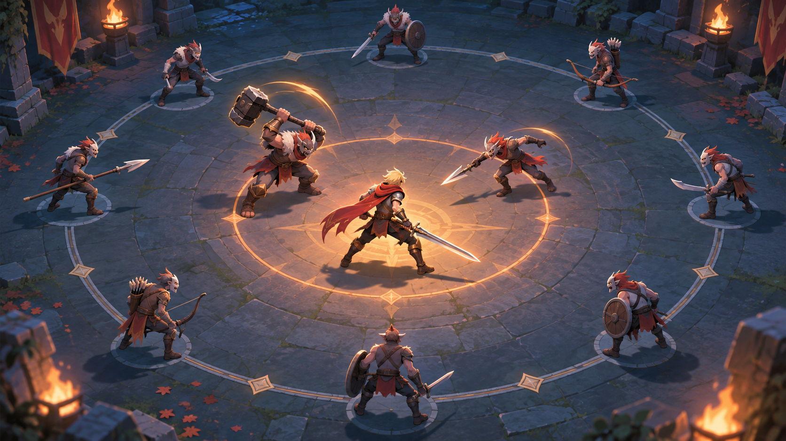
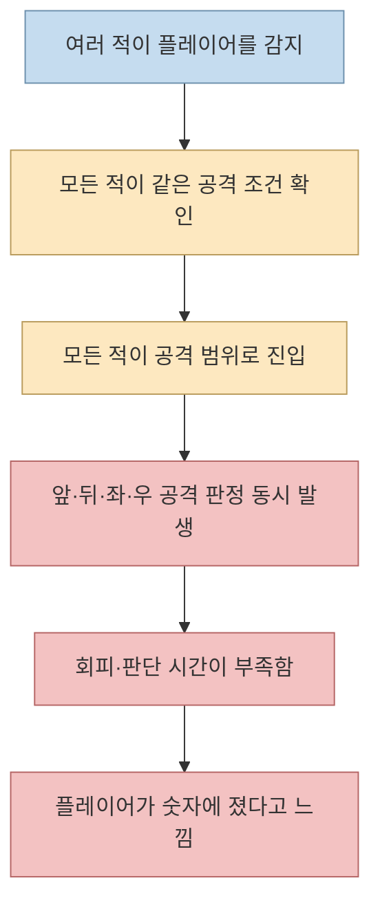
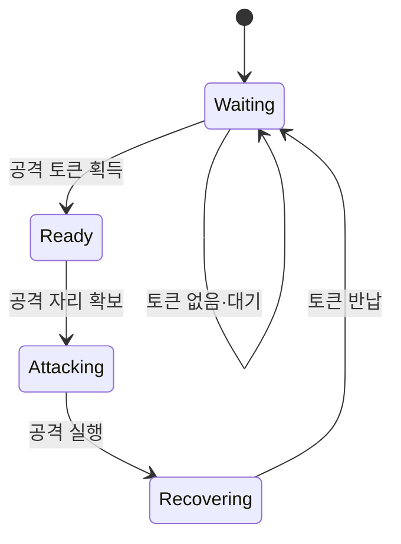
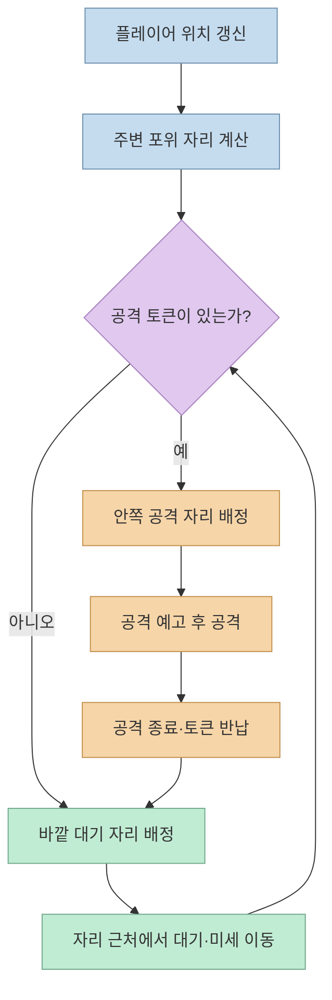
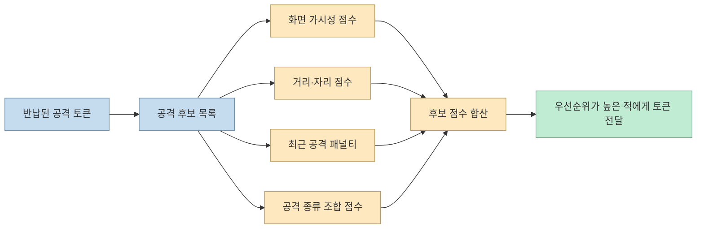
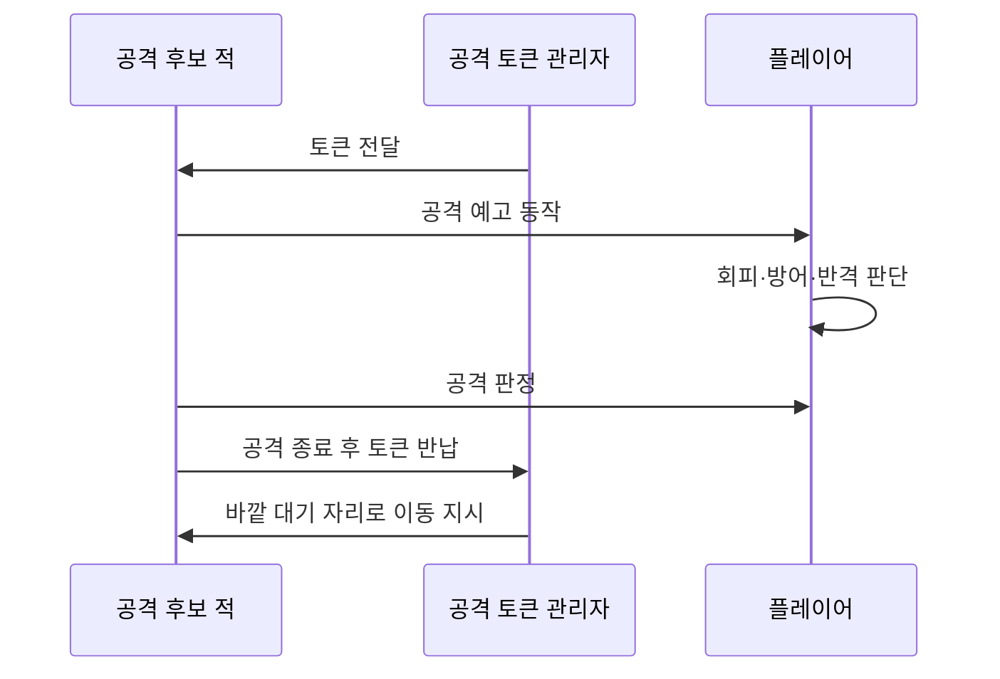

액션 게임을 하다 보면 적 여러 명에게 둘러싸였는데도 실제로는 한두 명만 차례로 공격하는 장면을 자주 볼 수 있다. 적들이 공격할 능력이 없어서가 아니라, **모든 적이 동시에 공격하면 플레이어의 판단과 회피가 의미 없어지기 때문**이다.

밥따뚜의 쇼츠는 이 문제를 `다 같이 공격`, `공격 토큰`, `포위 자리`라는 세 가지 방식으로 비교한다. 여기에 화면에 보이는 적을 우선하는 규칙, 공격 직전의 예고 동작, 대기 중인 적의 미세한 움직임까지 더하면 많은 적에게 둘러싸인 상황에서도 위험하면서 공정한 전투를 만들 수 있다.

<!--more-->

## Sources

- [원본 YouTube Shorts — 적들이 한 명씩만 덤비는 이유](https://youtube.com/shorts/TEWkHJoN8EU?si=WCayH1Ge6um3UBEo) — 다중 적 공격, 공격 토큰, 포위 자리 시스템을 비교한 원본 영상.

## 1. 모든 적이 동시에 공격하면 왜 불공정한가

가장 단순한 적 AI는 플레이어와의 거리를 확인한 뒤 가까워지면 공격하는 방식이다. 적이 한두 명뿐이라면 이 규칙만으로도 충분하다. 하지만 적이 여덟 명이고 모두 같은 조건으로 플레이어에게 접근하면, 화면 앞뒤와 좌우에서 공격이 겹친다. 영상은 이런 상황에서 플레이어가 실력으로 진 것이 아니라 숫자에 밀린 것처럼 느낄 수 있다고 설명한다. [영상 00:12](https://youtu.be/TEWkHJoN8EU?t=12)

문제는 적의 수가 많다는 사실 자체가 아니다. 플레이어가 다음 공격을 **보고, 판단하고, 회피할 시간**이 사라지는 것이 문제다. 공격 판정이 동시에 발생하면 회피 무적 시간이나 방어 자원을 사용해도 다음 타격을 피하기 어렵고, 플레이어는 전투 규칙보다 충돌 판정의 운에 영향을 받는다고 느낀다.



따라서 다중 적 전투의 첫 번째 목표는 “적이 모두 공격할 수 있는가”가 아니라 “플레이어가 동시에 처리해야 하는 위협의 수를 어느 정도로 제한할 것인가”가 된다.

## 2. 공격 토큰으로 동시에 공격하는 수를 제한한다

공격 토큰은 공격할 수 있는 권리를 적의 수와 분리하는 방법이다. 적이 플레이어 근처에 있다고 바로 공격하는 것이 아니라, 먼저 토큰을 받아야만 공격 상태로 전환된다. 공격을 끝내면 토큰을 반납하고, 토큰이 없는 적은 공격 범위 바깥에서 대기한다. [영상 00:29](https://youtu.be/TEWkHJoN8EU?t=29)

예를 들어 적이 여덟 명이어도 토큰을 두 개만 두면, 한 순간에 공격할 수 있는 적은 최대 두 명이다. 나머지 여섯 명은 전투에서 제거되는 것이 아니라 다음 공격 차례를 기다린다. 플레이어는 눈앞의 공격을 피하고, 공격이 끝난 적을 반격하며, 다음 공격자를 예측할 수 있다. 영상은 이 구조가 플레이어에게 여러 적을 상대하는 영웅이 된 느낌을 준다고 설명한다. [영상 00:41](https://youtu.be/TEWkHJoN8EU?t=41)



토큰 수는 난이도 조절 장치이기도 하다.

- 토큰 1개: 플레이어가 한 공격에 집중할 수 있어 읽기 쉽다.
- 토큰 2개: 긴장감과 회피 압박이 생기면서도 공격이 겹칠 여지가 제한된다.
- 토큰 3개 이상: 플레이어의 방어 수단, 무적 시간, 적 공격 속도와 함께 조정해야 한다.

단, 토큰 수를 낮추는 것만으로 전투가 좋아지지는 않는다. 토큰이 없는 적이 화면 한쪽에 겹쳐 서 있으면 공격 규칙은 공정해도 연출은 부자연스럽다. 그래서 공격 토큰은 다음 단계인 포위 자리와 함께 사용하는 편이 좋다. [영상 00:50](https://youtu.be/TEWkHJoN8EU?t=50)

## 3. 포위 자리가 대기 중인 적을 정리한다

공격 토큰만 사용하면 대기 중인 적이 플레이어에게 가장 가까운 한 지점으로 몰릴 수 있다. 이때 적이 줄을 서거나 서로 겹치면, 플레이어는 “전투 AI가 제한되어 있다”는 사실을 바로 알아차린다.

포위 자리 시스템은 플레이어 주변에 여러 개의 대기 위치를 미리 만든다. 안쪽 원은 토큰을 받은 적이 공격하는 자리이고, 바깥 원은 아직 공격하지 않는 적이 기다리는 자리다. 각 적은 자신에게 배정된 자리 또는 가장 가까운 빈자리를 찾아 이동하므로, 여러 적이 플레이어를 둘러싸면서도 서로 겹치지 않는다. [영상 00:56](https://youtu.be/TEWkHJoN8EU?t=56)



공격이 끝난 적은 안쪽 자리를 계속 점유하지 않고 바깥 대기 자리로 물러난다. 새 토큰을 받은 다른 적이 안쪽으로 들어오면, 공격이 계속 이어지면서도 플레이어 주변의 공간은 유지된다. 이 방식은 적이 많아 보이는 시각적 압박과 실제로 처리해야 하는 공격 수를 분리한다.

## 4. 토큰을 누구에게 줄 것인가

토큰이 비어 있을 때 아무 적에게나 무작위로 공격 권리를 주면, 화면 뒤나 카메라 밖에 있는 적이 갑자기 플레이어를 때릴 수 있다. 영상은 화면에 보이는 적을 뒤쪽 적보다 우선하는 규칙을 제안한다. [영상 01:20](https://youtu.be/TEWkHJoN8EU?t=80)

토큰 우선순위는 다음 요소를 조합할 수 있다.

1. **화면 가시성**: 카메라에 잘 보이는 적에게 높은 우선순위를 준다.
2. **거리**: 공격 자리까지 짧은 경로로 이동할 수 있는 적을 우선한다.
3. **최근 공격 여부**: 방금 공격한 적이 즉시 다시 토큰을 가져가지 않게 한다.
4. **공격 방향**: 같은 방향의 공격이 겹치지 않도록 입장 방향을 분산한다.
5. **적 종류**: 근접·원거리·특수 공격이 동시에 겹치지 않게 조절한다.



이 점수는 반드시 복잡한 머신러닝 모델일 필요가 없다. `가시성 × 3 + 거리 × 2 - 최근 공격 패널티`처럼 단순한 규칙으로 시작하고, 플레이테스트에서 이상하게 느껴지는 상황을 발견할 때 항목을 추가하면 된다. 게임 디자인에서 중요한 것은 가장 똑똑한 적을 만드는 것이 아니라, 플레이어가 다음 위협을 예측할 수 있게 만드는 것이다.

## 5. 공격 전 예고와 대기 중 움직임을 추가한다

공격 토큰과 포위 자리를 적용해도 적이 갑자기 칼을 휘두르면 플레이어는 맞은 이유를 이해하기 어렵다. 영상은 공격 직전에 적이 잠깐 몸을 움츠리는 동작을 넣어 언제 피해야 하는지 알려 주는 방법을 소개한다. [영상 01:27](https://youtu.be/TEWkHJoN8EU?t=87)

공격 예고는 다음과 같은 신호로 구성할 수 있다.

- 공격 방향으로 몸을 돌린다.
- 무기를 뒤로 당기거나 몸을 낮춘다.
- 짧은 효과음이나 색상 변화를 사용한다.
- 공격 범위를 바닥에 아주 짧게 표시한다.
- 예고 시간과 실제 판정 시점을 일정하게 유지한다.

반대로 토큰이 너무 적으면 나머지 적들이 구경하는 것처럼 보일 수 있다. 대기 중인 적도 배정된 자리 근처에서 옆으로 한두 걸음 움직이거나, 플레이어를 바라보거나, 공격 준비 자세를 취하게 하면 전투의 긴장감을 유지할 수 있다. 단, 이 움직임은 공격 판정과 분리해야 한다. 대기 애니메이션이 공격으로 오해될 정도로 크면 오히려 가독성이 떨어진다. [영상 01:32](https://youtu.be/TEWkHJoN8EU?t=92)



## 6. AI에게 구현을 부탁할 때는 규칙을 숫자로 적는다

영상의 마지막 부분은 AI에게 “적들이 한꺼번에 덤비지 않게 해 줘”라고 말하는 것보다, 공격 토큰과 포위 자리의 규칙을 구체적으로 설명하라고 제안한다. [영상 01:50](https://youtu.be/TEWkHJoN8EU?t=110)

예를 들어 다음처럼 요구할 수 있다.

```text
플레이어 주변에 근접 공격용 안쪽 원과 대기용 바깥 원을 만든다.

규칙:
1. 공격 토큰은 2개만 만든다.
2. 토큰을 가진 적만 안쪽 공격 자리에 들어갈 수 있다.
3. 공격이 끝나면 토큰을 반납하고 바깥 자리로 이동한다.
4. 토큰이 없는 적은 가장 가까운 빈 바깥 자리를 예약한다.
5. 화면에 보이는 적, 플레이어와 가까운 적, 최근 공격하지 않은 적을 우선한다.
6. 공격 직전에 짧은 준비 동작을 재생한다.
7. 대기 중인 적은 자리 근처에서 미세하게 움직이되 공격 판정은 하지 않는다.
8. 토큰 수와 포위 자리 수를 에디터에서 조정할 수 있게 만든다.
```

이 프롬프트는 결과를 보장하는 명령문이라기보다, 원하는 전투 규칙을 AI가 구현할 수 있는 단위로 쪼갠 예시다. 구현 후에는 반드시 적이 1명, 2명, 8명일 때를 각각 테스트해야 한다. 적 수가 적을 때는 다 같이 공격하는 규칙이 더 자연스러울 수 있고, 적이 많아질 때만 토큰과 포위 자리를 활성화하는 방식도 가능하다. 영상 역시 적이 한두 마리뿐인 게임이라면 모두 공격해도 충분하다고 설명한다. [영상 01:42](https://youtu.be/TEWkHJoN8EU?t=102)

## 핵심 요약

- 다중 적 전투의 문제는 적의 수보다 동시에 발생하는 공격 판정의 수다.
- 공격 토큰은 한 번에 공격할 수 있는 적의 수를 제한해 플레이어에게 판단 시간을 준다.
- 포위 자리는 공격 적과 대기 적의 위치를 분리해 적이 한곳에 겹치는 현상을 줄인다.
- 토큰은 화면에 보이고, 가까우며, 최근에 공격하지 않은 적에게 우선 배정하는 편이 공정하다.
- 공격 직전의 몸 움츠리기 같은 예고 동작은 회피 타이밍을 알려 준다.
- 대기 중인 적에게 미세한 움직임을 주되 공격 판정과는 분리해야 한다.
- AI에게 구현을 맡길 때는 토큰 수, 자리 반경, 우선순위, 예고 시간처럼 조정 가능한 규칙을 숫자로 명시한다.

## 결론

액션 게임에서 적들이 한 명씩 공격하는 것은 적 AI가 멍청해서가 아니라 플레이어에게 공정한 판단 기회를 주기 위한 설계다. `공격 토큰`으로 실제 위협의 수를 제한하고, `포위 자리`로 나머지 적의 위치를 정리하며, `공격 예고`로 회피 타이밍을 알려 주면 많은 적에게 둘러싸인 전투도 긴장감과 가독성을 함께 유지할 수 있다.
