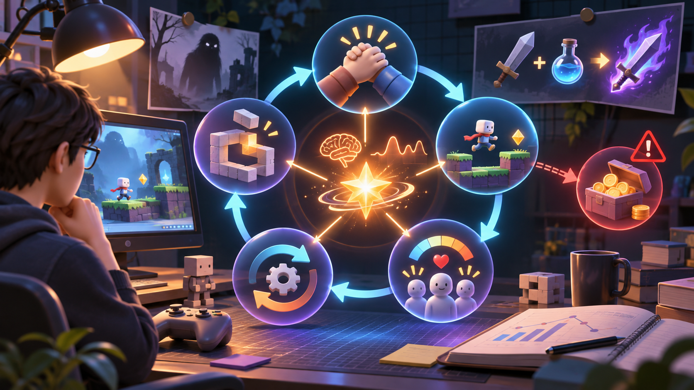
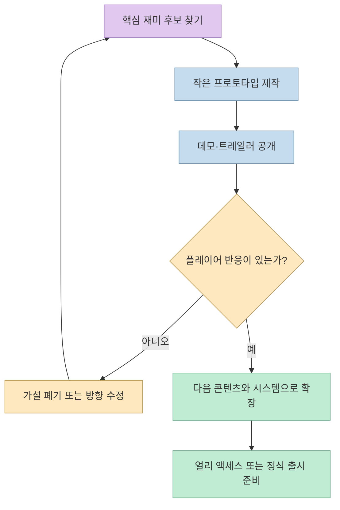
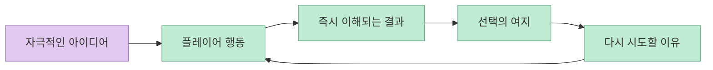
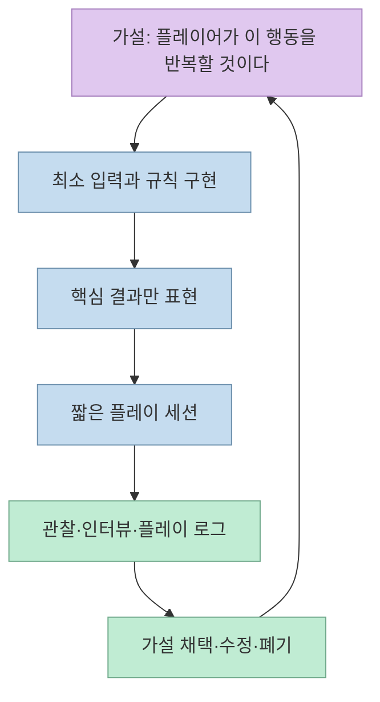
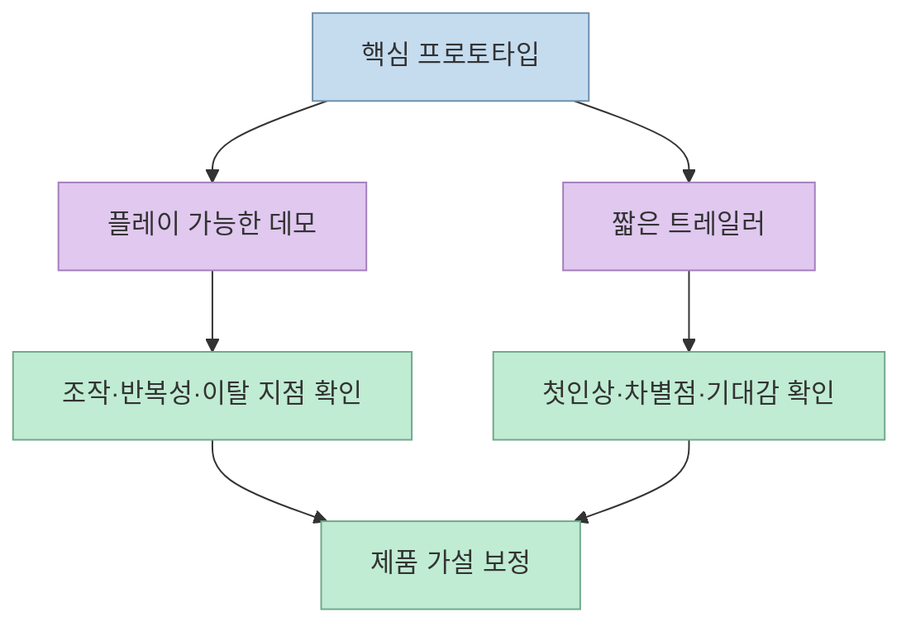
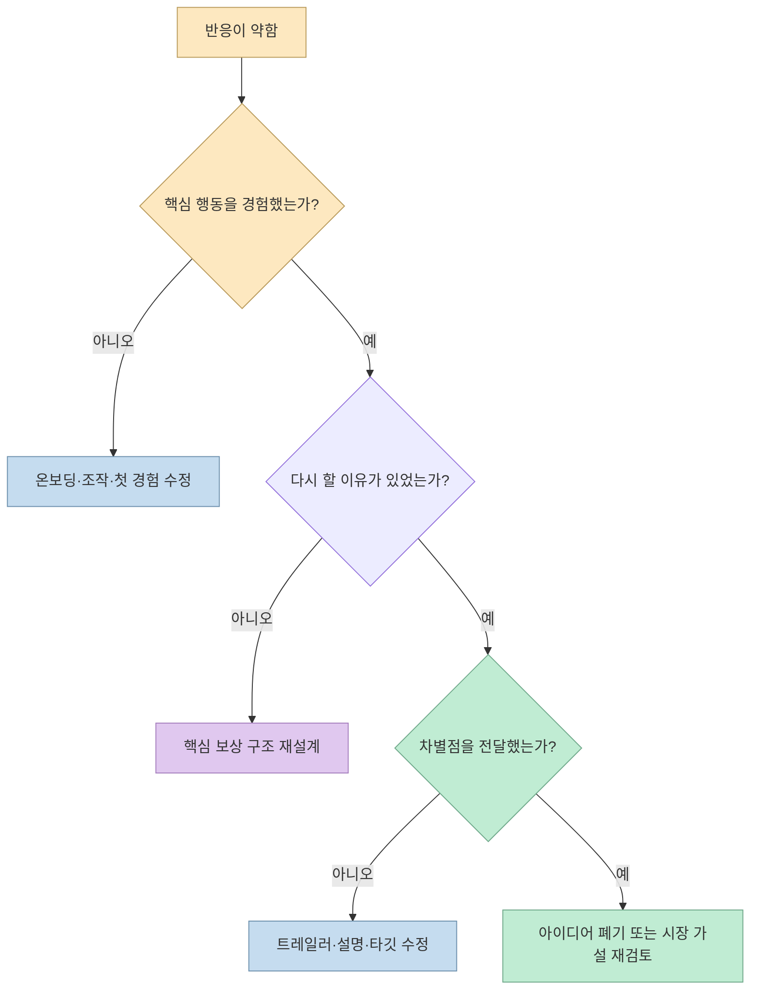
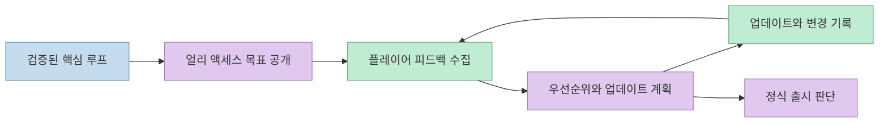

인디 게임을 만들 때 가장 위험한 상황은 수개월 동안 콘텐츠를 만든 뒤에야 핵심 플레이가 재미없는 것을 발견하는 것이다. 짧은 YouTube Shorts 영상은 이 문제를 자극적인 표현으로 압축한다. 먼저 플레이어가 반응할 만한 “도파민 포인트”를 찾고, 빠르게 프로토타입과 데모를 만든 다음, 반응이 좋지 않으면 버리고 다시 시도하자는 내용이다.

영상은 이 방식을 `DDD`라고 부른다. 여기서 DDD는 이 영상이 사용한 표현으로, 게임 개발에서 널리 합의된 공식 방법론이라고 단정하기보다 “핵심 보상 경험을 먼저 검증하는 반복 개발”로 해석하는 편이 정확하다. 특히 영상 후반의 “얼리 액세스로 돈을 벌고 업데이트를 방치한다”는 부분은 실천 지침이라기보다 업계의 나쁜 관행을 비꼬는 풍자에 가깝다.

<!--more-->

## Sources

- [YouTube Shorts 원문](https://youtu.be/ybOsF6Uakzs) — `DDD`라는 표현과 도파민 포인트, 프로토타입·데모·얼리 액세스 흐름을 설명한 영상.
- [영상 0:00](https://youtu.be/ybOsF6Uakzs?t=0) — DDD의 문제 제기.
- [영상 0:03](https://youtu.be/ybOsF6Uakzs?t=3) — 게임에서 도파민 포인트를 찾는 단계.
- [영상 0:21](https://youtu.be/ybOsF6Uakzs?t=21) — 포인트를 넣은 프로토타입과 데모·트레일러 검증.
- [영상 0:31](https://youtu.be/ybOsF6Uakzs?t=31) — 반응이 좋은 아이디어를 얼리 액세스로 확장하는 흐름.

> 영상의 자막과 말투를 바탕으로 내용을 재구성했다. “도파민”은 여기서 플레이어가 즉시 이해하고 반응하는 보상·긴장·성취의 감각을 가리키는 실무적 표현으로 사용하며, 특정 게임의 성공이나 매출을 보장하는 공식으로 해석하지 않는다.

## 1. 영상이 말하는 DDD의 구조

영상은 먼저 협동에서 나오는 재미, 창의성을 발휘하는 상황, 공포, 밸런스를 깨는 아이템 조합 등을 도파민 포인트의 예로 든다. 공통점은 게임 전체가 아니라 플레이어가 “이 장면 때문에 다시 해 보고 싶다”고 느낄 수 있는 구체적인 순간을 먼저 찾는다는 것이다.

그다음 흐름은 다음과 같다.

1. 플레이어가 강하게 반응할 핵심 순간을 하나 고른다.
2. 그 순간을 가장 짧은 플레이 가능한 프로토타입으로 만든다.
3. 데모나 트레일러로 외부 반응을 확인한다.
4. 반응이 약하면 프로젝트나 방향을 과감하게 버린다.
5. 반응이 확인된 아이디어만 다음 제작 단계로 확장한다.

이 구조에서 중요한 것은 “반응을 확인한다”는 말의 의미다. 조회 수나 좋아요 하나만 보고 성공으로 판정하는 것이 아니라, 플레이어가 어떤 장면을 기억했는지, 실제로 플레이를 반복했는지, 어떤 부분에서 이탈했는지를 확인해야 한다.

## 2. 도파민 포인트를 게임의 핵심 재미로 번역한다

“도파민을 넣자”는 말만으로는 구현할 수 없다. 실제 설계 문장으로 바꾸려면 플레이어 행동과 결과를 함께 적어야 한다.

| 막연한 표현 | 설계 가능한 질문 |
|---|---|
| 협동의 재미 | 두 플레이어가 혼자서는 해결할 수 없는 문제는 무엇인가? |
| 창의성의 재미 | 같은 목표를 몇 가지 다른 방식으로 해결할 수 있는가? |
| 공포의 재미 | 무엇을 모르는 상태로 남겨 두고, 언제 정보를 공개할 것인가? |
| 밸런스를 깨는 조합 | 어떤 규칙을 일시적으로 뒤집을 때 선택의 가치가 생기는가? |

핵심은 자극의 강도를 키우는 것이 아니라, 플레이어가 무엇을 하고 왜 결과를 얻는지 연결하는 것이다. 강한 이펙트나 큰 숫자만 추가해도 순간적인 자극은 만들 수 있지만, 플레이어의 선택과 결과가 이어지지 않으면 오래 유지되는 재미가 되기 어렵다.

예를 들어 “밸런스를 파괴하는 아이템 조합”을 만든다면 단순히 공격력을 100배로 올리는 것보다 다음을 먼저 정해야 한다.

- 조합이 가능한 조건은 무엇인가?
- 플레이어가 조합을 발견할 수 있는 단서는 있는가?
- 조합이 강력한 대신 감수해야 할 위험은 무엇인가?
- 한 번의 성공이 다음 선택과 빌드에 어떤 영향을 주는가?
- 조합이 모든 다른 선택을 무의미하게 만들지는 않는가?

이 질문이 있어야 “강한 조합을 발견하는 순간”이 일회성 버그가 아니라 게임 시스템의 핵심 경험이 된다.

## 3. 프로토타입의 목적은 콘텐츠가 아니라 가설 검증이다

영상은 도파민 포인트를 넣어 프로토타입을 만들라고 말한다. 이때 프로토타입에 필요한 것은 많은 맵이나 완성된 UI가 아니다. 핵심 가설을 플레이어가 몇 분 안에 경험할 수 있는 최소 구조다.

프로토타입을 만들 때는 다음 범위를 의도적으로 제한하는 것이 좋다.

- 플레이어가 할 수 있는 핵심 행동 1~2개
- 결과를 확인하는 짧은 반복 구간
- 핵심 선택의 차이를 보여 주는 최소한의 상태
- 테스트에 필요한 임시 그래픽과 사운드
- 실패했을 때 바로 다시 시작할 수 있는 구조

여기서 임시 그래픽을 사용하는 것은 대충 만들자는 뜻이 아니다. 아직 검증하지 않은 가설에 최종 아트와 콘텐츠 제작비를 투입하지 않겠다는 뜻이다. 오히려 프로토타입에서 중요한 것은 시각적 완성도보다 플레이어가 어떤 행동을 하고 어떤 결과를 느끼는지 확인하는 것이다.

## 4. 데모와 트레일러는 서로 다른 질문을 한다

영상은 프로토타입 다음에 데모나 트레일러를 빠르게 만들어 반응을 보자고 말한다. 두 방법은 비슷해 보이지만 확인하는 질문이 다르다.

- **플레이 가능한 데모**: 이 게임을 직접 해 본 사람이 핵심 행동을 재미있다고 느끼는가?
- **트레일러**: 플레이하기 전에도 게임의 차별점과 기대할 경험을 이해하는가?

트레일러의 반응이 좋다고 해서 플레이가 재미있다는 뜻은 아니다. 반대로 데모는 재미있지만 트레일러에서 그 장점이 보이지 않을 수도 있다. 따라서 두 반응을 하나의 지표로 합치지 말고, 어떤 단계의 가설이 확인된 것인지 분리해서 기록해야 한다.

실무적으로는 다음 질문을 함께 수집할 수 있다.

- 플레이어가 가장 먼저 설명한 장면은 무엇인가?
- 첫 5분 안에 규칙을 이해했는가?
- 다시 플레이한 이유는 무엇인가?
- 재미있지만 불편해서 그만둔 부분은 무엇인가?
- 게임의 차별점을 다른 사람에게 설명할 수 있었는가?

## 5. 반응이 좋지 않으면 버리는 기준을 미리 정한다

영상은 반응이 좋지 않으면 그냥 버리라고 말한다. 이 문장은 제작자의 시간과 비용을 보호하는 데는 유효하지만, “좋아요가 적다”만으로 프로젝트를 폐기하라는 뜻으로 받아들이면 위험하다.

먼저 반응이 약한 이유를 구분해야 한다.

1. 핵심 행동 자체가 재미없는가?
2. 재미는 있지만 설명과 온보딩이 부족한가?
3. 영상과 썸네일이 게임의 장점을 보여 주지 못했는가?
4. 테스트 대상이 게임의 목표 사용자와 달랐는가?
5. 프로토타입의 완성도가 낮아 재미를 경험하기 전에 이탈했는가?

폐기 기준은 프로토타입을 만들기 전에 정하는 편이 좋다. 예를 들어 “10명의 테스트 중 7명 이상이 핵심 행동을 자발적으로 두 번 이상 반복하지 않으면 다음 버전에서 핵심 루프를 바꾼다”처럼 행동 기준을 만들 수 있다. 숫자 자체는 프로젝트마다 다르지만, 감정적인 애착 때문에 계속 붙잡는 일을 줄여 준다.

## 6. 얼리 액세스는 검증 루프이지 결승선이 아니다

영상 후반은 반응이 확인된 아이디어를 빠르게 얼리 액세스로 출시하는 흐름으로 이어진다. 얼리 액세스는 실제 플레이어에게 미완성 버전을 제공하고 피드백을 받는 개발 방식으로 활용할 수 있지만, 제품을 덜 만든 상태에서 판매해도 된다는 면허는 아니다.

얼리 액세스로 전환하기 전에 최소한 다음은 준비해야 한다.

- 현재 버전에서 플레이어가 무엇을 할 수 있는지 설명한다.
- 아직 구현되지 않은 기능과 변경 가능성을 공개한다.
- 피드백을 어디서 받고 어떤 주기로 반영할지 정한다.
- 저장 데이터와 업데이트 호환성 계획을 세운다.
- 가격, 환불, 접근 권한, 운영 지원을 명확히 한다.
- 개발이 중단될 경우 플레이어에게 어떻게 알릴지 정한다.

영상의 “돈을 벌고 업데이트를 유기한다”는 표현은 이 책임을 일부러 뒤집어 말한 것이다. 빠른 출시와 수익화는 개발 지속성을 확보하는 방법이 될 수 있지만, 플레이어에게 약속한 업데이트를 방치하면 단기적인 매출과 별개로 신뢰를 잃는다. 그러므로 얼리 액세스는 개발자에게 유리한 판매 단계가 아니라, 플레이어와 검증 루프를 공유하는 계약에 가깝게 설계해야 한다.

## 7. DDD를 건강한 개발 습관으로 바꾸는 체크리스트

영상의 자극적인 표현을 실제 작업 방식으로 바꾸면 다음 체크리스트가 된다.

### 핵심 재미

- 플레이어가 반복하게 될 행동을 한 문장으로 설명할 수 있는가?
- 그 행동의 결과가 즉시 이해되는가?
- 단순한 자극이 아니라 선택과 결과의 관계가 있는가?

### 프로토타입

- 핵심 행동을 5분 안에 경험할 수 있는가?
- 임시 에셋으로도 가설을 검증할 수 있는가?
- 실패 후 즉시 다시 시도할 수 있는가?

### 피드백

- 좋아요가 아니라 실제 행동과 발화를 기록하는가?
- 데모와 트레일러의 질문을 분리했는가?
- 반응이 약할 때 수정·피벗·폐기 기준이 있는가?

### 얼리 액세스

- 현재 버전의 범위와 미완성 요소를 공개했는가?
- 피드백을 반영할 운영 능력이 있는가?
- 출시 후 업데이트를 중단할 때의 책임까지 고려했는가?

## 핵심 요약

- 영상의 DDD는 도파민 포인트를 먼저 찾고 빠른 검증 루프를 돌리자는 풍자적 표현이다.
- 도파민 포인트는 협동, 창의성, 공포, 강력한 조합처럼 플레이어가 반복하고 싶어 하는 핵심 순간으로 번역할 수 있다.
- 프로토타입의 목표는 콘텐츠를 많이 만드는 것이 아니라 핵심 재미에 대한 가설을 검증하는 것이다.
- 데모는 실제 플레이 경험을, 트레일러는 첫인상과 차별점 전달을 검증한다.
- 반응이 약하면 핵심 재미·온보딩·마케팅·테스트 대상 중 무엇이 문제인지 분리해야 한다.
- 얼리 액세스는 수익화 단계이기 전에 플레이어와 피드백 루프를 공유하는 운영 방식이다.
- 빠르게 버리는 능력과 출시 후 책임지는 능력은 함께 필요하다.

## 결론

인디 게임의 성공을 한 가지 도파민 공식으로 설명할 수는 없다. 하지만 개발 초기에 플레이어가 실제로 반복할 핵심 행동을 찾고, 작은 프로토타입과 데모로 검증하며, 반응이 약한 가설을 빠르게 수정하는 방식은 제작 리스크를 줄여 준다.

DDD를 건강하게 해석하면 “자극을 최대화해 돈을 뽑는 법”이 아니라 “핵심 재미를 가장 싼 비용으로 검증하고, 확인된 경험에만 제작비를 투입하는 법”이 된다. 여기에 얼리 액세스 이후의 업데이트 책임까지 포함해야 이 루프가 플레이어와 개발자 모두에게 지속 가능한 개발 방식이 된다.
