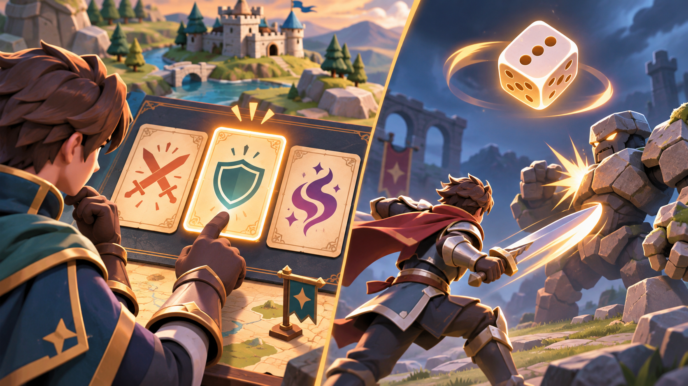
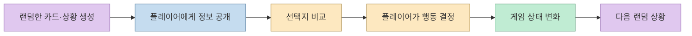
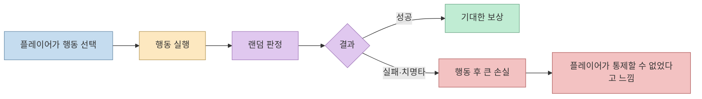
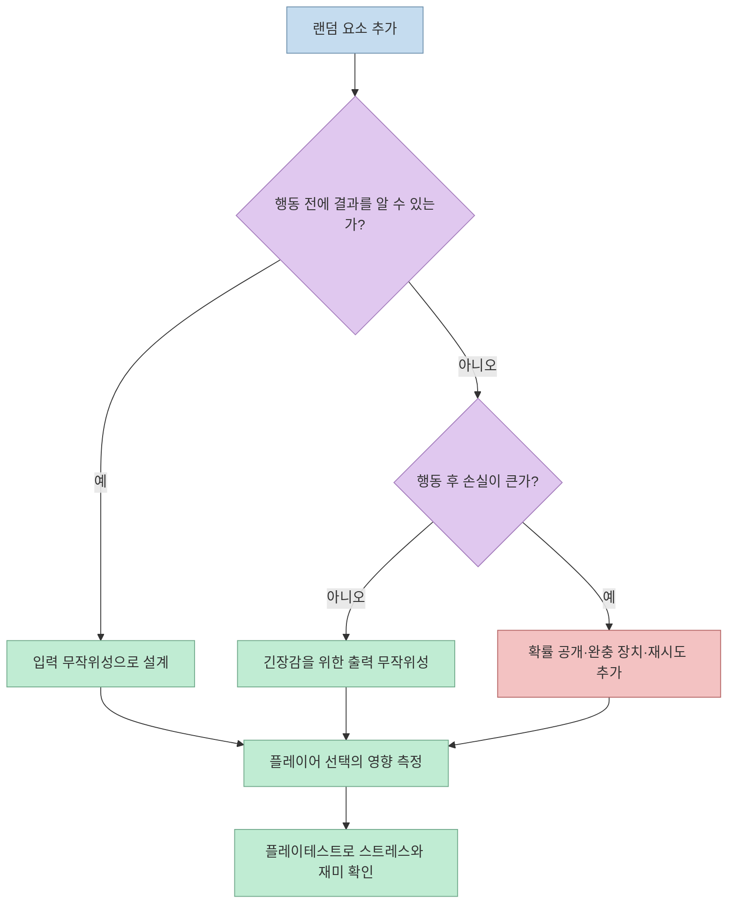
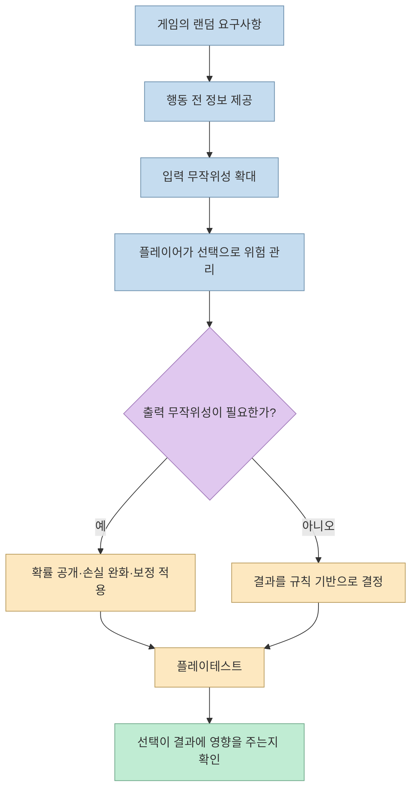

게임 속 랜덤은 모두 같은 방식으로 작동하지 않는다. 카드가 무작위로 등장하더라도 플레이어가 그중 하나를 고를 수 있다면 전략을 세울 여지가 남는다. 반대로 플레이어가 공격할지 말지 결정한 뒤 주사위가 치명타를 굴려 즉사시킨다면, 결과를 받아들이는 경험은 전혀 다르다.

저세상개발자의 쇼츠는 게임의 랜덤을 **입력 무작위성**과 **출력 무작위성**으로 나눈다. 이 구분은 “랜덤을 넣을 것인가, 뺄 것인가”보다 더 실용적인 질문을 만들어 준다. 랜덤이 플레이어의 의사결정 전에 정보를 제공하는가, 아니면 결정이 끝난 뒤 플레이어의 선택을 무효화하는가를 살펴보는 것이다.

<!--more-->

## Sources

- [원본 YouTube Shorts — 게임에 좋은 랜덤과 나쁜 랜덤이 있다?](https://youtube.com/shorts/vdbjOLEMQSg?si=dluOQg_SW4FqMLWz) — 입력 무작위성과 출력 무작위성의 차이를 설명한 원본 영상.

## 1. 입력 무작위성은 행동 전에 정보를 준다

입력 무작위성은 플레이어가 행동하기 전에 랜덤 결과 또는 랜덤한 선택지를 보여 주는 방식이다. 카드 게임에서 손패나 선택 가능한 카드가 무작위로 결정되더라도, 플레이어는 공개된 정보를 보고 어떤 카드를 가져갈지, 어떤 순서로 사용할지 결정할 수 있다. 영상은 이를 `Slay the Spire`의 카드 선택과 연결해 설명한다. [영상 00:06](https://youtu.be/vdbjOLEMQSg?t=6) · [영상 00:17](https://youtu.be/vdbjOLEMQSg?t=17)

핵심은 카드가 무작위라는 사실이 아니라 **카드가 공개된 뒤에도 플레이어의 선택이 남아 있다는 것**이다. 좋은 카드를 뽑는 운은 존재하지만, 나쁜 선택지를 어떻게 처리할지, 지금 공격 카드를 고를지 방어 카드를 고를지, 다음 턴을 위해 자원을 남길지 판단할 수 있다.



입력 무작위성의 장점은 플레이어가 랜덤을 전략의 재료로 바꿀 수 있다는 점이다. 모든 상황을 통제할 수는 없지만, 주어진 상황에서 최선의 수를 찾는 능력은 결과에 영향을 준다. 이때 랜덤은 플레이어를 대신해 결론을 내리는 장치가 아니라, 매번 다른 문제를 내는 장치가 된다.

## 2. 출력 무작위성은 행동 후 결과를 바꾼다

출력 무작위성은 플레이어가 행동을 결정하고 실행한 뒤에 결과를 랜덤으로 판정하는 방식이다. 공격이 명중할지, 치명타가 발생할지, 공격이 빗나갈지 결정하는 주사위 굴림이 대표적이다. 영상은 `Fire Emblem`에서 공격을 감행한 뒤 치명타로 즉사하는 상황을 예로 든다. [영상 00:27](https://youtu.be/vdbjOLEMQSg?t=27) · [영상 00:40](https://youtu.be/vdbjOLEMQSg?t=40)

출력 무작위성이 항상 나쁜 것은 아니다. 플레이어가 확률을 알고 위험을 감수할지 선택할 수 있고, 실패해도 회복할 수 있다면 긴장감과 드라마를 만들 수 있다. 문제는 랜덤 결과가 플레이어의 판단과 무관하게 큰 손실을 만들 때다.



플레이어는 공격을 선택할 때 이미 자신의 판단을 끝냈다고 생각한다. 그 뒤에 공개되지 않은 확률이 공격 결과를 뒤집으면, 실패의 원인을 자신의 선택보다 시스템의 주사위에서 찾기 쉽다. 특히 캐릭터 사망, 장비 파괴, 긴 진행도의 손실처럼 되돌리기 어려운 결과와 결합하면 스트레스가 커진다. [영상 00:43](https://youtu.be/vdbjOLEMQSg?t=43)

## 3. 랜덤의 문제는 확률보다 플레이어의 선택권이다

“확률이 낮으니 괜찮다”는 설명만으로는 충분하지 않다. 5%의 치명타라도 한 번 발생했을 때 캠페인을 잃게 만든다면 플레이어가 받는 충격은 크다. 반대로 50%의 확률이라도 결과를 미리 보고 행동을 취소하거나, 방어 자원을 사용하거나, 실패해도 회복할 수 있다면 받아들이기 쉬울 수 있다.

랜덤을 설계할 때는 다음 질문을 먼저 확인하는 편이 좋다.

- 랜덤 결과를 플레이어가 행동 전에 알 수 있는가?
- 결과를 본 뒤 다른 행동을 선택할 수 있는가?
- 실패했을 때 손실의 크기를 예측할 수 있는가?
- 실패를 줄이거나 보정할 자원이 있는가?
- 실패가 발생해도 다음 선택으로 만회할 수 있는가?
- 같은 결과가 반복될 때 게임이 보호 장치를 제공하는가?



## 4. 출력 무작위성을 사용해야 한다면 정보를 시각화한다

출력 무작위성을 완전히 제거하면 전투가 지나치게 계산적이거나 결과가 항상 예상되는 느낌이 될 수 있다. 그래서 게임은 확률과 위험을 플레이어가 이해할 수 있도록 보여 주는 방법을 사용한다. 영상은 주사위 같은 UI로 결과를 시각화하고, 출력 무작위성의 확률을 알려 플레이어가 그 정보를 고려해 전략을 고르게 하는 방식을 소개한다. [영상 00:47](https://youtu.be/vdbjOLEMQSg?t=47)

확률을 표시할 때는 숫자 하나만 보여 주는 것보다 결과의 범위와 손실까지 함께 보여 주는 편이 좋다.

```text
공격 성공 확률: 80%
예상 피해: 24~32
치명타 확률: 5%
실패 시: 적의 반격을 받음
```

이 정보가 있으면 플레이어는 “운이 나빴다”에서 멈추지 않고 “이번 공격은 위험하지만, 방어 카드를 먼저 쓰면 실패해도 버틸 수 있다”는 식으로 판단할 수 있다. 확률 공개는 랜덤을 없애지 않지만, 랜덤을 의사결정의 일부로 바꾼다.

다만 확률을 표시했다고 해서 모든 문제가 해결되는 것은 아니다. 실제 확률과 표시 확률이 다르거나, 플레이어가 이해할 수 없는 방식으로 계산되면 신뢰가 무너진다. 특히 연속 시도에서 확률이 독립인지, 운 보정이 적용되는지, 보장 횟수가 있는지를 명확히 해야 한다.

## 5. 입력 무작위성을 중심에 두고 출력 무작위성을 보조로 쓴다

영상은 최근 게임들이 출력 무작위성을 가능한 줄이고 입력 무작위성을 늘리는 방향으로 발전해 왔다고 설명한다. [영상 00:59](https://youtu.be/vdbjOLEMQSg?t=59)

이를 실제 시스템으로 옮기면 다음처럼 설계할 수 있다.

### 카드 게임

- 덱에서 어떤 카드가 나올지는 무작위로 결정한다.
- 손패와 선택 가능한 카드를 공개한다.
- 플레이어가 카드를 고르거나 버리거나 보류할 수 있게 한다.
- 카드 효과의 성공 확률이 있다면 확률과 결과 범위를 표시한다.

### 턴제 전투

- 적의 의도와 다음 공격을 먼저 보여 준다.
- 플레이어가 공격·방어·이동 중 하나를 선택하게 한다.
- 명중 확률을 사용하더라도 실패 시 대체 결과를 준비한다.
- 치명타가 발생해도 즉사 대신 방어력 감소나 다음 턴 위험 증가처럼 조절 가능한 손실을 우선한다.

### 로그라이크

- 다음 방, 보상, 이벤트의 일부 정보를 미리 보여 준다.
- 플레이어가 위험한 경로와 안전한 경로를 비교할 수 있게 한다.
- 반복 플레이에서 나쁜 결과만 연속으로 나오지 않도록 보정한다.



## 핵심 요약

- 입력 무작위성은 플레이어가 행동하기 전에 정보를 제공하고, 그 정보를 바탕으로 선택하게 만든다.
- 출력 무작위성은 플레이어의 행동 이후 결과를 결정하므로, 큰 손실과 결합하면 통제감을 약화할 수 있다.
- 랜덤의 품질은 확률의 높고 낮음만이 아니라 결과를 예상하고 대응할 수 있는지로 판단해야 한다.
- 출력 무작위성을 사용할 때는 확률, 결과 범위, 실패 시 손실, 보정 수단을 보여 주는 것이 좋다.
- 카드와 선택지에는 입력 무작위성을, 전투 판정에는 제한적이고 투명한 출력 무작위성을 사용하는 방식이 실용적이다.
- 최종 판단 기준은 랜덤이 플레이어의 선택을 무효화하는지, 아니면 새로운 선택을 만들어 내는지다.

## 결론

좋은 랜덤은 플레이어에게 새로운 문제를 던지고, 나쁜 랜덤은 이미 내린 결정을 뒤집는다. 게임에 무작위성을 넣을 때는 결과를 얼마나 극적으로 만들지보다, 플레이어가 그 결과를 고려해 행동할 수 있는지를 먼저 확인해야 한다. 입력 무작위성을 중심에 두고 출력 무작위성에는 정보 공개와 완충 장치를 더하면, 운의 긴장감은 유지하면서도 플레이어의 전략과 책임감을 살릴 수 있다.
