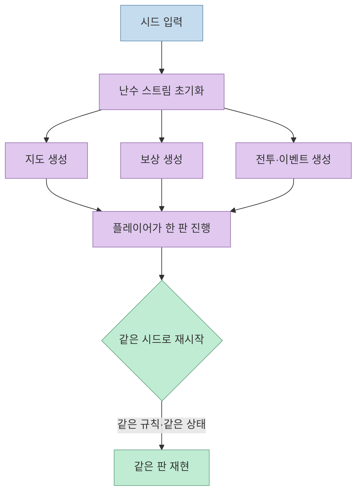
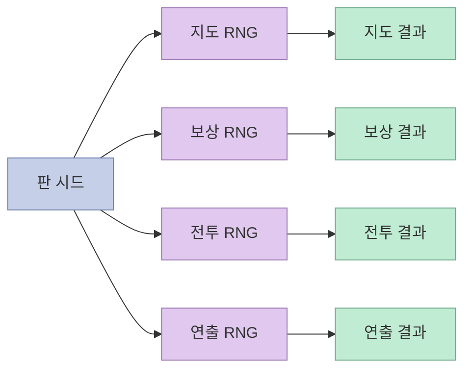
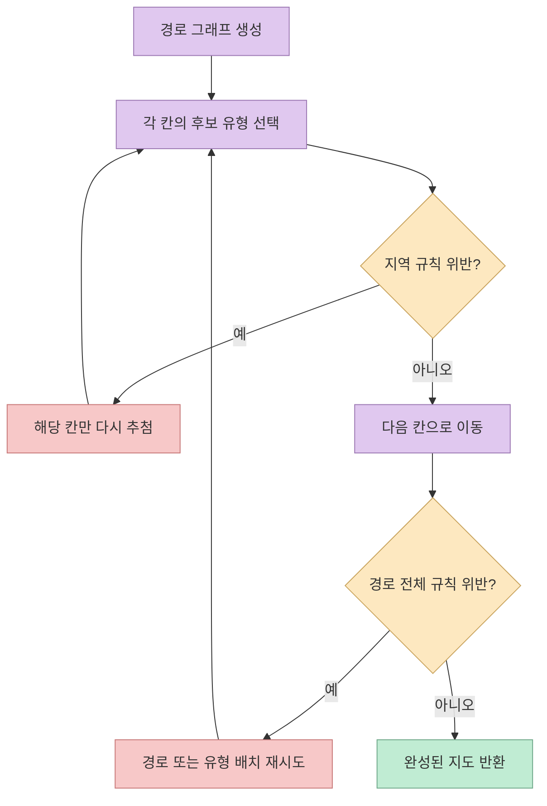
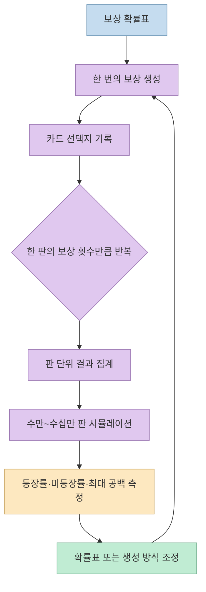
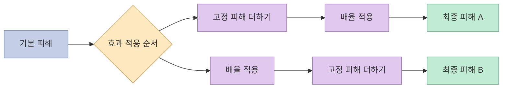
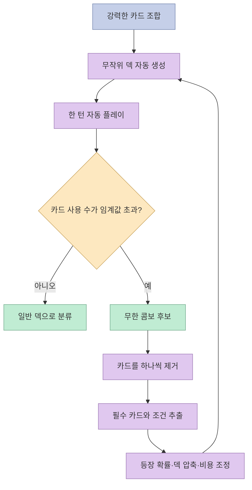
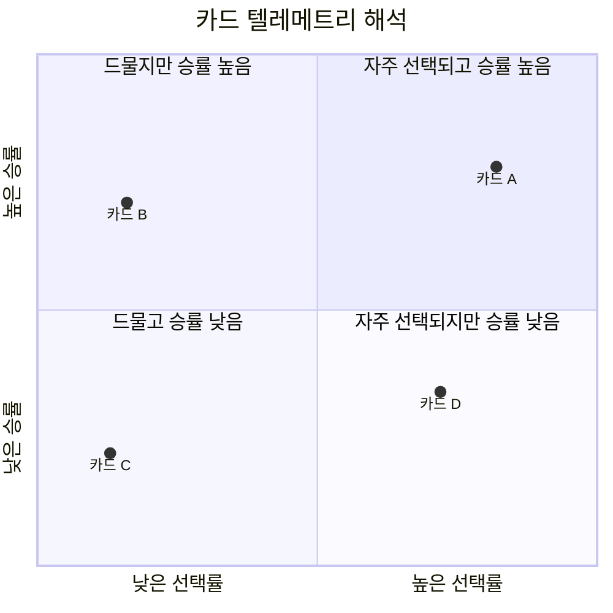
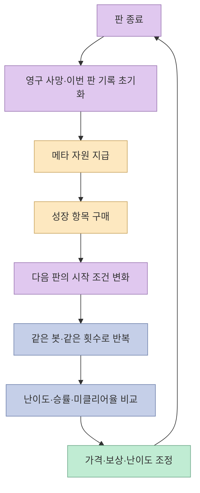

로그라이크 덱빌딩 게임은 매 판 다른 결과를 만들어야 하지만, 문제가 생겼을 때는 같은 판을 다시 재현할 수 있어야 한다. 지도와 보상 카드가 매번 달라지는 것만으로는 충분하지 않다. 어떤 난수와 규칙이 결과를 만들었는지 추적할 수 있어야 하고, 특정 조합이 너무 강하거나 특정 보상이 지나치게 드문지도 측정할 수 있어야 한다.

영상 [「로그라이크 덱빌딩 게임을 만들어봤다」](https://youtu.be/ObtscSL11uw)는 하나의 데모를 통해 이 문제를 단계적으로 보여 준다. 이 글은 영상의 흐름을 따라가며 로그라이크의 기본 개념부터 난수 스트림 분리, 절차적 맵 생성, 몬테카를로 시뮬레이션, 카드 조합 탐지, 플레이 기록 분석, 메타 진행 밸런싱까지 정리한다. 영상의 수치와 사례는 영상 속 데모와 소개된 개발 사례를 요약한 것이며, 아래 데모를 직접 실행해 재검증한 결과는 아니다.

<!--more-->

## Sources

- [로그라이크 덱빌딩 게임을 만들어봤다 — 데브조생](https://www.youtube.com/watch?v=ObtscSL11uw) — 한국어 자동 생성 자막을 기준으로 주장별 타임스탬프를 붙였다.
- [영상 썸네일](https://i.ytimg.com/vi/ObtscSL11uw/hqdefault.jpg)

## 1. 로그라이크의 핵심은 매번 새롭지만 다시 만들 수 있는 판이다

데모에서는 새 게임을 시작할 때마다 지도와 첫 보상 카드가 달라진다. 하지만 같은 시드(seed)를 입력하면 지도와 카드가 같은 순서로 나온다. 즉 로그라이크의 무작위성은 완전히 추적할 수 없는 혼돈이 아니라, **새로운 결과를 만들면서도 같은 조건에서 재현할 수 있는 생성 과정**이다. [영상 00:00](https://youtu.be/ObtscSL11uw?t=0)

이 구조는 개발 중 디버깅에 특히 중요하다. 특정 판에서만 발생하는 소프트락이나 지나치게 강한 보상 조합을 발견했을 때, 시드가 있으면 같은 시작 조건으로 문제를 반복해서 확인할 수 있다. 반대로 시드가 없거나 생성 과정이 외부 상태에 의존하면 “한 번 발생했고 다시는 재현되지 않는” 버그가 된다.

고전 로그라이크 **Rogue**에서 나온 이름과 함께 설명되는 또 하나의 핵심은 영구 죽음(permadeath)이다. Rogue는 저장한 판을 불러오면 저장 파일을 지워 위험한 상황에서 죽은 뒤 같은 상태를 되돌리는 것을 막았다. 죽으면 처음부터 다시 시작해야 하므로 한 번의 이동과 선택이 판 전체의 결과에 영향을 준다. [영상 00:29](https://youtu.be/ObtscSL11uw?t=29)

2008년 개발자들이 정리한 베를린 해석은 무작위 생성, 영구 죽음, 턴제 등을 로그라이크의 특성으로 제시했지만, 모든 항목을 반드시 만족해야 하는 엄격한 표준으로 만든 것은 아니다. 이후 로그라이크의 요소를 가져오면서 판이 끝난 뒤 성장 요소를 남기는 게임을 로그라이트라고 부르는 흐름도 생겼다. [영상 01:19](https://youtu.be/ObtscSL11uw?t=79)

## 2. 난수는 하나가 아니라 용도별 스트림으로 나눠야 한다

데모의 지도, 적, 보상 카드, 전투 중 카드 순서는 의사 난수 생성기(PRNG)가 만든 값을 사용한다. PRNG는 시드를 바탕으로 정해진 계산을 수행하므로, 같은 시드에서는 같은 수열을 생성한다. 영상에서는 2,000개의 시드를 두 번씩 실행해 같은 결과가 나오는지 확인하는 방식으로 재현성을 검증한다. [영상 02:16](https://youtu.be/ObtscSL11uw?t=136)

문제는 게임의 모든 시스템이 하나의 난수 생성기를 공유할 때 생긴다. 카드가 손에 들어올 때 살짝 기울어지는 연출에 난수 하나가 추가되자, 연출을 켠 판과 끈 판에서 첫 보상 카드부터 달라졌다. 연출이 난수 스트림에서 값을 하나 소비했기 때문에 이후 보상 시스템이 다른 위치의 값을 사용하게 된 것이다. [영상 02:38](https://youtu.be/ObtscSL11uw?t=158)

해결책은 난수 생성기를 용도별로 분리하는 것이다. 지도용, 보상용, 전투용, 연출용 생성기를 각각 만들고, 각 스트림의 시드는 전체 판 시드와 시스템 이름을 조합해 파생한다. 그러면 연출에서 난수를 몇 개 소비해도 보상과 지도의 결과는 영향을 받지 않는다. [영상 02:59](https://youtu.be/ObtscSL11uw?t=179)

이 분리는 테스트의 범위도 명확하게 만든다. 전투 계산이 바뀌지 않았는데 UI 연출을 추가했다는 이유로 보상 카드와 지도가 전부 바뀌면, 밸런스 변경과 표현 변경을 분리해 검증하기 어렵다. 반대로 시스템별 스트림을 분리하면 “연출 변경 전후의 게임 결과가 같은가”를 자동 테스트로 확인할 수 있다.

같은 시드가 같은 판을 만든다는 성질은 데일리 런에도 사용된다. 날짜 문자열을 해시해 숫자 시드로 바꾸면 모든 플레이어가 하루 동안 같은 판을 플레이할 수 있다. 이때 경쟁의 기준은 운이 아니라 경로 선택과 전투 운영이 된다. [영상 03:41](https://youtu.be/ObtscSL11uw?t=221)

## 3. 절차적 맵 생성은 생성 규칙과 제약 검사가 함께 필요하다

데모의 지도는 사람이 미리 그린 하나의 맵을 선택하는 방식이 아니라, 지도를 만드는 절차를 코드로 작성해 매 판 실행한다. 이를 절차적 생성(procedural generation)이라고 한다. 15층 지도에서 여러 경로를 아래층에서 위층으로 연결하고, 한 층을 오를 때마다 왼쪽 위·정면 위·오른쪽 위 중 하나로 이동하게 만든다. 경로가 서로 엇갈리지 않도록 제한한 뒤 각 칸에 일반 전투, 엘리트, 휴식, 상점 등의 유형을 배치한다. [영상 04:03](https://youtu.be/ObtscSL11uw?t=243)

단순한 가중치만으로는 플레이 가능한 지도가 보장되지 않는다. 영상의 예시 가중치는 일반 전투 62, 엘리트 14, 휴식 13, 상점 11이지만, 이 비율만 적용하면 초반에 엘리트가 나오거나 특정 경로에 상점이 한 번도 없는 지도가 생긴다. 그래서 “5층까지는 엘리트 금지”, “모든 경로에 상점 하나 이상”, “같은 유형의 휴식·엘리트·상점 연속 배치 금지”, “한 경로의 엘리트는 최대 세 개” 같은 제약을 추가한다. [영상 04:42](https://youtu.be/ObtscSL11uw?t=282)

모든 규칙을 만족할 때까지 지도 전체를 처음부터 다시 뽑는 방법은 비효율적일 수 있다. 영상에서는 규칙을 무시하고 만든 지도 2만 장 중 99.8%가 하나 이상의 규칙을 어겼고, 완성될 때까지 전체를 다시 뽑으면 지도 하나에 평균 803번의 시도가 필요했다. 반면 칸을 하나씩 채우면서 문제가 생긴 칸만 다시 뽑고, 경로 전체 규칙을 위반했을 때만 해당 배치를 되돌리는 방식은 평균 다섯 번 만에 지도를 완성했다. [영상 05:01](https://youtu.be/ObtscSL11uw?t=301)

여기서 중요한 설계 원칙은 **무작위성보다 유효성 검사가 먼저**라는 점이다. 생성기가 반환하는 결과는 “그럴듯한 모양”이 아니라 게임 규칙을 만족하는 유효한 상태여야 한다. 생성 중간 상태를 저장하고 필요한 부분만 되돌리는 체크포인트를 두면, 제약 조건이 복잡해져도 전체 재생성 비용을 줄일 수 있다.

## 4. 보상 확률은 표 하나가 아니라 플레이어 경험의 분포다

전투 보상은 일반·고급·희귀 카드 중에서 여러 장을 보여 주고 하나를 고르는 구조다. 일반 전투의 등급 가중치가 일반 60, 고급 32, 희귀 8이라고 해도, 실제 플레이어가 궁금한 것은 “희귀 카드의 이론상 확률이 얼마인가”보다 “한 판 동안 희귀 카드를 한 번도 보지 않을 확률이 얼마인가”에 가깝다. [영상 06:24](https://youtu.be/ObtscSL11uw?t=384)

이를 확인하기 위해 보상 선택지를 20만 번 뽑고, 12번씩 묶어 한 판으로 보는 몬테카를로 시뮬레이션을 사용할 수 있다. 영상의 데모에서는 희귀 카드가 선택지에 나온 비율이 23.6%, 한 판 내내 희귀 카드가 한 번도 나오지 않은 판이 4%로 측정됐다. 희귀 가중치를 8에서 12로 높이면 희귀 카드를 본 비율은 32.6%로 늘고, 한 번도 못 보는 판은 0.8%로 줄어든다. [영상 06:47](https://youtu.be/ObtscSL11uw?t=407)

확률표를 고치는 방법은 하나만 있지 않다. 단순 추첨은 매번 같은 가중치를 적용한다. 가방 방식은 확률에 맞는 카드 토큰을 가방에 넣고, 꺼낸 토큰을 다시 넣지 않다가 가방이 비면 다시 채운다. 확률 보정 방식은 특정 등급이 나오지 않을수록 해당 등급의 가중치를 올리고, 등장하면 다시 낮춘다. 세 방식은 평균 등장률이 비슷해도 같은 카드가 다시 등장하기까지의 최대 공백이 달라질 수 있다. [영상 07:07](https://youtu.be/ObtscSL11uw?t=427)

영상의 비교에서는 희귀 카드가 선택지에 나타나는 비율이 단순 추첨 23.6%, 가방 방식과 확률 보정 방식은 약 25.5%로 비슷했지만, 희귀 카드가 다시 나오기까지의 최대 보상 횟수는 단순 추첨 41회, 가방과 확률 보정은 15회였다. 플레이어 입장에서는 평균보다 긴 “운이 나쁜 구간”이 체감되므로, 평균 확률뿐 아니라 최악의 공백도 함께 측정해야 한다. [영상 07:54](https://youtu.be/ObtscSL11uw?t=474)

## 5. 시너지 밸런스는 카드 한 장이 아니라 계산식으로 봐야 한다

덱빌딩 게임에서 카드는 서로 더해지거나 곱해지며 강해진다. 영상의 데모는 한 카드가 전투 중 공격마다 피해량 3을 더하고, 다른 카드는 공격 피해를 1.5배로 만드는 상황을 비교한다. 기본 피해가 6이면 3을 더하는 효과가 50% 증가지만, 기본 피해가 30이면 10% 증가에 그친다. 반면 배율 효과는 기본 피해 크기와 관계없이 일정하게 큰 증가를 만든다. [영상 09:01](https://youtu.be/ObtscSL11uw?t=541)

다단 공격에서는 더하기 효과의 가치가 다시 커진다. 피해 3으로 여섯 번 공격하는 카드에 매 타격마다 3을 더하면 총 피해가 18에서 36으로 두 배가 된다. 두 효과를 동시에 적용할 때는 연산 순서도 결과를 바꾼다. 먼저 3을 더한 뒤 1.5배를 적용하면 타격당 9가 되지만, 먼저 1.5배를 적용한 뒤 3을 더하면 타격당 7.5가 된다. [영상 09:43](https://youtu.be/ObtscSL11uw?t=583)

따라서 카드 설명에 적힌 단일 수치만 보고 밸런스를 판단하면 안 된다. 기본 피해 구간, 공격 횟수, 다른 효과의 적용 순서, 전투 길이에 따라 같은 카드의 가치가 달라진다. 자동화된 덱으로 보스전을 반복해 평균 승리 턴을 비교하거나, 기본 피해를 변화시키며 효과의 상대적 증가율을 곡선으로 그리면 특정 조합이 어느 시점에 과도하게 강해지는지 확인할 수 있다. [영상 10:02](https://youtu.be/ObtscSL11uw?t=602)

## 6. 무한 콤보는 제거보다 희귀도와 조건을 조정할 수 있다

덱에서 카드를 뽑고, 에너지를 사용해 카드를 내고, 버린 더미가 비면 다시 섞는 구조에서는 특정 카드 조합이 한 턴에 끝없이 반복될 수 있다. 영상의 데모에서는 버린 더미를 다시 섞고 카드를 가져오면서 에너지를 돌려주는 카드와, 에너지 없이 내고 카드를 한 장 가져오는 카드가 얇은 덱에서 서로를 계속 되돌리는 구조를 만든다. [영상 10:42](https://youtu.be/ObtscSL11uw?t=642)

사람이 모든 카드 조합을 직접 열거하기 어렵기 때문에, 무작위 덱 5만 개를 만들고 각 덱을 한 턴씩 자동 플레이해 카드 사용 수가 200장을 넘는 경우를 무한 콤보 후보로 표시한다. 5만 덱 중 2,750개가 후보로 잡혔고, 후보 덱에서 카드를 하나씩 제거해도 남는 핵심 카드를 확인할 수 있었다. [영상 11:04](https://youtu.be/ObtscSL11uw?t=664)

무한 콤보를 막는 방법은 카드 효과를 삭제하거나 모든 반복을 금지하는 것만이 아니다. 영상에서는 반복 카드에 소멸을 붙이거나, 무료 카드의 에너지 비용을 0에서 1로 올리거나, 사용한 카드를 해당 턴에 다시 섞지 않는 규칙을 시도했다. 하지만 이런 변경은 무한 콤보뿐 아니라 덱을 압축해 강한 빌드를 만드는 재미까지 줄일 수 있었다. [영상 11:27](https://youtu.be/ObtscSL11uw?t=687)

그래서 최종 방향은 무한 콤보를 삭제하지 않고 **노릴 수 있지만 쉽게 완성할 수 없게 만드는 것**이었다. 덱 압축, 특정 카드의 낮은 등장 확률, 여러 장의 조합 조건을 동시에 요구하면 강력한 빌드가 희귀해진다. 영상의 시뮬레이션에서는 일반적으로 좋은 카드를 고르는 봇의 무한 콤보 비율이 0.2%, 무한 콤보만 노리는 봇은 17.5%였다. 핵심 카드를 희귀 등급으로 옮긴 뒤에는 각각 0.03%와 2.7%로 내려갔다. [영상 12:54](https://youtu.be/ObtscSL11uw?t=774)

강력한 조합은 무조건 나쁜 것이 아니다. 로그라이크의 재미 중 하나는 한 판 동안 특정 빌드를 노리고, 운과 경로 선택이 맞아떨어졌을 때 평소와 다른 힘을 얻는 데 있다. 밸런스의 목표는 모든 빌드를 평균으로 평준화하는 것이 아니라, 강력한 빌드가 게임을 무의미하게 만들 정도로 자주 나오지는 않도록 빈도와 조건을 조절하는 것이다.

## 7. 긴 전투와 OP 카드는 봇 러너와 텔레메트리로 찾는다

무한 콤보처럼 코드로 판정할 수 있는 문제는 자동화하기 쉽다. 하지만 실제로는 특정 전략이 너무 느리거나, 특정 카드가 선택되지 않거나, 어떤 카드의 승률이 높아 보이는 이유가 생존자 편향일 수도 있다. 영상에서는 일반적인 카드를 고르는 봇에게 수천~수만 판을 맡기고, 전투 턴 수와 카드 선택·승리 여부를 기록한다. [영상 13:38](https://youtu.be/ObtscSL11uw?t=818)

데모에서는 대부분의 전투가 네 턴 안에 끝났고 15턴 이상 걸린 전투는 75,518번 중 29번, 0.04%였다. 이런 측정은 “느린 전투가 있는 것 같다”는 감상을 실제 빈도로 바꿔 준다. 임계값을 정한 뒤 긴 전투의 덱과 적 조합을 다시 조사하면, 최적 전략이 지나치게 오래 걸리는지 확인할 수 있다. [영상 13:58](https://youtu.be/ObtscSL11uw?t=838)

텔레메트리는 판이 끝날 때 어떤 카드가 보였고 무엇을 골랐으며 이겼는지를 저장하는 방식이다. 카드마다 `등장했을 때 선택된 비율`과 `그 카드를 가진 판의 승률`을 산점도로 그리면, 거의 선택되지 않는 카드와 선택은 자주 되지만 승률을 높이지 못하는 카드를 구분할 수 있다. [영상 14:21](https://youtu.be/ObtscSL11uw?t=861)

단순 승률은 인과관계를 뜻하지 않는다. 영상에서 마지막 구간의 엘리트를 이겨야 얻는 카드는 보유 판의 승률이 42.9%로 높았지만, 그 카드를 얻을 때까지 살아남은 판 자체가 이미 강한 판이었다. 따라서 같은 층까지 살아남은 판끼리 비교하거나, 카드가 등장할 수 있는 시점과 덱 상태를 함께 통제해야 한다. [영상 15:24](https://youtu.be/ObtscSL11uw?t=924)

이 원칙은 표본 수에도 적용된다. 카드 보유 판이 적으면 관측 승률의 불확실성이 크다. 영상에서는 100판에서 30%로 관측된 승률이 실제로는 21~39% 범위일 수 있고, 8,000판 정도가 쌓여야 29~31%처럼 좁은 범위로 볼 수 있다고 설명한다. 수치의 중심만 표시하지 말고 표본 수와 신뢰 구간을 함께 보여 줘야 한다. [영상 15:01](https://youtu.be/ObtscSL11uw?t=901)

## 8. 메타 진행은 반복 플레이의 난이도 곡선을 바꾼다

영구 죽음이 있는 게임은 판이 끝나면 진행 상황이 초기화되지만, 로그라이트 구조에서는 판이 끝난 뒤에도 일부 자원을 남길 수 있다. 데모에서는 올라간 층에 따라 별 조각을 지급하고, 이를 최대 체력·시작 금화·추가 보상 카드에 사용한다. 무엇을 살 때마다 비용이 20에서 시작해 10씩 오르도록 설계되어 있다. [영상 16:02](https://youtu.be/ObtscSL11uw?t=961)

메타 진행의 효과는 플레이어가 다음 판에서 얼마나 쉽게 성공하는지로 측정해야 한다. 영상에서는 높은 난이도에서 300명의 봇이 40판씩 플레이한다. 메타 진행이 없으면 40판 동안 승률이 약 4% 수준에 머물고, 40판 안에 한 번도 클리어하지 못한 봇도 19.7%였다. 메타 진행이 있으면 마지막 다섯 판 승률이 28%까지 상승하고, 한 번도 클리어하지 못한 봇은 없었다. [영상 16:21](https://youtu.be/ObtscSL11uw?t=981)

가격 상승폭을 10에서 25로 높이면 마지막 다섯 판 승률은 15.8%로 내려갔다. 이처럼 메타 보상의 종류, 가격, 상승폭을 바꾼 뒤 같은 봇을 다시 실행하면 성장 속도가 난이도를 얼마나 낮추는지 비교할 수 있다. 다만 봇의 선택 방식이 실제 사람의 학습과 같다고 가정해서는 안 되므로, 자동 측정은 방향을 찾는 도구이고 최종 판단은 사람 플레이테스트로 보완해야 한다. [영상 16:44](https://youtu.be/ObtscSL11uw?t=1004)

잘하는 플레이어를 위한 난이도 사다리도 같은 방식으로 측정할 수 있다. 엘리트 체력 증가, 전투 시작 시 공격 횟수 증가, 덱에 쓸 수 없는 상처 카드 추가, 휴식 회복량 감소, 보스 체력 증가 등을 단계적으로 적용하면 난이도별 승률 곡선을 만들 수 있다. 데모에서는 0단계 보스 승률 26.7%가 5단계에서 4%까지 내려갔다. [영상 17:02](https://youtu.be/ObtscSL11uw?t=1022)

## 9. 게임 밸런스 도구는 재미를 대신 결정하지 않는다

영상이 반복해서 강조하는 결론은 생성기와 시뮬레이터, 봇 러너, 텔레메트리가 재미를 자동으로 만들어 주지는 않는다는 점이다. 이 도구들은 지도 생성이 규칙을 지키는지, 희귀 보상이 지나치게 드문지, 특정 조합이 얼마나 자주 나오는지, 메타 진행이 승률을 얼마나 바꾸는지를 측정한다. 사람이 실제로 플레이했을 때 재미있는지는 별도의 질문이다. [영상 17:44](https://youtu.be/ObtscSL11uw?t=1064)

실제 제작에서는 다음 순서로 연결하는 편이 안전하다.

1. **재현 가능한 상태를 만든다.** 판 시드와 시스템별 RNG를 저장하고, 같은 시드로 같은 결과를 재생할 수 있게 한다.
2. **생성 결과의 유효성을 검사한다.** 맵과 보상은 확률만 적용하지 말고 지역·경로·진행도 제약을 검사한다.
3. **분포를 측정한다.** 평균 등장률뿐 아니라 미등장률, 최대 공백, 전투 길이, 클리어율을 기록한다.
4. **조합을 탐색한다.** 무작위 덱과 목표형 봇을 사용해 사람이 놓치기 쉬운 시너지와 무한 루프를 찾는다.
5. **편향을 통제한다.** 카드의 획득 시점, 생존 구간, 표본 수를 고려해 단순 승률을 인과관계로 해석하지 않는다.
6. **사람의 판단으로 마무리한다.** 숫자가 좋아진 변경이 실제 플레이의 선택감과 발견의 즐거움을 해치지 않는지 확인한다.

## 핵심 요약

- 로그라이크의 무작위성은 매번 다른 결과와 같은 조건에서의 재현성을 함께 가져야 한다.
- 하나의 RNG를 모든 시스템이 공유하면 연출 변경만으로 지도와 보상이 바뀔 수 있으므로 용도별 난수 스트림을 분리한다.
- 절차적 맵 생성은 가중치만으로 끝나지 않는다. 지역 규칙과 경로 전체 제약, 부분 재시도가 함께 필요하다.
- 보상 밸런스는 이론 확률보다 플레이 한 판에서의 분포, 최악의 공백, 등장 기회의 체감으로 측정해야 한다.
- 카드 시너지는 고정 피해, 배율, 공격 횟수, 연산 순서가 함께 만드는 함수로 분석한다.
- 무한 콤보는 무조건 삭제하기보다 목표로 삼을 수 있을 만큼 강하되 충분히 희귀하게 만드는 방향을 검토할 수 있다.
- 봇 러너와 텔레메트리는 긴 전투, 선택되지 않는 카드, 생존자 편향을 찾는 데 유용하지만 사람의 재미를 대신 판단하지는 못한다.
- 메타 진행과 난이도 단계는 같은 조건의 반복 시뮬레이션으로 승률 곡선을 비교해야 한다.

## 결론

로그라이크 덱빌딩 게임의 설계는 무작위 카드를 많이 넣는 작업이 아니다. 판을 만드는 난수, 지도를 유효하게 만드는 제약, 보상 분포, 카드 계산식, 반복 조합, 플레이 기록, 판 밖의 성장까지 서로 연결된 시스템을 만들고 계속 측정하는 작업이다.

시드와 시스템별 RNG로 재현성을 확보한 뒤, 생성기와 시뮬레이터로 “얼마나 자주 발생하는가”를 확인하고, 봇과 사람 플레이테스트로 “실제로 재미있는가”를 구분하면 로그라이크의 변동성과 설계자의 통제력을 함께 얻을 수 있다.
