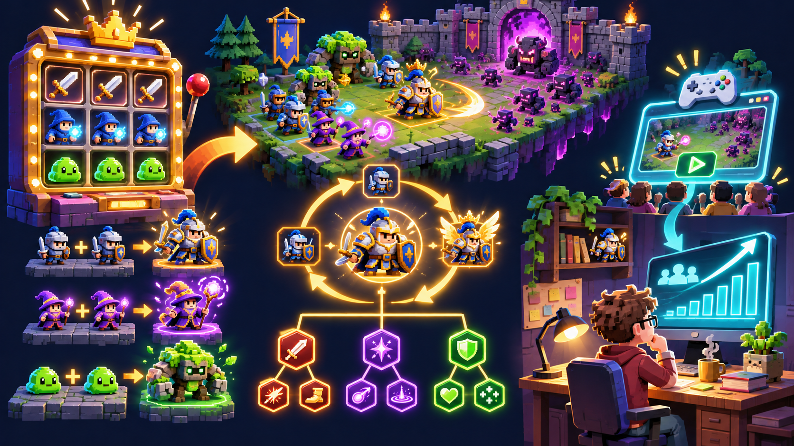
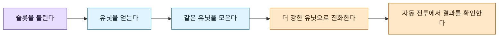
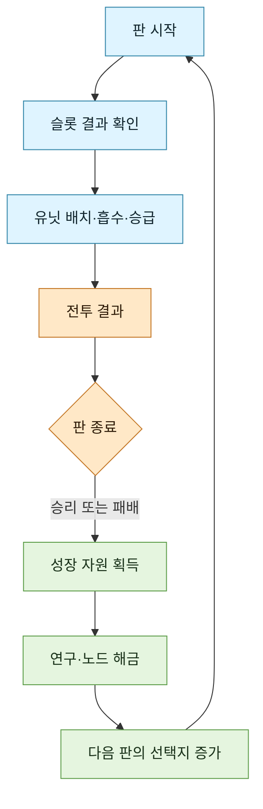
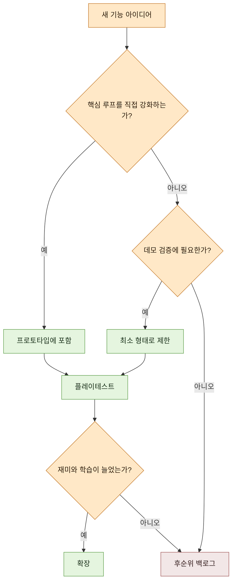

인디 게임이 출시 초기에 빠르게 주목받는 이유를 단순히 운이나 광고 예산으로 설명하기는 어렵다. 플레이어가 한눈에 이해할 수 있는 핵심 규칙, 반복하고 싶은 짧은 보상 루프, 다른 사람에게 직접 보여 줄 수 있는 데모가 함께 맞물려야 한다.

영상은 `Slotbound`가 출시 3일 만에 10만 장, 일주일도 되지 않아 20만 장을 판매했다고 소개하며, 그 배경을 네 가지 성공 공식으로 분석한다. 이 글은 영상의 주장을 그대로 나열하기보다, 각각의 요소가 플레이어 경험과 인디 개발 범위에 어떤 방식으로 연결되는지 게임 디자인 관점에서 풀어본다.

<!--more-->

## Sources

- [YouTube 원본 영상](https://youtu.be/8xgK_648AM8?si=1SyCW8Dg33gn-Wem) — Slotbound의 성공 요인과 공장 디펜스 게임에의 적용을 분석한 영상.
- [1초 만에 이해되는 하이 콘셉트](https://youtu.be/8xgK_648AM8?t=28) — 3×3 슬롯 머신과 오토 배틀러·디펜스의 결합.
- [이중 도파민 루프](https://youtu.be/8xgK_648AM8?t=51) — 한 판 안의 보상과 판 밖 성장의 연결.
- [무료 데모 선공개](https://youtu.be/8xgK_648AM8?t=75) — 출시 전 데모, 위시리스트, 스트리머 플레이의 관계.
- [1인 개발 스코프](https://youtu.be/8xgK_648AM8?t=100) — 핵심 재미에 개발 자원을 집중한 범위 설정.
- [공장 디펜스 게임에의 적용](https://youtu.be/8xgK_648AM8?t=119) — 영상 제작자가 자신의 게임에 적용하려는 세 가지 방향.

## 1. 첫 번째 공식: 1초 만에 이해되는 하이 콘셉트

영상이 첫 번째 성공 요인으로 꼽는 것은 복잡한 세계관이나 대규모 콘텐츠가 아니라, 화면을 보는 즉시 규칙이 전달되는 하이 콘셉트다. Slotbound는 3×3 슬롯 머신과 오토 배틀러·디펜스 게임을 결합한다. 슬롯을 돌려 유닛을 뽑고, 같은 유닛이 모이면 더 강한 형태로 진화한다는 구조다. [영상 00:28](https://youtu.be/8xgK_648AM8?t=28)

이 조합이 강한 이유는 두 장르의 익숙한 규칙을 동시에 활용하기 때문이다.

- 슬롯 머신은 결과를 기다리는 긴장과 무작위성을 제공한다.
- 오토 배틀러는 유닛을 배치하고 조합하는 전략을 제공한다.
- 디펜스는 결과를 전투 화면에서 확인하는 명확한 목표를 제공한다.

플레이어는 새로운 규칙을 전부 배워야 하는 대신, 이미 알고 있는 규칙 사이의 연결만 이해하면 된다. 슬롯 결과가 전투 유닛으로 바뀌고, 동일한 유닛을 모으면 강해진다는 인과관계가 짧은 시간 안에 전달된다.

### 1.1 하이 콘셉트는 설명 문장이 아니라 플레이 행동이어야 한다

“슬롯과 디펜스를 결합한 게임”이라는 문장만으로는 충분하지 않다. 실제로는 첫 플레이에서 슬롯을 돌리고, 유닛을 얻고, 같은 유닛이 합쳐지는 장면까지 빠르게 보여 줘야 한다. 콘셉트가 화면의 행동으로 번역될 때 플레이어는 긴 튜토리얼 없이도 게임의 핵심을 기억한다.

따라서 하이 콘셉트를 검증할 때는 다음 질문을 던져 볼 수 있다.

1. 처음 보는 사람이 게임 플레이 영상을 5초만 보고 핵심 행동을 말할 수 있는가?
2. 핵심 행동이 입력 하나 또는 짧은 입력 조합으로 시작되는가?
3. 그 입력의 결과가 화면 변화로 즉시 나타나는가?
4. 결과가 다음 행동을 자연스럽게 부르는가?

이 질문에 답하지 못한다면 세계관 설명이나 기능을 늘리기 전에 핵심 행동의 시각적 전달을 먼저 다듬어야 한다.

## 2. 두 번째 공식: 한 판 안과 판 밖을 연결하는 이중 보상 루프

두 번째 성공 요인은 짧은 플레이 안의 보상과 장기 성장의 보상을 겹쳐 놓은 구조다. 한 판 안에서는 슬롯 잭팟, 유닛 흡수, 승급이 반복되며 작은 기대감과 강해지는 쾌감을 만든다. 판이 끝난 뒤에는 연구와 성장에 사용하는 인크리멘탈 노드 해금 트리가 기다린다. [영상 00:51](https://youtu.be/8xgK_648AM8?t=51)

이 구조에서 중요한 것은 두 루프가 서로 분리되어 있지 않다는 점이다. 전투 중의 행동은 당장의 승패를 바꾸고, 판 밖에서의 해금은 다음 판의 선택지를 넓힌다. 패배하더라도 성장 자원이 남으면 플레이어는 “이번 판은 실패했다”에서 멈추지 않고 “다음 판에는 다른 노드를 찍어 보자”로 이동한다.

### 2.1 단기 루프의 역할: 다음 결과를 기다리게 만들기

단기 루프는 한 턴 또는 몇 초 안에 보상을 제공해야 한다. 슬롯을 돌린 결과가 새 유닛으로 나타나고, 같은 유닛이 합쳐지며, 승급한 유닛이 전투에서 적을 쓸어버리는 과정은 각각 독립적인 피드백이다.

이 피드백이 촘촘하면 플레이어는 큰 목표를 달성하지 못해도 계속 플레이할 이유를 얻는다. 중요한 것은 보상을 무작정 많이 주는 것이 아니라, 입력과 결과의 관계를 선명하게 유지하는 것이다.

### 2.2 장기 루프의 역할: 실패를 다음 시도의 재료로 바꾸기

판 밖의 성장 트리는 세션 사이의 공백을 메운다. 플레이어가 패배한 뒤에도 노드를 선택해 눈에 띄는 변화를 얻으면, 이전 판의 실패가 완전히 사라지지 않는다. 다음 판에서 새로운 빌드나 전략을 시험할 이유가 생긴다.

다만 영구 성장만 강하게 만들면 실력보다 누적 시간에 의존하는 구조가 될 수 있다. 장기 보상은 플레이어를 대신해 승리하는 수치 상승보다, 새로운 선택지와 조합을 여는 방향으로 설계하는 편이 반복 플레이의 의미를 오래 유지한다.

## 3. 세 번째 공식: 무료 데모를 마케팅 플라이휠로 사용하기

영상은 Slotbound가 정식 출시 전에 핵심 재미가 살아 있는 무료 데모를 Steam에 공개했다고 설명한다. 플레이어가 직접 경험한 호평과 스트리머 플레이가 겹치면서 출시 전 위시리스트가 10만 개를 넘겼고, 광고비로 관심을 사는 대신 플레이 경험이 입소문을 만들었다는 분석이다. [영상 01:15](https://youtu.be/8xgK_648AM8?t=75)

무료 데모의 핵심은 단순히 게임을 무료로 배포하는 것이 아니다. 데모 안에서 게임의 핵심 루프가 충분히 작동해야 하고, 플레이어가 다른 사람에게 보여 줄 만한 순간이 만들어져야 한다.

### 3.1 데모는 개발 완료판이 아니라 검증 가능한 최소판이다

혼자 개발하는 팀이 데모를 준비할 때 모든 콘텐츠를 담으려 하면 공개 시점이 계속 늦어진다. 영상에서 제시한 방향은 첫 지역, 핵심 유닛 또는 터렛, 그리고 한 바퀴의 성장 루프가 완성되면 먼저 공개하는 것이다. [영상 02:41](https://youtu.be/8xgK_648AM8?t=161)

이때 데모의 목표를 “정식판의 일부를 보여 주기”가 아니라 “플레이어가 핵심 재미를 판단할 수 있게 하기”로 정의해야 한다. 그러면 데모에 필요한 것은 콘텐츠의 양보다 다음과 같은 검증 지점이 된다.

- 처음 몇 분 안에 핵심 콘셉트를 이해하는가
- 한 판의 시작과 종료가 명확한가
- 패배 후 다시 시도할 장기 동기가 있는가
- 플레이어가 재미있었던 순간을 설명하거나 공유할 수 있는가
- 피드백을 바탕으로 수정할 수 있는 데이터가 남는가

데모는 마케팅 자산이면서 동시에 밸런스 테스트 장치다. 특히 중독성이나 난이도 곡선처럼 개발자가 혼자 판단하기 어려운 문제를 실제 플레이어의 행동으로 확인할 수 있다.

## 4. 네 번째 공식: 1인 개발에 맞는 스코프 집중

네 번째 요인은 많은 시스템을 만드는 것이 아니라, 핵심 재미 하나에 개발 자원을 집중한 스코프다. 영상은 무거운 엔진이나 방대한 스토리를 추가하기보다 슬롯과 성장의 손맛을 밀도 있게 만드는 선택을 강조한다. [영상 01:40](https://youtu.be/8xgK_648AM8?t=100)

1인 개발에서 스코프는 단순히 기능 목록의 크기가 아니다. 각각의 시스템이 핵심 루프를 강화하는지, 아니면 별도의 제작·테스트·운영 부담을 추가하는지를 판단하는 기준이다.

예를 들어 슬롯과 유닛 승급이 게임의 얼굴이라면, 새로운 메뉴·스토리·장비 시스템을 추가하기 전에 슬롯 결과의 가독성, 승급 연출, 전투 결과의 피드백을 개선하는 것이 우선이다. 콘텐츠가 적더라도 핵심 루프의 밀도가 높으면 데모에서 게임의 가능성을 보여 줄 수 있다.

## 5. 공장 디펜스 게임에 적용한 세 가지 방향

영상 후반부에서는 제작자가 자신이 개발 중인 공장 디펜스 게임에 Slotbound 분석을 적용하는 계획을 설명한다. 장르는 다르지만, 핵심 원칙은 그대로 옮길 수 있다. [영상 01:59](https://youtu.be/8xgK_648AM8?t=119)

### 5.1 복잡한 공정을 전투의 언어로 번역하기

첫 번째 방향은 벨트가 곧 탄약과 드론 군대가 된다는 핵심 콘셉트를 초반 몇 분 안에 체감하게 만드는 것이다. 공장 설비 안에서 공정을 직접 설계하고, 그 라인이 전선에 화력을 쏟아붓는 관계를 게임의 얼굴로 세운다. [영상 02:08](https://youtu.be/8xgK_648AM8?t=128)

공장 자동화 게임은 생산 규칙이 복잡해지기 쉽다. 하지만 플레이어가 생산량을 늘리는 이유를 전투 결과로 즉시 확인할 수 있다면, 복잡한 시스템이 목적이 아니라 수단으로 이해된다.

### 5.2 짧은 보상과 긴 성장의 간격 줄이기

두 번째 방향은 360도 신호 노드 탐색, 세 가지 선택지 중 하나를 고르는 전술 강화, 전선이 밀릴 때 포탑에 직접 올라가 쏘는 1인칭 전투를 묶는 것이다. 각각은 탐색, 선택, 직접 조작이라는 다른 쾌감을 제공하지만, 모두 공장을 확장하고 전선을 버티는 목표로 연결되어야 한다. [영상 02:27](https://youtu.be/8xgK_648AM8?t=147)

여기서 주의할 점은 보상 종류가 많아질수록 좋은 것이 아니라는 것이다. 각 보상이 같은 핵심 루프를 강화하는지, 플레이어가 다음에 무엇을 해야 하는지 더 명확해지는지를 확인해야 한다.

### 5.3 완성까지 숨기지 않고 첫 번째 검증판 공개하기

세 번째 방향은 정식 버전 전체를 혼자 완성한 뒤 공개하는 대신, 첫 지역과 핵심 터렛, 설비 루프가 완성되는 시점에 Steam 무료 데모를 공개하는 것이다. 실제 플레이어의 피드백으로 중독성과 밸런스를 다듬겠다는 계획이다. [영상 02:41](https://youtu.be/8xgK_648AM8?t=161)

이 전략을 실행하려면 데모에 들어갈 범위를 먼저 고정해야 한다. “첫 지역”이라는 이름만으로는 부족하고, 플레이어가 어떤 입력을 하고 어떤 결정을 내리며 어떤 결과를 얻는지까지 정의해야 한다. 그래야 피드백이 “콘텐츠가 부족하다”는 감상에 머물지 않고, 루프의 어느 단계가 약한지로 구체화된다.

## 핵심 요약

- **하이 콘셉트**: 이미 익숙한 규칙을 결합하되, 플레이어가 첫 몇 초 안에 행동과 결과를 이해하게 만든다.
- **이중 보상 루프**: 한 판 안의 작은 쾌감과 판 밖의 장기 성장을 연결해 “한 판만 더”를 만든다.
- **무료 데모**: 핵심 재미가 실제로 작동하는 최소판을 먼저 공개해 플레이어 경험을 위시리스트와 피드백으로 전환한다.
- **스코프 집중**: 1인 개발에서는 기능 수보다 핵심 루프에 투입하는 밀도가 더 중요하다.
- **적용 방법**: 다른 장르라도 핵심 콘셉트를 짧게 전달하고, 보상 간격을 줄이며, 검증 가능한 데모를 일찍 공개하는 원칙은 재사용할 수 있다.

## 결론

Slotbound의 사례에서 배울 점은 슬롯 머신이라는 소재 자체가 아니다. 플레이어가 즉시 이해할 수 있는 행동을 만들고, 짧은 보상과 장기 성장을 연결하고, 그 재미를 데모로 증명하며, 혼자 감당할 수 있는 범위에 집중한 설계 방식이다.

인디 게임을 만들 때 “무엇을 더 넣을까?”보다 먼저 물어야 할 질문은 “플레이어가 지금 당장 반복하고 싶은 행동은 무엇인가?”다. 그 행동이 선명해진 뒤에야 콘텐츠, 성장, 마케팅, 개발 도구가 같은 방향으로 정렬된다.
