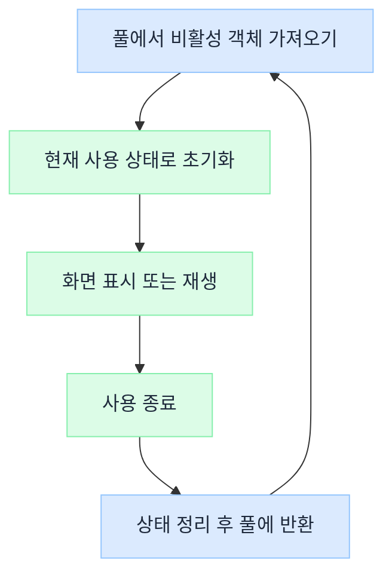

오브젝트 풀링은 총알처럼 짧게 살다 사라지는 오브젝트를 미리 만들어 재사용하는 기법입니다. 하지만 반복 생성과 제거가 일어나는 곳이라면 UI, 사운드 재생 객체, 임시 자료구조에도 적용을 검토할 수 있습니다. 이 글은 오늘코딩의 Shorts 내용을 요약했으며 직접 성능을 측정한 결과는 아닙니다.

<!--more-->

## Sources

- [오브젝트 풀링, 총알에만 쓰세요? — 오늘코딩 Todaycoding](https://www.youtube.com/shorts/dn5mS5ocZ5Y)

## 풀링 대상은 총알에 한정되지 않는다

영상은 데미지 숫자나 아이템 획득 알림처럼 잠깐 표시되는 UI도 풀링할 수 있다고 설명합니다. 화면에 띄울 때 문구와 위치를 설정하고, 표시가 끝나면 비활성화해 풀로 돌려놓습니다. 인벤토리도 슬롯을 계속 생성하기보다 슬롯 객체를 재사용하고 보여줄 아이템 데이터를 바꿀 수 있습니다. [영상 0:06](https://youtu.be/dn5mS5ocZ5Y?t=6) · [영상 0:20](https://youtu.be/dn5mS5ocZ5Y?t=20)

## 사운드와 비시각적 임시 데이터도 검토할 수 있다

효과음을 낼 때마다 오디오 소스가 붙은 객체를 새로 만든다면, 재생 객체를 풀에서 꺼내 위치를 설정해 재생하고 종료 후 반환할 수 있습니다. 재사용하는 것은 사운드 파일 자체가 아니라 **사운드 재생을 담당하는 객체**입니다. 영상은 이펙트와 임시 계산에 쓰는 리스트 같은 자료구조도 풀링 후보로 듭니다. [영상 0:26](https://youtu.be/dn5mS5ocZ5Y?t=26) · [영상 0:41](https://youtu.be/dn5mS5ocZ5Y?t=41)

## 재사용 전 상태를 초기화한다

풀에 반환하기 전이나 다시 꺼낼 때 이전 사용의 상태가 남지 않도록 해야 합니다. 예를 들어 이전 효과음의 음량, UI의 투명도, 연결된 이벤트 핸들러가 남으면 다음 사용에 영향을 줄 수 있습니다. 따라서 풀링은 단순히 객체를 켜고 끄는 데서 끝나지 않고, 매번 초기 상태를 보장하는 정리 절차까지 포함해야 합니다. [영상 0:49](https://youtu.be/dn5mS5ocZ5Y?t=49)

## 반복 생성이 잦은 곳부터 적용한다

모든 객체를 미리 풀에 넣을 필요는 없습니다. 풀에 대기 중인 객체도 메모리를 사용하므로, 반복적으로 만들고 제거하는 구간부터 찾아 적용하는 것이 영상의 권장 방향입니다. 판단 기준은 총알인지 UI인지가 아니라 **같은 역할의 인스턴스를 자주 생성하고 폐기하는지**입니다. [영상 1:01](https://youtu.be/dn5mS5ocZ5Y?t=61) · [영상 1:10](https://youtu.be/dn5mS5ocZ5Y?t=70)

## 핵심 요약

- 풀링은 총알뿐 아니라 반복 생성되는 임시 UI, 사운드 재생 객체, 이펙트, 임시 자료구조에도 검토할 수 있습니다.
- 재사용할 때는 이전 사용의 값과 이벤트 연결을 정리해야 합니다.
- 풀은 메모리를 점유하므로, 생성·제거가 실제로 잦은 구간부터 적용합니다.

## 결론

오브젝트 풀링의 기준은 오브젝트의 종류가 아니라 생성과 폐기가 반복되는 패턴입니다. 풀링 후보를 찾고, 재사용 초기화가 정확한지 확인한 뒤 필요한 곳부터 도입하세요.
