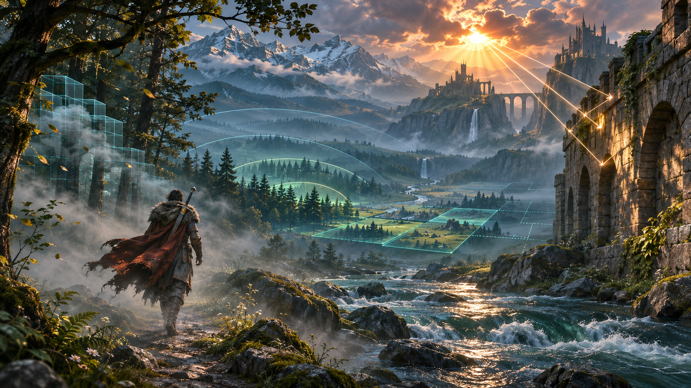

오픈월드 게임의 그래픽을 볼 때 “이 장면을 전부 실시간으로 계산하고 있을까?”라는 질문이 생긴다. 안개는 캐릭터의 움직임에 반응하고, 강물은 바위에 부딪혀 방향을 바꾸며, 수백 미터 떨어진 숲까지 바람에 흔들린다. 실내에서는 시간대와 횃불에 따라 간접광이 달라지고, 멀리 있는 풍경도 하나의 세계처럼 이어진다.

하지만 이 모든 것을 같은 정밀도로 계산하면 고성능 그래픽카드 한 장으로도 감당하기 어렵다. [Tony 정의 영상](https://youtu.be/2d8OsrPQU1U?si=8-BKMVYjWap1zfFn)은 붉은사막에 사용된 펄어비스의 블랙스페이스 엔진을 분석하며, 엔진이 모든 것을 진짜로 계산하는 것이 아니라 **보이는 가치가 큰 부분에 계산을 집중하고 나머지는 근사·대체·사전 생성으로 처리한다**고 설명한다.

이 글은 영상의 분석과 추정에 기반해 블랙스페이스 엔진의 렌더링 전략을 게임 엔진 개발자가 이해할 수 있는 단위로 나누어 살펴본다. 영상에서 공개적으로 확인된 사실과 화면을 바탕으로 한 해석은 구분해 설명한다.

<!--more-->

## Sources

- [YouTube 원본 영상](https://youtu.be/2d8OsrPQU1U?si=8-BKMVYjWap1zfFn) — 블랙스페이스 엔진의 그래픽 기술을 분석한 영상.
- [엔진과 붉은사막 소개](https://youtu.be/2d8OsrPQU1U?t=14) — 펄어비스 자체 엔진과 네이티브 4K·60fps에 대한 영상 설명.
- [안개와 대기 계산](https://youtu.be/2d8OsrPQU1U?t=121) — 볼륨 단위의 산란·흡수와 유체 기반 안개 반응.
- [강물 시뮬레이션](https://youtu.be/2d8OsrPQU1U?t=168) — 얕은 물 방정식, 입자, 거리별 근사 처리.
- [숲과 바람](https://youtu.be/2d8OsrPQU1U?t=246) — 바람 필드와 절차적 식생, 원거리 임포스터.
- [상호작용 시스템](https://youtu.be/2d8OsrPQU1U?t=349) — 접촉 위치와 힘을 전달하는 통합 반응 구조.
- [실시간 간접광과 레이 트레이싱](https://youtu.be/2d8OsrPQU1U?t=406) — 라이트맵 대신 런타임 조명과 거리별 레이 트레이싱.
- [가짜 돌벽과 텍스처 절약](https://youtu.be/2d8OsrPQU1U?t=594) — 깊이 정보와 작은 텍스처를 활용한 근사.
- [월드 스트리밍과 절차적 생성](https://youtu.be/2d8OsrPQU1U?t=728) — 대륙 분할, Houdini 기반 생성, 거리별 디테일 단계.

## 1. 자체 엔진을 선택한 이유

영상에 따르면 펄어비스는 2010년 약 10명 규모로 엔진과 게임을 함께 만들기 시작했고, 2014년 검은사막을 출시했다. 이후 검은사막 리마스터에서 물리 기반 렌더링과 이미지 기반 조명 같은 기능을 확장했고, 2021년 지스타에서 차세대 엔진의 개발 과정이 공개됐다. 당시에는 엔진과 도구만 전담하는 인력이 약 50명으로 늘어난 것으로 소개된다. [영상 01:07](https://youtu.be/2d8OsrPQU1U?t=67)

자체 엔진을 유지하는 비용은 크다. 렌더링, 에디터, 애니메이션, 물리, 네트워크, 플랫폼 대응까지 회사가 책임져야 한다. 그럼에도 특정 게임이 요구하는 기능을 원하는 시점에 넣어야 하고, 상용 엔진의 로드맵과 게임의 요구가 어긋날 때 출시 일정이 영향을 받는다면 자체 기술에 투자할 이유가 생긴다. [영상 01:47](https://youtu.be/2d8OsrPQU1U?t=107)

영상은 현재의 블랙스페이스 엔진이 검은사막 엔진을 단순히 고친 것이 아니라 기본 코드를 새로 작성했고, 액션 스크립트와 AI 일부만 가져와 크게 수정했다고 설명한다. 이 선택은 “모든 기술을 직접 만든다”는 의미보다, **게임의 차별점이 되는 계산 경로와 제작 도구를 직접 통제한다**는 전략으로 이해할 수 있다.

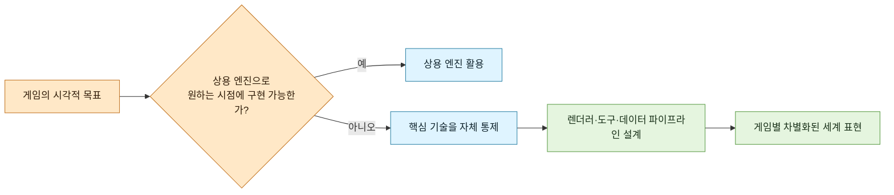

## 2. 안개: 화면 앞의 공간을 계산하는 방식

일반적인 안개는 카메라와 물체 사이의 거리에 따라 색을 섞는 방식으로도 충분히 표현할 수 있다. 하지만 영상에서 분석한 붉은사막의 안개는 카메라 앞 공간을 작은 상자, 즉 볼륨 셀로 나누고 셀마다 빛이 얼마나 흩어지고 흡수되는지를 계산하는 방식으로 설명된다. [영상 02:01](https://youtu.be/2d8OsrPQU1U?t=121)

빛이 셀을 통과하면서 누적되면 안개 사이로 들어오는 햇살이 기둥처럼 보인다. 여기에 유체 시뮬레이션을 연결하면 캐릭터가 걷거나 구를 때 안개가 밀려나고 다시 채워지는 움직임을 만들 수 있다.

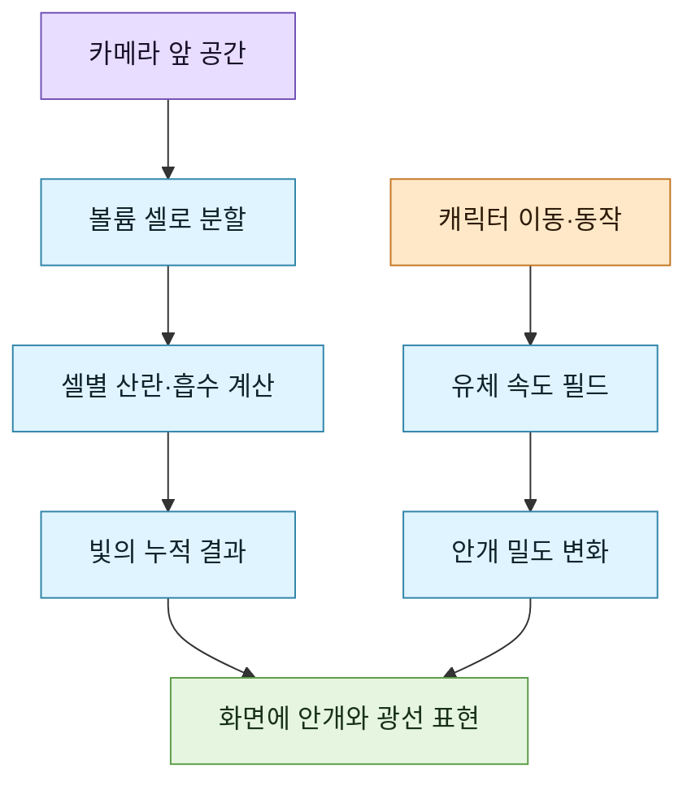

안개는 독립된 효과가 아니다. 영상은 대기 산란과 볼류메트릭 구름이 하나의 계산으로 묶여 있어 시간대가 바뀌면 안개의 밀도와 색도 함께 달라진다고 설명한다. 새벽의 푸른 안개, 해 질 녘의 금빛 안개, 눈이 내릴 때의 낮은 가시거리는 각각 별도의 이미지 효과를 붙인 결과가 아니라 환경 상태가 공유되는 결과로 볼 수 있다. [영상 02:30](https://youtu.be/2d8OsrPQU1U?t=150)

## 3. 강물: 모든 물을 시뮬레이션하지 않기

영상은 대부분의 게임에서 강물을 미리 만든 흐름 지도와 스크롤 텍스처, 별도의 물보라 효과로 표현한다고 설명한다. 강의 모양이 바뀌면 흐름 지도를 다시 만들기 어려운 이유도 이 때문이다.

반면 붉은사막의 강은 얕은 물 방정식을 사용해 물의 흐름을 계산하는 것으로 분석된다. 물 전체를 3차원 유체로 풀지 않고, 깊이를 수면 높이로 줄여 평면 위에서 계산한다. 화면에 보이는 수면의 움직임에 계산을 집중하는 절충이다. [영상 03:07](https://youtu.be/2d8OsrPQU1U?t=187)

카메라 주변에서는 다수의 입자가 서로 밀고 강바닥과 바위에 부딪히며, 낙차에 따라 거품이 생긴다. 통 같은 물체를 던졌을 때 물결이 퍼지고 물살에 떠내려가는 장면은 수면 시뮬레이션과 물체 상호작용이 연결된 사례로 설명된다. [영상 03:21](https://youtu.be/2d8OsrPQU1U?t=201)

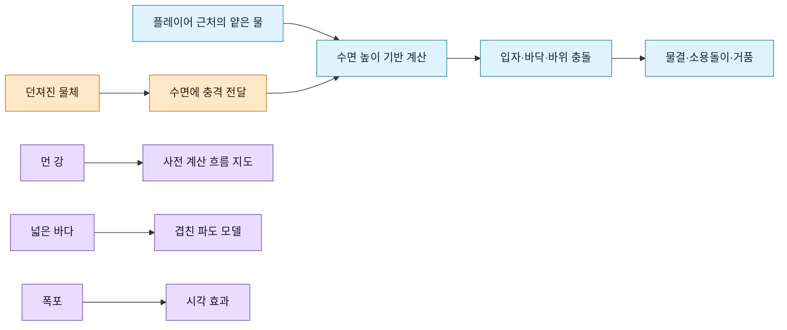

핵심은 “강 전체를 계산한다”가 아니다. 플레이어가 실제로 보고, 밟고, 물체를 던지는 영역만 동적으로 계산하고, 멀리 있는 물은 흐름 지도나 파도 모델로 대체한다. 카메라가 멈추었을 때 수면 해상도를 낮추고 움직일 때 되돌리는 방식도 같은 원칙에 속한다. [영상 03:39](https://youtu.be/2d8OsrPQU1U?t=219)

## 4. 숲과 바람: 넓은 범위를 살아 있게 보이기

영상에 따르면 한 장면에는 최대 50만 그루의 나무와 100종이 넘는 식생이 들어갈 수 있다. 이 정도의 오브젝트를 CPU가 하나씩 보고 그릴지 결정하면 비용이 커지므로, 식생의 위치와 밀도, 종류, 경사, 고도, 비워 둘 장소 같은 규칙을 저장하고 그래픽카드가 실행 중에 숲을 생성하는 방식이 소개된다. [영상 04:21](https://youtu.be/2d8OsrPQU1U?t=263)

이 방식은 개별 나무의 위치를 전부 저장하는 것과 다르다. 월드 데이터는 “이 지역은 어떤 종류의 나무가 어느 밀도로 자라는가”에 가까운 규칙으로 유지되고, 실제 인스턴스 배치는 렌더링 시점에 계산된다. 중요한 장소만 아티스트가 손으로 다듬어 절차적 생성의 반복감을 줄인다.

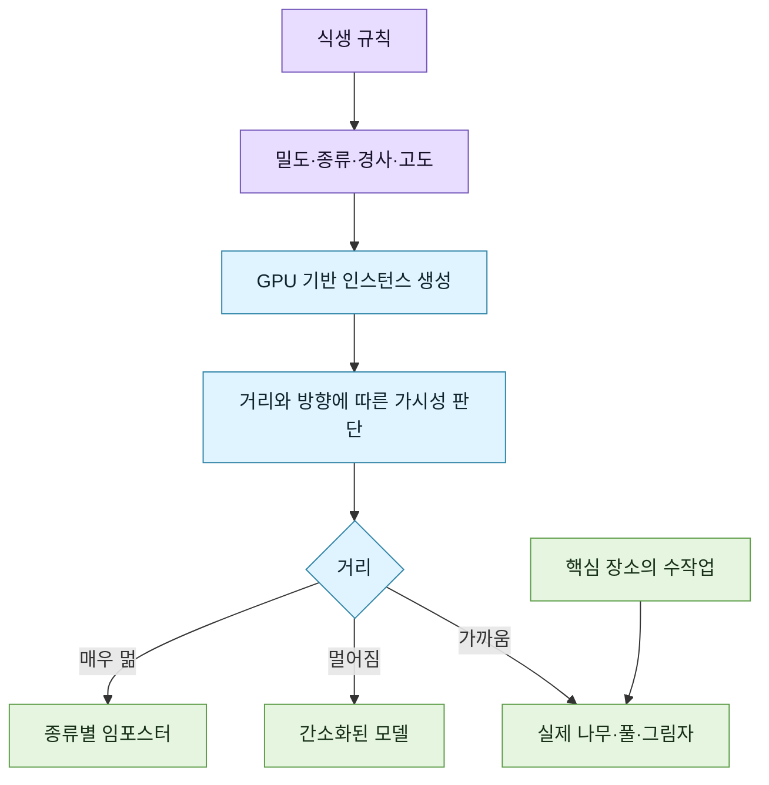

바람은 하나의 값으로 끝나지 않는다. 위치와 식생 밀도에 따라 방향과 세기가 달라지고, 물·풀·나무·옷·안개·먼지가 같은 바람 값을 공유하는 것으로 설명된다. 그래서 강물의 물결, 나뭇잎의 흔들림, 망토의 움직임이 서로 다른 효과처럼 보이면서도 같은 환경 상태에 반응한다. [영상 04:07](https://youtu.be/2d8OsrPQU1U?t=246)

다만 영상은 먼 숲을 살아 있게 보이게 하려고 거리별 바람 세기를 충분히 구분하지 않은 것으로 추정한다. 그 결과 가까운 풀까지 태풍처럼 흔들린다는 플레이어 반응이 나왔다는 설명이다. 실제 바람을 재현하는 것과 먼 풍경의 생동감을 전달하는 것 사이에서 시각적 과장을 선택한 사례다. [영상 05:13](https://youtu.be/2d8OsrPQU1U?t=313)

## 5. 상호작용: 접촉을 하나의 공통 입력으로 만들기

붉은사막의 상호작용은 오브젝트마다 별도의 이벤트를 붙이는 방식보다, 접촉을 공통 데이터로 전달하는 구조로 분석된다. 플레이어가 무언가에 닿으면 위치, 힘의 방향, 당시 행동을 전달하고, 받는 오브젝트가 자신의 물성에 따라 반응한다. [영상 05:49](https://youtu.be/2d8OsrPQU1U?t=349)

풀은 휘었다가 돌아오고, 칼에 맞은 풀은 맞은 부분이 베인다. 나무는 잡은 위치와 당기는 방향에 따라 휘며, 부러지면 그 상태가 월드에 남는다. 옷과 머리카락, 말의 갈기와 꼬리는 별도 물리 계산으로 움직이고, 물리 엔진 일부는 하복 같은 외부 기술을 사용한다고 영상은 설명한다. [영상 06:23](https://youtu.be/2d8OsrPQU1U?t=383)

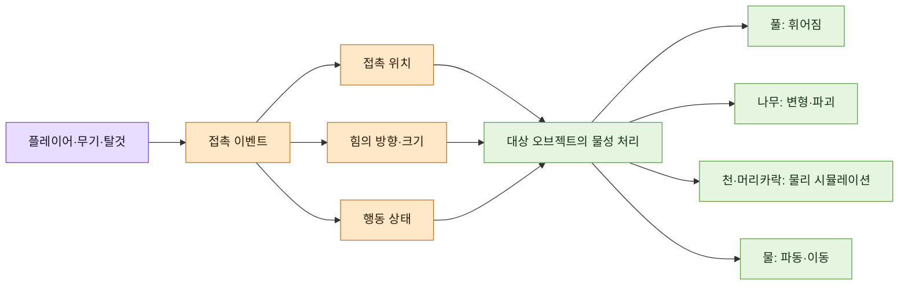

이 구조의 장점은 새로운 상호작용을 추가할 때 모든 조합을 별도로 구현하지 않아도 된다는 데 있다. 플레이어의 접촉 데이터와 대상의 물성 인터페이스가 정해져 있으면, 풀·나무·천·물은 각자 다른 반응을 구현하면서도 같은 파이프라인을 공유할 수 있다.

## 6. 실시간 조명: 간접광을 계산하되 범위를 제한하기

게임의 빛은 광원에서 물체로 곧장 오는 직접광과, 표면에 부딪힌 뒤 주변으로 튕기는 간접광으로 나눌 수 있다. 간접광은 빛이 여러 방향으로 퍼지기 때문에 계산 비용이 크고, 전통적인 게임에서는 미리 계산한 라이트맵으로 대체하는 경우가 많다. [영상 06:55](https://youtu.be/2d8OsrPQU1U?t=415)

라이트맵은 런타임 계산을 줄여 주지만 시간대, 문 개폐, 이동하는 광원에 따라 빛이 바뀌는 장면에는 제약이 있다. 영상은 붉은사막이 구운 조명을 사용하지 않고 간접광까지 플레이 중에 계산한다고 설명한다. 해가 지거나 횃불을 들고 실내에 들어갈 때 바닥과 벽의 색, 실내 그림자가 다시 그려지는 이유다. [영상 07:28](https://youtu.be/2d8OsrPQU1U?t=448)

다수의 마을 등불과 전투 불꽃은 다수 광원 시스템이 처리한다. 불꽃 입자의 움직임에 따라 빛의 모양과 밝기, 깜빡임이 함께 바뀌는 구조다.

### 6.1 레이 트레이싱도 모든 거리에서 사용하지 않는다

영상 분석에 따르면 최고 품질 설정에서도 간접광은 픽셀 16개당 광선 하나 수준으로 샘플링하고, 정밀한 레이 트레이싱은 약 100미터 안쪽에서 수행한다. 그 바깥은 SDF 복셀 형태의 거친 공간 표현으로 대체하고, 이미 계산한 빛은 레이디언스 캐시와 서펠 기반 저장소에 보관해 재사용한다. [영상 08:12](https://youtu.be/2d8OsrPQU1U?t=492)

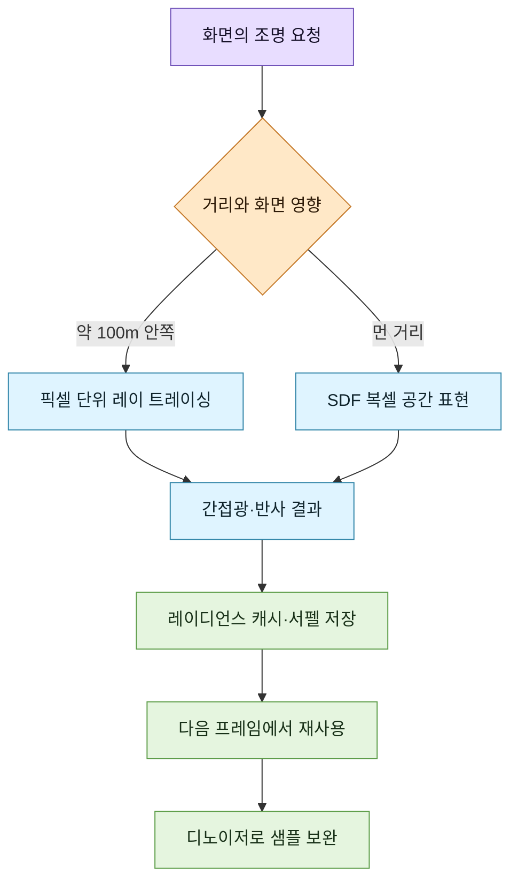

이 절충은 품질과 안정성을 바꾼다. 어두운 실내에서 벽이 자글거리거나, 문을 통과할 때 화면이 하얗게 번쩍이는 현상은 프레임마다 적은 수의 광선이 다른 결과를 만들고 디노이저가 새 조명을 안정화할 시간을 필요로 하기 때문에 생기는 것으로 영상은 추정한다. [영상 09:17](https://youtu.be/2d8OsrPQU1U?t=557)

즉, 레이 트레이싱을 켰다는 사실보다 중요한 것은 어디에서 샘플을 아끼고, 이전 프레임의 결과를 어떻게 재사용하며, 노이즈를 어떤 후처리로 감당하는가이다.

## 7. 가짜 돌벽과 작은 텍스처의 힘

영상은 마을의 돌벽이 실제로는 돌 하나하나를 가진 고밀도 모델이 아니라 거의 평평한 판에 가까운 것으로 분석한다. 화면의 깊이 정보를 수정해 평평한 벽에서 돌이 튀어나온 것처럼 보이게 만드는 방식이다. 칼이 돌의 윤곽을 그대로 관통하거나 카메라를 빠르게 돌릴 때 표면과 그림자가 흔들리는 현상이 근거로 제시된다. [영상 10:13](https://youtu.be/2d8OsrPQU1U?t=613)

이 기법은 실제 돌을 수천 개 모델링하는 것보다 훨씬 저렴하다. 대신 시점에 따라 입체감이 무너질 수 있고, 그림자는 실제 돌의 위치를 알 수 없기 때문에 별도의 보정이 필요하다. 플레이어가 돌벽을 파괴하거나 가까이서 모든 방향으로 관찰하는 게임이라면 부적합할 수 있지만, 대부분의 시점에서 표면 디테일만 필요하다면 효율적인 선택이다.

텍스처도 같은 원칙을 따른다. 영상에서 확인한 구역의 텍스처는 1K가 가장 크고, 512 또는 256픽셀도 많다고 설명한다. 작은 텍스처를 타일처럼 반복하고, 1미터당 픽셀 밀도를 일정하게 유지하면 넓은 벽과 바닥을 적은 메모리로 덮을 수 있다. [영상 10:54](https://youtu.be/2d8OsrPQU1U?t=654)

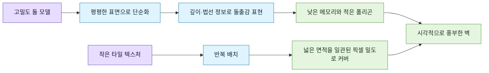

## 8. 200제곱킬로미터를 만드는 절차적 파이프라인

약 200제곱킬로미터의 땅을 사람이 하나씩 칠하는 것은 불가능하다. 영상은 대표 지역 몇 곳을 먼저 수작업으로 만들고, 길가의 식생 밀도나 경사에 따른 지형 변화 같은 규칙을 뽑아 Houdini로 대륙 전체에 펼쳤다고 설명한다. 자동화로 절약한 시간은 대표 지역을 더 다듬는 데 다시 투자하고, 대표 지역의 품질이 전체 규칙에 반영되는 구조다. [영상 12:32](https://youtu.be/2d8OsrPQU1U?t=752)

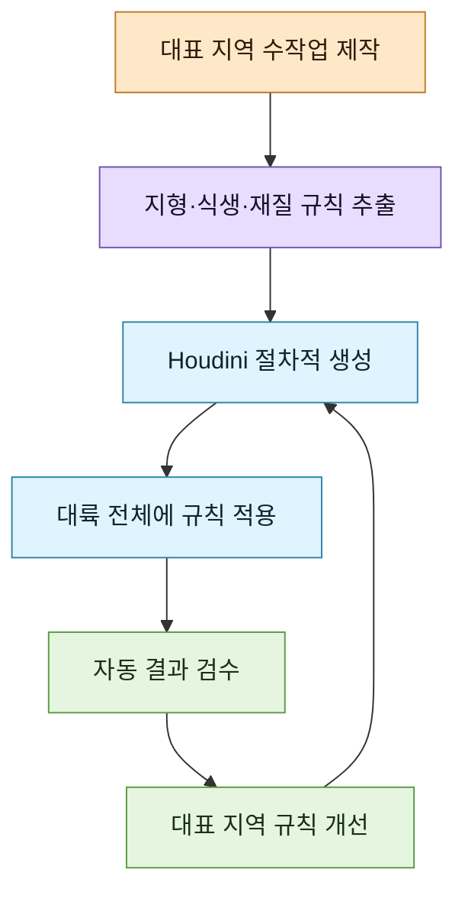

이 방식은 완전한 랜덤 생성과 다르다. 사람이 만든 기준 장면에서 규칙을 추출하기 때문에 전체 월드에 일관된 스타일을 유지할 수 있고, 반복되는 콘텐츠를 만들면서도 중요한 장소에는 수작업을 집중할 수 있다.

## 9. 월드 스트리밍과 거리별 디테일

게임이 실행되는 동안에는 무엇을 언제 메모리에 올릴지가 또 다른 문제다. 영상은 파이웰 대륙을 2만 개가 넘는 단위로 나누고, 먼저 256미터 격자로 자른 뒤 물체의 위치·크기·데이터 종류에 따라 더 작은 조각으로 분할한다고 설명한다. 플레이어 근처의 조각만 불러오고 멀어지면 내려놓는 방식이다. [영상 12:08](https://youtu.be/2d8OsrPQU1U?t=728)

렌더링 거리도 세 구간으로 나뉜다.

- **1km 안쪽**: 손에 닿는 물체와 촘촘한 디테일
- **3km까지**: 지형과 건물
- **10km까지**: 숲, 랜드마크, 하늘

물체마다 다섯 단계의 디테일 수준이 있고, 멀어지면 여러 물체를 합친 프록시로 교체한다. 프록시에도 원본 물체의 정보가 남아 있어 가까이서 바뀐 세계가 멀리서도 일관되게 보이도록 한다. [영상 13:01](https://youtu.be/2d8OsrPQU1U?t=781)

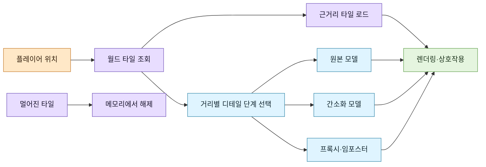

이 구조를 사용하면 플레이어 주변에는 물리와 조명을 정밀하게 적용하면서도, 시야 끝에는 숲과 랜드마크를 남길 수 있다. 영상에서 설명하는 과도한 원거리 바람도 이 전략의 일부다. 먼 풍경까지 움직이게 하면 비용은 늘지만, 정지된 배경보다 살아 있는 세계로 읽히는 효과가 크기 때문에 선택한 것으로 해석할 수 있다. [영상 13:24](https://youtu.be/2d8OsrPQU1U?t=803)

## 10. 엔진의 핵심은 “진짜와 가짜의 경계”를 고르는 것

영상의 마지막 정리는 블랙스페이스 엔진의 핵심을 잘 보여 준다. 빛은 가까운 거리에서만 정밀하게 광선을 따라가고, 강물은 플레이어 근처에서만 흐름을 계산한다. 돌벽은 화면 위에서만 솟아 있고, 텍스처는 작은 조각을 이어 붙인다. 반면 숲은 먼 거리까지 흔들리도록 비용을 사용한다. [영상 13:31](https://youtu.be/2d8OsrPQU1U?t=811)

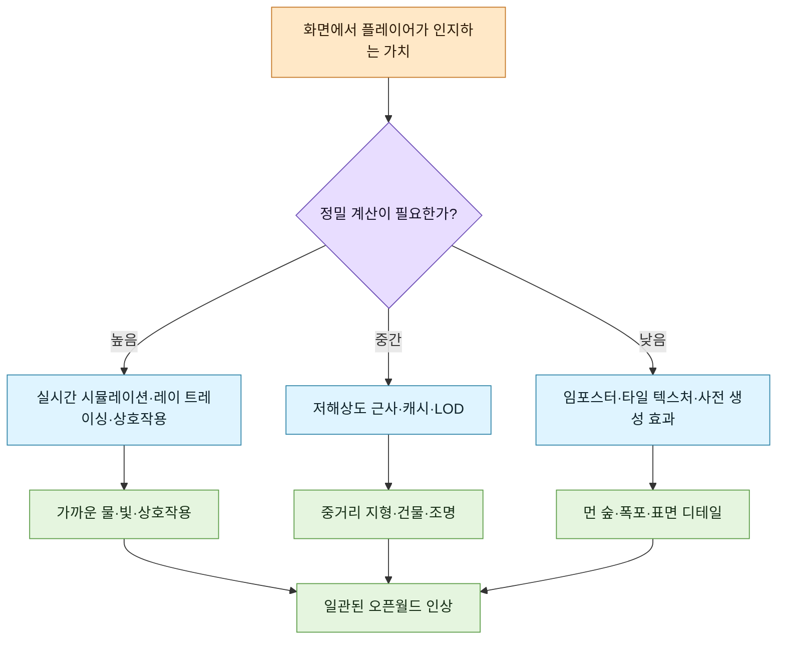

게임 엔진 개발에서 “모든 것을 실시간으로 계산한다”는 목표는 대개 좋은 목표가 아니다. 플레이어가 차이를 알아차리는 영역을 찾아 그곳에 예산을 쓰고, 알아차리기 어려운 영역은 화면에 맞는 형태로 단순화해야 한다. 중요한 것은 속이는 것 자체가 아니라, 근사 결과가 게임 플레이와 카메라 이동에서도 일관되게 유지되는지 검증하는 일이다.

## 핵심 요약

- **자체 엔진의 이유**: 상용 엔진의 범용 로드맵보다 게임에 필요한 렌더링·도구·데이터 파이프라인을 직접 통제하는 것이 중요할 때 자체 기술을 선택한다.
- **안개**: 볼륨 셀별 산란·흡수와 유체 반응을 연결해 캐릭터와 시간대에 반응하는 공기를 만든다.
- **강물**: 플레이어 근처의 얕은 물만 수면 기반으로 계산하고, 먼 강·바다·폭포는 흐름 지도나 파도 모델, 효과로 대체한다.
- **숲과 바람**: 식생 규칙을 GPU 인스턴싱과 거리별 LOD·임포스터로 확장하고, 여러 시스템이 공유하는 바람 필드로 세계의 일관된 움직임을 만든다.
- **상호작용**: 접촉 위치·힘·행동을 공통 데이터로 전달하고, 풀·나무·천·물은 자신의 물성에 맞게 반응한다.
- **조명**: 실시간 간접광과 레이 트레이싱을 사용하되, 가까운 영역에 정밀 계산을 제한하고 캐시·SDF·디노이저로 나머지를 보완한다.
- **근사 표현**: 돌벽의 깊이, 작은 텍스처 타일, 프록시와 임포스터처럼 화면에서 충분히 읽히는 대체 표현을 적극 활용한다.
- **월드 제작과 스트리밍**: 대표 지역에서 규칙을 추출해 절차적으로 대륙을 만들고, 타일과 거리별 디테일로 필요한 데이터만 로드한다.

## 결론

블랙스페이스 엔진의 인상적인 장면은 그래픽카드가 모든 물리 현상을 최고 정밀도로 계산해서 만들어진 결과가 아니다. 가까운 강물과 빛에는 계산을 집중하고, 먼 숲에는 인스턴싱과 임포스터를 사용하며, 돌벽과 텍스처는 시각적으로 충분한 근사로 바꾸는 식으로 계산 예산을 배분한 결과다.

오픈월드 렌더링에서 가장 중요한 질문은 “무엇을 진짜로 계산할까?”가 아니라 “플레이어가 무엇을 진짜라고 믿어야 할까?”에 가깝다. 그 경계를 장면·거리·상호작용·카메라 움직임에 따라 설계하는 능력이, 넓은 세계를 높은 프레임레이트로 보여 주는 엔진의 핵심 경쟁력이 된다.
