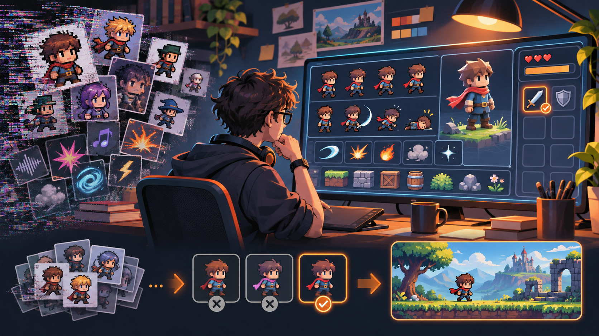
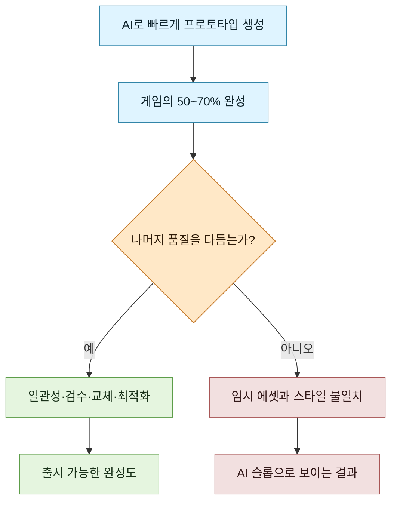
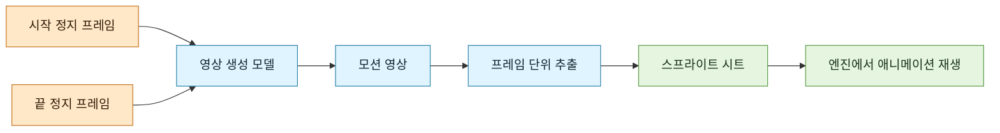
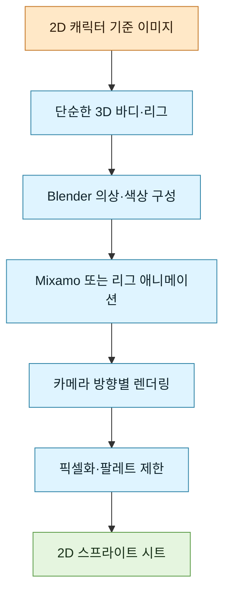
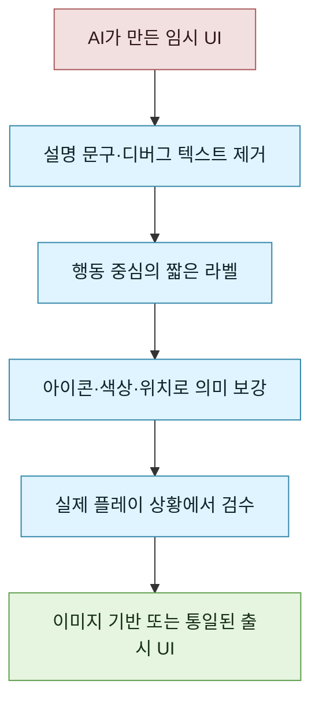
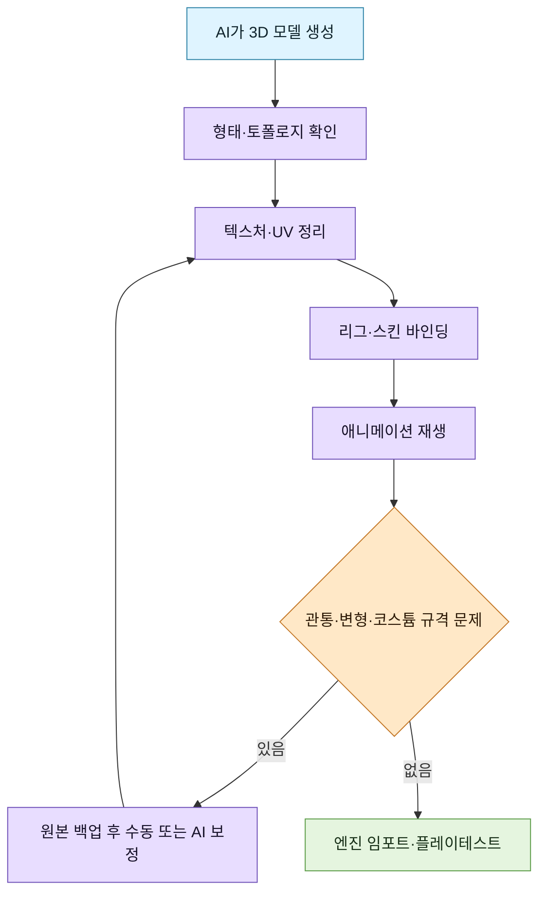
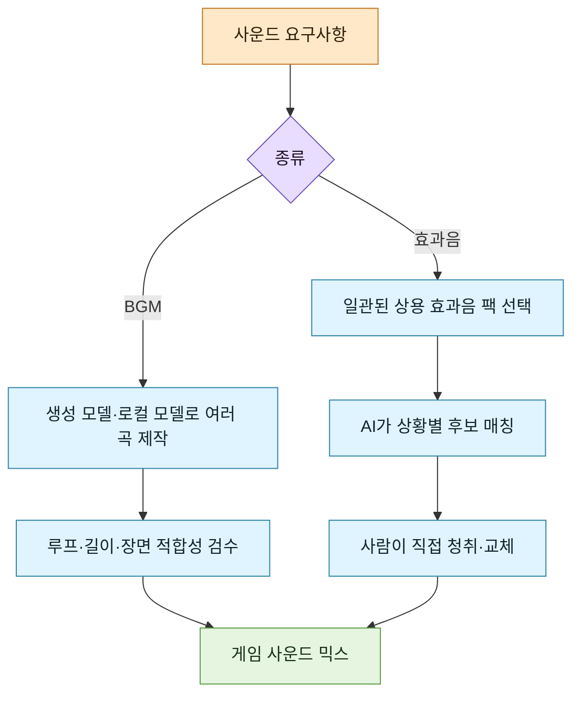
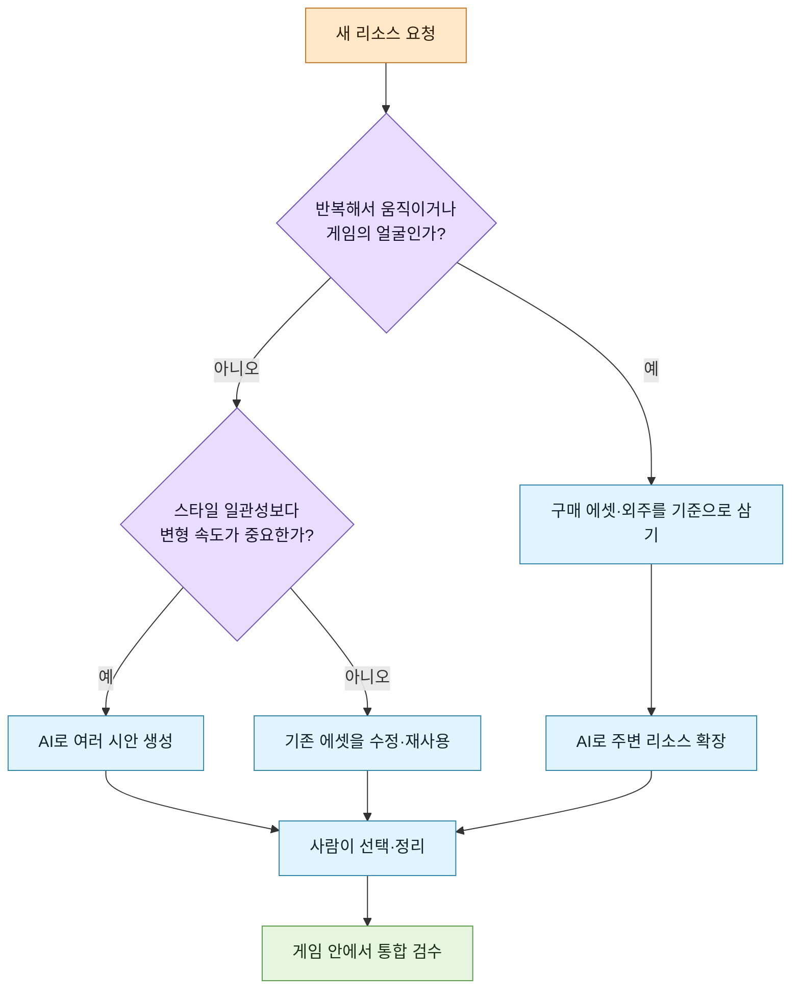

AI로 게임을 만들면 초반 결과가 빠르게 나온다. 배경 한 장, 아이콘 몇 개, 임시 캐릭터, 간단한 UI까지 짧은 시간 안에 만들 수 있다. 문제는 그다음이다. 캐릭터의 방향마다 그림체가 달라지고, UI는 코드로만 그린 티가 나며, 효과음과 배경음은 서로 다른 게임에서 가져온 것처럼 섞인다.

[LJ_GAMES의 영상](https://youtu.be/S9cPt7E0W50)은 이 문제를 ‘AI 슬롭’이라는 표현으로 다루며, 2D 스프라이트·3D 모델·UI·사운드에서 무엇을 AI로 만들고 무엇을 구매해야 하는지 실제 시행착오를 바탕으로 설명한다. 영상의 핵심은 AI를 포기하자는 것이 아니라, **일관성과 완성도에 직접 영향을 주는 리소스는 검증된 기반을 사용하고 AI는 변형·보조·프로토타이핑에 집중하자**는 것이다.

이 글에서는 영상의 경험담을 일반적인 게임 제작 파이프라인에 적용할 수 있도록 정리한다. 영상 속 특정 모델의 성능 수치나 개인적인 판단은 영상의 주장으로 구분하고, 프로젝트에 적용할 때 필요한 검수 기준을 별도로 제안한다.

<!--more-->

## Sources

- [YouTube 원본 영상](https://youtu.be/S9cPt7E0W50) — AI 게임 리소스와 AI 슬롭을 줄이는 방법을 다룬 영상.
- [AI 슬롭의 원인](https://youtu.be/S9cPt7E0W50?t=22) — 빠른 50~70%와 마감에 필요한 나머지 30%의 차이.
- [2D 스프라이트 제작 실험](https://youtu.be/S9cPt7E0W50?t=81) — 이미지·영상 생성 모델, 3D-to-2D 스프라이트 방식.
- [구매 에셋과 UI 교체 전략](https://youtu.be/S9cPt7E0W50?t=181) — 검증된 캐릭터 에셋과 출시 전 UI 교체.
- [3D 모델과 텍스처의 한계](https://youtu.be/S9cPt7E0W50?t=248) — 3D 생성, Mixamo 모션, 텍스처 보정.
- [여러 시안 먼저 받기](https://youtu.be/S9cPt7E0W50?t=318) — AI에게 완성본 검수까지 맡기지 않고 사람이 선택하는 방식.
- [UI 문구와 스킬 문서](https://youtu.be/S9cPt7E0W50?t=377) — AI 특유의 설명 문구를 줄이는 방법.
- [BGM과 효과음](https://youtu.be/S9cPt7E0W50?t=411) — 로컬 모델과 구매 효과음 팩의 장단점.
- [영상의 최종 리소스 공식](https://youtu.be/S9cPt7E0W50?t=497) — 움직이는 리소스는 구매하고 배경·UI·아이콘을 AI로 확장하는 전략.

## 1. AI 슬롭은 모델보다 마감 단계에서 시작된다

영상은 게임 완성도를 100으로 볼 때 AI가 50에서 70까지는 빠르게 만들어 주지만, 나머지 30을 채우는 데 훨씬 많은 시간이 든다고 설명한다. 초반의 빠른 결과에 익숙해지면 개발자는 그 30%를 기다리지 못하고 “1인 개발은 이 정도면 된다”고 타협하기 쉽다. 영상은 그 타협이 시작되는 순간부터 AI 슬롭이 생긴다고 말한다. [영상 00:22](https://youtu.be/S9cPt7E0W50?t=22)

여기서 말하는 AI 슬롭은 단순히 AI로 만든 이미지라는 뜻이 아니다. 다음과 같은 품질 문제가 서로 누적된 상태에 가깝다.

- 캐릭터 방향별 비율과 의상이 일치하지 않는다.
- 배경·캐릭터·UI의 색상과 명암 규칙이 다르다.
- 아이콘은 화려하지만 실제 상호작용의 의미를 전달하지 못한다.
- 사운드의 공간감·음량·악기 구성이 장면마다 달라진다.
- 임시 에셋과 최종 에셋이 한 화면에 섞여 있다.
- 디테일이 부족한 부분을 새 생성으로 덮어 버리면서 문제가 누적된다.



따라서 AI를 사용할지 말지보다 먼저 결정해야 하는 것은 마감 품질의 기준이다. 캐릭터의 앞·뒤·좌·우가 같은 스타일이어야 하는지, UI가 이미지 기반이어야 하는지, 사운드를 한 팩에서 통일할지 같은 기준이 없으면 도구를 바꿔도 결과는 쉽게 흔들린다.

## 2. 2D 스프라이트: 생성보다 일관성이 어렵다

영상은 코딩 에이전트나 LLM에게 움직이는 스프라이트 시트를 직접 그려 달라고 요청하면 결과가 쉽게 망가진다고 설명한다. 대신 정지된 시작 프레임과 끝 프레임을 이미지·영상 생성 모델에 주고, 원하는 모션을 영상으로 만든 다음 프레임 단위로 잘라 스프라이트로 만드는 방법을 실험했다. [영상 01:21](https://youtu.be/S9cPt7E0W50?t=81)

이 방법은 한 방향의 짧은 애니메이션이나 효과를 만들 때는 쓸 만하다. 생성 모델은 전체 스프라이트 시트의 모든 프레임을 동일한 캐릭터 구조로 유지하는 것보다, 두 장면 사이의 시각적 변화를 영상처럼 만드는 데 더 적합할 수 있기 때문이다.



문제는 여러 방향의 일관성이다. 상·하·좌·우 4방향, 또는 8방향 이동이 필요하면 각 방향에서 캐릭터의 얼굴·의상·무기·실루엣이 동일해야 한다. 한 방향의 결과가 좋아도 다른 방향에서 헤어스타일이나 장비가 바뀌면 플레이어는 바로 생성 결과임을 알아차린다.

### 2.1 3D를 중간 단계로 사용해 2D 스프라이트 만들기

영상의 두 번째 실험은 2D로 변환하기 쉬운 3D 캐릭터를 만들고, Mixamo로 애니메이션을 붙인 뒤 2D 도트 이미지로 렌더링하는 방식이다. 무료 2D 스프라이트 뼈대를 3D로 만들고, Blender에서 의상을 3D로 제작해 씌운 뒤 스프라이트로 변환한다. [영상 02:02](https://youtu.be/S9cPt7E0W50?t=122)

3D를 거치면 카메라 방향과 의상 색상을 통제하기 쉽고, 동일한 리그에서 여러 동작을 만들 수 있다. Blender 모델을 2D 렌더링에 맞춰 단순하게 만들면 의외로 그럴듯한 결과를 얻을 수 있다는 것이 영상의 관찰이다.



단점도 분명하다. 프레임 수가 충분하면 자연스럽지만, 고전 도트 게임처럼 프레임 수를 크게 줄이면 3D 움직임이 어색해질 수 있다. 무기를 휘두를 때 무기가 몸을 관통하거나, 의상과 신체가 충돌하는 문제를 모든 동작마다 보정해야 하는 비용도 생긴다. 낮은 프레임의 의도적인 도트 애니메이션이라면 오히려 움직임을 직접 코드로 제어하는 편이 더 나을 수 있다. [영상 02:40](https://youtu.be/S9cPt7E0W50?t=160)

## 3. 움직이는 2D 리소스는 구매 에셋을 기준으로 삼기

영상의 가장 현실적인 결론은 캐릭터와 몬스터처럼 움직여야 하는 리소스는 검증된 에셋을 구매해 사용하라는 것이다. 생성형 이미지의 특정 그림체가 널리 반복되면서, 캐릭터·몬스터까지 AI로 만들면 플레이어가 스타일의 불일치를 빠르게 알아차릴 수 있다. [영상 03:01](https://youtu.be/S9cPt7E0W50?t=181)

구매 에셋을 기준으로 삼으면 프로젝트의 시각적 기준이 먼저 고정된다.

- 캐릭터의 선 굵기와 실루엣이 정해진다.
- 애니메이션 프레임 수와 방향 구성이 정해진다.
- 팔레트와 명암 규칙을 배경·UI에 적용할 수 있다.
- AI는 빈 화면에서 캐릭터를 발명하는 대신 배경과 보조 에셋을 기준에 맞춰 생성할 수 있다.

```mermaid
flowchart LR
    A[검증된 캐릭터·몬스터 에셋 구매] --> B[스타일 기준 고정]
    B --> C[배경 팔레트·명암 설계]
    B --> D[UI 아이콘·패널 설계]
    B --> E[AI로 장식·변형·보조 리소스 생성]
    C --> F[통일된 게임 화면]
    D --> F
    E --> F

    classDef anchor fill:#ffe8c7,stroke:#c47726,color:#2e1b08
    classDef style fill:#dff4ff,stroke:#3185a8,color:#10242c
    classDef output fill:#e5f5df,stroke:#5d9d49,color:#183018
    class A anchor
    class B,C,D,E style
    class F output
```

영상 제작자는 지금까지 출시한 게임에서 캐릭터 스프라이트와 대부분의 효과를 구매해 사용했고, 일부는 외주를 맡겼다고 말한다. 이것은 AI를 활용하지 않는다는 뜻이 아니라, 플레이어가 가장 자주 보는 핵심 움직임을 이미 검증된 자산으로 고정하고 AI를 주변 영역에 사용하는 비용 배분이다. [영상 09:00](https://youtu.be/S9cPt7E0W50?t=539)

## 4. UI는 코드로 만들 수 있지만 출시 전에는 다시 봐야 한다

웹 기반 게임은 CSS와 코드로 UI를 빠르게 만들 수 있다. 그러나 영상은 AI가 코드만으로 그린 UI를 그대로 사용하는 게임이 많고, 이 부분에서 AI가 만든 화면이라는 인상이 강하게 난다고 지적한다. 개발 중에는 임시 UI로 사용하더라도 출시 전에는 UI용 이미지를 만들거나 구매해 교체하라고 권한다. [영상 03:37](https://youtu.be/S9cPt7E0W50?t=217)

UI가 특히 중요한 이유는 화면 전체에 반복적으로 등장하기 때문이다. 배경은 한 장면에만 보일 수 있지만, 체력 바·버튼·창·아이콘은 플레이 내내 반복된다. 작은 어색함도 누적되면 게임 전체의 완성도를 떨어뜨린다.

### 4.1 AI 특유의 설명 문구 제거하기

영상은 AI가 UI를 기획서처럼 생각해 불필요한 설명 문구를 넣는 습관도 지적한다. 이를 줄이기 위해 에이전트용 `AGENTS.md`나 UI용 스킬 문서에 다음 규칙을 명시할 수 있다.

- UI는 기획서가 아니라 플레이 중 사용하는 도구다.
- 불필요한 안내 문구와 장황한 설명을 넣지 않는다.
- 가능한 경우 글보다 레이아웃과 아이콘으로 의도를 전달한다.
- 버튼 이름은 행동을 직접 나타내는 짧은 표현을 사용한다.
- 개발용 디버그 텍스트와 출시용 UI를 분리한다.



이 과정은 UI를 무조건 이미지로 바꾸라는 뜻은 아니다. 반응형 배치와 접근성이 중요한 UI는 코드로 유지하되, 배경 패널·버튼 프레임·아이콘·장식처럼 스타일을 결정하는 요소는 검증된 이미지나 디자인 시스템으로 통일하는 것이 핵심이다.

## 5. 3D 모델: AI가 잘하는 영역과 아직 어려운 영역

영상은 3D 모델링에서 캐릭터를 Blender 코드나 AI에게 직접 깎게 하는 것보다 Tripo 같은 3D 전문 AI를 사용하는 편이 현실적이라고 평가한다. 하지만 텍스처가 깨끗하게 정리되지 않거나, 파츠별 코스튬을 정확히 교체하는 기능은 여전히 어렵다고 말한다. [영상 04:09](https://youtu.be/S9cPt7E0W50?t=249)

3D 캐릭터에서 코스튬 시스템이 어려운 이유는 단순히 옷 모델을 만드는 문제만이 아니다. 옷의 기준 포즈, 몸의 스킨 바인딩, 소켓 위치, UV·텍스처 규격, 충돌, 애니메이션 중 관통까지 하나의 계약으로 맞아야 한다.



Mixamo에 없는 동작은 애니메이터가 아니면 새로 만들기 어렵다는 지적도 있다. 기본 걷기·달리기·공격처럼 라이브러리에 있는 동작은 활용하기 쉽지만, 게임의 개성을 만드는 특수 행동은 별도의 키 애니메이션이나 수작업 보정이 필요하다.

카메라를 확대했을 때 텍스처가 깨지거나 뭉개지는 문제도 작은 화면에서는 지나가지만, 컷신·인벤토리·근접 전투에서는 바로 드러난다. AI로 텍스처를 보정할 수는 있지만 원본을 덮어쓰면 문제가 더 커질 수 있으므로, 항상 원본을 백업하고 수정본을 별도 버전으로 관리해야 한다. [영상 04:44](https://youtu.be/S9cPt7E0W50?t=284)

## 6. 완성본 하나보다 여러 시안을 먼저 받기

AI에게 처음부터 완성된 결과물 하나를 요구하면, 모델은 내부적으로 여러 번 보고 고치는 과정을 거쳐 최종안을 만들려고 한다. 결과가 마음에 들지 않으면 다시 전체 완성본을 생성하게 되고, 영상은 이 반복이 토큰과 시간을 많이 사용한다고 설명한다. [영상 05:18](https://youtu.be/S9cPt7E0W50?t=318)

대안은 AI에게 최종 판단까지 맡기지 않고 여러 시안을 만들게 한 뒤, 사람이 직접 고르는 것이다. 또는 AI에게 편집 도구를 만들게 하고 사람이 그 도구에서 최종 결과를 만드는 방식도 있다.

```mermaid
flowchart LR
    A[요구사항과 스타일 기준] --> B[AI가 여러 시안 생성]
    B --> C[사람이 빠르게 비교]
    C --> D[선택안과 수정 지점 결정]
    D --> E[AI가 선택안만 정리]
    E --> F[사람이 편집툴에서 최종 보정]
    F --> G[게임에 통합]

    classDef input fill:#ffe8c7,stroke:#c47726,color:#2e1b08
    classDef agent fill:#dff4ff,stroke:#3185a8,color:#10242c
    classDef human fill:#e8ddff,stroke:#7052b8,color:#171229
    classDef output fill:#e5f5df,stroke:#5d9d49,color:#183018
    class A input
    class B,E agent
    class C,D,F human
    class G output
```



이 방식의 단점은 사람이 판단해야 할 일이 늘어난다는 것이다. 원하는 스타일과 탈락 기준이 명확해야 하고, 여러 시안을 비교할 시간도 필요하다. 하지만 최종 완성본을 매번 다시 생성하는 것보다, 선택과 수정의 책임을 사람에게 두는 편이 AI 리소스 비용과 방향 이탈을 줄일 수 있다.

## 7. 사운드: BGM은 생성, 효과음은 톤이 맞는 팩

영상은 아트보다 사운드가 AI로 작업하기 더 어렵다고 평가한다. BGM 생성 모델은 품질이 높지만, 게임 배경음으로 사용하기에는 지나치게 완성도가 높거나 존재감이 클 수 있다. 반면 게임 BGM에 맞는 모델은 상대적으로 부담이 적고 로컬 모델로도 비슷한 수준을 만들 수 있다고 설명한다. [영상 06:51](https://youtu.be/S9cPt7E0W50?t=411)

로컬 모델은 비용과 데이터 관리 측면의 장점이 있지만, 컴퓨터 자원을 많이 사용한다. 영상은 최소 램 32GB, VRAM 8GB 이상의 환경을 권장하며, 그보다 낮다면 구독형 서비스를 사용하는 편이 낫다고 말한다. 이 수치는 영상 제작자의 권장 기준이므로 프로젝트와 모델에 따라 달라질 수 있다.

효과음은 다른 결론이다. 생성형이나 로컬 모델로 효과음을 여러 개 만들면 일부는 마음에 들어도 전체 톤이 맞지 않아 통일하기 어렵다. 그래서 영상은 하나의 효과음 팩을 구매하고, AI에게 상황에 맞는 소리를 1차 매칭시킨 뒤 사람이 들어 보고 이상한 것만 교체하는 방식을 추천한다. [영상 07:31](https://youtu.be/S9cPt7E0W50?t=451)



효과음은 플레이어가 같은 종류의 행동을 반복해서 들을 때 일관성이 특히 중요하다. 검을 휘두를 때마다 다른 공간감과 음량의 소리가 나오면 공격의 무게감이 흔들린다. 반대로 한 팩에서 나온 소리를 기준으로 선택하면 전체 게임의 톤을 맞추기 쉽다.

## 8. 리소스 종류별 AI 사용 기준

영상의 경험을 프로젝트 의사결정 표로 바꾸면 다음과 같은 기준을 사용할 수 있다.

| 리소스 | AI 활용도 | 추천 전략 | 주요 검수 포인트 |
|---|---:|---|---|
| 배경 이미지 | 높음 | 여러 시안 생성 후 스타일 선별 | 반복성, 원근, 팔레트 |
| 아이콘 | 높음 | 생성 후 크기와 실루엣 정리 | 작은 화면 가독성 |
| UI 장식 | 중간 | 코드 프로토타입 후 이미지 교체 | 버튼 상태, 여백, 일관성 |
| 움직이는 2D 캐릭터 | 낮음~중간 | 검증된 에셋 구매 후 수정 | 방향별 일관성, 프레임, 충돌 |
| 몬스터 스프라이트 | 낮음~중간 | 기존 팩·외주를 기준으로 확장 | 실루엣, 애니메이션, 피격 상태 |
| 3D 소품 | 중간~높음 | AI 생성 후 텍스처와 LOD 보정 | UV, 폴리곤, 스케일 |
| 3D 캐릭터 | 중간 | 전문 3D 생성 도구와 수동 리깅 | 토폴로지, 스킨, 코스튬 |
| BGM | 중간 | 생성·로컬 모델로 여러 곡 제작 | 루프, 길이, 장면과의 충돌 |
| 효과음 | 낮음 | 한 팩을 구매하고 AI로 후보 매칭 | 음량, 공간감, 톤 |



이 기준은 AI를 사용할 영역과 사용하지 않을 영역을 영구적으로 나누는 규칙이 아니다. 프로토타입에서는 모든 것을 AI로 빠르게 만들 수 있고, 출시가 가까워질수록 핵심 캐릭터·UI·사운드부터 검증된 자산으로 교체할 수 있다.

## 9. 새 프로젝트는 빈 프로젝트에서 시작할 때 더 빠를 수 있다

영상 마지막에는 빈 프로젝트에 게임 방향성을 짧게 설명하고, 고성능 코딩 모델에 핵심 루프를 한 번에 만들어 달라는 추가 팁이 나온다. 기존 코드가 없는 상태에서는 잘못된 구조와 충돌하는 일이 적고, 모델이 프로젝트 전체를 이해하는 데 드는 비용도 줄어든다는 설명이다. [영상 10:04](https://youtu.be/S9cPt7E0W50?t=604)

영상 제작자는 이 방식으로 게임의 30~50% 정도가 만들어지는 동안 주간 사용량의 20~30% 선을 소비했다고 말하지만, 이는 특정 모델·요금제·프롬프트·프로젝트에 대한 개인 경험이다. 일반적인 성능 보장으로 해석해서는 안 된다.

실제로 적용할 때는 다음처럼 진행하는 것이 안전하다.

1. 빈 저장소에 장르·카메라·핵심 루프·참고 게임을 짧게 작성한다.
2. 모델에게 먼저 플레이 가능한 작은 수직 슬라이스를 만들게 한다.
3. 빌드와 실행을 확인한 뒤에만 UI·콘텐츠·에셋을 추가한다.
4. 마음에 든 구조를 보존하고, 기능별로 작은 수정 요청을 보낸다.
5. 프로젝트가 커지면 사용량과 코드 이해 비용이 늘어난다는 점을 고려한다.

이 방식의 진짜 장점은 AI가 기존 장르의 익숙한 패턴을 조합해 개발자가 미처 생각하지 못한 핵심 루프를 제안할 수 있다는 데 있다. 다만 제안이 재미있는지, 실제 플레이 가능한지, 기존 게임과 구별되는지는 사람이 판단해야 한다.

## 10. AI 슬롭을 줄이는 출시 전 체크리스트

### 스타일

- 캐릭터와 몬스터의 방향별 외형이 일치하는가?
- 배경·UI·아이콘이 같은 팔레트와 명암 규칙을 사용하는가?
- 임시 생성 이미지가 최종 화면에 남아 있지 않은가?

### 2D·3D

- 핵심 캐릭터의 움직임과 피격 프레임이 자연스러운가?
- 무기·의상·몸의 관통이 없는가?
- 확대했을 때 텍스처·UV·실루엣 문제가 보이지 않는가?
- 원본 에셋과 수정 에셋의 라이선스를 기록했는가?

### UI

- 설명 문구가 너무 많지 않은가?
- 버튼이 아이콘과 위치만으로도 이해되는가?
- 개발용 디버그 텍스트가 제거되었는가?
- 작은 화면과 게임 플레이 중에도 UI가 시야를 가리지 않는가?

### 사운드

- BGM이 게임 플레이를 덮어쓰지 않는가?
- 효과음의 음량·공간감·톤이 한 게임처럼 들리는가?
- 같은 행동의 사운드가 반복될 때 피로하지 않은가?
- 생성·구매한 사운드의 상업적 사용 조건을 확인했는가?

### 사람의 검수

- AI가 고른 결과를 사람이 직접 비교했는가?
- 원본과 수정본을 분리해 보관했는가?
- 실제 플레이어가 처음 보는 화면에서 스타일 불일치를 발견할 수 있는가?
- “괜찮아 보인다”가 아니라 구체적인 탈락 기준으로 검사했는가?

## 핵심 요약

- **AI 슬롭은 AI 사용 자체가 아니라 마감 단계의 타협에서 생긴다.** 빠르게 만들어진 50~70%와 출시 품질을 만드는 나머지 30%를 분리해서 봐야 한다.
- **2D 스프라이트는 생성보다 방향별 일관성이 어렵다.** 영상 생성 후 프레임 추출이나 3D-to-2D 방식은 실험할 수 있지만, 여러 방향과 낮은 프레임에서는 보정 비용이 커진다.
- **움직이는 캐릭터·몬스터는 검증된 에셋을 기준으로 삼는 편이 안정적이다.** AI는 배경·아이콘·장식·변형 리소스에 활용한다.
- **UI는 개발 중 코드로 만들더라도 출시 전에 스타일을 정리해야 한다.** AI 특유의 설명 문구와 임시 CSS UI를 그대로 두지 않는다.
- **3D는 AI 활용 가능성이 더 높지만** 텍스처·UV·코스튬·리깅·관통·특수 모션은 여전히 사람의 보정이 필요하다.
- **효과음은 한 팩을 기준으로 통일하고 BGM은 생성 모델을 선택적으로 사용**하는 전략이 현실적이다.
- **완성본 하나를 반복 생성하기보다 여러 시안을 받아 사람이 선택**하면 시간과 토큰 낭비를 줄일 수 있다.
- **마지막 완성도는 사람이 직접 보고 듣고 쳐내는 시간에서 나온다.**

## 결론

AI로 게임 리소스를 만들 때 가장 위험한 선택은 모든 것을 AI에게 만들게 하는 것이다. 캐릭터, 몬스터, UI, BGM, 효과음을 각각 다른 프롬프트로 생성하면 개별 결과는 그럴듯해도 게임 전체는 하나의 작품처럼 보이지 않는다.

현실적인 전략은 기준이 되는 에셋을 먼저 고르는 것이다. 움직이는 2D 캐릭터와 몬스터, 효과음처럼 반복적으로 노출되고 일관성이 중요한 리소스는 구매하거나 외주로 확보한다. 그 위에 AI로 배경, 아이콘, UI 장식, 3D 소품, 변형안을 만들고 사람이 선별한다.

결국 AI 슬롭을 벗어나는 방법은 더 좋은 모델 하나를 찾는 것이 아니다. 무엇을 생성하고 무엇을 구매할지 결정하고, 여러 결과 중 하나를 선택하고, 출시 전 마지막 30%를 타협하지 않는 것이다. 그 과정에 필요한 가장 중요한 도구는 새 모델이 아니라 **일관된 기준과 충분한 검수 시간**이다.
