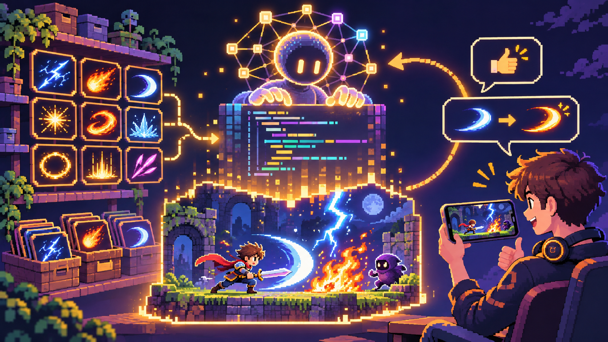
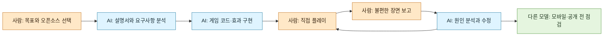
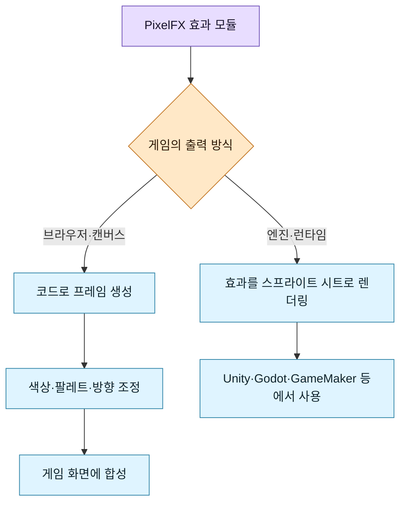
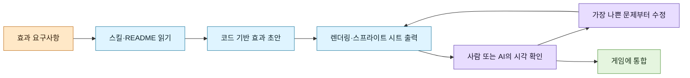
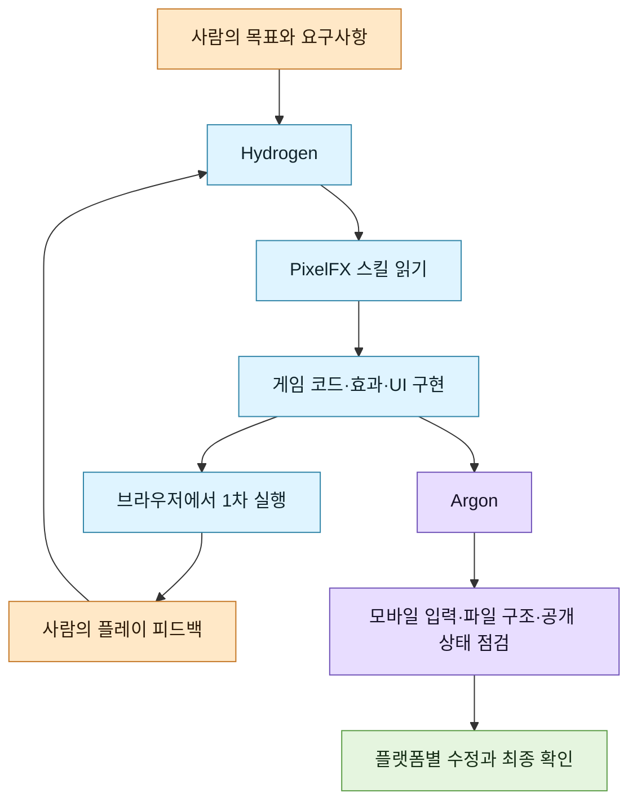
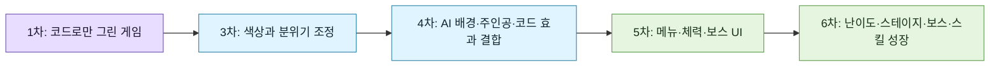
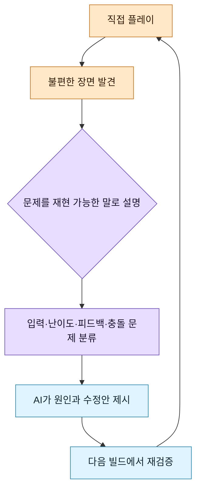
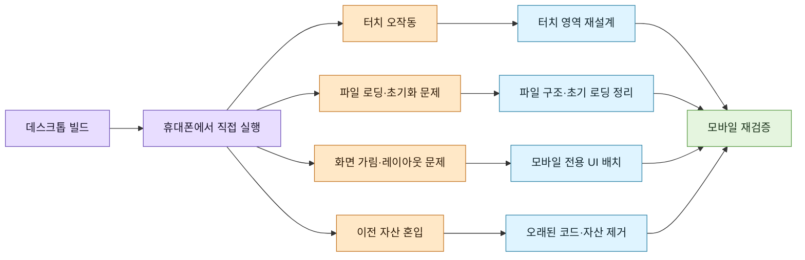

AI에게 “게임을 만들어 줘”라고 요청하면 게임이 완성될까? 영상 속 사례는 가능하다고 말하지만, 실제 과정을 보면 AI가 혼자 모든 일을 한 것은 아니다. 오픈소스 효과 라이브러리가 시각 자산과 제작 규칙을 제공했고, 한 모델이 게임 코드를 작성했으며, 사람이 직접 플레이하면서 불편한 점을 말로 전달했다. 마지막으로 다른 모델이 모바일 대응과 공개 전 점검을 맡았다.

이 글은 [반보AI의 영상](https://youtu.be/0kNMLmZqpIE?si=O5PFPUgJ6xEIuoki)을 바탕으로 이 작업을 게임 개발 파이프라인의 관점에서 분석한다. 영상에서 말한 제작 시간과 모델 성능은 영상의 주장으로 표시하고, PixelFX의 기능·라이선스와 Google Antigravity 모델 정보는 확인 가능한 공식 자료와 구분해 설명한다.

<!--more-->

## Sources

- [YouTube 원본 영상](https://youtu.be/0kNMLmZqpIE?si=O5PFPUgJ6xEIuoki) — PixelFX, Hydrogen, Argon을 조합해 액션 게임을 만든 제작 사례.
- [게임 제작 결과와 역할 분담](https://youtu.be/0kNMLmZqpIE?t=0) — 코드 작성, 오픈소스 연결, 플레이테스트, 모바일 수정의 전체 흐름.
- [PixelFX 공식 저장소](https://github.com/patch-gg/pixelfx) — 244개 코드 기반 픽셀 효과와 사용 방법, 라이선스.
- [PixelFX 갤러리](https://patch-gg.github.io/pixelfx/) — 설치 없이 효과를 확인할 수 있는 공식 갤러리.
- [Google Antigravity의 Hydrogen 소개](https://antigravity.google/blog/gemini-4-hydrogen-in-google-antigravity) — Hydrogen의 출시와 공식 벤치마크 수치.
- [Google Antigravity 모델 문서](https://antigravity.google/docs/models) — Hydrogen·Argon·Orchestrator의 역할과 사용 조건.

## 1. “코드를 한 줄도 쓰지 않았다”의 실제 의미

영상의 첫 문장은 화면에 보이는 액션 게임을 제작자가 직접 짠 코드는 한 줄도 없다는 것이다. 저장 기록을 기준으로 첫 판부터 마지막 모습까지 하루 저녁, 약 5시간 45분이 걸렸고, 게임은 여섯 번 바뀌었다고 설명한다. [영상 00:00](https://youtu.be/0kNMLmZqpIE?t=0) [영상 03:18](https://youtu.be/0kNMLmZqpIE?t=198)

그러나 이것은 사람이 아무 작업도 하지 않았다는 뜻이 아니다. 영상에서 사람은 다음 일을 맡았다.

- 게임에 사용할 오픈소스와 AI용 사용 설명서를 선택했다.
- AI에게 만들 기능과 제약을 자연어로 전달했다.
- 직접 플레이하며 불편한 조작과 버그를 찾았다.
- “너무 어렵다”, “스킬 키가 불편하다”처럼 재현 가능한 문제를 말로 보고했다.
- 컴퓨터와 휴대폰에서 최종 결과를 확인했다.

반면 AI는 오픈소스 규칙을 읽고 게임 코드를 작성했으며, 문제 보고를 바탕으로 수정안을 만들었다. 따라서 이 사례를 더 정확히 표현하면 **사람이 코드를 직접 타이핑하지 않고, 요구사항·검증·피드백을 담당한 AI 보조 개발**이다.

핵심은 “자연어로 요청하면 코드가 나온다”가 아니라, **각 역할을 사람과 모델 사이에 나누고 플레이 결과를 다시 입력으로 넣는 반복 구조**다.

## 2. PixelFX가 제공한 것은 효과 244개만이 아니다

영상에서 사용한 PixelFX는 Patch 팀이 공개한 오픈소스 픽셀 효과 라이브러리다. 공식 저장소는 불꽃, 폭발, 마법, 날씨, UI, 아이템, 생물 등 244개의 효과와 애니메이션을 제공하며, 각 효과는 작은 코드 조각으로 구성되어 있다고 설명한다. [PixelFX README](https://github.com/patch-gg/pixelfx) [영상 00:52](https://youtu.be/0kNMLmZqpIE?t=52)

일반적인 이미지 에셋 팩과 다른 점은 효과가 완성된 PNG 묶음만으로 제공되지 않는다는 것이다. 코드로 그려지기 때문에 색을 바꾸거나 좌우로 뒤집고, 게임의 픽셀 해상도에 맞춰 렌더링하고, 필요하면 스프라이트 시트로 내보낼 수 있다.

공식 저장소의 사용 예시는 브라우저 게임에서 효과를 직접 업데이트·렌더링하는 방식과, Godot·Unity·GameMaker·Defold·LÖVE·Bevy 같은 엔진에서 스프라이트 시트로 사용하는 방식을 모두 제시한다. [PixelFX 사용 방법](https://github.com/patch-gg/pixelfx#use-one)

### 2.1 라이선스는 효과와 글꼴을 나눠 확인해야 한다

공식 저장소의 라이선스 섹션은 코드와 효과를 MIT 라이선스로 설명하며 상업적 사용을 허용한다. 동시에 `gallery/fonts`에 포함된 Patch Pixel 글꼴은 같은 조건이 아니므로 별도의 `NOTICE.md`를 확인해야 한다. [PixelFX 라이선스](https://github.com/patch-gg/pixelfx#license)

따라서 프로젝트에 가져올 때는 저장소 전체를 무심코 복사하기보다 다음처럼 분리하는 편이 안전하다.

1. `src/core`와 필요한 `src/fx` 효과만 가져온다.
2. `LICENSE`와 `NOTICE.md`를 프로젝트의 고지 문서에 반영한다.
3. 글꼴을 사용한다면 효과 코드와 별도로 라이선스를 확인한다.
4. 상용 출시 전에는 실제 배포물에 포함되는 파일 목록을 다시 검사한다.

## 3. AI용 스킬은 에셋 라이브러리의 사용법을 실행 절차로 바꾼다

PixelFX의 중요한 특징은 효과 목록만 제공하는 것이 아니라 AI가 읽을 수 있는 스킬을 함께 제공한다는 점이다. 공식 README는 새 효과를 만들 때 초안을 작성하고, 렌더링하고, 눈으로 확인하고, 개선하는 과정을 반복한다고 설명한다. [PixelFX의 스킬 설명](https://github.com/patch-gg/pixelfx#the-skill) 영상은 이 설명서를 신입 개발자에게 건네는 업무 매뉴얼에 비유한다. [영상 01:43](https://youtu.be/0kNMLmZqpIE?t=103)

영상에서 AI는 이 규칙을 따라 실 매듭, 매듭 폭발, X자 베기, 반달 칼바람이라는 게임 전용 효과 네 개를 만들었다. 효과를 만든 뒤 그림으로 뽑아 확인한 시트도 남아 있다고 설명한다. [영상 02:07](https://youtu.be/0kNMLmZqpIE?t=127)

이것은 프롬프트 하나로 완성품을 생성하는 방식과 다르다. 에셋 제작 규칙을 먼저 읽고, 결과를 시각적으로 렌더링하고, 가장 나쁜 부분부터 수정하는 검증 루프가 명시되어 있다.

게임 개발자가 오픈소스를 AI에게 사용할 때 얻는 가장 큰 이점은 “기능이 이미 있다”가 아니다. 라이브러리의 구조와 품질 기준을 AI에게 전달할 수 있는 문서가 함께 있다는 점이다. 이 문서가 있어야 모델이 임의의 효과를 새로 발명하기보다 기존 프로젝트의 표현 방식에 맞춰 확장할 가능성이 높아진다.

## 4. Hydrogen은 구현 담당, Argon은 검수와 플랫폼 대응 담당

영상은 Google Antigravity 안에서 Hydrogen 모델이 게임 코드를 작성했다고 설명한다. Google 공식 발표에 따르면 Gemini 4 Hydrogen은 2026년 11월 Antigravity에 추가되었고, 일반적인 코딩과 에이전트 작업을 위한 모델로 소개됐다. 공식 발표에는 Artificial Analysis Intelligence Index 51, Terminal-Bench 4.1 57%라는 수치도 있지만, 이는 Google이 인용한 벤치마크 결과이지 영상 제작자가 직접 측정한 수치는 아니다. [Google Antigravity 공식 발표](https://antigravity.google/blog/gemini-4-hydrogen-in-google-antigravity) [영상 02:38](https://youtu.be/0kNMLmZqpIE?t=158)

영상에서 Hydrogen은 PixelFX의 설명서를 읽고 게임 기능을 구현하는 역할을 맡았다. 반면 마지막 점검, 웹 공개, 휴대폰 대응은 같은 Antigravity의 Argon 모델로 바꿔 진행했다. [영상 04:39](https://youtu.be/0kNMLmZqpIE?t=279)

Google 문서에서 설명하는 Orchestrator도 계획을 세우고 검토하는 모델과, 검색·파일 수정·빌드·테스트를 실행하는 모델을 나누는 구조다. 이 사례는 Orchestrator를 직접 사용했다는 뜻은 아니지만, 하나의 모델이 모든 단계에서 최고 성능일 필요는 없다는 역할 분담 원칙과 연결된다. [Antigravity 모델 문서](https://antigravity.google/docs/models#orchestrator)

### 4.1 모델 성능 수치를 그대로 일반화하면 안 된다

영상은 Hydrogen이 여러 AI 시험에서 Argon과 비슷하고, 특정 코딩 시험에서 더 높은 점수를 받았다고 설명한다. 하지만 영상 자체도 이 수치가 Google 발표 기준이며 제작자가 직접 측정한 것은 아니라고 명시한다. 또한 실제로 확인한 것은 해당 게임 하나라고 선을 긋는다. [영상 03:04](https://youtu.be/0kNMLmZqpIE?t=184)

따라서 이 사례에서 말할 수 있는 것은 “Hydrogen이 모든 게임 개발에서 Argon보다 우월하다”가 아니다. 더 정확한 결론은 다음과 같다.

- 영상 속 작업에서는 Hydrogen이 코드 생성과 반복 수정에 사용되었다.
- Argon은 모바일 대응과 공개 전 점검에 사용되었다.
- 모델 선택은 벤치마크 순위보다 작업 단계와 실패 비용에 따라 달라질 수 있다.
- 최종 품질은 모델 이름보다 요구사항, 실행 검증, 사람의 피드백에 크게 좌우된다.

## 5. 첫 판에서 여섯 번째 판까지 바뀐 게임

영상에서 첫 판은 그림 없이 코드로만 그린 액션 게임이었다. 세 번째 판에서는 네온 색 분위기를 따뜻한 금빛 판타지로 바꾸고, 네 번째 판부터는 이미지 AI로 만든 배경과 주인공 위에 PixelFX 코드 효과를 겹쳤다. 배경은 유적과 폭포, 벚꽃 신전, 도서관 첨탑, 장미 창 성채 네 장이고 주인공은 아홉 가지 자세로 구성했다고 설명한다. [영상 03:35](https://youtu.be/0kNMLmZqpIE?t=215)

다섯 번째 판에서는 일시 정지 메뉴, 체력 창, 보스 체력 막대를 추가했다. 여섯 번째 판에서는 초반에 약하게 시작해 갈수록 강해지는 구조로 조정하고, 스테이지를 여섯 개에서 열 개로 늘렸다. 네 번째·일곱 번째·열 번째 스테이지에는 보스를 배치했다. [영상 03:59](https://youtu.be/0kNMLmZqpIE?t=239)

게임의 성장 구조도 단계적으로 붙었다.

- 첫 스테이지의 몬스터 체력을 평소의 62%로 낮춰 진입 난도를 낮췄다.
- 기본 공격은 1단계부터 10단계까지 외형이 달라지게 했다.
- 처음에는 스킬 하나만 제공하고, 진행에 따라 번개 창·얼음 진·순간이동 연속 베기를 열어 네 개로 확장했다.

이 순서는 게임 개발에서 유용한 프로토타이핑 순서이기도 하다. 먼저 입력과 전투가 작동하는지 확인하고, 그다음 시각적 방향을 정하고, UI와 콘텐츠를 늘리고, 마지막에 난이도 곡선과 성장 구조를 다듬는다. 처음부터 모든 배경과 스킬을 만들지 않았기 때문에 짧은 시간 안에 여러 버전을 비교할 수 있었다.

## 6. 사람이 해야 하는 일: 플레이하고 구체적으로 말하기

영상에서 가장 중요한 장면은 제작자가 직접 플레이하면서 불편한 점을 말로 전달하는 부분이다. 첫 판은 실로 도형을 그려야 공격할 수 있어 너무 어려웠고, 이를 그대로 보고하자 세 번 연속 공격하면 칼바람이 날아가고 도형은 0.25초 뒤 자동으로 터지는 방식으로 바뀌었다. [영상 05:02](https://youtu.be/0kNMLmZqpIE?t=302)

스킬 키가 불편하다는 피드백에는 L 키를 Q·E 키로 옮기고, 준비가 끝났을 때 고리와 금빛 불꽃으로 알려 주는 시각 피드백이 추가됐다. 일시 정지 메뉴가 없다는 점, 보스가 적다는 점, 배경 기둥에 캐릭터가 걸린다는 점도 한 번에 보고했고, 이후 판에서 순서대로 수정했다. [영상 05:17](https://youtu.be/0kNMLmZqpIE?t=317)

AI에게 “재미가 없다”고 말하는 것보다 “세 번 연속 공격했을 때 칼바람이 나가고, 도형 입력은 0.25초 후 자동 확정되게 해 달라”고 말하는 편이 훨씬 좋은 수정 입력이다. 사람이 해야 하는 일은 코드를 대신 쓰는 것이 아니라, 플레이 경험을 관찰 가능한 문제와 원하는 변화로 번역하는 것이다.

## 7. 모바일 검수는 데스크톱 테스트의 복사가 아니다

컴퓨터에서 정상적으로 보인 게임을 휴대폰에서 직접 열자 네 가지 문제가 발견됐다. 위쪽 버튼을 누를 때 원치 않는 점프가 발생했고, 70개가 넘는 파일이 나뉘어 시작 화면에서 멈췄다. 작업용 버튼 줄이 화면을 가렸고, 시작 직후 예전 캐릭터와 맵이 섞여 보였다. [영상 05:33](https://youtu.be/0kNMLmZqpIE?t=333)

Argon 모델은 이 문제를 다음처럼 수정했다.

- 조이스틱·점프·대시 버튼을 분리했다.
- 분리된 파일을 하나로 묶고 오래된 버튼 줄과 코드를 제거했다.
- 오른쪽에 큰 공격 버튼을 두고 주변에 네 개의 스킬 버튼을 부채꼴로 배치했다.
- 스킬마다 별도 아이콘을 넣었다.
- 일시 정지 버튼만 남기고, 모험 시작 버튼을 누르면 전체 화면으로 열리게 했다.

영상은 아이폰에서도 게임이 실행되는 것까지 확인했다고 말한다. [영상 06:11](https://youtu.be/0kNMLmZqpIE?t=371)

모바일 테스트에서 드러난 문제는 단순한 CSS 조정만이 아니다. 입력 장치가 마우스에서 터치로 바뀌고, 화면 비율과 사용 가능한 공간이 달라지며, 네트워크·파일 로딩 순서가 시작 경험에 영향을 준다. 따라서 모바일을 지원하려면 마지막에 버튼 크기만 키우는 것이 아니라 **처음부터 별도의 입력·로드·레이아웃 검증 단계**를 둬야 한다.

## 8. 이 워크플로를 실제 프로젝트에 적용하는 순서

이 사례를 그대로 따라 하려면 다음 순서가 현실적이다.

### 8.1 1단계: 결과물이 아니라 기반을 먼저 고른다

AI에게 빈 프로젝트에서 모든 효과를 만들게 하기보다, PixelFX처럼 다음 조건을 만족하는 기반을 먼저 찾는다.

- 실행 가능한 예제와 갤러리가 있는가
- 코드 구조와 설치 방법이 문서화되어 있는가
- AI가 읽을 수 있는 스킬·README가 있는가
- 상업적 사용과 포함 자산의 라이선스를 분리해 확인할 수 있는가
- 필요한 엔진으로 직접 사용하거나 스프라이트 시트로 내보낼 수 있는가

### 8.2 2단계: 작은 플레이 루프부터 만든다

첫 요청은 “완성된 게임”이 아니라 이동·공격·피격·재시작처럼 1분 안에 검증할 수 있는 루프로 제한한다. 영상의 첫 판처럼 그림 없이 코드로만 그린 버전도 이 단계에서는 충분하다.

### 8.3 3단계: 스킬을 명시적으로 읽게 한다

AI 코딩 도구에 라이브러리의 AI용 사용 설명서가 있다는 사실을 알려 주는 것에서 그치지 말고, 작업의 첫 단계로 해당 문서를 읽고 규칙을 요약하게 한다. 그다음 효과 하나를 만들고 렌더링 결과를 확인하게 한다.

### 8.4 4단계: 사람의 피드백을 숫자와 상황으로 말한다

“어려워요” 대신 “첫 스테이지에서 세 번 연속 공격 전에 사망한다”, “Q 키를 누를 때 캐릭터 이동과 겹친다”, “휴대폰 가로 화면에서 오른쪽 UI가 게임 영역을 가린다”처럼 보고한다. AI가 수정하려면 문제의 재현 조건이 필요하다.

### 8.5 5단계: 제작과 검수를 분리한다

큰 작업을 한 번에 맡기지 말고 다음처럼 나눈다.

1. **구현 단계**: 게임 루프, 효과, UI, 스테이지를 만든다.
2. **플레이테스트 단계**: 사람이 직접 플레이하고 문제 목록을 만든다.
3. **수정 단계**: AI가 문제 원인을 찾고 작은 수정으로 해결한다.
4. **플랫폼 단계**: 모바일 입력, 파일 로딩, 화면 크기, 전체 화면을 검증한다.
5. **공개 단계**: 오래된 자산과 개발용 버튼을 제거하고 실제 배포 주소에서 확인한다.

## 핵심 요약

- **AI 게임 개발의 핵심은 역할 분담**이다. 사람은 목표·선택·플레이·판단을 맡고, AI는 구현·분석·수정을 맡는다.
- **PixelFX는 244개 코드 기반 효과와 AI용 제작 규칙을 제공**한다. 코드 기반이라 색상·방향·해상도 조정과 스프라이트 시트 출력이 가능하다.
- **라이선스는 자산별로 확인해야 한다.** PixelFX의 코드와 효과는 MIT지만 포함 글꼴은 별도 조건이다.
- **Hydrogen과 Argon을 같은 역할로 볼 필요가 없다.** 영상 사례에서는 Hydrogen이 구현을 맡고 Argon이 모바일 대응과 최종 점검을 맡았다.
- **모델 성능 벤치마크는 참고 자료일 뿐**이다. 영상의 수치는 Google 발표 기준이며, 실제 프로젝트 품질은 테스트와 피드백에 달려 있다.
- **사람의 가장 중요한 작업은 직접 플레이하는 것**이다. 불편한 장면을 재현 조건과 원하는 변화로 말해야 AI가 제대로 수정할 수 있다.
- **모바일은 별도 플랫폼으로 검증해야 한다.** 입력, 레이아웃, 파일 로딩, 오래된 자산 혼입은 데스크톱에서 발견되지 않을 수 있다.

## 결론

이 사례는 “AI가 혼자 게임을 만들었다”는 이야기보다, AI가 게임 개발 파이프라인의 여러 역할을 나누어 수행할 수 있다는 사례에 가깝다. 오픈소스 스킬은 품질 기준과 확장 방법을 제공하고, 구현 모델은 코드를 빠르게 만들며, 사람은 직접 플레이해 기계가 찾기 어려운 불편을 발견한다. 마지막 검수 모델은 플랫폼과 공개 상태를 정리한다.

게임 개발자가 이 흐름에서 가져갈 실용적인 원칙은 간단하다. 빈 프로젝트에서 모든 것을 생성하게 하지 말고, 검증된 기반과 문서를 먼저 선택한다. 구현과 검수를 분리한다. 그리고 AI가 만든 결과를 반드시 직접 플레이한 뒤, 불편한 장면을 구체적인 조건으로 다시 전달한다. 말로만 만드는 게임의 품질은 말의 화려함보다 **좋은 기반, 짧은 반복, 정확한 플레이 피드백**에서 결정된다.
