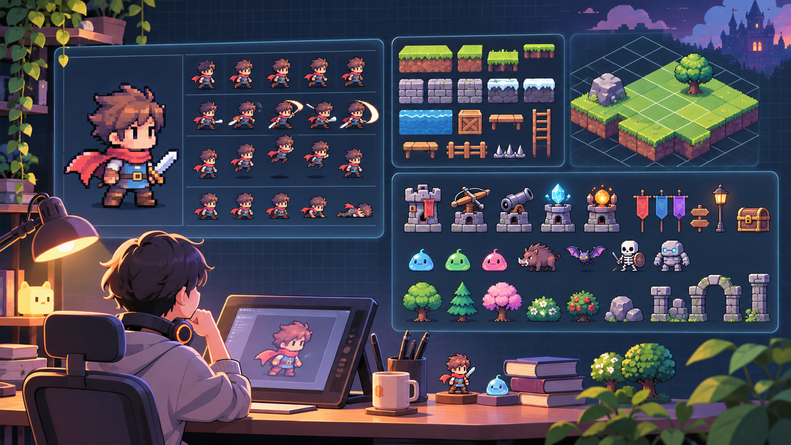
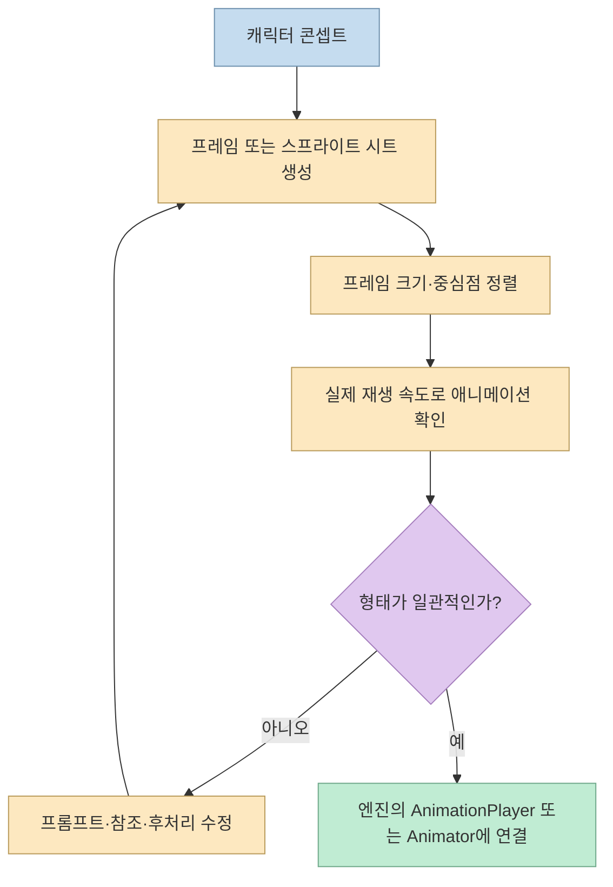
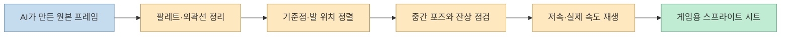
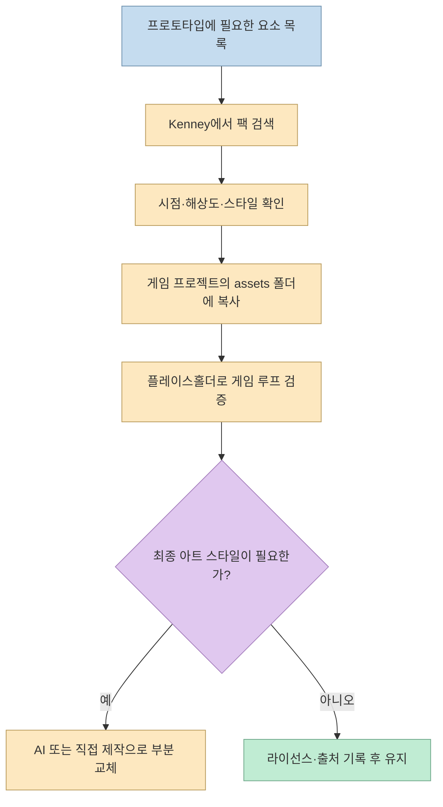
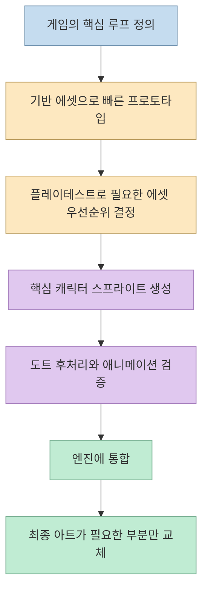

AI 모델이 게임 코드를 빠르게 작성해 주는 시대가 되었지만, 게임을 실행할 수 있는 코드와 게임처럼 보이는 결과물 사이에는 여전히 큰 간격이 있다. 캐릭터가 걷고 공격하는 각 프레임이 자연스럽게 이어져야 하고, 바닥·벽·장식물은 같은 시점과 색감으로 맞아야 한다.

ZeroCho TV의 쇼츠는 이 문제를 **스프라이트 생성 도구, 도트 애니메이션 도구, 무료 게임 에셋 팩**으로 나누어 소개한다. 영상의 자동 자막에는 도구명이 일부 변형되어 있지만, 여기서는 영상에서 언급한 `sprite-gen`, `perfectPixel`, `Kenney`를 기준으로, AI 게임 제작 과정에서 에셋을 어떻게 조합하면 좋은지 그대로 확장해 본다.

<!--more-->

## Sources

- [원본 YouTube Shorts — 게임 제작할 때 이런 것들 한번 써보세요!](https://youtube.com/shorts/MOcUPkbjzDI?si=a12de6AwzDyzYUgP) — 스프라이트 생성, 도트 애니메이션, Kenney 에셋 팩을 소개한 원본 영상.
- [SpriteGen 공식 소개](https://spritegen.ai/about/) — 게임 개발자를 위한 AI 스프라이트 생성 도구와 투명 PNG 스프라이트 시트 출력 안내.
- [Kenney 공식 에셋 목록](https://kenney.nl/assets) — 2D·3D·UI·사운드 등 게임 제작용 에셋 목록.
- [Kenney 라이선스 안내](https://kenney.nl/support) — 에셋 페이지의 콘텐츠가 CC0로 제공된다는 공식 안내. 개별 팩의 조건은 내려받기 시 다시 확인한다.

## 1. AI가 코드를 만들어도 에셋은 별도 문제다

영상은 최근 AI 모델을 이용해 프롬프트 한 번으로 동작하는 게임을 만드는 사례가 늘고 있다고 말한다. 하지만 게임 제작에서 반복적으로 발목을 잡는 것은 캐릭터, 배경, 이펙트처럼 플레이 화면을 구성하는 에셋이다. 특히 2D 게임에서는 한 장의 일러스트보다 **동일한 캐릭터가 여러 프레임에서 같은 비율과 중심점을 유지하는 것**이 더 중요하다. [영상 00:00](https://youtu.be/MOcUPkbjzDI?t=0) · [영상 00:09](https://youtu.be/MOcUPkbjzDI?t=9)

이미지 생성 모델에게 “이 캐릭터의 걷기 애니메이션을 만들어 달라”고 요청하면 각 프레임의 발 위치, 몸의 크기, 그림자, 무기 위치가 조금씩 달라질 수 있다. 한 장씩 보면 괜찮아도 게임에서 빠르게 재생하면 캐릭터가 흔들리거나 순간적으로 형태가 바뀌는 현상이 생긴다. 따라서 생성 단계부터 게임 엔진에 넣는 단계까지 다음 검사를 분리하는 편이 안전하다.

## 2. SpriteGen 계열 도구는 ‘한 장’보다 시트를 목표로 한다

영상의 첫 번째 추천은 스프라이트를 만드는 도구다. SpriteGen 공식 소개도 캐릭터 설명을 입력하면 게임 엔진에 넣을 수 있는 투명 PNG 스프라이트 시트를 얻는 흐름을 강조한다. [영상 00:22](https://youtu.be/MOcUPkbjzDI?t=22) · [SpriteGen 공식 소개](https://spritegen.ai/about/)

여기서 중요한 결과물은 멋진 캐릭터 이미지 한 장이 아니라 **같은 캔버스 규격으로 나뉜 프레임 집합**이다. 도구를 사용할 때는 다음 조건을 처음부터 명시하는 것이 좋다.

- 프레임 수와 시트의 행·열 수
- 모든 프레임의 캔버스 크기와 캐릭터 기준점
- 정면·측면·후면 중 필요한 방향
- 걷기, 대기, 공격처럼 애니메이션의 상태
- 투명 배경과 픽셀 경계 보존 여부

스프라이트 시트를 엔진에 넣은 뒤에는 단순히 이미지를 표시하지 말고, 실제 게임의 이동 속도와 함께 확인해야 한다. 프레임이 8장이라고 해서 반드시 자연스러운 것은 아니다. 움직임의 핵심 포즈가 어느 프레임에 배치되었는지, 마지막 프레임에서 첫 프레임으로 돌아갈 때 자세가 튀지 않는지가 더 중요하다.

## 3. Perfect Pixel이 해결하는 것은 도트 애니메이션의 어색함이다

영상의 두 번째 도구는 `perfectPixel`로 소개된 도트 애니메이션 계열 도구다. 자동 자막만으로는 특정 제품이나 버전을 확정하기 어렵기 때문에, 이 글에서는 이름을 특정 제품의 기능 목록으로 단정하지 않고 **도트 애니메이션을 정리하는 도구군**이라는 의미로 다룬다. [영상 00:50](https://youtu.be/MOcUPkbjzDI?t=50)

도트 그래픽에서는 작은 차이도 크게 보인다. 한 프레임에서 외곽선이 한 픽셀 두꺼워지거나, 캐릭터의 발이 한 칸 이동하는 것만으로도 움직임이 떨리는 것처럼 보일 수 있다. 이런 도구의 역할은 생성된 프레임을 그대로 믿는 것이 아니라 다음과 같은 후처리 작업을 반복 가능하게 만드는 데 있다.

1. 프레임별 팔레트와 외곽선 규칙을 맞춘다.
2. 캐릭터의 기준점과 발 위치를 정렬한다.
3. 불필요한 중간 픽셀이나 깨진 실루엣을 수정한다.
4. 게임에서 사용할 프레임 속도와 반복 구간을 확인한다.

이 과정을 생략하고 생성 이미지 여러 장을 순서대로 재생하면 “AI가 만든 티”가 강해진다. 반대로 프레임 수가 적더라도 실루엣과 중심점이 안정적이면 플레이어는 움직임을 더 자연스럽게 받아들인다. 즉, 생성 모델의 성능만으로 해결하려 하기보다 **생성 → 정렬 → 재생 검증**을 하나의 에셋 파이프라인으로 보는 것이 핵심이다. [영상 01:04](https://youtu.be/MOcUPkbjzDI?t=64)

## 4. Kenney는 빈 프로토타입을 빠르게 채우는 기반 에셋이다

세 번째로 소개된 Kenney는 캐릭터 하나를 생성하는 도구라기보다, 게임을 구성하는 여러 요소를 한꺼번에 확보할 수 있는 에셋 라이브러리다. 영상은 미니맵, 2D·3D 오브젝트, 타워 디펜스 구성물, UI와 차량 같은 예시를 든다. [영상 01:17](https://youtu.be/MOcUPkbjzDI?t=77)

Kenney 공식 사이트에는 플랫폼, 타워 디펜스, UI, 환경물, 캐릭터 등 다양한 팩이 정리되어 있다. 공식 지원 문서는 에셋 페이지의 콘텐츠가 CC0로 제공된다고 안내하지만, 프로젝트에 복사할 때는 **사용한 팩의 페이지와 라이선스 정보를 함께 보관**하는 습관이 좋다. [Kenney 에셋](https://kenney.nl/assets) · [라이선스 안내](https://kenney.nl/support)

Kenney 같은 기반 팩의 장점은 아트 제작을 끝내 준다는 데 있지 않다. 플레이어 이동, 충돌, 카메라, 레벨 구조, UI 흐름을 임시 그래픽으로 먼저 검증하게 해 준다는 데 있다. 이후 게임의 핵심 캐릭터나 반복적으로 노출되는 오브젝트만 고유한 스타일로 교체하면, 초반 개발 속도와 최종 결과물의 개성을 함께 관리할 수 있다.

## 5. 세 가지를 함께 쓰는 실전 순서

세 도구를 모두 사용한다고 해서 모든 에셋을 AI로 다시 만들 필요는 없다. 작업의 목적에 따라 역할을 나누면 된다.

| 단계 | 주 도구 | 확인할 것 |
|---|---|---|
| 게임 루프 검증 | Kenney | 장르에 맞는 시점, 임시 에셋의 라이선스 |
| 핵심 캐릭터 제작 | SpriteGen 계열 도구 | 방향, 프레임 수, 투명 배경, 기준점 |
| 움직임 다듬기 | Perfect Pixel 계열 도구 | 픽셀 정렬, 팔레트, 반복 구간, 재생 속도 |
| 최종 통합 | 게임 엔진 | 필터링 설정, 피벗, 충돌 영역, 실제 화면 크기 |

이 순서를 따르면 “예쁜 캐릭터부터 만들고 나서 게임을 붙이는” 위험을 줄일 수 있다. 먼저 무료 기반 에셋으로 게임의 재미와 화면 구성을 확인하고, 플레이어가 가장 많이 보는 캐릭터와 중요한 인터랙션만 정교하게 다듬는 방식이다.

## 핵심 요약

- AI가 게임 코드를 만들어도 프레임 간 일관성과 에셋 스타일 통일은 별도 작업이다.
- SpriteGen 계열 도구는 단일 이미지보다 게임에 바로 넣을 수 있는 스프라이트 시트 생성에 적합하다.
- `perfectPixel`은 영상의 자동 자막만으로 특정 제품을 확정하기 어려우므로, 도트 프레임 정렬·팔레트·후처리 도구군으로 이해하는 것이 안전하다.
- Kenney는 프로토타입을 빠르게 채우는 기반 에셋이며, 사용 팩의 라이선스와 출처를 프로젝트에 기록해야 한다.
- 가장 효율적인 순서는 **기반 에셋으로 플레이 검증 → 핵심 스프라이트 생성 → 도트 후처리 → 엔진 통합**이다.

## 결론

AI 게임 개발에서 에셋 문제를 해결하는 방법은 모든 그래픽을 한 번에 생성하는 것이 아니다. 무료 기반 팩으로 게임의 구조를 먼저 확인하고, 플레이어가 가장 많이 보는 스프라이트에 생성과 후처리를 집중하는 편이 빠르고 안정적이다. 영상에서 소개한 도구들도 각각의 역할을 나누어 사용할 때, 프로토타입 속도와 결과물의 완성도를 함께 높일 수 있다.
