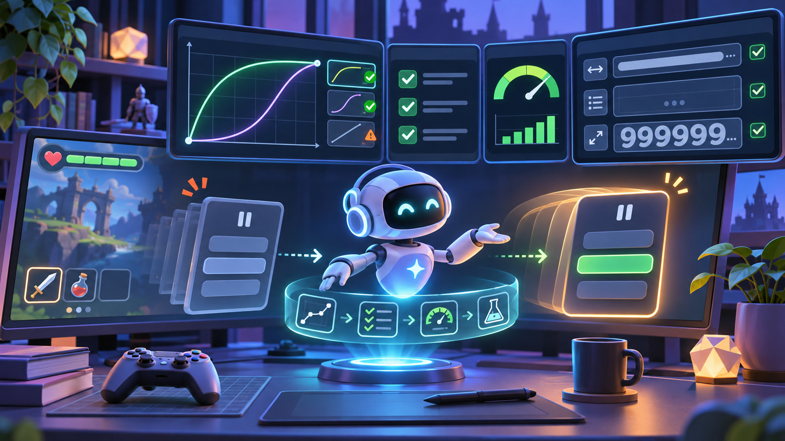
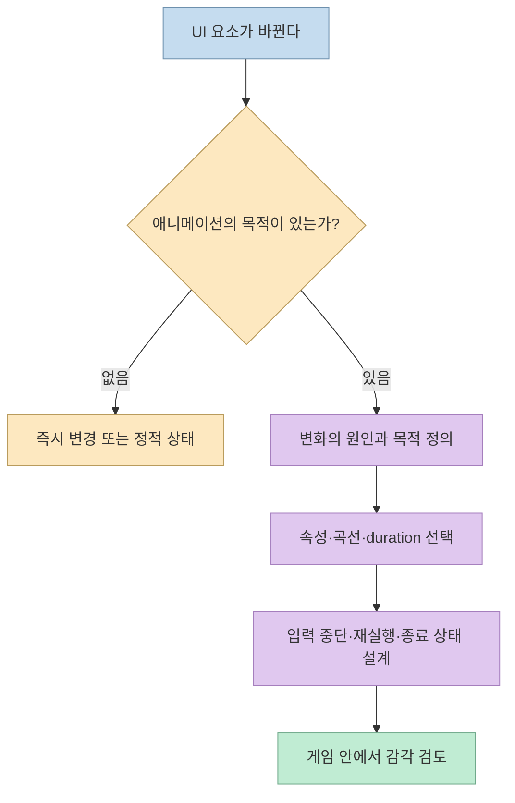
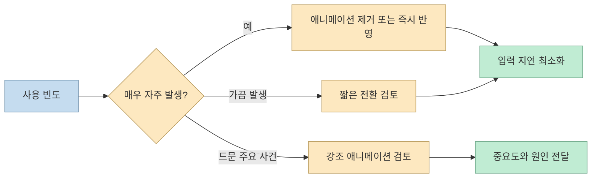
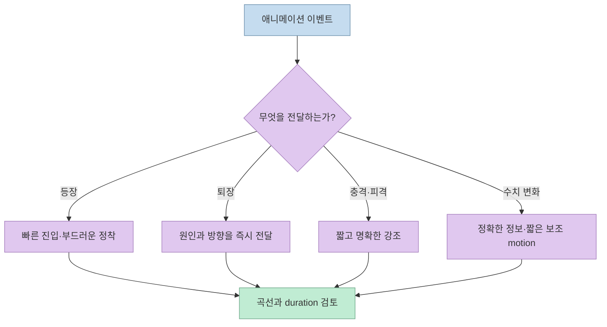
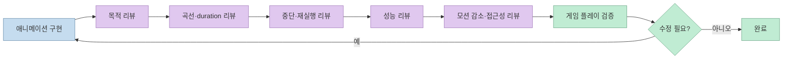
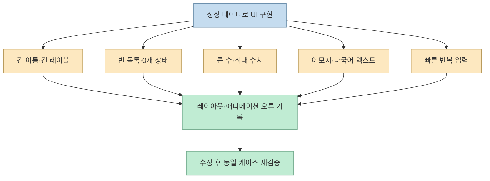

AI에게 게임 메뉴나 HUD의 애니메이션을 만들어 달라고 하면 화면은 움직이지만 어딘가 어색한 결과가 나올 때가 많다. 패널이 지나치게 튀거나, 알림이 늦게 사라지거나, 버튼을 누를 때마다 불필요한 전환이 반복되기도 한다. 영상은 이 문제를 “AI에게는 감각이 부족하다”는 말로 요약하고, `emilkowalski/skills`라는 디자인 엔지니어링 스킬 모음을 소개한다.

이 저장소는 애니메이션을 하나 만드는 스킬만 제공하지 않는다. 어떤 요소를 애니메이션해야 하는지 찾고, easing과 duration을 고르고, 기존 motion을 리뷰하고, 프레임 드롭을 점검하고, 긴 이름·빈 목록·큰 숫자 같은 최악의 데이터를 넣어 UI를 깨 보는 흐름까지 포함한다. 게임 개발에서는 이 기준을 메뉴, 인벤토리, 퀘스트 알림, 전투 피드백, 설정 화면에 적용할 수 있다.

<!--more-->

## Sources

- [YouTube Shorts 원문](https://youtu.be/blnl5g2ZRig) — `emilkowalski/skills`를 소개한 영상.
- [영상 0:00](https://youtu.be/blnl5g2ZRig?t=0) — AI가 만든 화면 움직임이 어색할 수 있다는 문제 제기.
- [영상 0:18](https://youtu.be/blnl5g2ZRig?t=18) — 애니메이션 실수와 수정법을 스킬에 기록했다는 설명.
- [영상 0:23](https://youtu.be/blnl5g2ZRig?t=23) — 애니메이션 생성·검토·제거·UI 파괴 테스트 스킬 소개.
- [영상 0:36](https://youtu.be/blnl5g2ZRig?t=36) — `npx skills@latest add emilkowalski/skills` 설치 흐름.
- [emilkowalski/skills 공식 저장소](https://github.com/emilkowalski/skills) — 스킬 목록, 설치 방법, 설계 철학.
- [애니메이션 스킬](https://github.com/emilkowalski/skills/blob/main/skills/animate/SKILL.md) — 애니메이션 여부, 목적, 도구, 속성, 곡선, duration, 중단과 종료를 결정하는 기준.
- [애니메이션 리뷰 스킬](https://github.com/emilkowalski/skills/tree/main/skills/review-animations) · [성능 스킬](https://github.com/emilkowalski/skills/tree/main/skills/animation-performance) — 기존 motion 검토와 프레임 드롭 점검.
- [UI 파괴 테스트 스킬](https://github.com/emilkowalski/skills/tree/main/skills/break-ui) — 긴 이름, 빈 목록, 큰 숫자 등 최악의 데이터 검증.

> 저장소의 스킬 목록과 설명은 변경될 수 있다. 이 글의 19개라는 표현과 기능 목록은 2026년 11월 27일 공식 README에서 확인한 내용을 기준으로 한다. 저장소는 웹 UI 중심이므로, 게임 엔진에 그대로 설치되는 플러그인이라기보다 게임 UI 작업에 적용할 설계·검토 지침으로 이해하는 것이 정확하다.

## 1. AI는 움직임을 만들 수 있지만 목적까지 자동으로 알지는 못한다

영상은 AI가 “움직임에 맞는 속도 곡선”을 잘 고르지 못하는 경우를 예로 든다. 공식 README도 에이전트가 진입 애니메이션에 `ease-in`을 사용하거나, UI의 반투명 그림자 대신 단색 테두리를 선택하는 것처럼 작은 선택을 반복한다고 설명한다.

문제는 애니메이션 API를 모르는 것이 아니다. 대부분의 도구는 `duration`, `easing`, `opacity`, `transform` 같은 속성을 쉽게 작성한다. 어려운 부분은 “이 움직임이 사용자에게 무엇을 설명해야 하는가?”를 결정하는 것이다.

게임 UI에서 같은 패널이라도 목적에 따라 움직임이 달라진다.

- **메뉴 열기**: 패널이 어디에서 나타났는지 알려 주되 입력을 지연시키지 않아야 한다.
- **피격 피드백**: 짧고 즉각적인 색·위치 변화로 피해 결과를 전달해야 한다.
- **보상 획득**: 플레이어가 보상과 출처를 인식할 정도의 강조가 필요하다.
- **반복되는 HUD 갱신**: 매 프레임 또는 자주 바뀌는 값이라면 오히려 애니메이션을 줄여야 한다.



## 2. 먼저 “애니메이션해야 하는가”를 결정한다

공식 `emil-design-eng` 스킬의 출발점은 애니메이션을 어떻게 만들지가 아니라 애니메이션이 필요한지 묻는 것이다. 자주 반복되는 동작일수록 움직임이 사용자의 시간을 빼앗을 수 있다.

게임에서도 이 기준은 유효하다. 플레이어가 초당 여러 번 조작하는 전투 HUD나 인벤토리 숫자에 긴 전환을 넣으면 정보 확인이 늦어지고, 입력과 화면의 반응이 분리된다. 반대로 보스 등장, 레벨업, 첫 보상처럼 드문 순간에는 애니메이션이 사건의 중요도를 전달할 수 있다.



예를 들어 플레이어가 아이템을 빠르게 여러 번 줍는 게임이라면 아이템 수량이 바뀔 때마다 300ms짜리 숫자 카운트업을 실행하는 것보다, 짧은 강조색과 즉시 반영을 사용하는 편이 읽기 쉽다. 반대로 새 장비를 처음 획득하는 순간에는 아이콘의 등장, 슬롯 강조, 사운드를 묶어 보상의 의미를 전달할 수 있다.

## 3. easing은 속도가 아니라 움직임의 의도를 표현한다

같은 거리와 같은 duration이라도 속도 곡선에 따라 인상이 달라진다. 시작이 느리고 끝이 빠른 곡선은 요소가 화면 밖에서 들어오는 진입보다, 사용자가 움직임을 따라가야 하는 상황에서 어색하게 느껴질 수 있다. 반대로 시작이 빠르고 끝이 느린 곡선은 도착 지점을 안정적으로 보여 주는 데 적합하다.

게임 UI의 기본 선택을 다음처럼 생각할 수 있다.

- **Enter**: 화면에 나타나는 이유를 빠르게 보여 주고, 마지막에 부드럽게 안착한다.
- **Exit**: 사라질 방향과 원인을 즉시 보여 주되, 다음 입력을 막지 않는다.
- **Impact**: 짧은 시간 안에 변화가 전달되어야 하므로 과도한 잔상을 피한다.
- **Progress**: 수치의 실제 변화가 중요한 경우 곡선보다 정보의 정확성을 우선한다.



중요한 것은 특정 easing 이름을 외우는 것이 아니다. “왜 이 요소는 이 속도로 움직여야 하는가?”를 설명할 수 있어야 한다. AI에게 애니메이션을 요청할 때도 “부드럽게 해 줘”보다 “전투 중 자주 반복되는 피격 표시이므로 100ms 안에 원인을 전달하고 입력을 지연시키지 않게 해 줘”처럼 목적과 빈도를 함께 알려 주는 편이 좋다.

## 4. 생성·검토·개선을 분리하면 품질이 올라간다

저장소는 애니메이션을 만드는 `animate`뿐 아니라 `review-animations`와 `improve-animations`를 별도 스킬로 제공한다. 이 구분은 AI가 만든 결과를 그대로 승인하지 않고, 다른 관점에서 다시 평가하게 한다.

게임 UI 작업에서는 다음 순서를 사용할 수 있다.

1. **생성**: 메뉴, 인벤토리, HUD의 상태 전환을 구현한다.
2. **목적 검토**: 각 애니메이션이 무엇을 설명하는지 확인한다.
3. **감각 검토**: 곡선, duration, 시작점, 종료점, 중단 가능성을 확인한다.
4. **성능 검토**: 동시에 많은 요소가 움직일 때 프레임 비용을 측정한다.
5. **접근성 검토**: 모션 감소 설정과 입력 반복 상황을 확인한다.



리뷰는 “더 화려하게 만들기”가 아니다. 애니메이션이 많아질수록 화면은 풍부해질 수 있지만, 플레이어가 무엇을 봐야 하는지 놓칠 가능성도 커진다. 어떤 움직임은 목적을 설명하지 못하면 제거하는 것이 개선이다.

## 5. 게임 UI에서 `break-ui`가 찾아내는 문제

영상은 긴 이름과 빈 목록 등을 넣어 화면을 일부러 망가뜨려 보는 스킬을 소개한다. 공식 저장소의 `break-ui`도 긴 이름, 특이한 이메일, 한 글자 이름, 큰 수, 빈 목록, 긴 레이블, 이모지와 비라틴 문자를 사용해 UI를 테스트하도록 설명한다.

이 방식은 게임 UI에도 그대로 적용된다.

- 플레이어 이름이 최대 길이를 넘으면 이름표가 버튼을 밀어내지 않는가?
- 아이템 수량이 `999999`가 되면 슬롯의 숫자가 잘리지 않는가?
- 퀘스트 목록이 비어 있으면 빈 화면 애니메이션이 무한 반복되지 않는가?
- 긴 번역 문장이 들어오면 툴팁과 대화창이 화면 밖으로 나가지 않는가?
- 컨트롤러와 키보드 입력이 동시에 들어와도 포커스 애니메이션이 꼬이지 않는가?



애니메이션 테스트에서 특히 중요한 것은 상태 전환 중 데이터가 바뀌는 경우다. 목록이 닫히는 동안 새로운 아이템이 추가되거나, 툴팁이 나타나는 도중 다른 버튼에 포커스가 이동하면 이전 애니메이션의 종료 콜백이 새 상태를 덮어쓸 수 있다. 따라서 시각적인 모양뿐 아니라 중단·재실행·동시 입력을 함께 테스트해야 한다.

## 6. 성능과 모션 감소는 마지막 옵션이 아니다

UI 애니메이션은 짧아 보여도 많은 요소가 동시에 움직이면 비용이 누적될 수 있다. 파티클, 월드 오브젝트, HUD 전환이 한 프레임에 겹치는 게임에서는 애니메이션의 목적뿐 아니라 업데이트 방식과 렌더링 비용도 확인해야 한다.

공식 저장소의 `animation-performance` 스킬은 프레임을 떨어뜨리는 애니메이션 문제를 찾는 데 초점을 둔다. 게임에서는 다음 항목을 함께 기록하는 것이 좋다.

- 동시에 움직이는 UI 요소의 수
- 레이아웃 계산을 유발하는 속성 변경 여부
- 텍스처·블러·마스크·파티클과 겹치는지
- 저사양 기기에서의 프레임 시간
- 애니메이션이 끝나기 전에 상태가 다시 바뀌는지

또한 모션 감소 설정이 있는 사용자를 위해 움직임을 단순히 짧게 만드는 것보다, 의미를 유지하는 정적 전환으로 바꾸는 것이 더 나을 수 있다. 예를 들어 메뉴가 슬라이드되는 대신 즉시 표시되도록 하고, 선택된 항목은 색상과 포커스 링으로 표시하는 식이다.

## 7. 게임 개발자가 실제로 사용할 설치와 요청 흐름

공식 저장소는 다음 명령으로 스킬 모음을 설치하도록 안내한다.

```bash
npx skills@latest add emilkowalski/skills
```

설치 후에는 모든 스킬을 기억하려 하지 않아도 된다. 저장소에는 `ask-emil`이라는 라우터 역할의 스킬이 있어 상황을 설명하면 적합한 스킬이나 짧은 실행 순서를 추천한다. 게임 UI 작업에서는 다음과 같이 요청할 수 있다.

```text
Godot 4 인벤토리에서 아이템을 획득할 때 슬롯이 강조되게 해 줘.
전투 중 자주 반복되는 이벤트라 입력을 지연시키면 안 되고,
아이템 수량이 999999가 되거나 목록이 비어도 레이아웃이 깨지지 않아야 해.
애니메이션을 만든 뒤 목적, duration, 중단 처리, 성능과 엣지 케이스를 검토해 줘.
```

이 요청은 단순히 “애니메이션을 추가해 줘”가 아니다. 빈도, 목적, 최악의 데이터, 검토 기준을 포함하므로 에이전트가 화려한 효과보다 사용성을 우선할 가능성이 높아진다.

## 핵심 요약

- `emilkowalski/skills`는 AI가 UI 애니메이션과 디자인 결정을 잘못하는 문제를 줄이기 위한 스킬 모음이다.
- 공식 README에는 생성, 검토, 개선, 제거, 성능, 모션 기회 탐색, 프로토타이핑, UI 파괴 테스트 등의 스킬이 정리되어 있다.
- 애니메이션은 구현 전에 “정말 움직여야 하는가”와 “무엇을 설명하는가”를 결정해야 한다.
- easing과 duration은 취향이 아니라 진입·퇴장·피격·수치 변화 같은 목적에 맞춰 선택해야 한다.
- 생성 후에는 목적, 곡선, duration, 중단·재실행, 성능, 접근성을 별도로 리뷰하는 편이 안전하다.
- 긴 이름, 빈 목록, 큰 숫자, 다국어, 빠른 반복 입력은 게임 UI에서 반드시 테스트할 엣지 케이스다.
- 저장소는 웹 UI 중심이지만, 같은 판단 기준을 게임 메뉴·HUD·인벤토리·알림에도 적용할 수 있다.

## 결론

AI가 만든 애니메이션이 어색한 이유는 코드 문법을 몰라서만이 아니다. 화면의 목적, 사용 빈도, 정보의 우선순위, 중단 가능성, 성능과 접근성까지 함께 판단해야 하기 때문이다. `emilkowalski/skills`는 이런 판단을 하나의 거대한 프롬프트가 아니라 생성·검토·테스트·개선 스킬로 나눈다.

게임 개발에서 이 접근을 활용할 때 가장 중요한 규칙은 “더 많이 움직이게 하라”가 아니다. 움직임이 플레이어에게 정보를 전달하거나 행동의 결과를 이해시키는지 먼저 묻고, 그렇지 않다면 제거하는 것이다. AI 에이전트에게도 애니메이션 구현만 맡기지 말고, 목적과 최악의 입력을 함께 주어 리뷰 단계까지 실행하게 해야 한다.
