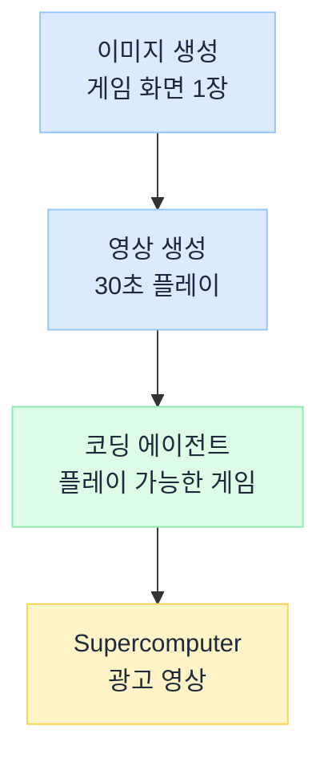
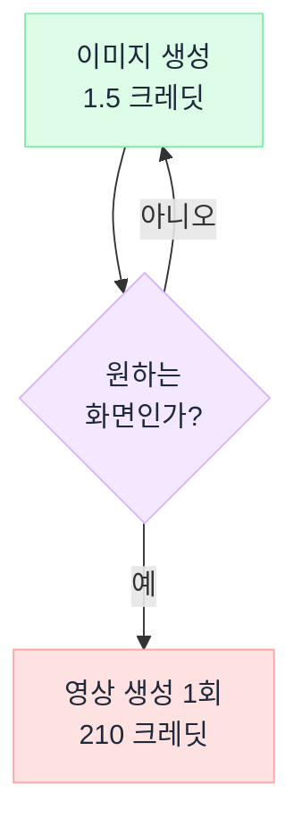
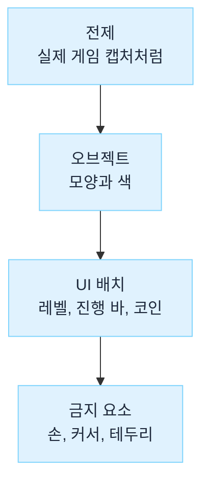
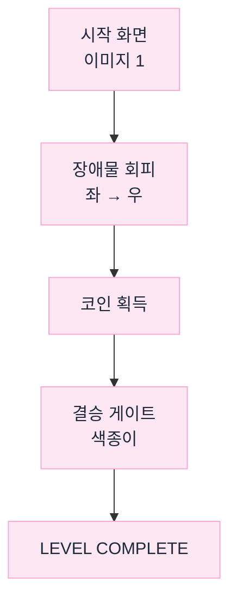
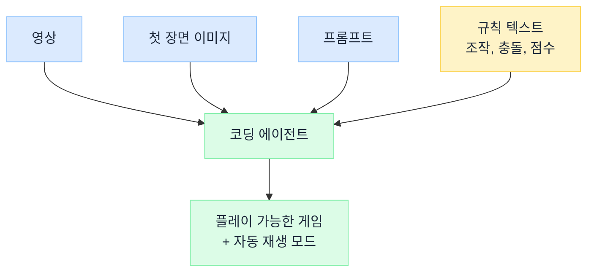
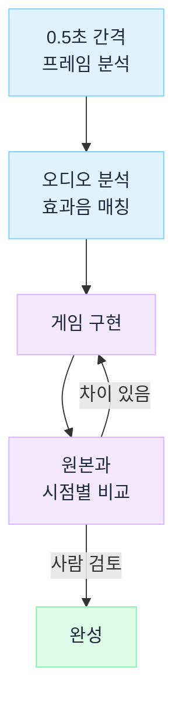
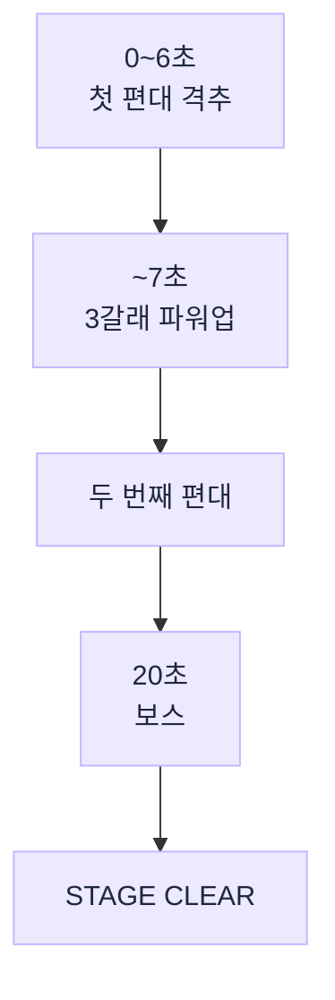
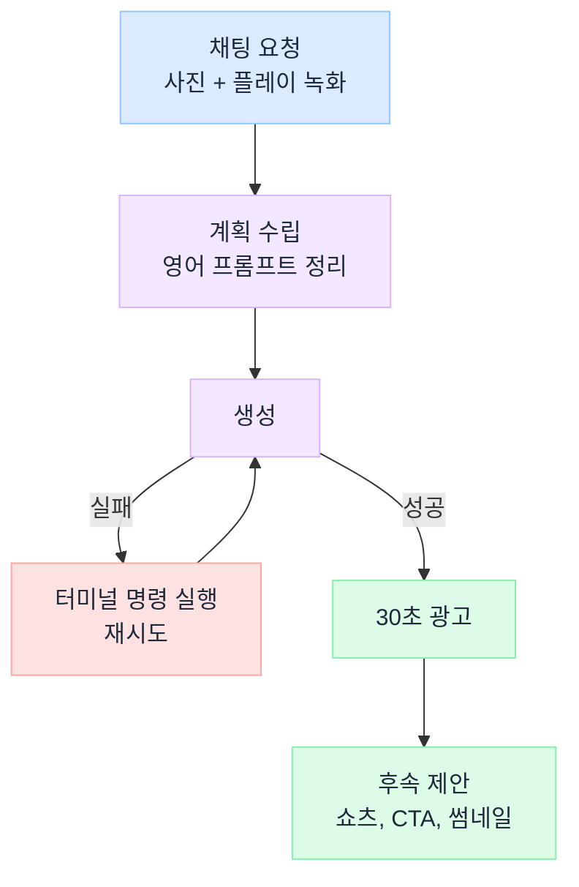

게임 아이디어는 있는데 코드부터 짜기 막막할 때, **화면부터 그려서 그것을 기획서로 쓰는 방법**이 있습니다. 유튜브 채널 「코드깎는노인」의 영상 *요즘 AI는 영상을 게임으로 만들어줍니다 | 힉스필드로 게임만들기*(2026-11-16 공개, 약 15분)는 AI 이미지·영상 플랫폼 Higgsfield로 게임 화면과 플레이 영상을 먼저 만들고, 그 영상을 코딩 에이전트에게 보여 줘 실제로 플레이할 수 있는 게임을 만드는 과정을 보여 줍니다.

이 글은 영상 자막을 바탕으로 **요약·정리한 것**이며, 필자가 직접 재현해 본 내용은 아닙니다. 영상 속 수치(크레딧, 작업 시간 등)는 모두 영상에서 말한 값이고, 필자의 의견은 마지막 부분에 따로 표시했습니다.

<!--more-->

## Sources

- [요즘 AI는 영상을 게임으로 만들어줍니다 | 힉스필드로 게임만들기 — 코드깎는노인 (YouTube)](https://www.youtube.com/watch?v=4gOrUimSHmU)

> **참고**: 영상 설명란의 Higgsfield 링크는 캠페인 추적용 URL(`higgsfield-general-campaign-yt-codingartisan`)입니다. 협찬 또는 제휴 콘텐츠일 가능성이 높으니 이 점을 감안해서 보세요. 자막은 유튜브 자동 생성 자막이라 고유명사 일부(모델명 등)가 정확하지 않을 수 있습니다.

## 전체 흐름: 영상이 곧 기획서

영상의 핵심 아이디어는 Higgsfield에서 만든 이미지와 영상을 **게임 기획서**로 쓰는 것입니다 ([0:47](https://youtu.be/4gOrUimSHmU?t=47)). 순서는 다음과 같습니다.

1. Higgsfield에서 게임 화면을 **이미지**로 먼저 그린다.
2. 마음에 드는 이미지를 첫 장면으로 삼아 30초짜리 **플레이 영상**을 만든다.
3. 영상, 이미지, 사용한 프롬프트를 **코딩 에이전트**에게 주고 똑같은 게임을 만들게 한다.
4. 완성된 게임의 **광고 영상**을 Higgsfield의 Supercomputer 기능으로 만든다.

영상에서는 이 방법으로 장르가 다른 게임 두 개(공굴리기, 우주 슈팅)를 만들었습니다 ([1:10](https://youtu.be/4gOrUimSHmU?t=70)). 맨 처음에는 AI가 만든 30초 영상과, 그 영상을 보고 코딩 에이전트가 만든 실제 게임을 나란히 보여 주는데 둘의 모습이 거의 같습니다 ([0:02](https://youtu.be/4gOrUimSHmU?t=2)).

## 왜 이미지부터 만드는가: 크레딧 비용

처음부터 영상을 만들 수도 있지만, 결과물이 원하는 디자인이라는 보장이 없고 다시 만들 때마다 비용이 듭니다 ([1:56](https://youtu.be/4gOrUimSHmU?t=116)). Higgsfield는 이미지나 영상을 만들 때마다 **크레딧**을 차감합니다. 영상에서 사용한 설정 기준 비용은 다음과 같습니다 ([1:56](https://youtu.be/4gOrUimSHmU?t=116), [2:19](https://youtu.be/4gOrUimSHmU?t=139)).

| 결과물 | 크레딧 |
| --- | ---: |
| 게임 화면 이미지 1장 | 1.5 |
| 같은 장면의 30초 영상 1편 | 210 |

영상 한 편 값으로 이미지를 140장 만들 수 있습니다(210 ÷ 1.5 = 140). 그래서 **싼 이미지로 디자인을 충분히 맞춘 뒤, 영상은 한 번만 만드는** 순서를 권합니다. 영상 마지막에서도 이 순서가 게임이 아닌 다른 영상을 만들 때도 그대로 통한다고 다시 강조합니다 ([14:22](https://youtu.be/4gOrUimSHmU?t=862)).

## 1단계: 게임 화면 이미지 만들기

첫 번째 게임은 하늘 위 트랙에서 파란 공이 굴러가며 장애물을 피하고 코인을 먹는 모바일 게임입니다 ([1:33](https://youtu.be/4gOrUimSHmU?t=93)).

**프롬프트에 넣은 내용** ([2:41](https://youtu.be/4gOrUimSHmU?t=161)):

- "실제 모바일 게임을 플레이하다가 캡처한 것 같은 화면"이라는 전제
- 트랙, 공, 장애물, 코인, 결승 게이트 각각의 모양과 색
- 화면 위쪽 UI 배치: 레벨 표시, 진행 바, 코인 개수
- 금지 요소: 손, 마우스 커서, 휴대폰 테두리

**설정** ([3:03](https://youtu.be/4gOrUimSHmU?t=183), [3:25](https://youtu.be/4gOrUimSHmU?t=205)):

- 모델: Higgsfield에서 고를 수 있는 이미지 모델 중 하나 (자막에는 "GPT 이미지 2.6 선버스트"로 나옴. 정확한 표기는 Higgsfield에서 확인 필요)
- 화면 비율: 세로 9:16 (모바일 게임)
- 비용: 1.5 크레딧

결과 이미지에는 프롬프트에서 지정한 자리에 "레벨 12", 진행 바, 코인 숫자 "328"이 또렷하게 들어갔습니다. 영상에서는 이 한 장을 **게임이 어떻게 생겨야 하는지 보여 주는 첫 번째 기획서**라고 부릅니다 ([3:25](https://youtu.be/4gOrUimSHmU?t=205)).

## 2단계: 이미지를 30초 플레이 영상으로

그림 한 장으로는 공이 어떻게 굴러가고, 무엇을 피하고, 어떻게 끝나는지 보여 줄 수 없습니다. 그래서 이미지 결과 화면의 "영상으로 전환" 버튼을 눌러, 이 이미지를 첫 장면으로 쓰는 영상을 만듭니다 ([3:50](https://youtu.be/4gOrUimSHmU?t=230), [4:10](https://youtu.be/4gOrUimSHmU?t=250)).

**모델과 옵션** ([4:10](https://youtu.be/4gOrUimSHmU?t=250)~[5:18](https://youtu.be/4gOrUimSHmU?t=318)):

| 항목 | 선택 가능한 값 | 영상에서 고른 값 |
| --- | --- | --- |
| 모델 | — | Seedance 2.5 (한 번에 최대 30초) |
| 길이 | 4~30초 (슬라이더) | 30초 |
| 화면 비율 | 21:9, 16:9, 4:3, 1:1, 3:4, 9:16 | 9:16 |
| 화질 | 480p, 720p, 1080p, 4K | 720p |

길이를 줄이면 생성 버튼에 표시되는 크레딧도 함께 줄어듭니다. 이 설정에서 210 크레딧이 표시됐고, 비용은 길이와 해상도에 따라 달라진다고 합니다 ([5:41](https://youtu.be/4gOrUimSHmU?t=341)).

**영상 프롬프트 작성법** ([5:18](https://youtu.be/4gOrUimSHmU?t=318), [5:41](https://youtu.be/4gOrUimSHmU?t=341)):

- 프롬프트 맨 앞의 "이미지 1"은 방금 만든 이미지를 가리키며, 이 이미지를 시작 화면으로 쓰라는 뜻입니다.
- 30초 동안 일어날 일을 **순서대로** 적습니다: 오른쪽 장애물을 왼쪽으로 피함 → 코인 획득 → 왼쪽 장애물을 오른쪽으로 피함 → 결승 게이트 통과 시 색종이 → 화면 가운데 "LEVEL COMPLETE"
- 카메라는 공 뒤를 같은 거리로 따라가게 합니다.
- 사람 손이나 커서가 나오지 않게 해 달라고 다시 적었습니다.

결과 영상은 프롬프트에 적은 흐름대로 나왔습니다. 영상에서는 이렇게 역할을 나눕니다. **이미지는 게임의 생김새를, 영상은 움직임과 소리를 보여 주는 기획서**라는 것입니다 ([6:43](https://youtu.be/4gOrUimSHmU?t=403)).

## 3단계: 코딩 에이전트에게 영상 보여 주기

**에이전트에게 준 자료** ([7:07](https://youtu.be/4gOrUimSHmU?t=427)):

- Higgsfield로 만든 영상
- 첫 장면 이미지
- 이미지와 영상을 만들 때 쓴 프롬프트

어떤 코딩 에이전트(제품·모델)를 썼는지는 자막에서 확인되지 않습니다.

**요청 내용** ([7:07](https://youtu.be/4gOrUimSHmU?t=427), [7:30](https://youtu.be/4gOrUimSHmU?t=450)):

- 영상과 최대한 똑같은 게임을 실제로 플레이할 수 있게 만들어 달라.
- 게임 규칙은 **글로 따로** 지정했습니다: 공은 저절로 앞으로 굴러가고, 플레이어는 좌우로만 움직이며, 장애물에 부딪히면 처음부터 다시 시작하고, 코인 하나에 1점.
- 원본 영상과 나란히 비교할 수 있도록, 공이 영상과 같은 흐름으로 혼자 달리는 **자동 재생 모드**도 만들어 달라.

영상에서는 이렇게 정리합니다. **모습과 흐름은 영상으로 보여 주고, 점수처럼 정확해야 하는 규칙은 글로 정해 주는 게 확실하다**는 것입니다 ([7:30](https://youtu.be/4gOrUimSHmU?t=450)).

### 에이전트가 일한 방식

영상에서 설명한 에이전트의 작업 과정은 다음과 같습니다 ([7:53](https://youtu.be/4gOrUimSHmU?t=473), [8:16](https://youtu.be/4gOrUimSHmU?t=496)).

1. **프레임 분석**: 영상을 0.5초 간격의 이미지로 나눠 장면마다 무엇이 어디에 있는지 파악
2. **오디오 분석**: 일정한 간격으로 반복되는 소리는 코인 소리로, 25초 무렵 크게 터지는 소리는 색종이 소리로 판단해 효과음을 맞춤 (자막상 "0.5초마다 5초마다"로 나와 정확한 간격은 불분명합니다)
3. **나란히 비교**: 완성된 게임을 원본 영상과 같은 시점끼리 맞대어 놓고 색과 위치를 반복 수정
4. **사람 피드백**: 영상 제작자가 공의 반사광처럼 원본과 다른 부분을 짚어 주고 한 번 더 다듬게 함

여기까지 약 **1시간 10분**이 걸렸습니다. 완성된 게임에서는 장애물에 부딪히면 레벨이 처음부터 다시 시작되고, 코인을 먹을 때마다 숫자가 1씩 오르며, 결승 게이트를 지나면 "LEVEL COMPLETE"가 뜹니다. 하늘, 떠 있는 성, 트랙, 공, 장애물 모양까지 원본 영상과 거의 같았다고 합니다 ([8:40](https://youtu.be/4gOrUimSHmU?t=520)).

## 다른 장르에도 통할까: 우주 슈팅 게임

두 번째 게임은 위에서 내려다보는 우주 슈팅 게임입니다. 플레이어는 하트 3개(목숨 3개)를 가진 비행기로 레이저를 쏴 적을 격추하고, 마지막에 보스를 물리칩니다 ([9:03](https://youtu.be/4gOrUimSHmU?t=543)). 이미지 생성 → 영상으로 전환 → Seedance 2.5로 30초 영상까지, 순서는 첫 번째 게임과 같습니다.

달라진 점은 영상 프롬프트를 **시간표 형식**으로 쓴 것입니다 ([9:26](https://youtu.be/4gOrUimSHmU?t=566)). 몇 초에 무엇이 나올지 정해 두면 30초 안에 들어갈 장면을 원하는 순서대로 배치할 수 있습니다. 결과 영상도 적어 둔 시간표대로 나왔습니다 ([10:07](https://youtu.be/4gOrUimSHmU?t=607)).

| 시간 | 장면 |
| --- | --- |
| 0~6초 | 첫 번째 적 편대 격추 |
| 약 7초 | 레이저가 세 갈래로 늘어나는 파워업 획득 |
| 그 이후 | 두 번째 편대가 총알을 쏘며 등장 |
| 20초 | 보스 등장 |
| 마지막 | STAGE CLEAR |

이번에는 코딩 에이전트가 영상 속 음악의 빠르기까지 측정해 게임 음악을 **분당 120박자**로 맞췄습니다. 제작에는 약 **1시간 15분**이 걸렸고, 이번에도 제작자가 레이저 굵기 같은 차이를 짚어 준 뒤 한 번 더 다듬었습니다 ([10:30](https://youtu.be/4gOrUimSHmU?t=630)). 완성된 게임에서는 적 총알에 맞으면 하트가 하나씩 줄고, 보스를 물리치면 STAGE CLEAR와 함께 다음 스테이지로 넘어갑니다 ([10:53](https://youtu.be/4gOrUimSHmU?t=653)).

## 4단계: Supercomputer로 게임 광고 만들기

게임을 만든 뒤에는 사람들에게 알려야 하므로, 첫 번째 게임의 광고 영상도 Higgsfield로 만들었습니다 ([11:16](https://youtu.be/4gOrUimSHmU?t=676)).

**Supercomputer란** ([11:16](https://youtu.be/4gOrUimSHmU?t=676)~[12:01](https://youtu.be/4gOrUimSHmU?t=721)):

- 채팅창에 원하는 결과물을 말로 설명하면, AI 에이전트가 작업 계획을 세우고 직접 만들어 주는 기능입니다.
- 앞 단계에서는 모델 선택, 길이·비율 설정, 생성 버튼 누르기를 사람이 직접 했습니다. Supercomputer에서는 에이전트가 단계마다 알맞은 모델을 고르고, 앞 단계의 결과물을 다음 단계 재료로 넘깁니다.
- Higgsfield는 이를 "채팅 하나에 담긴 AI 제작 팀"이라고 소개합니다.
- 자주 쓰는 작업 방식을 묶어 둔 **스킬**과 외부 서비스를 연결하는 **커넥터** 메뉴가 있지만, 영상에서는 쓰지 않고 채팅 요청만으로 진행했습니다.

**광고 요청** ([12:25](https://youtu.be/4gOrUimSHmU?t=745)):

- 첨부: 광고 모델로 쓸 남성 사진 1장, 첫 번째 게임 플레이 녹화 영상
- 요청: 사진 속 인물이 게임을 즐기는 30초 가로 광고. 연두색 거실에서 휴대폰 게임에 빠져 있다가 → 화면 속으로 빨려 들어가 → 게임 세 개를 달리고 → 다시 거실로 돌아와 웃는 장면까지 순서대로 적음

**진행 과정** ([12:48](https://youtu.be/4gOrUimSHmU?t=768)):

- Supercomputer가 한국어 요청을 영어 프롬프트로 다시 정리했습니다.
- 중간에 생성이 한 번 실패로 표시됐지만, 멈추지 않고 터미널에서 직접 명령을 실행한 뒤 생성을 다시 시작해 끝까지 완성했습니다.

**결과** ([13:37](https://youtu.be/4gOrUimSHmU?t=817)):

- 휴대폰 속 게임 화면이 넓어지면서 게임 속으로 들어가는 장면이 만들어졌습니다. 영상 제작자는 직접 찍고 합성하려면 손이 많이 가는 장면이라고 평가합니다.
- 트랙, 파란 공, 빨간색·흰색 줄무늬 장애물이 첨부한 플레이 영상 속 모습 그대로 나왔습니다.
- 결과 아래에는 다음 작업 제안이 표시됩니다: 세로 쇼츠 버전, 영상 끝의 "지금 플레이하기" CTA, 광고 썸네일 3종. 같은 채팅에서 후속 작업을 이어 갈 수 있습니다 ([14:00](https://youtu.be/4gOrUimSHmU?t=840)).

## 핵심 요약

- **영상을 기획서로 쓴다**: 이미지는 생김새, 영상은 움직임과 소리를 전달하고, 코딩 에이전트는 이를 보고 게임을 구현합니다 ([6:43](https://youtu.be/4gOrUimSHmU?t=403)).
- **이미지 먼저, 영상은 한 번**: 영상 설정 기준 이미지 1.5 크레딧, 30초 영상 210 크레딧입니다. 디자인은 이미지로 충분히 맞춥니다 ([2:19](https://youtu.be/4gOrUimSHmU?t=139)).
- **영상 프롬프트는 순서나 시간표로**: "몇 초에 무엇"을 정해 두면 30초 안의 장면 배치를 원하는 대로 할 수 있습니다 ([9:26](https://youtu.be/4gOrUimSHmU?t=566)).
- **정확한 규칙은 글로**: 조작 방식, 충돌 처리, 점수는 영상이 아니라 텍스트로 명시합니다 ([7:30](https://youtu.be/4gOrUimSHmU?t=450)).
- **비교 가능하게 만들어라**: 자동 재생 모드와 시점별 비교로 에이전트가 원본과의 차이를 스스로 줄이게 하고, 마지막에 사람이 남은 차이를 짚어 줍니다 ([8:16](https://youtu.be/4gOrUimSHmU?t=496)).
- **결과**: 장르가 다른 게임 두 개를 각각 약 1시간 10~15분 만에 플레이 가능한 상태로 만들었습니다.

### 필자 의견 (검증하지 않은 해석)

- 이 방법이 가장 잘 맞는 곳은 **아트 방향과 게임 느낌을 빠르게 맞춰 보는 프로토타이핑**이라고 봅니다. 영상에 나온 게임 두 개는 30초 한 판짜리, 규칙 몇 줄 수준입니다. 레벨 설계, 진행 시스템, 밸런스처럼 영상으로 표현하기 어려운 부분은 여전히 글로 된 설계가 필요합니다.
- 영상에는 코딩 에이전트의 종류와 그 실행 비용, 크레딧의 실제 금액이 나오지 않습니다. 따라서 "싸고 빠르다"는 인상은 이 정보 없이는 판단할 수 없습니다.
- 다른 사람의 게임 화면을 그대로 흉내 내는 데 쓰면 저작권 문제가 생길 수 있습니다. 직접 구상한 화면을 기획서로 쓸 때 가장 깔끔하게 맞는 방법입니다.

## 결론

이 영상이 보여 주는 것은 특정 도구 사용법보다 **작업 순서**입니다. 싼 이미지로 화면을 확정하고, 영상 한 편으로 움직임을 보여 주고, 정확한 규칙은 글로 보충해 코딩 에이전트에게 넘깁니다. 기획 문서를 쓰기 어려운 1인 개발자에게는 "보여 주는 기획서"가 실용적인 출발점이 될 수 있습니다. 다만 협찬 가능성과 비용 정보가 빠져 있다는 점을 감안하고, 직접 작은 게임 하나로 재현해 본 뒤 판단하길 권합니다.
