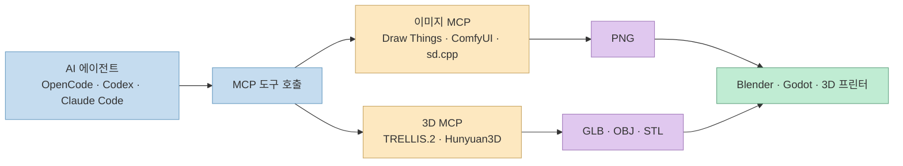
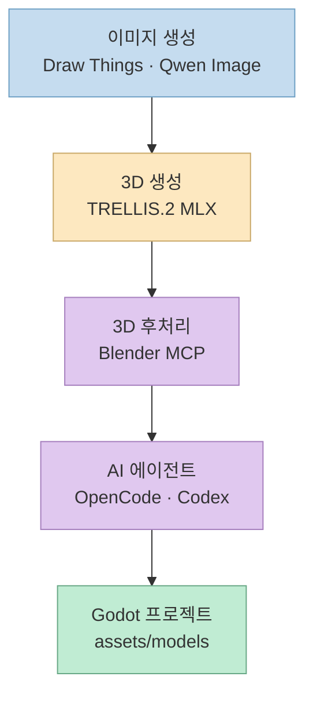

Mac M5와 통합 메모리 32GB 환경에서는 이미지 생성과 3D 모델 생성을 모두 로컬에서 구현할 수 있다. Claude Code, Codex, OpenCode, Paseo 같은 AI 코딩 에이전트에서 MCP를 호출해 이미지를 만들고, 이를 3D 모델로 변환한 다음 Blender나 Godot 프로젝트에 사용하는 방식이다.

핵심은 이미지 생성 엔진과 3D 생성 엔진을 분리하고 MCP로 통합하는 것이다.

<!--more-->

## Sources

- [공유된 ChatGPT 대화](https://chatgpt.com/s/t_6afd91b71f208191a7d2138c623d942d)

## 1. 추천하는 구성 5가지

| 구성 | 이미지 생성 | 3D 생성 | 난이도 |
|---|---|---|---|
| A. 간편형 | Draw Things | Hunyuan3D | 낮음~중간 |
| B. 통합형 | ComfyUI | TRELLIS.2 | 중간~높음 |
| C. 개발자형 | stable-diffusion.cpp | TRELLIS.2 MLX | 높음 |
| D. Blender 중심 | Draw Things | Hunyuan3D + Blender | 중간~높음 |
| E. 직접 구축 | 원하는 로컬 모델 | 원하는 로컬 모델 | 높음 |

처음 시도한다면 A 구성이 적합하다. 이미지와 3D 워크플로를 하나의 GUI에서 관리하려면 B, Qwen GGUF 모델과 MCP를 적극적으로 활용하려면 C 구성을 선택할 수 있다.



이 구조에서는 추론을 Mac에서 실행하므로 외부 이미지 생성 API 호출 비용이 발생하지 않는다. 다만 MCP를 사용하는 에이전트 자체가 유료 API에 연결되어 있다면 그 비용은 별도로 발생할 수 있다.

## 2. 방법 A — Draw Things + Hunyuan3D MCP

### Draw Things

Draw Things는 macOS에서 이미지 생성 모델을 쉽게 설치하고 실행할 수 있는 앱이다. API 서버를 활성화하면 MCP를 통해 제어할 수 있다. 기존 Draw Things 모델을 그대로 활용하려는 경우에 적합하다.

### 이미지 생성 MCP 설정

Draw Things가 설치되어 있다면 다음 순서로 진행한다.

1. Draw Things에서 이미지 생성 모델을 로드한다.
2. 설정에서 API Server를 활성화한다.
3. 기본 포트 `7860`을 확인한다.
4. MCP 클라이언트에 `mcp-drawthings`를 추가한다.

터미널에서 API 연결을 확인한다.

```bash
curl http://localhost:7860
```

Claude Desktop이나 Cursor에서 사용할 설정은 다음과 같다.

```json
{
  "mcpServers": {
    "drawthings": {
      "command": "npx",
      "args": ["-y", "mcp-drawthings"],
      "env": {
        "DRAWTHINGS_HOST": "localhost",
        "DRAWTHINGS_PORT": "7860",
        "DRAWTHINGS_OUTPUT_DIR": "/Users/USER/Pictures/ai-generated"
      }
    }
  }
}
```

`USER`는 macOS 계정 이름으로 교체하고 출력 폴더도 미리 생성해 둔다.

이 MCP는 `generate_image`, `check_status`, `get_config` 등의 도구를 제공한다. 텍스트 이미지 생성뿐 아니라 기존 이미지 변환도 지원한다. 공식 저장소는 [mcp-drawthings](https://github.com/james-see/mcp-drawthings)다.

### 3D 생성 MCP 추가

이미지를 3D 모델로 변환하려면 Hunyuan3D를 별도로 설치한다. Hunyuan3D 2.1은 이미지에서 3D 메시를 생성하고, 지원되는 파이프라인에서는 텍스처를 적용할 수 있는 오픈 모델이다. 게임 소품, 캐릭터, 장식 모델에 사용할 수 있다.

Apple Silicon용 MCP 서버와 Web UI가 함께 있는 [Hunyuan-mcp-webui](https://github.com/KouyamaCreate/Hunyuan-mcp-webui) 프로젝트가 있다.

```bash
brew install git python@3.10 node

git clone \
  https://github.com/KouyamaCreate/Hunyuan-mcp-webui.git

cd Hunyuan-mcp-webui
./setup_macos.sh
```

Web UI는 다음처럼 실행한다.

```bash
./run_web_ui.sh
```

접속 주소는 `http://127.0.0.1:8090`이다.

MCP 클라이언트에는 다음과 같이 추가한다.

```json
{
  "mcpServers": {
    "hunyuan3d": {
      "command": "/Users/USER/Hunyuan-mcp-webui/run_mcp_server.sh",
      "args": []
    }
  }
}
```

설치한 실제 경로에 맞게 수정한다. 이 프로젝트는 MCP로 이미지→3D 변환을 호출할 수 있으며 Apple Silicon의 MPS와 메모리 절약 설정을 지원한다. 다만 신규 커뮤니티 통합 프로젝트이므로 실사용 안정성은 직접 확인해야 한다.

이렇게 연결하면 AI 에이전트에 다음과 같이 명령할 수 있다.

> 귀여운 판타지 게임에 사용할 나무 보물상자 이미지를 생성하고, 배경을 제거한 다음 Hunyuan3D로 3D 모델을 만들어 `assets/models/chest.glb`로 저장해 줘.

이미지 MCP의 출력 파일을 3D MCP가 읽을 수 있는 경로로 전달하도록 에이전트에 지시해야 한다.

## 3. 방법 B — ComfyUI + TRELLIS.2

확장성과 워크플로 자동화가 중요하다면 ComfyUI를 추천한다. ComfyUI의 가장 큰 장점은 텍스트→이미지, 이미지 편집, 배경 제거, 3D 변환 등을 워크플로로 관리할 수 있다는 점이다.

### ComfyUI 설치

```bash
brew install python@3.11 git uv

git clone https://github.com/comfyanonymous/ComfyUI.git
cd ComfyUI

uv venv --python 3.11
source .venv/bin/activate

uv pip install torch torchvision torchaudio
uv pip install -r requirements.txt

python main.py --listen 127.0.0.1
```

브라우저에서 `http://127.0.0.1:8188`에 접속한다. Apple Silicon에서는 PyTorch MPS를 사용하는 구성이며, 설치 버전과 모델에 따라 추가 의존성 조정이 필요할 수 있다.

### 공식 Comfy MCP 연결

ComfyUI에는 공식 로컬 MCP 서버인 [Comfy MCP](https://github.com/Comfy-Org/comfy-mcp)가 있다. 이미지 생성, 워크플로 실행, 모델 탐색, 작업 진행 상태 조회 등을 지원한다.

이 프로젝트는 `comfy-cli`를 기반으로 작동하므로 일반 MCP 브리지처럼 HTTP 요청만 전달하는 방식보다 기능이 다양하다. M5 32GB는 공식 MCP 안내에서 로컬 이미지 생성이 가능한 메모리 구간에 해당하지만, 대형 모델은 여전히 메모리 부족이나 느린 생성 속도가 발생할 수 있다.

### TRELLIS.2로 3D 생성

TRELLIS.2는 Microsoft의 이미지→3D 생성 모델이다. 일반 버전은 CUDA 기반이지만 Apple Silicon에서 실행하도록 이식한 MLX 버전이 있다. 추천 프로젝트는 [trellis2mlx](https://github.com/lyonsno/trellis2mlx)다.

```bash
git clone https://github.com/lyonsno/trellis2mlx.git
cd trellis2mlx

uv venv .venv --python python3.11
source .venv/bin/activate
uv pip install -e .
```

모델 다운로드에는 Hugging Face 인증과 일부 모델의 접근 권한이 필요하다.

```bash
hf auth login

hf download microsoft/TRELLIS.2-4B
hf download microsoft/TRELLIS-image-large
hf download facebook/dinov3-vitl16-pretrain-lvd1689m
```

이미지를 GLB로 생성하는 예시는 다음과 같다.

```bash
PYTHONPATH=. python generate.py \
  --image input.png \
  --output output.glb \
  --seed 42 \
  --steps 8 \
  --no-cascade \
  --target-faces 100000 \
  --texture-size 512 \
  --simplify-first \
  --no-hole-fill \
  --repair-exterior-surface
```

이 설정은 32GB Mac에서 먼저 시도하기 좋은 저해상도 미리보기 구성이다. 고해상도 생성에는 더 많은 메모리와 시간이 필요하다.

MCP 연결 시 주의할 점은 `trellis2mlx` 자체가 CLI 도구라는 것이다. ComfyUI에 대응하는 커스텀 노드를 사용하거나, CLI 실행 명령을 감싼 별도의 MCP 서버를 만들어야 한다.

Apple Silicon용 ComfyUI 노드로는 [ComfyUI-TRELLIS.2-mac](https://github.com/zjkhurry/ComfyUI-TRELLIS.2-mac)을 참고할 수 있다.

### ComfyUI MCP 설치를 간단하게 하는 방법

기존 ComfyUI가 없는 경우 공식 CLI를 사용해 통합 설치할 수 있다.

```bash
mkdir -p ~/ai/comfy-mcp
cd ~/ai/comfy-mcp

uv venv --python 3.11
source .venv/bin/activate

uv pip install comfy-mcp "comfy-cli>=1.14.0"

comfy install
comfy launch
```

이후 MCP 클라이언트에 다음 명령을 등록한다.

```json
{
  "mcpServers": {
    "comfy": {
      "command": "/Users/USER/ai/comfy-mcp/.venv/bin/comfy-mcp",
      "env": {
        "COMFY_BIN": "/Users/USER/ai/comfy-mcp/.venv/bin/comfy"
      }
    }
  }
}
```

이 방식은 ComfyUI의 이미지 워크플로 실행을 위한 것이다. TRELLIS.2 워크플로는 별도 모델과 노드를 설치해야 한다.

## 4. 방법 C — stable-diffusion.cpp + Qwen Image + MCP

기존에 관심을 가지고 있던 Qwen Image GGUF 모델을 직접 실행하려면 이 구성을 선택할 수 있다. 이미지 생성 모델을 GUI 앱에 종속시키지 않고 CLI·서버 기반으로 관리하는 방식이다.

- Apple Metal 지원
- GGUF 모델
- MCP 연동
- 로컬 추론

### stable-diffusion.cpp 설치

```bash
brew install cmake git rust

git clone --recursive \
  https://github.com/leejet/stable-diffusion.cpp

cmake -S stable-diffusion.cpp \
  -B stable-diffusion.cpp/build \
  -DCMAKE_BUILD_TYPE=Release \
  -DSD_METAL=ON

cmake --build stable-diffusion.cpp/build \
  --config Release -j
```

빌드가 완료되면 `sd-server`를 사용할 수 있다.

### 이미지 MCP 설치

Qwen Image 2.1을 위한 MCP 서버로 [zavora-ai/mcp-imagegen](https://github.com/zavora-ai/mcp-imagegen)을 사용할 수 있다.

```bash
git clone https://github.com/zavora-ai/mcp-imagegen
cd mcp-imagegen

cargo install --path .
```

이 MCP는 Qwen Image 2.1 모델 프리셋, 이미지 생성 및 편집 등을 지원한다. 설정 예시는 다음과 같다.

```json
{
  "mcpServers": {
    "imagegen": {
      "command": "/Users/USER/.cargo/bin/mcp-imagegen",
      "env": {
        "MCP_IMAGEGEN_CONFIG_DIR": "/Users/USER/.config/mcp-imagegen"
      }
    }
  }
}
```

첫 실행으로 설정 파일을 생성한 다음 `config.toml`에서 모델 출력 경로와 `sd-server` 경로를 지정해야 한다. GGUF뿐 아니라 필요한 텍스트 인코더와 VAE도 함께 준비해야 한다.

M5 32GB에서는 우선 Q4 또는 Q5 양자화 모델부터 시험하는 편이 좋다. Q8은 메모리 점유량과 처리 시간을 비교한 다음 사용하는 것을 권장한다.

## 5. 방법 D — Blender MCP와 로컬 3D 생성 결합

이 방법은 단순한 3D 생성이 아니라, AI가 Blender에서 모델을 수정하고 작업까지 자동화하도록 만드는 방식이다.

Blender MCP는 자연어로 Blender의 오브젝트, 메시, 재질, 카메라, 렌더링 등을 조작할 수 있게 해준다.

설치:

```bash
brew install uv
uvx mcp-for-blender setup
```

Blender를 열고 MCP 애드온을 활성화한 뒤 MCP 서버를 시작한다. 에이전트 설정은 다음과 같다.

```json
{
  "mcpServers": {
    "blender": {
      "command": "uvx",
      "args": [
        "--python",
        "3.11",
        "mcp-for-blender"
      ]
    }
  }
}
```

공식 프로젝트는 [MCP for Blender](https://github.com/ahujasid/mcp-for-blender)다.

Blender MCP는 기본적으로 자연어로 3D 작업을 수행하는 도구이지, 생성형 3D 신경망 모델 자체는 아니다.

Hunyuan3D와 연결하려면 [blender-hunyuan3d-mac](https://github.com/larattalabs/blender-hunyuan3d-mac)도 참고할 수 있다. 이 프로젝트는 Mac에서 Hunyuan3D의 Shape·Texture 파이프라인을 실행하고 Blender와 연결한다. 다만 문서상 텍스처 생성 과정에 약 40GB의 여유 메모리를 요구하므로 현재 32GB Mac에서는 전체 고품질 파이프라인 실행이 어려울 수 있다.

## 6. 방법 E — 이미지·3D를 하나의 커스텀 MCP로 통합

여러 게임 프로젝트에서 반복해서 사용할 계획이라면 개인적으로 가장 확장성이 높은 구성이다. 하나의 MCP에 다음 도구를 제공하도록 만들 수 있다.

| MCP 도구 | 기능 |
|---|---|
| `generate_image` | 텍스트 → PNG |
| `edit_image` | 이미지 수정 |
| `remove_background` | 배경 제거 |
| `generate_3d` | 이미지 → GLB |
| `optimize_mesh` | 폴리곤 최적화 |
| `export_model` | GLB / OBJ / STL 변환 |
| `create_asset` | 이미지부터 최종 3D까지 일괄 실행 |

구현 기술은 Python + FastMCP를 추천한다.

```text
local-asset-mcp/
├── server.py
├── engines/
│   ├── image.py          # Draw Things 또는 sd.cpp
│   ├── trellis.py        # TRELLIS.2 MLX
│   ├── hunyuan.py        # Hunyuan3D
│   └── blender.py        # 후처리
├── workflows/
│   ├── image_to_3d.py
│   └── game_asset.py
└── outputs/
    ├── images/
    └── models/
```

서버 내부에서 이미지와 3D 모델을 순차적으로 호출하도록 만들면 MCP 클라이언트가 각각의 생성 엔진을 직접 이해할 필요가 없다.

단, 이 구조는 설계 예시이며 바로 실행 가능한 완성 프로그램은 아니다.

## 7. OpenCode에서 MCP를 연결하는 예시

OpenCode는 Claude Desktop과 MCP 설정 형식이 다르다. `~/.config/opencode/opencode.json` 또는 프로젝트의 `opencode.json`에 다음과 같이 설정할 수 있다.

```json
{
  "$schema": "https://opencode.ai/config.json",
  "mcp": {
    "drawthings": {
      "type": "local",
      "command": ["npx", "-y", "mcp-drawthings"],
      "enabled": true
    },
    "hunyuan3d": {
      "type": "local",
      "command": [
        "/Users/USER/Hunyuan-mcp-webui/run_mcp_server.sh"
      ],
      "enabled": true
    },
    "blender": {
      "type": "local",
      "command": [
        "uvx",
        "--python",
        "3.11",
        "mcp-for-blender"
      ],
      "enabled": true,
      "environment": {
        "BLENDER_HOST": "localhost",
        "BLENDER_PORT": "9876"
      }
    }
  }
}
```

각 MCP 서버의 의존성 설치가 끝났다는 전제의 설정이다. OpenCode 자체가 이미지를 생성하는 것은 아니며, 로컬 MCP 도구를 호출한다.

OpenCode 안에서는 다음처럼 사용할 수 있다.

> 로컬 이미지 모델로 귀여운 로봇 캐릭터를 생성하고, Hunyuan3D를 이용해 3D GLB 모델을 만들어 줘. 생성된 GLB를 Blender에서 열고 폴리곤 수를 최적화한 다음 Godot 프로젝트의 assets/models 디렉터리에 저장해 줘.

## 8. M5 32GB 기준 최종 추천

| 목적 | 추천 조합 |
|---|---|
| 가장 간편한 이미지 생성 | Draw Things + MCP |
| Qwen GGUF 사용 | stable-diffusion.cpp + mcp-imagegen |
| 다양한 이미지 워크플로 | ComfyUI + 공식 MCP |
| 로컬 이미지→3D | TRELLIS.2 MLX |
| 빠르게 3D 파이프라인 구성 | Hunyuan3D MCP |
| 3D 수정 및 자동화 | Blender MCP |
| 게임 에셋 자동 생성 | 이미지 MCP + TRELLIS.2 + Blender MCP |

32GB 메모리는 이미지 모델과 3D 모델을 동시에 상주시킬 때 부족할 가능성이 있다. 따라서 이미지 생성을 완료하고 메모리를 해제한 다음 3D 추론을 실행하는 순차 처리 방식을 권장한다.

또한 게임용 GLB와 달리 3D 프린팅용 STL은 별도의 메시 복구, watertight 검사, 두께 및 치수 검증이 필요하다. 생성형 AI의 출력이 바로 출력 가능한 CAD 모델이 되는 것은 아니다.

가장 추천하는 실제 구성은 다음과 같다.



처음에는 Draw Things MCP와 Blender MCP를 연결하고, 그다음 TRELLIS.2 MLX를 추가하는 순서가 설치와 문제 해결 측면에서 가장 무난하다.

현재 공개된 Apple Silicon 이식 프로젝트들은 지속적으로 변경되고 있으므로, 특히 3D 생성 엔진은 32GB 환경에서 미리보기 수준의 테스트를 먼저 수행하는 것이 좋다.

## 핵심 요약

- 이미지 생성 엔진과 3D 생성 엔진을 분리하고 MCP로 연결한다.
- 가장 간단한 시작점은 Draw Things + Hunyuan3D MCP다.
- 다양한 워크플로를 구성하려면 ComfyUI + TRELLIS.2를 사용할 수 있다.
- Qwen GGUF 모델을 직접 다루려면 stable-diffusion.cpp + mcp-imagegen 구성이 적합하다.
- Blender MCP는 생성형 3D 모델 자체가 아니라 Blender 작업을 자연어로 자동화하는 도구다.
- M5 32GB에서는 이미지와 3D 모델을 동시에 상주시키기보다 순차 처리하는 편이 안전하다.
- 게임용 GLB와 3D 프린팅용 STL은 후처리와 검증 기준이 다르다.

## 결론

M5 32GB Mac에서 로컬 이미지 생성, 이미지→3D 변환, Blender 후처리, Godot 반입까지 이어지는 게임 에셋 파이프라인을 구성할 수 있다. 처음부터 모든 엔진을 연결하기보다 Draw Things MCP와 Blender MCP로 기본 흐름을 만든 다음 TRELLIS.2 MLX 또는 Hunyuan3D를 추가하는 방식이 설치와 문제 해결에 유리하다.

