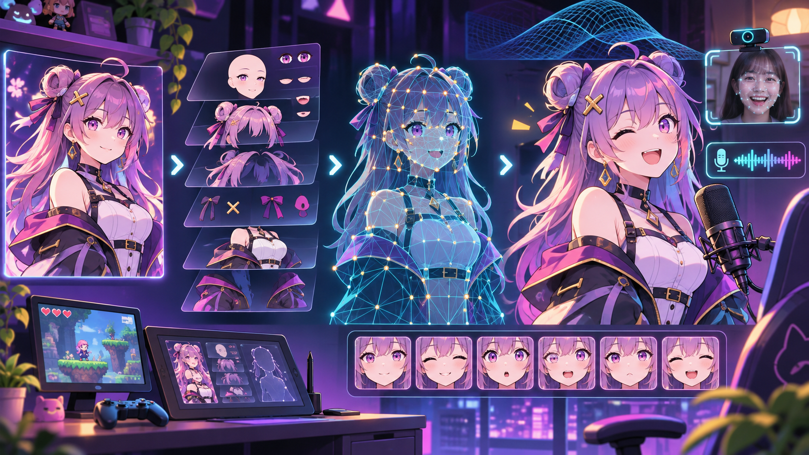
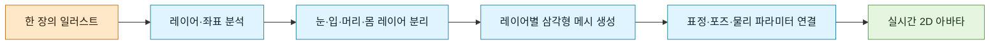
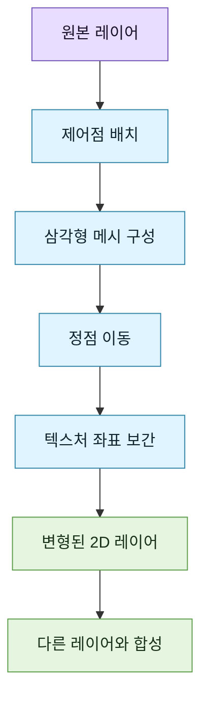
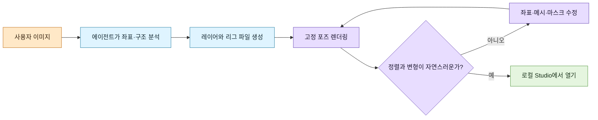
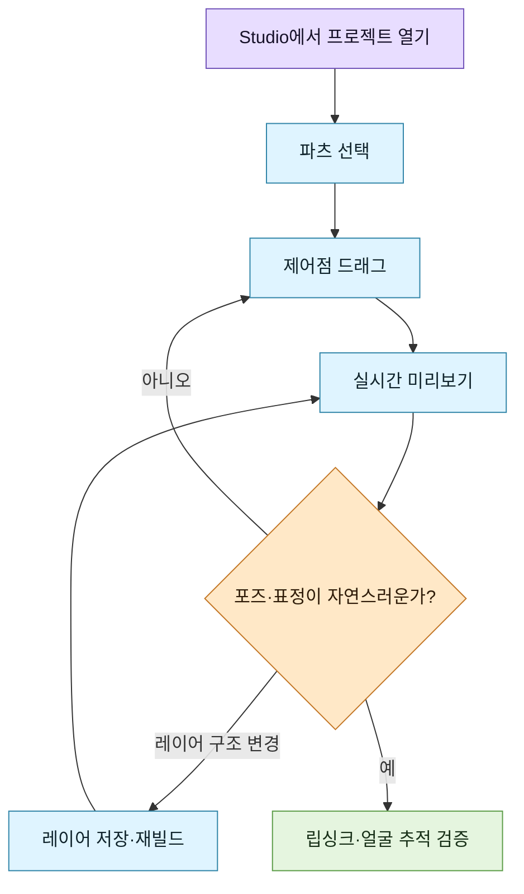
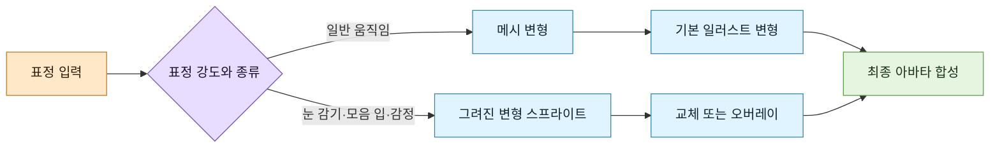
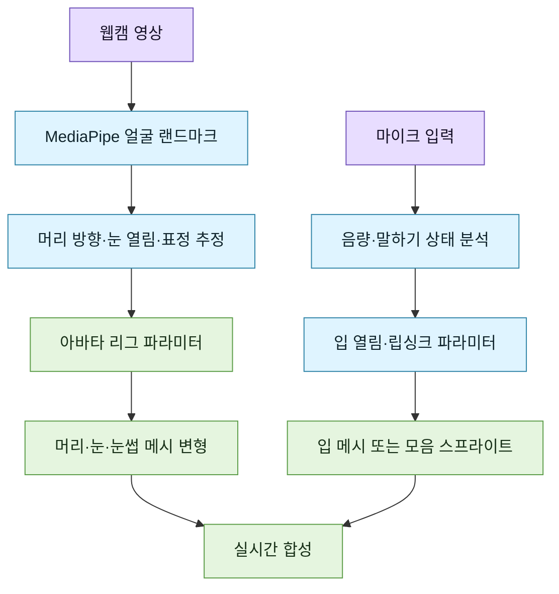
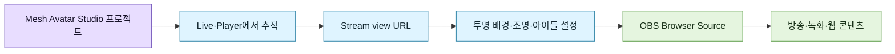

2D 캐릭터를 방송용 아바타나 게임 캐릭터로 움직이려면 눈·입·머리카락·몸의 움직임을 각각 준비해야 한다. 전통적인 방식에서는 일러스트를 여러 파츠로 나누고, 리깅하고, 표정과 물리를 조정하는 작업이 필요하다.

한 [Threads 게시물](https://www.threads.com/share/BBX_z9TEvy)은 오픈소스 [Mesh Avatar Studio](https://github.com/shinshin86/mesh-avatar-studio)를 소개하며 “일러스트 한 장으로 눈 깜빡임, 표정 변화, 음성 기반 립싱크를 구현할 수 있다”고 설명한다. 공식 저장소를 확인하면 이 프로젝트는 단순한 이미지 애니메이션 필터가 아니라, 코딩 에이전트가 초기 아바타 구조를 만들고 로컬 편집기에서 메시 포인트와 움직임을 보정하는 하이브리드 도구다.

이 글에서는 한 장의 그림이 어떻게 움직이는 아바타가 되는지, 어떤 부분을 AI 에이전트에 맡기고 어떤 부분을 사람이 직접 조정해야 하는지, 게임·버튜버·웹 콘텐츠 제작에 어떻게 활용할 수 있는지 정리한다.

<!--more-->

## Sources

- [Threads 원문 공유 링크](https://www.threads.com/share/BBX_z9TEvy) — Mesh Avatar Studio를 소개한 게시물.
- [Threads 원문 게시물](https://www.threads.com/@sandpia_com/post/DgIIo6Pmge7) — 작성자 `sandpia_com`의 본문과 기술 스택 설명.
- [Mesh Avatar Studio 공식 저장소](https://github.com/shinshin86/mesh-avatar-studio) — 설치, 에이전트 제작, 로컬 편집기, 얼굴 추적·립싱크 기능.
- [공식 에이전트 가이드](https://github.com/shinshin86/mesh-avatar-studio/blob/main/docs/agent-guide.md) — 이미지 좌표 보정, 레이어 생성, 포즈 검토 절차.
- [공식 레퍼런스 문서](https://github.com/shinshin86/mesh-avatar-studio/blob/main/docs/reference.md) — Player·Stream view·OBS Browser Source 연결 방법.
- [아바타 포맷 문서](https://github.com/shinshin86/mesh-avatar-studio/blob/main/docs/format.md) — `.mavatar`, 폴더 URL, 런타임 로딩 구조.

## 1. 한 장의 이미지가 바로 움직이는 것은 아니다

Threads 게시물은 한 장의 이미지로 2D 캐릭터를 만들고 눈 깜빡임, 표정 변화, 음성 기반 립싱크를 구현할 수 있다고 소개한다. 공식 저장소의 설명도 한 장의 일러스트를 애니메이션 2D 메시 아바타로 바꿔 눈을 깜빡이고, 말하고, 고개를 돌리고, 숨 쉬고, 머리카락을 흔들 수 있다고 설명한다.

하지만 원본 일러스트 한 장의 모든 픽셀이 자동으로 독립된 파츠가 되는 것은 아니다. Mesh Avatar Studio의 핵심은 다음 네 가지를 조합하는 데 있다.

1. **레이어 분리**: 눈, 입, 머리카락, 몸처럼 움직임이 필요한 부위를 분리한다.
2. **메시 변형**: 각 레이어를 삼각형 메시로 나누고 제어점의 움직임으로 이미지를 변형한다.
3. **입력 신호 연결**: 얼굴 방향, 눈 상태, 음성 크기와 음소를 아바타 파라미터로 전달한다.
4. **로컬 편집과 검수**: 자동으로 만든 결과를 사람이 직접 보고 포인트와 움직임을 보정한다.



따라서 이 도구는 “이미지 한 장을 자동으로 Live2D 파일로 변환하는 버튼”이라기보다, 초기 리깅 작업을 에이전트가 준비하고 사용자가 로컬 편집기에서 품질을 완성하는 파이프라인에 가깝다.

## 2. 메시 변형은 어떻게 2D 그림에 깊이를 만든다

일러스트 레이어는 평면 이미지지만, 이미지 위에 제어점과 삼각형을 배치하면 일부 영역을 늘리거나 기울일 수 있다. 머리를 오른쪽으로 돌릴 때 얼굴 레이어의 한쪽 제어점을 이동하고, 머리카락 레이어를 별도 메시로 흔들면 입체적으로 보이는 움직임을 만들 수 있다.



이 방식은 실제 3D 모델처럼 새로운 옆면을 만들어 내는 것이 아니다. 원본 이미지의 픽셀을 메시의 정점 이동에 맞춰 늘리고 줄이는 방식이므로, 회전 각도가 커질수록 그림이 찌그러질 수 있다. 그래서 정면에 가까운 캐릭터, 머리와 어깨 중심의 일러스트, 투명 배경 PNG가 좋은 입력으로 권장된다. [공식 저장소의 입력 권장 사항](https://github.com/shinshin86/mesh-avatar-studio#step-1-ask-your-agent-to-create-the-avatar)

게임 개발 관점에서는 이 절충이 오히려 장점이 될 수 있다. 완전한 3D 캐릭터보다 제작 비용이 낮고, 2D 일러스트의 스타일을 유지하면서 제한된 범위의 호흡·깜빡임·고개 움직임·머리카락 흔들림을 추가할 수 있기 때문이다.

## 3. 코딩 에이전트가 맡는 초기 리깅

공식 워크플로에서 첫 단계는 Claude Code나 Codex 같은 코딩 에이전트에게 일러스트와 에이전트 가이드를 전달하는 것이다. 에이전트는 이미지 좌표를 확인하고, 확대된 격자에서 리그를 배치하고, 이미지를 레이어로 분리하고, 고정된 포즈에서 결과를 검토한다. [공식 에이전트 가이드](https://github.com/shinshin86/mesh-avatar-studio/blob/main/docs/agent-guide.md)

저장소는 Codex CLI를 사용해 `npm run create -- /path/to/your-image.png` 형태로 아바타 프로젝트를 만들 수 있다고 안내한다. 원본 이미지가 없을 때는 랜덤 캐릭터를 생성하는 옵션도 제공하지만, 실제 프로젝트에서는 사용 권한이 확인된 이미지를 사용하는 편이 안전하다.

초기 생성 단계에서 에이전트가 수행하는 작업은 다음과 같이 나눌 수 있다.

- 이미지에서 머리·몸·눈·입·머리카락의 위치를 읽는다.
- 각 파츠가 다른 파츠 위에 어떻게 겹치는지 추정한다.
- 움직임을 줄 제어점과 메시 경계를 만든다.
- 눈을 감은 형태와 입 모양을 추가할 준비를 한다.
- 고개 회전, 눈 깜빡임, 호흡, 머리카락 흔들림을 포즈로 검토한다.



에이전트는 반복적인 좌표 작업을 빠르게 수행할 수 있지만, 생성 결과가 모든 일러스트에서 완벽하다고 가정하면 안 된다. 눈·손·머리카락 경계가 잘못 읽히거나, 메시가 옷과 몸을 잘못 연결할 수 있기 때문에 로컬 편집기에서 직접 확인하는 단계가 필수다.

## 4. 로컬 편집기에서 사람이 해야 하는 일

공식 저장소의 편집기는 왼쪽에서 파츠를 선택하고 이미지 위의 점을 드래그해 위치를 조정하며, 오른쪽 미리보기에서 결과를 확인하는 구조다. 샘플 프로젝트는 읽기 전용으로 열리고, 복사한 뒤 자신의 프로젝트로 편집을 이어 갈 수 있다.

작업 순서는 다음과 같다.

1. `npx create-mesh-avatar-studio`로 프로젝트를 생성한다.
2. `npm run dev`로 로컬 편집기를 실행한다.
3. 프로젝트를 열고 파츠를 선택한다.
4. 이미지 위의 제어점을 드래그해 눈·입·머리카락·몸의 위치를 맞춘다.
5. Pose test에서 고개를 돌리고 기울이며 눈을 감긴다.
6. 문제가 있는 레이어의 포인트와 마스크를 다시 조정한다.
7. 레이어를 바꾸었다면 Save and rebuild layers로 다시 생성한다.



메시 포인트를 고치는 작업은 단순한 미관 조정이 아니다. 눈과 손의 외곽선, 머리·머리카락·번의 영역은 이미지가 레이어로 잘리는 방식에도 영향을 줄 수 있다. 공식 문서가 특정 값을 바꾼 뒤 레이어 재빌드를 요구하는 이유도 여기에 있다.

## 5. 눈 깜빡임과 표정은 두 가지 방식으로 만든다

메시 변형만으로 눈과 입을 움직일 수도 있다. 눈 주변 메시를 닫힌 형태로 변형하거나, 입 주변을 벌리고 오므리는 방식이다. 다만 원본 일러스트의 눈과 입이 평면으로만 늘어나면 표정이 어색해질 수 있다.

Mesh Avatar Studio는 그 대안으로 그려진 변형 이미지를 추가할 수 있다. 공식 문서에서는 닫힌 눈과 모음별 입 모양을 별도로 그려 넣으면 깜빡임과 말하기가 더 자연스러워진다고 설명한다. 슬프거나 놀란 눈, 화나거나 슬픈 닫힌 입 같은 표정 변형도 선택적으로 추가할 수 있다. [공식 Drawn variants 설명](https://github.com/shinshin86/mesh-avatar-studio#step-4-get-drawn-eyes-and-mouths)



게임에서는 두 방식을 혼합하는 것이 좋다. 호흡과 약한 고개 움직임은 메시 변형으로 처리하고, 눈을 완전히 감거나 특정 감정을 보여 주는 순간에는 그려진 변형을 사용하는 식이다. 이렇게 하면 전체 애니메이션을 손으로 그리지 않으면서도 중요한 표정의 품질을 확보할 수 있다.

## 6. 얼굴 추적과 립싱크 연결

Mesh Avatar Studio의 Player는 웹캠으로 얼굴 움직임을 추적하고, 마이크 입력으로 입을 움직이는 실행 경로를 제공한다. 게시물은 이미지 한 장으로 눈 깜빡임과 음성 기반 립싱크까지 구현할 수 있다고 요약하지만, 실제 결과는 입력 장치와 보정 상태에 따라 달라진다.

얼굴 추적은 카메라에서 얻은 얼굴 랜드마크를 아바타 파라미터로 변환한다. 예를 들어 얼굴의 좌우 회전은 머리 메시의 회전·변형량으로, 눈의 열림 정도는 눈 메시나 눈 스프라이트의 상태로, 입의 열림과 발화 상태는 입 파라미터로 매핑할 수 있다.



얼굴 추적에서는 중립 자세 보정이 중요하다. 카메라를 켠 순간의 얼굴이 이미 한쪽으로 기울어져 있으면 아바타가 계속 고개를 갸웃할 수 있다. 립싱크는 음량만으로도 입을 열 수 있지만, 모음별 입 모양을 사용하려면 음성 분석과 아바타의 입 스프라이트 매핑이 추가로 필요하다.

## 7. OBS와 웹 콘텐츠로 연결하기

공식 레퍼런스에는 아바타만 표시하는 Stream view가 제공된다. 배경을 투명하게 만들고, 아이들 애니메이션·조명·그림자 설정을 URL 파라미터로 조정할 수 있다. 이 URL을 OBS Browser Source로 추가하면 방송 장면 위에 아바타를 배치할 수 있다. [공식 Stream view 문서](https://github.com/shinshin86/mesh-avatar-studio/blob/main/docs/reference.md#stream-view-url)



이 구조는 게임에 캐릭터를 직접 삽입하는 것과 다르다. 게임 엔진 안에서 아바타를 렌더링할 수도 있지만, OBS와 브라우저를 이용하면 방송용 오버레이나 웹 페이지의 인터랙티브 캐릭터로 빠르게 활용할 수 있다. 공식 저장소는 런타임 패키지를 폴더 URL이나 `.mavatar` 아카이브로 로드하는 API도 제공한다. [아바타 포맷 문서](https://github.com/shinshin86/mesh-avatar-studio/blob/main/docs/format.md)

## 8. 설치와 최소 실행 흐름

공식 README는 Node.js 22.17 이상과 Git을 요구한다. 기본 샘플을 실행하는 가장 짧은 흐름은 다음과 같다.

```bash
npx create-mesh-avatar-studio
cd mesh-avatar-studio
npm run dev
```

저장소를 직접 복제했다면 `npm install` 뒤 `npm run doctor`로 필요한 도구를 확인할 수 있다. 편집기와 Live 페이지는 Node.js만으로 동작하지만, 에이전트가 레이어를 재생성하거나 포즈 리뷰를 실행하는 과정에는 Python·uv·Playwright Chromium이 추가로 사용될 수 있다. [공식 설치 안내](https://github.com/shinshin86/mesh-avatar-studio#try-the-sample)

실제 프로젝트에서의 권장 순서는 다음과 같다.

1. 투명 배경의 정면 상반신 일러스트를 준비한다.
2. 라이선스와 상업적 사용 가능 여부를 확인한다.
3. 로컬 프로젝트를 생성하고 에이전트에게 `docs/agent-guide.md`를 따르도록 한다.
4. 에이전트가 만든 리그를 Studio에서 연다.
5. Pose test로 머리 회전·눈 감기·호흡·머리카락을 검수한다.
6. 필요한 경우 제어점을 드래그하고 레이어를 재빌드한다.
7. 립싱크와 얼굴 추적을 테스트한다.
8. Stream view와 OBS Browser Source를 연결한다.

## 9. 게임 개발에서의 활용 범위와 한계

### 활용하기 좋은 경우

- 대화형 NPC나 상점 주인처럼 상반신 중심의 캐릭터
- 2D 게임의 대화 장면과 이벤트 컷신
- 웹 게임의 안내 캐릭터와 튜토리얼 아바타
- 버튜버·스트리밍용 방송 캐릭터
- 일러스트를 유지하면서 가벼운 호흡·깜빡임·표정만 추가해야 하는 프로토타입

### 주의해야 하는 경우

- 캐릭터가 360도로 회전하거나 전신 동작을 크게 해야 하는 게임
- 옆모습과 뒷모습의 새로운 정보를 만들어야 하는 경우
- 원본 이미지에 머리카락·손·의상이 서로 많이 겹치는 경우
- 실시간 추적 지연이 게임 플레이에 직접 영향을 주는 경우
- 사용하려는 원본 일러스트의 라이선스가 불명확한 경우

메시 변형은 원본 그림에 없는 정보를 새로 만드는 3D 모델링이 아니다. 카메라 각도가 커지면 텍스처가 늘어나거나 레이어가 겹칠 수 있고, 분리되지 않은 부분은 함께 움직인다. 따라서 게임의 핵심 플레이어블 캐릭터보다, 제한된 각도와 표정으로도 충분한 NPC·방송 캐릭터·프로토타입에 먼저 적용하는 것이 안전하다.

## 핵심 요약

- **Mesh Avatar Studio는 이미지 한 장을 즉시 완성형 3D 모델로 만드는 도구가 아니다.** 레이어 분리와 메시 변형을 이용해 제한된 범위의 2D 움직임을 만든다.
- **코딩 에이전트는 초기 리깅과 파일 생성을 담당**하고, 사용자는 로컬 편집기에서 제어점과 포즈를 직접 보정한다.
- **메시 변형과 그려진 표정 변형을 함께 사용할 수 있다.** 일반적인 호흡·고개 움직임은 메시로, 눈 감기와 감정 표현은 별도 스프라이트로 처리하면 품질을 높일 수 있다.
- **MediaPipe 얼굴 추적과 마이크 립싱크**를 아바타 파라미터에 연결해 실시간 반응을 만든다.
- **OBS Browser Source와 Stream view**를 이용하면 별도의 게임 엔진 통합 없이 방송용 오버레이로 활용할 수 있다.
- **좋은 입력은 정면 상반신·투명 배경 일러스트**이며, 큰 회전과 전신 동작에는 3D 리깅이나 더 많은 원화가 필요하다.
- **사람의 검수는 필수**다. 자동 생성된 메시의 좌표, 레이어 경계, 포즈, 추적 중 찌그러짐을 직접 확인해야 한다.

## 결론

Mesh Avatar Studio의 핵심은 AI가 일러스트를 마법처럼 움직이게 만든다는 데 있지 않다. 한 장의 이미지에서 움직임에 필요한 구조를 추출하고, 메시 변형으로 저렴한 2D 애니메이션을 만들고, 얼굴·음성 입력을 파라미터에 연결한 뒤, 사람이 로컬 편집기에서 품질을 조정하는 데 있다.

게임 개발자에게는 완성된 2D 캐릭터 리깅에 들어가기 전 프로토타입 도구로 유용하다. 버튜버와 콘텐츠 제작자에게는 기존 일러스트를 빠르게 방송용 아바타로 확장하는 방법이 될 수 있다. 다만 원본에 없는 시점과 동작을 만들어 주는 도구는 아니므로, 캐릭터의 활동 범위와 카메라 각도를 먼저 정한 뒤 적용하는 것이 가장 현실적이다.
