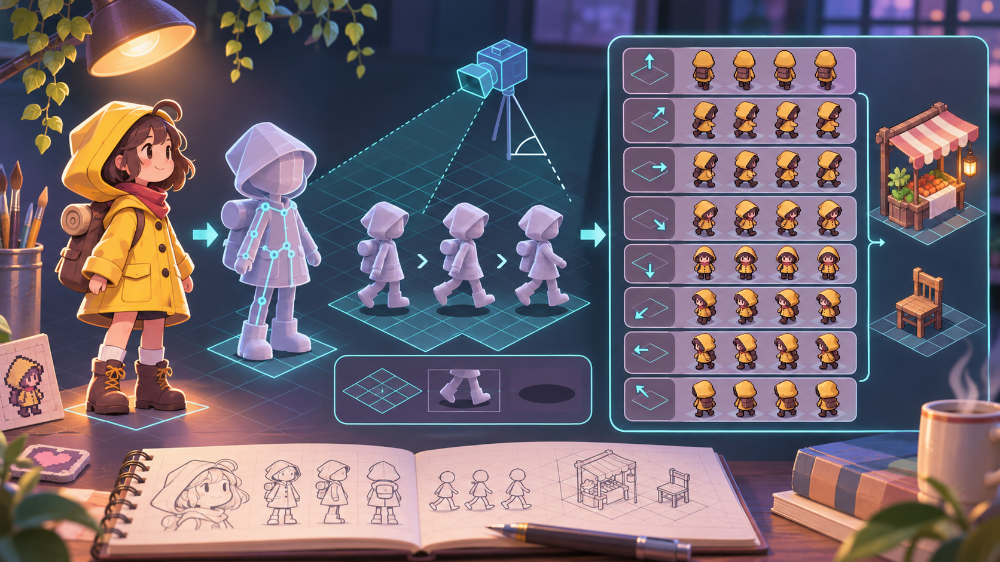
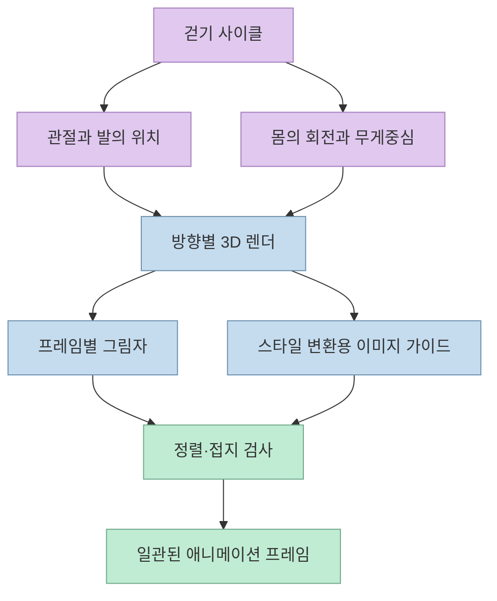
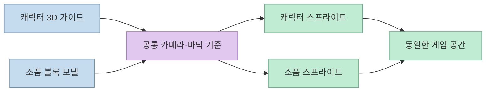
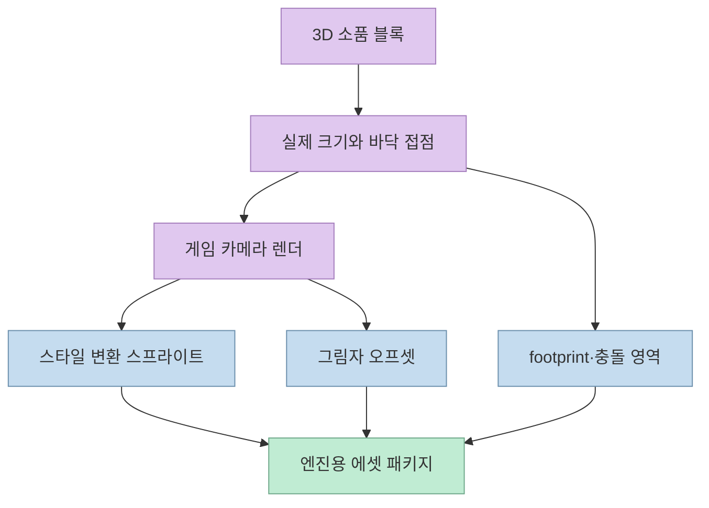
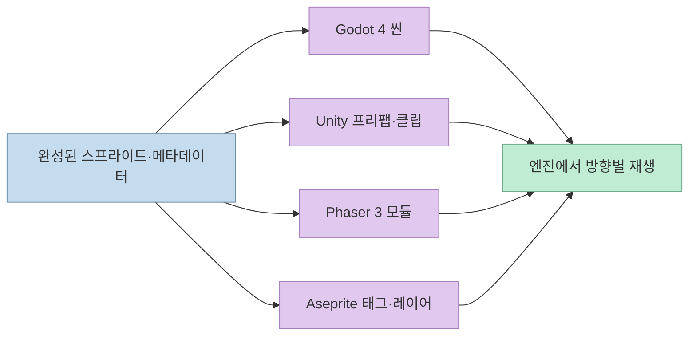
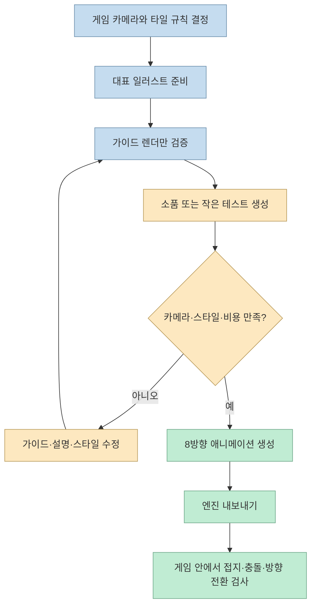

2D 게임에서 캐릭터 한 명을 여러 방향으로 걷게 하려면 같은 캐릭터를 여러 각도와 여러 포즈로 반복해서 그려야 한다. AI 이미지 모델에 “이 캐릭터가 8방향으로 걷는 스프라이트를 만들어 달라”고 요청하는 방법도 있지만, 프레임마다 다리가 같은 쪽에 놓이거나 카메라 각도와 그림자가 달라지는 문제가 생긴다.

[SpriteCast](https://github.com/Sunghwan0112/spritecast)는 이 문제를 3D 가이드와 이미지 생성의 역할 분리로 해결하려는 Claude Code 플러그인이다. 3D 모델이 자세·걷기 동작·카메라·그림자를 먼저 결정하고, 이미지 모델은 그 결과를 입력 그림체에 맞춰 다시 그린다. 따라서 AI에게 모든 프레임의 구조를 상상하게 하는 대신, 움직임과 공간 관계는 3D에 맡기고 스타일 변환만 이미지 모델에 맡긴다.

<!--more-->

## Sources

- [Threads 원문](https://www.threads.com/share/_yunX6LJ7) — SpriteCast와 Claude Code 설치 방법을 소개한 게시물.
- [SpriteCast 공식 저장소](https://github.com/Sunghwan0112/spritecast) — 기능, 설치, 처리 단계, 비용 안내, 엔진별 내보내기.
- [SpriteCast SKILL.md](https://github.com/Sunghwan0112/spritecast/blob/main/skills/spritecast/SKILL.md) — 3D 가이드 기반 소품·캐릭터 생성 스킬의 실행 방법.
- [SpriteCast 라이선스](https://github.com/Sunghwan0112/spritecast/blob/main/LICENSE) — 코드와 예제에 적용된 MIT 라이선스.

> 비용, 지원 모델, 엔진 버전은 저장소와 외부 API 정책에 따라 바뀔 수 있다. 비용과 버전 관련 내용은 2026년 11월 27일 공식 README에서 확인한 대략적인 값이며, 실제 실행 전 플러그인이 표시하는 비용을 다시 확인해야 한다.

## 1. 문제는 이미지 생성보다 프레임 간 일관성이다

걷기 애니메이션은 예쁜 그림을 여러 장 만드는 작업과 다르다. 다음 조건이 모든 프레임에서 동시에 유지되어야 한다.

- 같은 캐릭터의 얼굴·의상·신체 비율
- 발이 번갈아 앞뒤로 움직이는 보행 주기
- 게임에서 사용하는 카메라의 높이와 방향
- 캐릭터가 실제로 서 있는 지점과 발의 기준점
- 프레임마다 이어지는 그림자와 광원 방향

이미지 모델에 텍스트로 포즈만 설명하면 각 프레임의 구조가 독립적으로 생성되기 쉽다. SpriteCast의 핵심은 이 구조적 문제를 이미지 모델의 프롬프트로 해결하려 하지 않는 데 있다.


## 2. SpriteCast의 3D 가이드 파이프라인

공식 저장소가 설명하는 캐릭터 처리 흐름은 다음과 같다.

1. 정면을 보고 똑바로 선 캐릭터 일러스트에서 턴어라운드 정보를 만든다.
2. 3D 모델을 생성하고 리깅한 뒤 걷기와 대기 동작을 적용한다.
3. 게임의 카메라 각도로 각 방향의 동작을 렌더링한다.
4. 이미지 모델이 렌더 결과 위에 원본 그림체를 입힌다.
5. 결과 프레임을 다시 렌더 가이드에 맞춰 정렬하고, 머리 크기·외곽선·발 위치를 확인한다.
6. 스프라이트 시트와 그림자, 엔진에서 사용할 기준점 정보를 내보낸다.

여기서 3D 모델은 최종 화면에 그대로 보이는 모델이라기보다 일관된 포즈와 공간 관계를 제공하는 중간 가이드다. 최종 결과는 2D 또는 픽셀아트 스프라이트지만, 프레임마다 다른 포즈를 만들어 내는 일은 3D 애니메이션이 담당한다.

## 3. 왜 3D가 발과 그림자를 안정시키는가

걷기 동작에서 가장 눈에 띄는 오류는 발의 순서와 지면 접촉이다. 이미지 모델만으로 여러 방향을 생성하면 앞 프레임과 뒤 프레임에서 같은 발이 계속 앞에 놓이거나, 캐릭터가 지면에서 살짝 떠 보일 수 있다.

3D 가이드에서는 관절의 위치와 보행 사이클이 먼저 결정된다. 카메라가 바뀌어도 같은 모델의 같은 동작을 렌더링하므로 방향별 프레임이 하나의 움직임에서 파생된다. 그림자도 각 프레임의 3D 몸체와 광원에서 계산되므로 발이 들리거나 내려갈 때 그림자의 형태가 함께 달라진다.



다만 3D 가이드가 모든 그림 오류를 해결하지는 않는다. 공식 문서도 외곽선 검사만으로 머리가 잘못 돌아간 것까지 알아내지는 못한다고 설명한다. 따라서 최종 결과는 실제 게임 안에서 프레임을 재생하고, 방향 전환과 발 접지를 직접 확인해야 한다.

## 4. 카메라를 고정하면 캐릭터와 소품을 같은 세계에 놓을 수 있다

SpriteCast는 캐릭터뿐 아니라 소품도 같은 방식으로 처리한다. 포장마차, 의자, 책장 같은 물체를 실제 크기의 블록으로 구성하고, 게임에서 사용할 카메라로 렌더링한 뒤 스타일을 입힌다.

이 방식의 장점은 캐릭터와 소품의 화면상 크기와 방향을 맞추기 쉽다는 점이다. 캐릭터는 8방향으로 걷는데 의자는 정면 그림 한 장만 갖고 있거나, 포장마차가 캐릭터와 다른 카메라 각도로 그려져 있으면 장면 전체가 어색해진다. 같은 카메라 가이드와 바닥 기준을 사용하면 두 종류의 에셋을 한 공간에 배치하기 쉬워진다.

공식 README에는 기본 2:1 아이소메트릭 카메라, true isometric, 3/4 top-down, front, 사용자 지정 pitch·yaw 설정이 소개되어 있다. 프로젝트가 이미 사용하는 카메라와 가장 가까운 설정을 고르는 것이 중요하다.



## 5. 픽셀아트와 일반 일러스트를 나누어 생각한다

SpriteCast는 일반 스프라이트뿐 아니라 픽셀아트 출력도 지원한다. 공식 README는 캐릭터를 약 100픽셀 높이로 만드는 흐름과, 약 96픽셀 또는 64픽셀 높이의 픽셀 세트를 설명한다.

픽셀아트에서는 단순히 큰 이미지를 축소하는 것보다 픽셀 단위의 실루엣과 색상 수가 중요하다. 따라서 다음 항목을 먼저 결정하는 편이 좋다.

- 캐릭터의 최종 높이와 게임 내 타일 크기
- 외곽선의 두께와 색상 수
- 그림자를 별도 레이어로 둘지, 스프라이트에 구워 넣을지
- 8방향 모두를 그릴지, 대각선 4방향만 그릴지
- 작은 해상도에서 얼굴과 손을 얼마나 단순화할지

공식 README의 `facings` 설정으로 대각선 4방향만 먼저 그리는 선택지도 안내된다. 제작 비용은 줄일 수 있지만, 그 결과를 모든 방향의 완전히 새로운 그림으로 오해해서는 안 된다. 직선 이동 방향에서는 가장 가까운 방향 프레임을 재사용하는 방식이므로, 게임의 카메라와 움직임에 맞는지 확인해야 한다.

## 6. 소품은 스프라이트만이 아니라 기준점과 충돌 정보까지 필요하다

게임에 소품을 넣을 때 필요한 것은 PNG 한 장뿐이 아니다. 캐릭터가 어느 지점에 서는지, 그림자를 어디에 그리는지, 플레이어가 어느 부분을 통과할 수 없는지까지 정해야 한다.

SpriteCast의 소품 출력은 스프라이트와 그림자, 기준점 정보를 포함하는 JSON을 만들 수 있다. 공식 문서에는 다음과 같은 정보가 소개되어 있다.

- **anchor**: 소품이 바닥에 닿는 기준점
- **shadow offset**: 그림자를 스프라이트와 얼마나 떨어뜨려 그릴지
- **pixel-per-metre**: 3D 공간과 2D 출력 크기를 연결하는 기준
- **footprint·collision polygon**: 캐릭터가 소품을 통과할 수 없는 바닥 영역

이 정보가 있으면 소품을 눈대중으로 배치하는 대신, 게임 월드의 좌표와 바닥 기준에 맞춰 정렬할 수 있다.



## 7. Godot·Unity·Phaser로 내보내는 방법

공식 저장소가 안내하는 내보내기 대상은 캐릭터 기준으로 Godot, Unity, Phaser, Aseprite다. 캐릭터 애니메이션을 만든 뒤 엔진별 출력 파일을 생성할 수 있다.

- **Godot 4**: 그림자·몸체·효과를 포함한 씬과 간단한 재생 스크립트
- **Unity**: 스프라이트 스트립과 에디터 스크립트, 애니메이션 클립과 프리팹 구성
- **Phaser 3**: 프리로드·생성·애니메이션 재생에 사용할 JavaScript 모듈
- **Aseprite**: 방향별 태그와 그림자·몸체·효과 레이어를 가진 파일

소품은 Godot 4와 Phaser 3 내보내기가 문서에 소개되어 있다. Unity와 Aseprite에 대한 소품 지원 범위는 캐릭터와 같다고 가정하지 말고, 현재 저장소의 문서를 확인해야 한다.



## 8. 설치와 실행 비용을 확인한다

Claude Code에서는 다음 두 명령으로 마켓플레이스와 플러그인을 설치할 수 있다.

```bash
claude plugin marketplace add Sunghwan0112/spritecast
claude plugin install spritecast@spritecast
```

플러그인은 Python 3.9 이상과 브라우저가 필요하며, 첫 실행에서 자체 가상환경과 필요한 패키지를 준비한다. 걷는 캐릭터를 만들 때는 이미지 생성용 OpenAI 키와 3D 모델·리깅에 사용하는 Tripo 키가 필요하다. 소품처럼 이미지 생성만 사용하는 단계와 캐릭터 리깅까지 사용하는 단계의 외부 서비스 요구사항이 다르다.

공식 README는 예시 비용을 다음처럼 안내한다.

- 소품 한 면: 약 0.07달러
- 추가 소품 방향: 면당 약 0.08달러
- 8방향 보행 캐릭터: 이미지 생성 비용 약 2.2달러와 Tripo 크레딧
- 픽셀아트 보행 시트: 설정과 해상도에 따라 약 0.7~1.35달러 수준

이는 고정 요금이 아니라 외부 API의 모델·해상도·크레딧 정책에 영향을 받는 대략적인 값이다. 실행 중 유료 단계에서 표시되는 비용을 확인하고 승인하는 흐름이 포함되어 있으므로, 팀 프로젝트에서는 API 키와 비용 승인 절차를 별도로 관리해야 한다.

## 9. 실제 게임 프로젝트에 적용하는 순서

SpriteCast를 바로 전체 캐릭터 제작에 사용하기보다 작은 검증부터 진행하는 편이 안전하다.

1. 게임의 카메라 각도와 타일·캐릭터 크기를 결정한다.
2. 정면에서 똑바로 선 대표 캐릭터 일러스트를 준비한다.
3. 무료 예제나 가이드 렌더만 먼저 실행해 카메라와 바닥 기준을 확인한다.
4. 작은 해상도의 한 방향 또는 소품 하나로 스타일 변환 결과를 확인한다.
5. 8방향 보행과 그림자를 생성한다.
6. Godot·Unity·Phaser 중 실제 프로젝트에 맞는 출력물을 만든다.
7. 방향 전환, 발 접지, 그림자, 기준점, 충돌 영역을 게임 안에서 검사한다.



## 핵심 요약

- SpriteCast는 한 장의 캐릭터 그림에서 8방향 보행 스프라이트를 만들기 위한 Claude Code 플러그인이다.
- 3D 모델이 포즈·걷기·카메라·그림자를 결정하고, 이미지 모델은 원본 그림체를 입힌다.
- 3D 가이드는 프레임 간 발 위치와 캐릭터 비율을 맞추는 데 도움을 준다.
- 캐릭터뿐 아니라 같은 카메라와 실제 크기 기준을 사용하는 소품도 만들 수 있다.
- 스프라이트 외에 그림자, 기준점, 픽셀-미터 비율, 충돌 영역 같은 메타데이터가 게임 통합에 중요하다.
- Godot 4, Unity, Phaser, Aseprite용 캐릭터 출력이 제공되며, 소품 출력 범위는 대상별로 확인해야 한다.
- 외부 이미지·3D 생성 API 비용이 발생하므로 실행 전 비용과 API 키 관리 방식을 정해야 한다.
- 최종 결과는 이미지 뷰어가 아니라 실제 게임에서 방향 전환·접지·그림자·충돌을 검증해야 한다.

## 결론

SpriteCast의 흥미로운 점은 AI에게 애니메이션의 모든 구조를 그리게 하지 않는다는 것이다. 3D는 움직임과 공간의 규칙을 만들고, 이미지 모델은 그 규칙을 원하는 그림체로 표현한다. 이 역할 분리 덕분에 한 장의 콘셉트 이미지에서 여러 방향의 캐릭터와 소품을 더 일관된 기준으로 확장할 수 있다.

다만 자동 생성된 스프라이트가 곧바로 완성된 게임 에셋이 되는 것은 아니다. 카메라와 타일 규칙을 먼저 고정하고, 작은 테스트로 스타일과 비용을 확인한 뒤, 엔진 안에서 기준점·충돌·그림자까지 검증해야 한다. 이 과정을 지키면 SpriteCast는 단순한 이미지 생성기가 아니라 2D 게임 에셋 제작 파이프라인의 한 단계로 활용할 수 있다.
