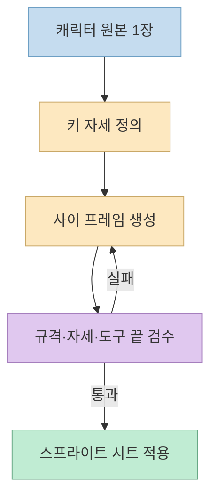
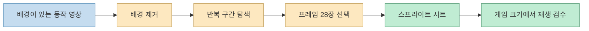
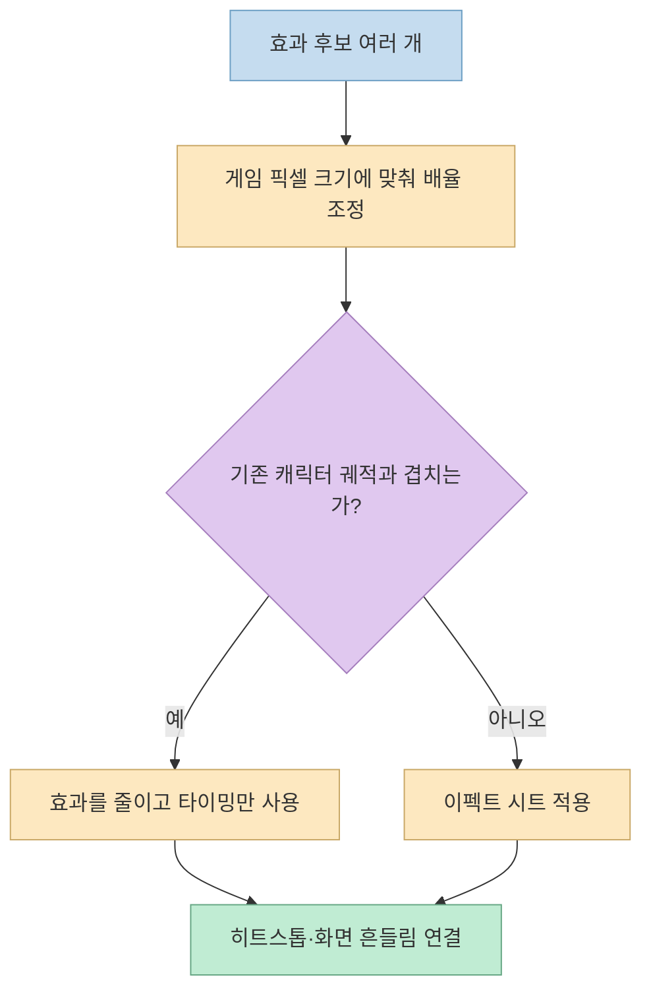
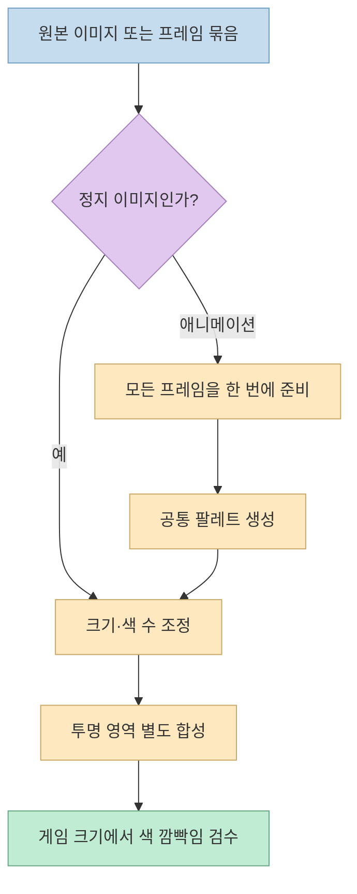
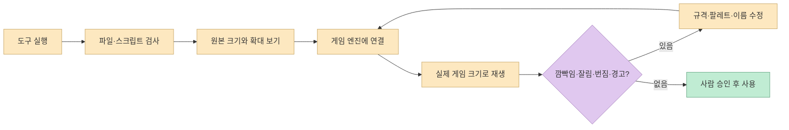

게임용 이미지를 만드는 도구는 “결과가 나왔는가”보다 “게임 안에서 계속 같은 규격으로 보이는가”가 더 중요하다. 영상 한 편에서 본 도구를 실제 프로젝트에 넣어 보면, 생성 자체보다 프레임 크기·투명 배경·팔레트·엔진 애니메이션 이름·사람의 눈 검수가 더 큰 문제가 된다.

이 글은 [Yunjin Games의 영상](https://youtu.be/CbAE9cdQZi8)을 바탕으로 네 가지 도구를 정리한 것이다. 영상 제작자는 고양이 전략 게임과 택틱스 RPG에 도구를 직접 적용했으며, 도구를 추천하기보다 어떤 상황에서 유용했고 어디서 실패했는지를 비교했다.

<!--more-->

## Sources

- [Yunjin Games — 쇼츠를 보고 알게 된 도구 4가지, 지금 만드는 게임에 써 봤습니다](https://youtu.be/CbAE9cdQZi8)
- 영상은 2dimg2motion, sprite-gen, pixelfx, PixelOE를 실제 게임에 적용하고 비교한다. 아래의 수치와 결과는 별도 재현 실험이 아니라 영상 속 제작자의 테스트 기록이다.

## 1. 2dimg2motion: 한 장의 캐릭터를 공격 애니메이션으로 확장하기

[영상 초반](https://youtu.be/CbAE9cdQZi8?t=44)에서 소개한 `2dimg2motion`은 캐릭터 그림 한 장을 입력해 하나의 동작을 14칸짜리 스프라이트로 만드는 규칙 모음에 가깝다. 영상에서는 프로그램 자체보다 AI 에이전트가 따라야 할 스킬이며, MIT 라이선스라고 설명한다. 그림 생성은 Codex와 ChatGPT 유료 사용량으로 진행했고, Claude Code는 Codex에 지시문을 보내는 방식으로 보조했다.

실험 대상은 곡괭이를 들어 올렸다가 내려찍고 반동 후 원위치로 돌아오는 고양이 광부 공격이었다. [약 1분 28초부터](https://youtu.be/CbAE9cdQZi8?t=88) 작업 폴더가 Git 저장소가 아니라는 이유로 Codex가 시작을 거절했고, 이후에는 “폴더 밖에 파일을 만들지 말라”는 지시가 자동 저장 규칙과 충돌해 네 개의 키 자세 중 일부만 그린 뒤 멈췄다. 자동 저장을 허용하도록 지시를 고치자 작업을 끝낼 수 있었다.

도구의 검사 스크립트는 통과했지만, 실제 게임에 넣으면서 별도의 문제가 드러났다. [2분 49초 부근](https://youtu.be/CbAE9cdQZi8?t=163)에서 영상은 14칸 애니메이션의 곡괭이가 게임의 타일 높이보다 커서 끝이 잘렸다고 설명한다. 생성 도구는 게임의 칸 규격을 자동으로 알지 못하므로, 결과 스프라이트를 게임의 셀 크기에 맞춰 다시 조정해야 한다.

또한 14칸이 항상 충분한 것은 아니다. 영상에서는 원본 스킬 사본을 만들어 키 자세 사이의 프레임 수를 구간별로 지정했고, `2, 4, 5, 5, 2` 구성을 사용해 총 24칸으로 늘렸다. [3분 26초부터](https://youtu.be/CbAE9cdQZi8?t=206) 기존 키 자세 네 장은 재사용하고 사이 프레임 18장만 새로 생성했으며, 두 실험을 합쳐 12회 생성과 약 25만 토큰, 약 20분이 들었다고 기록한다. 이 수치는 도구의 고정 비용이 아니라 해당 실험의 사용량이다.

24칸 결과는 같은 1초 동안 내려찍기와 반동이 더 촘촘했지만, 키 자세가 바뀌는 구간에서 캐릭터 크기가 미세하게 흔들렸다. [영상 후반의 평가](https://youtu.be/CbAE9cdQZi8?t=229)처럼 자동 검사가 통과해도 눈으로 보면 보이는 문제가 남을 수 있다. 따라서 이 도구는 완성 애니메이션을 무조건 대체하기보다, 기존 영상에 원하는 자세가 없을 때 새 공격 동작 후보를 빠르게 시험하는 용도에 더 적합하다.

## 2. sprite-gen: 영상에서 반복 동작과 배경을 분리하기

`sprite-gen`은 [4분 28초 부근](https://youtu.be/CbAE9cdQZi8?t=268)에서 소개된다. 영상 설명에 따르면 영상의 배경을 지우고 반복되는 구간을 찾아 게임에 넣을 스프라이트 시트로 만드는 도구이며, Apache 라이선스다. 영상 자르기와 시트 생성은 이미지 생성 없이 로컬 컴퓨터에서 처리한다.

흰 배경 영상에서 페르시안 고양이의 걷기 동작을 추출해 기존 자체 스크립트와 비교했을 때, 두 방식 모두 28프레임의 반복 구간을 찾고 시작과 끝이 자연스럽게 이어졌다. 하지만 속도는 자체 방식이 영상 하나당 1~2초, `sprite-gen`이 약 23초로 차이가 났다. [5분 15초부터](https://youtu.be/CbAE9cdQZi8?t=315) 영상은 이를 약 10배 느린 결과로 기록한다.

가장자리 품질은 서로 다른 장단점을 보였다. 자체 방식은 몸 주변에 희뿌연 테두리가 남았지만, `sprite-gen`은 검은 윤곽선에서 더 깔끔하게 끊겼다. 대신 수염이 거의 사라지고 가장자리가 계단처럼 각졌다. 더 심각한 문제는 96장 중 세 장에서 흰 꼬리가 완전히 투명해져 윤곽선만 남은 것이었다. 그중 한 장이 반복 구간에 포함되어 게임에서 한 바퀴 돌 때마다 꼬리가 깜빡였다. [영상의 5분 45초 이후](https://youtu.be/CbAE9cdQZi8?t=345)에서 이 문제는 게임 크기로 줄여도 확인할 수 있었다.

도구의 RIFE 수리 기능으로 앞뒤 프레임 사이를 채우자 꼬리는 돌아왔지만 뒷다리가 번지는 새로운 문제가 생겼다. 원인을 해결한 것이 아니라 튄 프레임을 덮은 셈이다. [6분 15초 부근](https://youtu.be/CbAE9cdQZi8?t=375)에서 영상은 꼬리가 사라진 프레임과 다리가 번진 프레임 모두 자동 검사에서 경고 없이 통과했다고 지적한다. 결국 이 도구의 품질 보고서와 비교 화면은 후보를 고르는 데 유용하지만, 최종 검수는 실제 게임 크기에서 직접 해야 한다.

## 3. pixelfx: 효과 이미지보다 타격 타이밍을 가져오기

`pixelfx`는 [6분 58초부터](https://youtu.be/CbAE9cdQZi8?t=419) 소개되는 코드 기반 도트 이펙트 도구다. 244가지 도트 효과를 이미지 파일이 아니라 코드로 그리며, MIT 라이선스라고 설명한다. 단, 함께 들어 있는 글꼴 하나는 MIT가 아니어서 영상에서는 사용하지 않았다.

영상 제작자는 여덟 가지 효과를 애니메이션과 시트로 굽는 데 8.4초가 걸렸고, 네 가지를 고양이 공격에 적용했다. 도트 베기를 고양이 크기에 맞추려고 10배 확대하면 픽셀이 큰 덩어리처럼 보이고, 캐릭터에 이미 노란 궤적이 있어 효과가 겹쳤다. [7분 35초 부근](https://youtu.be/CbAE9cdQZi8?t=455)에서 가장 자연스러웠던 조합은 짧은 번쩍임, 피격 순간 0.14초 멈춤, 화면 0.18초 흔들림이었다.

이 도구의 가장 큰 가치는 이미지 자체보다 효과 타이밍 데이터였다. [8분 53초 이후](https://youtu.be/CbAE9cdQZi8?t=533) 영상은 73개 동작에서 수치를 추출해, 검 베기는 0.14초 멈춤, 가벼운 연타는 0.015초 멈춤, 무거운 무기는 0.2초 멈춤과 0.34초 흔들림을 참고값으로 남겼다고 설명한다. 이 숫자를 그대로 복사하기보다 무기 무게와 공격 속도에 대한 출발점으로 삼고, 게임의 입력 지연과 피해 판정 시점에 맞춰 다시 조정해야 한다.

웹 게임 엔진 Phaser에 시트를 넣을 때도 함정이 있었다. 애니메이션이 비어 버린 것이 아니라 첫 프레임에서 멈춘 채 반복됐고, 콘솔에는 오류가 아닌 경고 28줄이 남았다. [8분 23초부터](https://youtu.be/CbAE9cdQZi8?t=503) 영상은 시트 프레임 이름 규칙이 엔진의 기대와 달랐기 때문이라고 분석한다. 시트를 굽고 프레임 이름을 바꾸거나 애니메이션을 직접 정의하자 28프레임이 모두 재생됐다. 에셋을 넣은 뒤에는 화면뿐 아니라 콘솔 경고도 확인해야 하는 이유다.

## 4. PixelOE: 도트 변환보다 팔레트 일관성이 중요하다

`PixelOE`는 [9분 20초부터](https://youtu.be/CbAE9cdQZi8?t=560) 소개되는 후처리 도구다. 인공지능으로 그림을 생성하는 방식이 아니라 윤곽을 넓혔다가 줄이고 색 수를 제한하는 계산으로 이미지를 도트화한다. 영상에서는 Apache 라이선스이며 그래픽카드 없이도 동작한다고 설명한다. 고양이 네 마리와 알렌 캐릭터를 12가지 설정으로 변환한 65장에 약 17초가 걸렸다.

택틱스 RPG 주인공 알렌은 크기 64, 색 32개 설정에서 윤곽과 색 면이 분명해 도트 캐릭터처럼 잘 나왔다. 반면 고양이는 크기 128과 색을 줄이지 않는 설정이 더 깔끔했다. 흰색과 검은색이 많은 고양이 이미지에서 색 수를 줄이면 초록 눈과 분홍 귀가 회색으로 합쳐졌고, 검은 고양이는 어두운 털이 배경에 묻혔다. [10분 11초 부근](https://youtu.be/CbAE9cdQZi8?t=611)에서는 도구가 투명 배경을 직접 이해하지 않아 배경색과 투명 영역을 별도로 처리했다고 설명한다.

도트화에서 가장 중요한 실패는 프레임마다 팔레트를 새로 고른 것이었다. 걷기 여섯 칸을 각각 처리하자 프레임마다 색 32개를 독립적으로 선택했고, 어떤 프레임에는 파란 눈을 표현할 공통 색이 없어 눈이 회색으로 바뀌었다. [10분 17초 이후](https://youtu.be/CbAE9cdQZi8?t=617) 영상은 여섯 프레임을 한 장으로 이어 붙여 공통 팔레트 32색을 만든 뒤 모든 프레임에 같은 팔레트를 적용하자 깜빡임이 사라졌다고 설명한다. 다만 작은 파란 눈처럼 면적이 좁은 색은 여전히 탁해질 수 있다.

게임 전체를 도트 스타일로 바꿀 때도 이미지별로 처리하면 안 된다. 영상 후반에는 캐릭터의 걷기·공격 프레임을 이어 붙여 공통 팔레트 48색을 적용하고, 화면에서 도트 한 칸이 같은 크기로 보이도록 설정을 다시 잡았다. [11분 15초 부근](https://youtu.be/CbAE9cdQZi8?t=675)에서 확인할 수 있듯, 원본 이미지 기준으로 깔끔한 설정이 이미 작은 게임 스프라이트에도 같은 결과를 보장하지 않는다.

## 실전 적용 포인트

네 도구를 비교할 때는 “어떤 도구가 가장 좋은가”보다 결과물이 게임 파이프라인의 어느 단계에 들어가는지 먼저 정해야 한다.

1. **새 동작 후보 만들기:** 기존 영상에 원하는 자세가 없을 때 `2dimg2motion`으로 키 자세와 사이 프레임을 실험한다. 원본 파일은 결과 폴더 밖에 보관하고, 생성 프레임의 셀 크기와 애니메이션 길이를 게임 규격에 맞춘다. [영상의 원본 삭제 사례](https://youtu.be/CbAE9cdQZi8?t=140)처럼 결과 폴더 정리 규칙이 원본까지 지우지 않는지 확인한다.
2. **영상에서 시트 추출하기:** `sprite-gen`은 반복 구간과 비교 화면을 빠르게 확인하는 데 쓸 수 있지만, 꼬리·수염·얇은 윤곽처럼 투명도에 민감한 부분은 모든 프레임을 실제 게임 크기로 재생한다.
3. **타격감 설계하기:** `pixelfx` 효과가 기존 아트와 충돌하면 효과 이미지 대신 멈춤 시간·화면 흔들림·피격 타이밍만 가져온다. 효과 시트는 엔진의 프레임 이름 규칙을 확인하고 콘솔 경고를 없앤 뒤 사용한다.
4. **도트 스타일 통일하기:** `PixelOE`로 걷기나 공격을 변환할 때는 프레임별 처리보다 공통 팔레트와 동일한 도트 크기를 우선한다. 투명 배경과 어두운 캐릭터는 별도 합성·검수 대상으로 둔다.
5. **자동 검사를 최종 판정으로 쓰지 않기:** [영상의 결론](https://youtu.be/CbAE9cdQZi8?t=713)처럼 네 도구 모두 자동 검사 통과와 실제 품질이 일치하지 않았다. 최소한 정상 크기, 확대 보기, 실제 게임 재생, 콘솔 경고, 반복 루프의 시작·끝을 사람이 확인한다.

## 핵심 요약

- `2dimg2motion`은 한 장의 캐릭터에서 새 동작 후보를 빠르게 만들 수 있지만, 프레임 수·셀 크기·원본 보관을 직접 관리해야 한다.
- `sprite-gen`은 영상에서 반복 구간과 스프라이트 시트를 추출하지만, 투명 가장자리와 특정 프레임의 결함을 자동 검사가 놓칠 수 있다.
- `pixelfx`는 효과 이미지보다 히트스톱과 화면 흔들림 같은 타격감 수치를 참고하는 데 더 유용할 수 있다.
- `PixelOE`는 정지 이미지 도트화에는 잘 맞지만, 애니메이션은 공통 팔레트를 사용하지 않으면 색이 깜빡인다.
- 도구가 제공하는 자동 검사와 실제 게임 플레이 검수는 서로 대체할 수 없다.

## 결론

영상의 가장 현실적인 결론은 네 도구 중 하나를 골라 모든 아트 문제를 해결하라는 것이 아니다. 도구마다 잘하는 단계가 다르므로 새 동작 후보 생성, 영상 프레임 추출, 타격감 수치 참고, 도트 스타일 변환으로 역할을 나누고, 마지막에는 게임 안에서 사람이 확인해야 한다. 특히 스프라이트 작업에서는 생성 품질보다 **일관된 셀 크기, 공통 팔레트, 엔진 프레임 이름, 실제 표시 크기**가 완성도를 좌우한다.

