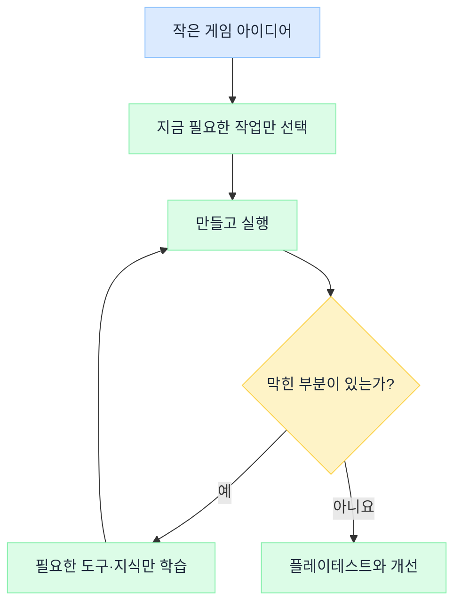
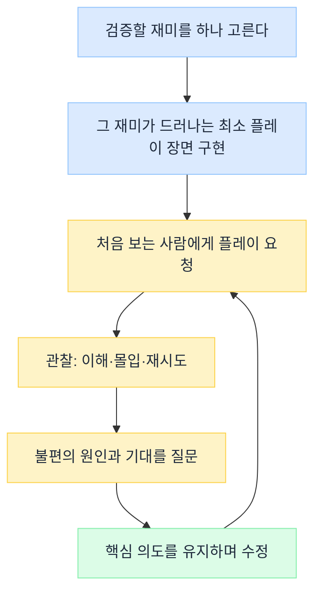

AI 도구가 기획, 코드, 그림, 사운드까지 도와주면서 게임을 시작하기는 쉬워졌습니다. 하지만 도구를 많이 갖추는 것만으로 재미있는 게임이 만들어지지는 않습니다. 이 글은 「퇴근 후 게임 실험실」 영상의 내용을 요약한 것으로, 작은 게임 경험부터 만들고 실제 반응을 보며 개선하자는 제작 접근을 정리합니다. 영상 속 의견과 사례를 요약했으며 직접 재현한 결과는 아닙니다. [영상 초반](https://youtu.be/cVnUUNBRT6U?t=20)

<!--more-->

## Sources

- [AI로 게임 만들기, 시작은 쉬운데 그다음은? — 퇴근 후 게임 실험실](https://www.youtube.com/watch?v=cVnUUNBRT6U)

## 1. 시작 전에 도구를 모두 갖출 필요는 없다

게임 제작은 기획, 개발, 아트가 서로 영향을 주는 일입니다. 버튼 하나도 플레이어에게 어떤 선택을 주는지와 그 선택을 화면에서 어떻게 보여줄지를 함께 고민해야 합니다. 영상은 Claude Code Game Studios 저장소처럼 기획부터 테스트와 출시까지 필요한 역할을 살펴볼 수 있는 자료를 예로 들지만, 모든 역할을 공부하고 나서야 시작할 수 있다는 뜻은 아니라고 설명합니다. 작은 작업을 하다가 필요한 지식을 그때 배우면 됩니다. [영상 1:16](https://youtu.be/cVnUUNBRT6U?t=76) · [영상 1:36](https://youtu.be/cVnUUNBRT6U?t=96)

## 2. 범위를 줄여도 화면의 일관성은 챙긴다

영상은 처음 만들 때 픽셀 아트나 로우폴리처럼 표현 범위를 제한하는 선택이 현실적일 수 있다고 말합니다. 다만 작은 그림이라고 해서 아무렇게나 만들어도 된다는 뜻은 아닙니다. 캐릭터마다 크기 기준이 다르거나 배경만 지나치게 세밀하면 화면 안에서 서로 어울리지 않을 수 있습니다. 무엇을 또렷하게 보여주고 무엇을 덜어낼지 정하는 것이 스타일의 일관성을 만듭니다. [영상 2:08](https://youtu.be/cVnUUNBRT6U?t=128) · [영상 2:28](https://youtu.be/cVnUUNBRT6U?t=148)

원화는 캐릭터의 형태와 인상을 정하고, 스프라이트 시트는 실제 움직임에 사용할 프레임을 담습니다. 이펙트는 공격이나 피격 같은 사건을 강조합니다. 따라서 개별 에셋의 품질뿐 아니라 같은 게임 화면에서 크기, 색, 움직임이 잘 어울리는지 확인해야 합니다. [영상 2:57](https://youtu.be/cVnUUNBRT6U?t=177)

## 3. 에셋은 무료 자료와 필요한 생성 도구를 조합한다

영상은 AI 생성 결과만 고집하지 않고 무료 에셋도 활용할 수 있다고 설명합니다. Kenney 같은 에셋 라이브러리에서 임시 리소스나 출시용 리소스를 찾고, 필요한 경우 이미지·스프라이트 생성 도구를 보완적으로 사용할 수 있습니다. 다만 무료라는 이유만으로 바로 포함하지 말고, 프로젝트에 맞는 사용 조건과 라이선스를 확인해야 합니다. 영상에서도 도구와 자료의 선택은 프로젝트 요구에 맞춰야 한다고 강조합니다. [영상 3:20](https://youtu.be/cVnUUNBRT6U?t=200) · [영상 3:40](https://youtu.be/cVnUUNBRT6U?t=220)

핵심은 여러 도구를 한꺼번에 구독하는 것이 아니라, 현재 부족한 결과가 무엇인지 확인하는 것입니다. 원하는 캐릭터 동작이 없으면 스프라이트 생성 도구를 조사하고, 엔진 연결이나 코드가 막히면 그 부분에 맞는 도구를 찾아볼 수 있습니다. 먼저 문제를 특정하면 선택지도 좁아집니다. [영상 6:52](https://youtu.be/cVnUUNBRT6U?t=412)

## 4. 프로토타입도 재미를 판단할 수 있게 다듬는다

프로토타입은 기능이 적어도 괜찮지만, 확인하려는 재미나 인상을 전달할 정도로는 완성되어야 합니다. 움직임을 시험하려는데 캐릭터가 잘 보이지 않거나, 선택지를 시험하려는데 설명을 이해하기 어렵다면 플레이어가 그 기능을 싫어하는지 사용법을 몰라 헤매는지 구분하기 어렵습니다. 범위는 작게 유지하되 검증할 핵심은 읽기 쉽게 만듭니다. [영상 7:18](https://youtu.be/cVnUUNBRT6U?t=438) · [영상 7:34](https://youtu.be/cVnUUNBRT6U?t=454)

## 5. 피드백은 그대로 기능 목록으로 옮기지 않는다

만든 사람에게 익숙한 조작이나 화면이 처음 보는 사람에게는 보이지 않을 수 있습니다. 플레이어가 어디서 헤매는지, 무엇을 좋아하는지, 다시 플레이하려는지 관찰해야 합니다. 의견을 듣더라도 요청된 기능을 전부 그대로 추가하는 것이 답은 아닙니다. 무엇이 불편했고 어떤 기대가 충족되지 않았는지 파악한 뒤, 게임의 의도를 유지하면서 문제를 해결할 다른 방법이 있는지 판단합니다. [영상 8:02](https://youtu.be/cVnUUNBRT6U?t=482) · [영상 8:20](https://youtu.be/cVnUUNBRT6U?t=500)

## 6. 구독료는 병목이 확인된 다음에 쓴다

영상은 월 요금만 비교하기보다 쓸 만한 결과를 얻는 데 드는 시간과 비용을 함께 보라고 제안합니다. 원하는 결과가 정해지지 않았다면 모델을 바꿔도 같은 고민이 남을 수 있습니다. 반대로 결과는 명확하지만 반복 작업이나 품질이 병목이라면 그때 도구를 비교하고 비용을 늘릴 수 있습니다. [영상 6:52](https://youtu.be/cVnUUNBRT6U?t=412) · [영상 7:07](https://youtu.be/cVnUUNBRT6U?t=427)

실제로 시작할 때는 다음 순서가 실용적입니다.

1. 만들고 싶은 플레이 장면 하나를 문장으로 적습니다.
2. 그 장면을 확인하는 데 필요한 최소 입력, 규칙, 피드백만 만듭니다.
3. 가진 무료 에셋과 현재 도구로 먼저 플레이 가능한 버전을 만듭니다.
4. 다른 사람이 플레이하는 모습을 관찰해 가장 큰 혼란이나 재미를 확인합니다.
5. 해결할 병목이 분명해졌을 때만 새 도구나 유료 플랜을 검토합니다.

## 핵심 요약

- AI 도구를 모두 구독하거나 모든 분야를 먼저 공부한 뒤 시작할 필요는 없습니다.
- 표현 범위를 줄이더라도 에셋의 크기와 스타일은 한 화면에서 일관되어야 합니다.
- 프로토타입은 작게 만들되, 검증할 재미가 플레이어에게 전달되도록 다듬습니다.
- 피드백은 기능 요청 목록으로 바로 바꾸지 말고 불편의 원인과 기대를 확인합니다.
- 비용은 현재 가진 도구로 시도한 뒤 실제 병목이 확인되면 늘립니다.

## 결론

AI는 게임 재료를 빠르게 만들고 반복 작업을 줄여줄 수 있지만, 어떤 경험을 만들고 결과를 어떻게 고칠지는 개발자의 몫입니다. 도구 선택에 앞서 작은 플레이 장면을 만들고, 다른 사람의 반응을 보며 한 단계씩 개선하는 것이 출발점입니다. [영상 마무리](https://youtu.be/cVnUUNBRT6U?t=569)
