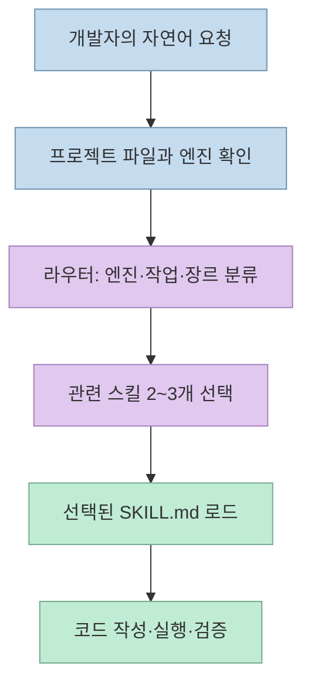
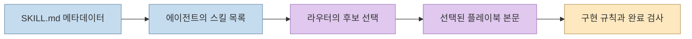
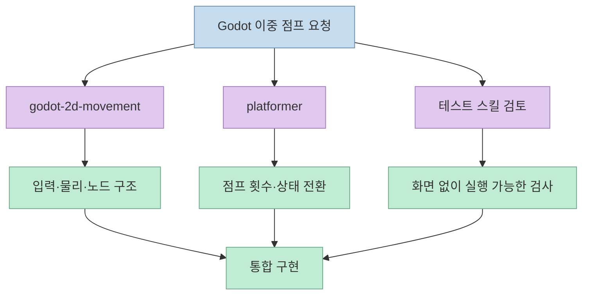
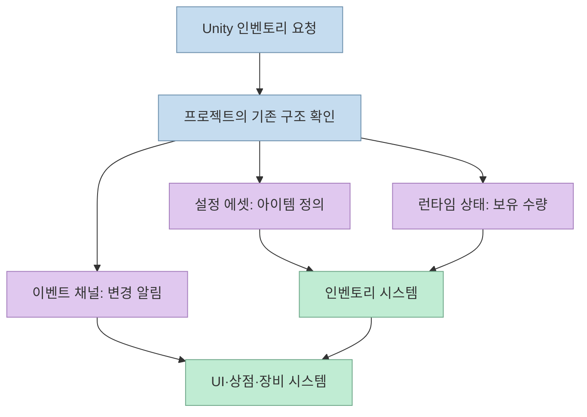
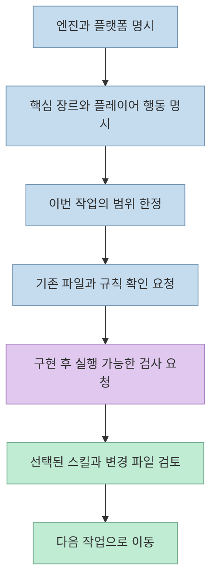

게임 개발용 코딩 에이전트에 기능을 추가할 때 스킬을 하나씩 설치하는 방식은 프로젝트가 커질수록 관리하기 어려워진다. Godot 이동 시스템, Unity 인벤토리, 웹게임 테스트, 에셋 제작처럼 작업마다 필요한 지침이 다른데, 모든 지침을 항상 에이전트에게 보여 주면 선택지가 너무 많아지고 컨텍스트도 불필요하게 커진다.

Threads에서 소개된 [Awesome Gamedev Agent Skills](https://github.com/gamedev-skills/awesome-gamedev-agent-skills)는 이 문제를 게임 개발 작업용 스킬 라우터로 해결한다. 프로젝트의 엔진과 사용자의 요청을 읽고, 수십 개의 스킬 중 현재 작업에 맞는 두세 개를 먼저 연결한 뒤 에이전트가 코드를 작성하도록 하는 구조다.

<!--more-->

## Sources

- [Threads 원문](https://www.threads.com/share/BAcrI-6Eur) — 79개 게임 개발 스킬과 라우터의 사용 사례를 소개한 게시물.
- [Awesome Gamedev Agent Skills 공식 저장소](https://github.com/gamedev-skills/awesome-gamedev-agent-skills) — 스킬 목록, 설치 방법, 지원 엔진과 라우터 개요.
- [공식 설치 문서](https://github.com/gamedev-skills/awesome-gamedev-agent-skills/blob/main/docs/INSTALLATION.md) — `skills` CLI와 에이전트별 설치 경로.
- [공식 호환성 문서](https://github.com/gamedev-skills/awesome-gamedev-agent-skills/blob/main/docs/COMPATIBILITY.md) — Agent Skills 형식과 도구별 탐색 경로.
- [라우터 SKILL.md](https://github.com/gamedev-skills/awesome-gamedev-agent-skills/blob/main/router/SKILL.md) — 요청을 엔진·분야·작업별 스킬로 연결하는 라우팅 규칙.

> 저장소의 스킬 수, 지원 엔진 버전, 테스트 결과는 저장소가 갱신되면 바뀔 수 있다. 아래의 수치와 버전은 이 글을 작성한 2026년 11월 26일에 공식 README에서 확인한 값이다.

## 1. 핵심은 스킬의 개수보다 선택 계층이다

이 저장소는 공식 README 기준으로 12개 엔진을 위한 79개의 게임 개발 스킬과 라우터를 제공한다. 지원 대상에는 Godot, Unity, Unreal, Ebitengine, Phaser, PixiJS, three.js, Bevy, pygame, LÖVE, Defold, Roblox가 포함된다.

여기서 라우터는 모든 스킬의 내용을 매번 한꺼번에 실행하는 시스템이 아니다. 에이전트가 사용자의 자연어 요청과 프로젝트 파일을 바탕으로 엔진과 작업을 추정하고, 관련성이 높은 스킬을 소수만 선택하는 진입점이다.



이 방식의 장점은 두 가지다.

1. **컨텍스트 절약**: 현재 작업과 관계없는 스킬의 긴 설명을 매번 읽히지 않는다.
2. **선택 기준의 표준화**: 개발자가 스킬 이름을 기억하지 않아도 “Godot 플랫폼 게임에 이중 점프를 추가해 달라”처럼 요청할 수 있다.

반대로 라우터가 잘못된 엔진이나 작업을 감지하면 적절한 지침이 로드되지 않을 수 있다. 따라서 중요한 작업에서는 어떤 스킬이 선택되었는지, 그 스킬이 요구하는 엔진 버전과 검증 절차가 무엇인지 확인해야 한다.

## 2. 스킬은 작업별 플레이북으로 동작한다

이 프로젝트의 각 스킬은 일반적인 프롬프트 모음이라기보다 `SKILL.md` 파일로 구성된 작업별 플레이북이다. 파일에는 스킬의 역할, 적용 범위, 다른 스킬과의 관계, 자주 발생하는 실수, 작업이 끝난 뒤 실행할 검사가 들어간다.



이 구조는 “에이전트가 코드를 작성한다”는 말의 범위를 좁혀 준다. 예를 들어 Godot 이동 스킬은 단순히 이동 코드를 출력하는 데서 끝나지 않고, 프로젝트의 입력 구조와 물리 업데이트 위치를 확인하고 테스트 가능한 방식으로 구현하도록 유도할 수 있다.

다만 `SKILL.md`가 있다고 해서 에이전트가 실제 게임을 완벽하게 검증해 주는 것은 아니다. 스킬이 안내하는 검사 명령을 실행할 수 있는 환경인지, 프로젝트가 해당 엔진 버전과 의존성을 갖추었는지, 실행 결과를 사람이 확인했는지는 별도의 문제다.

## 3. Godot 요청은 엔진 스킬과 장르 스킬로 나뉜다

원문이 든 Godot 이중 점프 사례는 라우터의 역할을 이해하기 좋은 예다. 이 요청에는 최소한 두 종류의 지식이 필요하다.

- **엔진 지식**: Godot 프로젝트 구조, 노드, 입력, 물리 프레임, GDScript.
- **게임플레이 지식**: 플랫폼 게임의 지상·공중 상태, 점프 횟수 초기화, 낙하 처리.

라우터는 요청을 엔진 하나와 작업 하나로 단순하게 매칭하는 대신, 엔진별 스킬과 장르·기능별 스킬을 함께 선택하는 방향으로 설계되어 있다.



이 분리는 기능을 재사용하기 좋게 만든다. 플랫폼 게임이 아니더라도 `godot-2d-movement`를 활용할 수 있고, 다른 엔진에서 플랫폼 게임을 만들 때는 엔진 스킬만 바꾸고 장르 스킬의 설계 원칙을 참고할 수 있다.

## 4. Unity 사례는 기능보다 프로젝트 규칙을 먼저 본다

Unity 인벤토리 예시에서는 `ScriptableObject` 설정 에셋과 이벤트 채널 같은 프로젝트 구성 패턴이 중요하다. 인벤토리는 아이템 배열 하나를 만드는 것으로 끝나지 않는다.

- 아이템 정의를 코드와 데이터 중 어디에 둘지
- 런타임 인벤토리 상태와 에디터 설정을 어떻게 분리할지
- UI, 저장 시스템, 게임플레이 시스템이 어떤 이벤트를 구독할지
- 동일한 아이템 정의를 상점·보상·장비에서 어떻게 재사용할지

이런 규칙을 스킬로 문서화해 두면 에이전트가 매번 임의의 싱글턴이나 하드코딩된 아이템 목록을 만들 가능성을 낮출 수 있다. 특히 기존 Unity 프로젝트에 기능을 추가할 때는 새 코드의 동작보다 현재 프로젝트가 이미 사용하는 데이터 흐름을 보존하는 것이 더 중요하다.



## 5. 웹게임 스킬은 구현·손맛·테스트를 분리한다

원문과 관련 게시물에서는 웹게임 제작을 `game-engine`, `game-feel`, `develop-web-game`처럼 나누어 설명한다. 이 구분은 웹게임을 단순한 HTML 파일 생성 작업으로 보지 않는다는 점에서 의미가 있다.

- **구현 스킬**: 게임 루프, 입력, 렌더링, 상태 관리 등 기본 구조를 만든다.
- **게임 필 스킬**: 타격감, 화면 흔들림, 이펙트, 반응 지연 같은 플레이 감각을 다룬다.
- **테스트 스킬**: 브라우저나 화면을 사람이 직접 보지 않아도 실행 여부와 오류를 검사한다.

세 영역을 한 번에 요청하면 코드가 생성되더라도 무엇이 문제인지 분리하기 어렵다. 먼저 플레이 가능한 최소 루프를 만들고, 그다음 피드백을 추가하고, 마지막으로 반복 실행 가능한 테스트를 붙이는 흐름이 안정적이다.


## 6. 설치는 전체 번들보다 프로젝트 단위가 낫다

공식 README는 다음 명령으로 설치를 시작하도록 안내한다.

```bash
npx skills add gamedev-skills/awesome-gamedev-agent-skills
```

이 CLI는 사용 중인 코딩 에이전트를 감지하고 라우터와 스킬을 적절한 위치에 설치하는 방식이다. 특정 에이전트만 대상으로 하거나, 먼저 목록만 확인하거나, 필요한 스킬만 선택하는 옵션도 제공된다. Claude Code에서는 라우터와 엔진별 번들을 플러그인 형태로 설치하는 대안도 안내한다.

처음부터 모든 스킬을 전역으로 설치하는 것이 항상 좋은 선택은 아니다. 공식 README는 스킬 설명이 너무 많아지면 에이전트의 목록 예산을 넘어서 선택 정확도가 떨어질 수 있다고 경고한다. 따라서 다음 순서가 현실적이다.

1. 새 프로젝트에서는 라우터와 사용하는 엔진 번들만 설치한다.
2. 특정 장르나 시스템을 만들 때 관련 스킬을 추가한다.
3. 여러 프로젝트에서 공통으로 쓸 규칙만 전역 설치한다.
4. 에이전트가 선택한 스킬과 실제 적용 결과를 확인한다.

설치 전에는 Node.js 요구 버전도 확인해야 한다. 공식 README 기준 CLI에는 Node.js 22.20 이상이 필요하다고 안내되어 있으며, 실제 설치 시점의 README와 CLI 오류 메시지를 우선해야 한다.

## 7. 저장소의 검증 결과는 유용하지만 적용 범위를 구분해야 한다

공식 README는 스킬이 공식 엔진 문서와 릴리스 정보를 바탕으로 작성되었고, 12개 엔진 중 10개는 실제 도구 체인에서 코드를 실행하거나 컴파일해 확인했다고 설명한다. 또 366개의 블라인드 테스트 프롬프트에서 스킬이 필요한 요청의 98.7%에 올바른 스킬이 로드되었다고 보고한다.

이 수치는 프로젝트의 품질을 판단하는 참고 자료지만, 특정 게임 프로젝트의 성공을 보장하는 벤치마크는 아니다. 다음 요소는 사용자의 환경에서 다시 검증해야 한다.

- 설치한 엔진 버전과 저장소가 가정한 엔진 버전이 같은가?
- 사용하는 플랫폼과 그래픽 API가 예제의 조건과 같은가?
- 프로젝트의 기존 폴더 구조와 코딩 규칙을 스킬이 이해하는가?
- 에이전트가 실행할 수 있는 테스트와 CI 환경이 준비되어 있는가?
- 생성된 코드가 실제 플레이 경험과 성능 목표를 만족하는가?

특히 README에는 현재 확인된 엔진 버전도 함께 적혀 있으므로, 장기 프로젝트에서는 스킬 저장소 업데이트 때마다 버전 지원 범위와 변경 이력을 확인하는 편이 안전하다.

## 8. 실제 프로젝트에 적용하는 요청 순서

AI 에이전트에게 한 번에 “게임을 만들어 달라”고 요청하는 것보다, 라우터가 선택할 수 있는 정보를 단계적으로 제공하는 편이 좋다.



예를 들어 다음처럼 요청할 수 있다.

```text
Godot 4 프로젝트에서 기존 Player 씬과 입력 맵을 유지한 채 이중 점프를 추가해 줘.
먼저 관련 스킬을 선택하고, 수정할 파일과 상태 전환 규칙을 설명해.
구현 후 화면 없이 실행할 수 있는 검사와 실패 시 종료 코드를 포함해 검증해 줘.
```

이 요청은 엔진, 기존 제약, 기능 범위, 검증 요구를 한 번에 전달한다. 라우터는 엔진·플랫폼·게임플레이 관련 스킬을 선택할 수 있고, 에이전트는 구현 전에 변경 범위를 설명할 수 있다.

## 핵심 요약

- Awesome Gamedev Agent Skills는 게임 개발용 79개 스킬과 라우터를 제공한다.
- 공식 README 기준 Godot, Unity, Unreal 등 12개 엔진을 지원한다.
- 라우터는 프로젝트 엔진과 자연어 작업 요청을 바탕으로 필요한 스킬을 소수 선택한다.
- 스킬은 `SKILL.md` 형태의 작업별 플레이북이며 구현 규칙과 완료 검사를 포함한다.
- Godot 이동, Unity 인벤토리, 웹게임 테스트처럼 엔진 지식과 장르·작업 지식을 조합할 수 있다.
- 전체 번들을 무조건 설치하기보다 라우터와 현재 프로젝트의 엔진·작업 스킬부터 설치하는 편이 관리에 유리하다.
- 저장소의 테스트 수치와 엔진 버전은 참고 자료이며, 실제 프로젝트 환경에서 다시 검증해야 한다.

## 결론

게임 개발 AI 에이전트의 문제는 스킬이 부족해서만 생기지 않는다. 스킬이 많아질수록 현재 작업에 어떤 지침을 적용할지 결정하는 선택 계층이 중요해진다. Awesome Gamedev Agent Skills는 이 선택을 라우터로 분리하고, 엔진·장르·작업별 플레이북을 필요한 순간에 로드하는 구조를 제안한다.

이 구조를 도입할 때의 핵심은 79개를 모두 외우거나 설치하는 것이 아니다. 프로젝트의 엔진과 첫 번째 병목을 명확히 적고, 라우터가 고른 스킬을 확인하며, 구현 결과를 실제 엔진과 테스트에서 검증하는 것이다. 그러면 AI에게 게임 제작을 맡기는 과정이 무작위 코드 생성보다 재현 가능한 개발 워크플로에 가까워진다.
