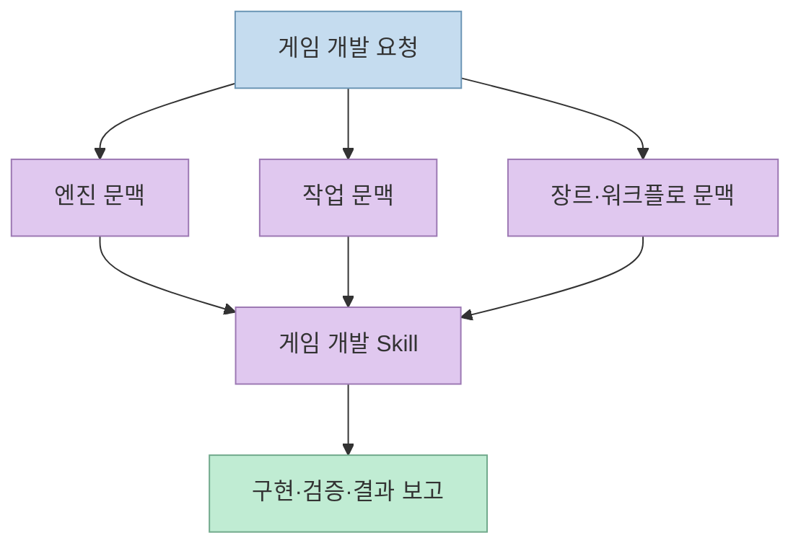
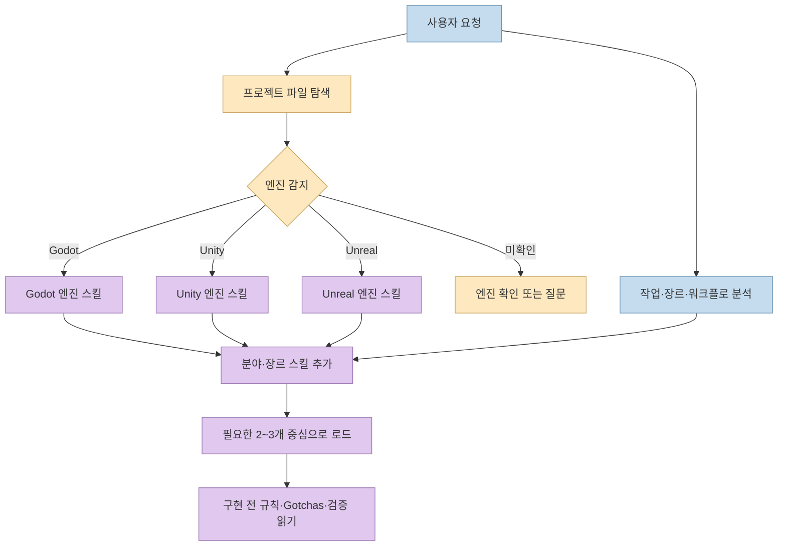
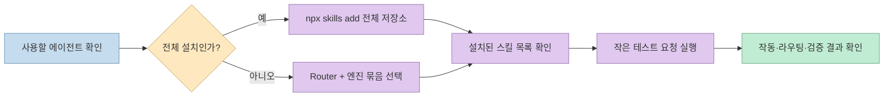
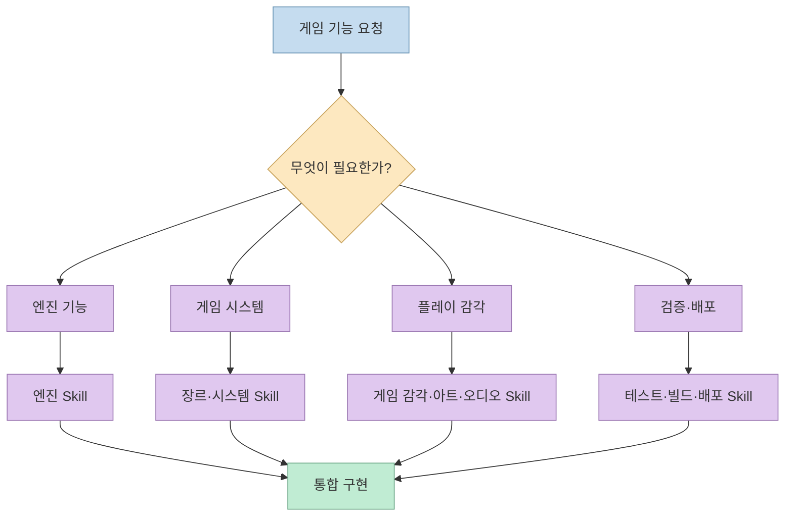
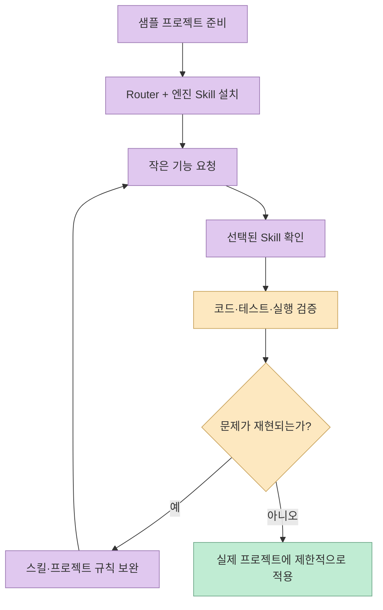

AI에게 게임을 만들어 달라고 요청할 때 가장 먼저 부딪히는 문제는 코드 작성 자체가 아니다. 어떤 엔진을 쓰는지, 지금 필요한 작업이 이동인지 저장인지 전투인지, 그 작업에 필요한 규칙과 검증 방법을 AI가 알고 있는지가 더 큰 차이를 만든다.

한 [Threads 게시물](https://www.threads.com/share/EFzlzC-JR)은 `gamedev-skills/awesome-gamedev-agent-skills`를 소개하며, Claude Code·Codex·Gemini 같은 코딩 에이전트에 게임 개발 전문 스킬을 설치할 수 있다고 설명한다. 공식 저장소를 확인하면 이 프로젝트는 12개 게임 엔진을 대상으로 79개 스킬과 엔진·작업을 감지하는 Router를 제공한다. [원문 게시물](https://www.threads.com/@kim_joungmun/post/DgAr4y9mKIi)과 [공식 저장소 README](https://github.com/gamedev-skills/awesome-gamedev-agent-skills)

이 글은 게시물의 홍보 문장을 그대로 반복하기보다, 이 스킬 모음이 어떤 구조로 동작하며 실제 게임 프로젝트에 어떻게 도입해야 하는지를 정리한다. GitHub 별 수와 게시물의 반응 수는 시점에 따라 변하므로 현재 수치로 단정하지 않는다.

<!--more-->

## Sources

- [Threads 원문 공유 링크](https://www.threads.com/share/EFzlzC-JR) — 게임 개발 스킬 모음과 설치 명령을 소개한 게시물.
- [Threads 원문 게시물](https://www.threads.com/@kim_joungmun/post/DgAr4y9mKIi) — 작성자 `kim_joungmun`의 본문과 댓글.
- [awesome-gamedev-agent-skills 공식 저장소](https://github.com/gamedev-skills/awesome-gamedev-agent-skills) — 79개 스킬, 12개 엔진, Router의 현재 README.
- [Router 스킬](https://github.com/gamedev-skills/awesome-gamedev-agent-skills/blob/main/router/SKILL.md) — 엔진·작업·장르별 라우팅 규칙.
- [스킬 목록](https://github.com/gamedev-skills/awesome-gamedev-agent-skills/tree/main/skills) — 엔진·분야·장르·워크플로별 스킬 구성.
- [설치 문서](https://github.com/gamedev-skills/awesome-gamedev-agent-skills/blob/main/docs/INSTALLATION.md) — 에이전트별 설치와 부분 설치 방법.
- [호환성 문서](https://github.com/gamedev-skills/awesome-gamedev-agent-skills/blob/main/docs/COMPATIBILITY.md) — 지원되는 에이전트와 설치 방식.

## 1. 이 프로젝트가 해결하는 문제

게임 개발은 일반적인 코딩 작업보다 문맥이 넓다. 플레이어 이동을 구현하려면 엔진의 입력 시스템과 물리 규칙을 알아야 하고, 저장 기능을 추가하려면 데이터 직렬화와 버전 호환을 고려해야 한다. 로그라이크를 만든다면 장르의 반복 구조와 절차적 생성, 덱빌딩을 함께 이해해야 한다.

AI에게 “게임을 만들어 줘”라고만 요청하면 모델은 이 문맥을 한 번에 추측해야 한다. 그 결과 엔진 버전에 맞지 않는 API를 사용하거나, 에디터에서만 동작하는 코드를 만들거나, 기능은 구현했지만 실행·테스트 방법을 제시하지 않는 일이 생긴다.

`awesome-gamedev-agent-skills`는 이 문맥을 작은 `SKILL.md` 파일들로 분리한다. 각 스킬은 특정 엔진이나 작업을 수행할 때 필요한 규칙, 흔한 실수, 검증 방법을 에이전트가 읽을 수 있는 형태로 제공한다. [공식 README](https://github.com/gamedev-skills/awesome-gamedev-agent-skills)



핵심은 AI에게 게임 지식을 새로 학습시키는 것이 아니라, 작업을 시작하기 전에 필요한 개발 지침을 읽히는 것이다. 스킬은 모델 그 자체가 아니며, 에이전트의 실행 권한이나 프로젝트 품질을 자동으로 보장하지도 않는다.

## 2. 79개 스킬과 12개 엔진의 구성

공식 README는 현재 저장소를 79개 게임 개발 스킬과 12개 엔진을 위한 모음으로 설명한다. 지원 엔진 목록에는 Godot, Unity, Unreal, Ebitengine, Phaser, PixiJS, three.js, Bevy, pygame, LÖVE, Defold, Roblox가 포함된다. 저장소 버전에 따라 스킬 수와 지원 기준이 바뀔 수 있으므로, 설치 전에 README와 릴리스 정보를 확인하는 것이 안전하다. [README의 엔진 목록](https://github.com/gamedev-skills/awesome-gamedev-agent-skills#readme) · [릴리스](https://github.com/gamedev-skills/awesome-gamedev-agent-skills/releases)

스킬은 엔진에만 묶여 있지 않다. 저장소 구조는 대체로 다음 네 종류의 관심사를 조합한다.

- **엔진 스킬**: Godot, Unity, Unreal처럼 특정 엔진의 파일 구조와 API를 다룬다.
- **분야 스킬**: 게임 AI, 물리, 셰이더, 오디오, 게임 감각, 에셋 제작처럼 엔진을 넘나드는 주제를 다룬다.
- **장르 스킬**: RPG, 로그라이크, 플랫폼 게임, 퍼즐 등 장르의 설계 패턴을 다룬다.
- **워크플로 스킬**: 저장, 테스트, 빌드, itch.io·Steam 배포, 문서화 같은 제작 과정을 다룬다.

예를 들어 “Godot로 절차적 던전 로그라이크를 만들고 저장 기능을 추가해 줘”라는 요청에는 Godot 기본 스킬 하나만 필요한 것이 아니다. 엔진 기본기, 타일맵 또는 절차적 생성, 로그라이크 규칙, 저장 시스템이 함께 필요할 수 있다. Router는 이런 조합을 자동으로 구성하는 역할을 한다. [Router의 라우팅 설명](https://github.com/gamedev-skills/awesome-gamedev-agent-skills/blob/main/router/SKILL.md)

## 3. Router는 어떤 방식으로 필요한 스킬을 고르는가

Router의 목적은 개발자가 스킬 이름을 하나씩 외우지 않도록 하는 것이다. 공식 문서에 따르면 Router는 먼저 프로젝트 파일에서 엔진을 감지하고, 요청 문장에서 작업·분야·장르·워크플로 단서를 읽은 뒤 필요한 스킬을 순서대로 불러온다. `project.godot`가 있으면 Godot, `*.uproject`가 있으면 Unreal처럼 프로젝트 파일이 엔진 감지 신호가 된다. [Router 스킬](https://github.com/gamedev-skills/awesome-gamedev-agent-skills/blob/main/router/SKILL.md)



Router의 장점은 모든 스킬을 매번 넣지 않는다는 데 있다. 에이전트가 볼 수 있는 스킬 설명이 지나치게 많으면 관련 없는 설명이 잘리거나, 어떤 스킬을 선택해야 하는지 오히려 어려워질 수 있다. 공식 README도 이미 많은 스킬을 가진 에이전트라면 전체 묶음보다 Router와 현재 사용하는 엔진 묶음만 설치하는 방식을 안내한다. [설치 팁](https://github.com/gamedev-skills/awesome-gamedev-agent-skills#installation)

## 4. 설치 방법

가장 간단한 전체 설치 명령은 다음과 같다.

```bash
npx skills add gamedev-skills/awesome-gamedev-agent-skills
```

이 명령은 설치 프로그램을 통해 감지된 에이전트에 스킬을 배치한다. 지원되는 에이전트와 설치 경로는 [호환성 문서](https://github.com/gamedev-skills/awesome-gamedev-agent-skills/blob/main/docs/COMPATIBILITY.md)에서 확인할 수 있다.

Claude Code 플러그인 방식으로는 Router와 엔진 묶음을 분리해 설치할 수도 있다.

```bash
claude plugin marketplace add gamedev-skills/awesome-gamedev-agent-skills
claude plugin install router@awesome-gamedev-agent-skills
claude plugin install godot@awesome-gamedev-agent-skills
```

Unity라면 마지막 줄을 `unity`, Unreal이라면 `unreal`로 바꾼다. 브라우저 게임을 만든다면 `web-engines`, 나머지 엔진은 저장소 문서에 적힌 묶음 이름을 확인해야 한다. 설치 가능한 묶음 이름을 추측하기보다 [설치 문서](https://github.com/gamedev-skills/awesome-gamedev-agent-skills/blob/main/docs/INSTALLATION.md)의 현재 명령을 기준으로 삼는 편이 좋다.



## 5. 게임 엔진별로 활용하는 예시

### Godot

Godot 프로젝트에서는 `project.godot`가 엔진 감지 신호가 된다. “플레이어에게 더블 점프를 추가해 줘”라고 요청하면 이동과 플랫폼 장르에 관련된 스킬이 조합될 수 있다. “절차적 던전 로그라이크를 만들어 줘”라면 타일맵, 절차적 생성, 로그라이크 관련 스킬이 함께 필요하다. 공식 README도 이런 자연어 요청과 라우팅 결과를 예시로 보여 준다. [예시 요청과 매핑](https://github.com/gamedev-skills/awesome-gamedev-agent-skills#what-you-can-ask)

```text
Godot 프로젝트에 플레이어 더블 점프를 추가해 줘.

현재 입력 액션과 이동 스크립트를 먼저 읽고,
기존 중력·바닥 판정·애니메이션을 깨지 않는 최소 변경으로 구현해 줘.
실행 가능한 테스트나 재현 절차도 함께 작성해 줘.
```

### Unity

Unity에서는 `*.cs`, 씬, 프리팹, ScriptableObject와 프로젝트 설정이 서로 연결된다. “Unity RPG 인벤토리”처럼 요청하면 C# 스크립팅, ScriptableObject 데이터, RPG, 저장 시스템이 함께 필요할 수 있다. AI에게 코드만 생성하게 하기보다 현재 씬과 프리팹 연결, 직렬화 필드, 에디터에서 확인할 방법을 함께 요구해야 한다.

```text
Unity 6 프로젝트에 RPG 인벤토리를 추가해 줘.

기존 아이템 데이터가 있다면 먼저 재사용하고,
아이템 정의는 ScriptableObject, 런타임 소유 아이템은 별도 저장 데이터로 분리해 줘.
테스트용 씬과 저장·불러오기 검증 절차까지 포함해 줘.
```

### Unreal

Unreal에서는 C++ 클래스, Blueprint, 애셋 경로, Gameplay Framework의 역할 경계가 중요하다. “Unreal 캐릭터에 스태미나를 추가해 줘”라고 할 때는 어느 클래스가 권한을 가지는지, 복제되는 값인지, UI가 어떤 상태를 구독하는지를 먼저 정해야 한다. 스킬은 이 작업을 시작할 때 Unreal의 프로젝트 구조와 흔한 실수를 참조하게 하는 역할을 한다.

### 브라우저 게임

Phaser, PixiJS, three.js 같은 웹 엔진에서는 게임 루프와 렌더링뿐 아니라 브라우저의 입력·오디오·리사이즈·배포 구조를 함께 고려해야 한다. `web-engines` 묶음이나 해당 엔진 스킬을 사용하면 일반 웹 애플리케이션용 AI 응답보다 게임 루프와 캔버스에 맞는 방향으로 요청을 좁힐 수 있다.

## 6. 지원 스킬의 범위는 무엇인가

게시물은 물리 엔진, RPG·로그라이크 로직, UI, 사운드, Steam 배포 등을 모두 다룬다고 소개한다. 공식 저장소의 스킬 구조에도 엔진별 기능뿐 아니라 게임 AI, 물리, 오디오, 셰이더, 게임 감각, 저장, 테스트, 배포와 같은 분야가 포함되어 있다. [스킬 디렉터리](https://github.com/gamedev-skills/awesome-gamedev-agent-skills/tree/main/skills)

이 범위는 다음과 같은 작업을 시작할 때 유용하다.

- **물리**: 충돌, 레이캐스트, 리지드바디, 캐릭터 이동의 엔진별 차이 확인
- **게임 AI**: FSM·행동 트리·유틸리티 AI·길찾기 선택
- **게임 감각**: 히트스톱, 화면 흔들림, 피격 피드백, 이펙트 타이밍
- **저장 시스템**: 세이브 슬롯, 버전 업그레이드, 데이터 검증
- **RPG·로그라이크**: 진행 루프, 능력 조합, 던전·보상 구조
- **UI·UX**: 메뉴 구조, 입력 포커스, HUD, 튜토리얼 흐름
- **배포**: 빌드, itch.io·Steam 등 플랫폼별 출시 절차



중요한 것은 “스킬이 있으니 모든 기능을 바로 만들 수 있다”가 아니다. 스킬은 해당 작업을 시작할 때 확인해야 하는 지식과 절차를 알려 준다. 실제 프로젝트의 기존 코드, 에셋 라이선스, 게임 디자인 의도, 플랫폼 계정과 인증 정보까지 대신 판단하지는 않는다.

## 7. Router를 믿기 전에 확인해야 할 것

자동 라우팅은 편리하지만, 감지 결과를 검토하지 않고 바로 코드를 실행하면 문제가 생길 수 있다. 다음 네 가지는 첫 작업 전에 확인하는 편이 좋다.

### 프로젝트 엔진이 명확한가

프로젝트 파일이 없거나 여러 엔진의 파일이 섞여 있으면 Router가 잘못된 엔진을 선택할 수 있다. 빈 디렉터리에서 시작한다면 요청에 엔진과 버전을 직접 적고, 첫 단계에서 프로젝트 구조를 생성하기 전에 확인을 받는다.

### 요청이 기능 단위로 충분히 구체적인가

“게임을 만들어 줘”보다 “Godot 2D 플랫폼 게임에서 기존 Player 씬에 코요테 타임과 점프 버퍼를 추가해 줘”가 훨씬 좋은 입력이다. 엔진, 기능, 장르, 기존 코드의 위치, 완료 조건을 포함하면 Router와 에이전트 모두 선택 범위를 줄일 수 있다.

### 스킬의 검증 방법이 실제 프로젝트와 맞는가

스킬에 CLI 테스트가 적혀 있어도 프로젝트가 에디터 전용 상태라면 실행되지 않을 수 있다. 반대로 헤드리스 테스트가 지원되는 엔진이라면 사람이 에디터를 클릭하는 대신 명령줄 검증을 먼저 실행하는 것이 낫다.

### 설치된 스킬의 버전이 프로젝트 버전과 맞는가

엔진이 업데이트되면 API와 권장 워크플로가 바뀔 수 있다. 공식 저장소는 특정 시점의 엔진 버전을 기준으로 스킬을 확인한다고 설명하므로, 실제 프로젝트 버전과 스킬이 가정하는 버전을 비교해야 한다. [버전 지원과 변경 기록](https://github.com/gamedev-skills/awesome-gamedev-agent-skills/blob/main/docs/VERSION_SUPPORT.md)

## 8. 안전한 도입 순서

처음부터 79개 스킬을 모두 설치하고 큰 게임을 만들어 달라고 요청하기보다, 다음 순서로 작은 기능을 검증하는 편이 좋다.

1. **복제 가능한 테스트 프로젝트를 만든다.** 실제 상용 프로젝트가 아니라 별도 브랜치나 샘플 프로젝트에서 시작한다.
2. **Router와 엔진 묶음만 설치한다.** Godot 프로젝트라면 전체 묶음보다 Router와 Godot 관련 묶음부터 확인한다.
3. **작은 요청을 보낸다.** 이동, UI 버튼, 저장 슬롯처럼 완료 여부를 쉽게 판단할 수 있는 기능을 고른다.
4. **에이전트가 읽은 스킬을 확인한다.** 어떤 엔진·분야·장르 스킬이 선택되었는지 보고 잘못된 라우팅을 수정한다.
5. **코드와 실제 실행을 모두 검증한다.** 테스트 통과만 보지 말고 게임을 실행해 첫 플레이 루프를 확인한다.
6. **작업 후 스킬을 프로젝트 규칙에 맞게 보완한다.** 반복되는 실패가 있으면 별도 로컬 스킬이나 프로젝트 `AGENTS.md`에 기록한다.



## 핵심 요약

- `awesome-gamedev-agent-skills`는 게임 개발용 `SKILL.md`를 엔진·분야·장르·워크플로별로 모은 저장소다.
- 공식 README 기준으로 79개 스킬과 Godot·Unity·Unreal·Phaser·three.js·Roblox 등 12개 엔진을 다룬다.
- Router는 프로젝트 파일에서 엔진을 감지하고, 자연어 요청에서 작업·장르·워크플로를 읽어 필요한 스킬을 고른다.
- 전체 묶음을 설치할 수도 있지만, 이미 많은 스킬을 가진 에이전트라면 Router와 현재 엔진 묶음만 설치하는 편이 문맥 비용을 줄일 수 있다.
- 설치 명령은 `npx skills add gamedev-skills/awesome-gamedev-agent-skills`이며, Claude Code에는 Router와 엔진별 플러그인을 따로 설치할 수 있다.
- 스킬은 코드 생성기나 게임 제작 자동 완성 버튼이 아니다. 기존 프로젝트와 엔진 버전, 테스트, 플레이 결과를 사람이 확인해야 한다.
- 처음에는 복제 가능한 샘플 프로젝트에서 작은 기능 하나를 요청하고, 라우팅 결과와 실제 실행을 검증한 뒤 범위를 넓히는 것이 안전하다.

## 결론

게임 개발용 AI 에이전트의 품질은 모델 이름만으로 결정되지 않는다. 어떤 엔진을 쓰는지, 어떤 시스템을 만들고 있는지, 무엇을 성공으로 볼지에 대한 문맥을 작업 전에 제공해야 한다.

`awesome-gamedev-agent-skills`와 Router는 이 문맥을 재사용 가능한 파일로 정리하고, 요청에 맞는 스킬을 선택하는 기반을 제공한다. 가장 좋은 사용법은 모든 스킬을 설치한 뒤 AI에게 전부 맡기는 것이 아니라, **Router로 범위를 좁히고, 작은 기능부터 구현하며, 코드와 실행 결과를 함께 검증하는 것**이다.
