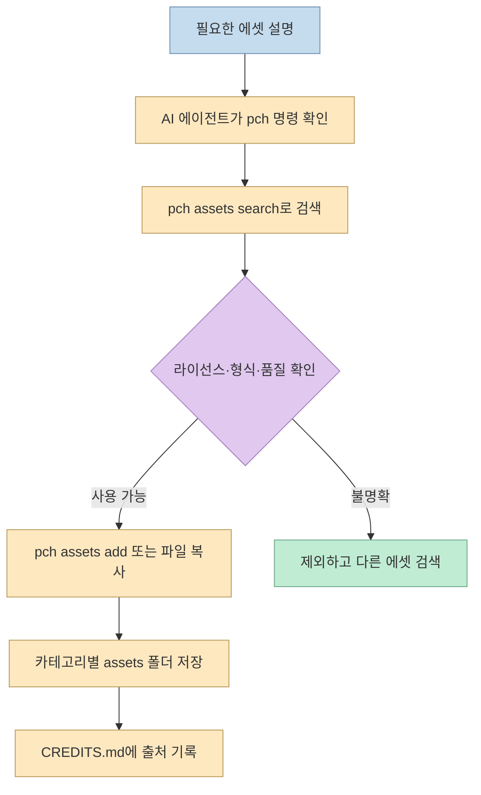

게임을 만들 때 코드를 작성하는 일만큼 시간이 걸리는 작업이 있다. 효과음, 3D 모델, 스프라이트, 배경 음악처럼 직접 만들기 부담스러운 에셋을 찾고, 내려받고, 프로젝트에 맞게 분류하는 일이다.

한 [Threads 게시물](https://www.threads.com/share/QFzDE8ZBT)은 약 5.9만 개의 무료 에셋을 AI로 검색하고 다운로드하는 방법을 소개한다. 핵심은 AI가 마법처럼 에셋을 만들어 준다는 뜻이 아니라, **Patch의 `pch` CLI를 AI 코딩 에이전트에게 사용하게 해 검색·복사·크레딧 작성을 자동화하는 것**이다.

<!--more-->

## 원문에서 소개한 방식

게시물의 예시는 다음과 같은 작업 지시다.

```text
docs.patch.gg/cli.md를 참고해서 무료 효과음(SFX)을 전부 검색하고 다운로드해 줘.

1. 필요한 도구(pch) 세팅 후 효과음 에셋 조회
2. 카테고리별(UI, 타격음, 환경음 등)로 분류해서 ./assets/sfx 폴더에 저장
3. 라이선스랑 출처 표기 문구는 CREDITS.md에 정리해 줘
```

3D 모델, 스프라이트, BGM을 찾고 싶다면 `효과음(SFX)`과 `./assets/sfx` 부분만 바꾸면 된다. 중요한 것은 단순히 파일을 많이 받는 것이 아니라, **검색 조건·폴더 구조·라이선스 기록을 한 번에 명시하는 것**이다.

## `pch`는 어떤 도구인가

[Patch CLI 문서](https://docs.patch.gg/cli.md)에 따르면 `pch`는 Patch 프로젝트와 에셋을 다루는 명령줄 도구다. 에셋 관련 명령은 다음과 같다.

- `pch assets search [query]`: 3D 모델, 머티리얼, HDRI, 사운드, 음악, 스프라이트를 검색한다.
- `pch assets add <ids…>`: 선택한 에셋을 게임에 복사하고 라이선스와 크레딧을 추가한다.
- `pch guide`: Patch에서 프로젝트를 만들고 테스트·배포하는 전체 안내를 출력한다.

따라서 AI에게 “무료 에셋을 찾아 줘”라고만 말하기보다 `pch assets search`와 `pch assets add`를 사용하고, 결과를 지정한 폴더에 정리하라고 지시하는 편이 재현 가능하다.



## 바로 사용할 수 있는 작업 지시문

프로젝트 루트에서 AI 에이전트에게 다음처럼 요청할 수 있다.

```text
docs.patch.gg/cli.md를 먼저 읽고 pch를 사용할 수 있는지 확인해 줘.

무료 SFX 중에서 다음 조건에 맞는 에셋을 찾아 줘.
- 용도: UI 클릭, 메뉴 이동, 버튼 확인
- 형식: 게임 엔진에서 사용하기 쉬운 WAV 또는 OGG
- 라이선스: 상업 게임에서 사용할 수 있고 조건이 명확한 것
- 저장 위치: ./assets/sfx/ui/

검색 결과마다 에셋 ID, 원본 URL, 라이선스, 저작자, 필요한 출처 표기를 확인해 줘.
확인할 수 없는 에셋은 다운로드하지 말고, 사용한 에셋과 라이선스를 ./CREDITS.md에 추가해 줘.
```

환경음이나 음악을 찾을 때는 `용도`와 저장 위치만 바꾸면 된다. 여러 종류를 한 번에 처리하더라도 UI, 전투, 환경처럼 작업 단위를 나누면 검수와 삭제가 쉽다.

## '무료'와 '상업적 사용 가능'은 다르다

원문은 CC0·CC-BY 등 안전한 라이선스를 강조하지만, 무료라는 표현만으로 사용 조건이 완전히 결정되지는 않는다.

### CC0

일반적으로 저작권상 넓은 사용 권한을 제공하는 형태지만, 원본 페이지의 조건과 에셋에 포함된 제3자 권리를 확인해야 한다. 특히 상표, 실제 인물, 별도 음원 샘플이 섞였는지는 따로 살펴야 한다.

### CC-BY

저작자 표시가 필요한 라이선스다. 게임 크레딧, 웹사이트, 저장소의 `CREDITS.md` 등 프로젝트에 맞는 위치에 저작자·원본 링크·라이선스를 남겨야 한다. 표시 방법과 수정 여부 조건도 라이선스 버전별로 확인한다.

### 확인이 어려운 에셋

검색 결과에 라이선스가 표시되더라도 다음 항목이 비어 있으면 바로 사용하지 않는 편이 낫다.

- 원본 에셋 페이지 URL
- 저작자 또는 제공자
- 라이선스 이름과 버전
- 상업적 사용·수정·재배포 조건
- 저작자 표시가 필요한 경우의 정확한 문구

AI 에이전트가 라이선스를 요약할 수는 있지만, 법적 판단을 대신하지는 않는다. 최종적으로는 원본 라이선스 페이지를 열어 프로젝트의 배포 방식과 맞는지 확인해야 한다.

## 폴더와 `CREDITS.md`를 함께 관리하기

에셋을 내려받는 것보다 나중에 “이 파일을 어디서 받았지?”라는 질문에 답할 수 있게 만드는 것이 더 중요하다. 예를 들어 다음처럼 구성할 수 있다.

```text
assets/
├── sfx/
│   ├── ui/
│   ├── combat/
│   └── environment/
├── sprites/
└── music/
CREDITS.md
```

`CREDITS.md`에는 파일명과 출처를 연결해 둔다.

```markdown
# Credits

## SFX

- `assets/sfx/ui/menu-confirm.ogg`
  - Title: Menu Confirm
  - Author: Example Author
  - License: CC BY 4.0
  - Source: https://example.com/assets/menu-confirm
  - Attribution: "Menu Confirm" by Example Author, licensed under CC BY 4.0
```

파일명만으로 원본을 추적하기 어렵다면 에셋 ID나 해시도 함께 기록한다. 나중에 라이선스가 바뀌거나 에셋을 교체할 때도 어떤 파일을 다시 확인해야 하는지 알 수 있다.

## 이 워크플로의 적절한 사용 범위

이 방식은 다음 작업에 특히 잘 맞는다.

- 프로토타입에 필요한 임시 에셋을 빠르게 찾기
- 장르별 에셋 후보를 여러 개 비교하기
- 프로젝트 폴더와 크레딧 초안을 동시에 만들기
- 혼자 개발하면서 반복적인 다운로드·분류 작업 줄이기

반대로 최종 출시용 에셋은 자동 다운로드 결과를 그대로 넣기보다 사람이 한 번 더 확인해야 한다. 게임의 분위기와 품질이 맞는지, 동일한 에셋이 다른 게임에도 흔히 사용되는지, 라이선스가 실제 배포 플랫폼과 맞는지 검수하는 단계가 필요하다.

## 핵심 요약

- Threads 게시물의 핵심은 AI 생성이 아니라 `pch` CLI를 이용한 에셋 검색 자동화다.
- `pch assets search`로 후보를 찾고, `pch assets add` 또는 명시한 폴더에 에셋을 정리할 수 있다.
- 에셋 종류·폴더·파일 형식·라이선스 조건을 작업 지시문에 구체적으로 적어야 결과를 재현하기 쉽다.
- CC0·CC-BY라도 원본 URL과 사용 조건을 확인하고 `CREDITS.md`에 기록해야 한다.
- 자동화는 후보 수집과 정리를 빠르게 해 주지만, 최종 라이선스와 품질 판단은 개발자가 맡아야 한다.

## Sources

- [원문 Threads 게시물](https://www.threads.com/share/QFzDE8ZBT) · [확장된 원문 게시물](https://www.threads.com/@nukunzzang/post/DfwY5mbkl82) — 무료 에셋을 AI로 검색·다운로드하는 작업 지시 예시를 확인했다.
- [Patch CLI 문서](https://docs.patch.gg/cli.md) — `pch` 설치, `pch assets search`, `pch assets add` 명령을 확인했다.

