AI 도구를 고를 때 GitHub 별 수만 보면 실제 용도를 놓치기 쉽다. 같은 주목을 받은 프로젝트라도 주식 분석 시스템, 데스크톱 조작, 코딩 에이전트, 디자인 시스템처럼 해결하려는 문제가 모두 다르기 때문이다.

PICKIT의 쇼츠 [「모르면 손해인 최신 트렌드 AI스킬 탑 10!」](https://youtube.com/shorts/zYwWHNOlu0c?si=b0pgQzbG4hpu_nB4)는 당시 일주일 동안 별을 많이 얻은 AI 관련 GitHub 프로젝트 10개를 소개한다. 이 글은 쇼츠의 순위를 그대로 현재 인기 순위라고 단정하지 않고, 영상 게시 시점의 목록을 공식 저장소와 대조해 각 도구가 어떤 문제를 풀며 게임 개발 과정에 어디에 연결되는지 정리한다.

<!--more-->

## Sources

- [원본 YouTube Shorts — PICKIT](https://youtube.com/shorts/zYwWHNOlu0c?si=b0pgQzbG4hpu_nB4) — 순위와 소개 문장을 확인한 원본 영상.
- [Daily Stock Analysis](https://github.com/wylhustcn/daily-stock-analysis) — 여러 시장의 종목을 분석하고 결과를 알림으로 보내는 시스템.
- [Hallmark](https://github.com/nutlope/hallmark) — AI가 만든 것처럼 보이는 웹 디자인을 줄이기 위한 디자인 스킬.
- [Vercel agent-desktop](https://github.com/vercel-labs/agent-desktop) — 접근성 트리 기반 데스크톱 조작 도구.
- [Google Elephant-Goldfish Model](https://github.com/google/elephant-goldfish-model) — 풍부한 프로젝트 맥락과 독립적인 검토를 결합한 에이전트 개발 방법론.
- [OpenMausBot](https://github.com/milind-soni/OpenMausBot) — 여러 AI 에이전트를 메신저처럼 다루는 데스크톱 앱.
- [GoogleChrome modern-web-guidance](https://github.com/GoogleChrome/modern-web-guidance) — AI 코딩 에이전트가 현대적인 웹 개발 규칙을 따르도록 돕는 가이드.
- [Anthropic skills](https://github.com/anthropics/skills) — 문서·PDF·스프레드시트·슬라이드·디자인 작업을 위한 공식 스킬 모음.
- [Matt Pocock skills](https://github.com/mattpocock/skills) — 소프트웨어 엔지니어링 작업을 작은 에이전트 스킬로 나눈 모음.
- [T3 Code](https://github.com/pingdotgg/t3code) — 컴퓨터와 휴대폰에서 코딩 에이전트를 제어하는 오픈소스 인터페이스.
- [Meta Astryx](https://github.com/meta/astryx) — Meta의 내부 디자인 시스템을 현대적인 오픈소스 UI 시스템으로 재구성한 프로젝트.

> 영상의 한국어 자동 자막에는 `메타 아스트릭스`, `맵포커스킬즈`처럼 고유명사가 변형된 부분이 있었다. 공식 저장소 검색 결과를 바탕으로 각각 **Astryx**, **Matt Pocock의 skills**로 정리했다. 별 수와 순위는 GitHub의 실시간 값이 아니라 영상이 소개한 시점의 스냅샷이다. [영상 00:00](https://youtu.be/zYwWHNOlu0c?t=0)

## 1. 10위: Daily Stock Analysis — 반복되는 데이터 작업을 자동화하는 구조

쇼츠의 10위는 `daily-stock-analysis`다. 영상은 AI가 한국 주식을 포함한 시장을 매일 분석하고, 결론과 위험 신호를 보내 준다고 소개한다. 공식 저장소는 A주·홍콩·미국 등 여러 시장의 데이터를 모아 의사결정 대시보드와 알림을 만드는 시스템으로 설명하며, GitHub Actions·Docker·FastAPI와 Telegram·Discord·Slack·이메일 같은 전달 채널을 지원한다고 적고 있다. [영상 00:10](https://youtu.be/zYwWHNOlu0c?t=10) · [공식 저장소](https://github.com/wylhustcn/daily-stock-analysis)

게임 개발에 그대로 주식 분석을 가져올 필요는 없다. 중요한 구조는 **정해진 주기로 데이터를 수집하고, AI가 해석하고, 결과를 사람이 보는 채널로 전송하는 파이프라인**이다. 예를 들어 매일 새벽에 최근 플레이 로그를 집계해 다음 내용을 보내도록 만들 수 있다.

- 전날 가장 많이 실패한 튜토리얼 단계
- 특정 기기에서만 급증한 크래시
- 카드·무기·캐릭터별 선택률과 승률 변화
- 빌드 시간이 길어진 브랜치와 최근 커밋
- 스토어 리뷰에서 반복되는 불만 키워드

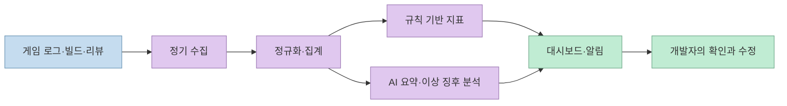

다만 금융 분석처럼 외부 데이터의 정확성과 최신성이 중요한 영역은 AI의 결론을 그대로 의사결정에 사용하면 안 된다. 게임 분석에서도 같은 원칙이 적용된다. AI에게 “이 카드가 약하니 상향해”라고 맡기기보다, 원본 이벤트·표본 수·구간별 승률을 함께 보여 주고 사람이 원인을 확인해야 한다.

## 2. 9위: Hallmark — AI가 만든 웹 페이지의 뻔한 패턴을 줄이는 디자인 스킬

`Hallmark`는 AI가 생성한 것처럼 보이는 웹 디자인을 줄이기 위한 Claude Code·Codex·Cursor·OpenCode용 디자인 스킬이다. 공식 저장소는 프로젝트의 기존 폰트·팔레트·프레임워크를 먼저 읽고, 여러 테마를 제안하며, 브라우저에서 여러 화면 크기로 렌더링을 검사하는 흐름을 설명한다. [영상 00:17](https://youtu.be/zYwWHNOlu0c?t=17) · [Hallmark README](https://github.com/nutlope/hallmark)

게임 개발에서는 랜딩 페이지뿐 아니라 게임 내 메뉴와 HUD 프로토타입에도 이 문제가 생긴다. AI에게 “예쁜 인벤토리 화면”이라고만 요청하면 보라색 그라디언트, 과도한 카드 모서리, 의미 없는 배지, 실제로 동작하지 않는 입력창이 반복될 수 있다. Hallmark의 접근은 먼저 프로젝트 맥락과 디자인 재료를 확인하고, 결과를 실제 브라우저에서 검사한다는 데 의미가 있다.

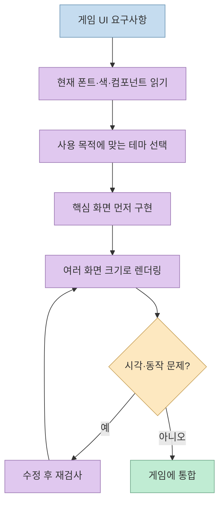

게임 UI에 적용할 때는 “AI 티가 안 나게”보다 더 구체적인 규칙이 필요하다. 예를 들어 전투 중 가장 먼저 읽어야 할 자원은 무엇인지, 터치 영역은 최소 얼마인지, 상태 이상을 색상만으로 구분하지 않는지, 키보드·게임패드 포커스가 어디로 이동하는지 등을 디자인 계약으로 남겨야 한다.

## 3. 8위: Vercel agent-desktop — 화면을 보지 않고도 데스크톱을 조작하기

Vercel의 `agent-desktop`은 AI 에이전트가 macOS·Windows·Linux 데스크톱 앱을 운영체제 접근성 트리로 읽고 조작하게 하는 CLI·C 라이브러리다. 화면 픽셀을 추측하는 대신 버튼·텍스트 필드·메뉴 같은 UI 요소를 JSON 트리와 참조 ID로 받고, 그 참조를 사용해 클릭하거나 값을 입력한 뒤 다시 상태를 읽는다. [영상 00:21](https://youtu.be/zYwWHNOlu0c?t=21) · [agent-desktop README](https://github.com/vercel-labs/agent-desktop)

게임 개발에서는 다음과 같은 데 사용할 수 있다.

- 에디터에서 프로젝트를 열고 특정 설정을 바꾼 뒤 재실행하기
- 로컬 빌드 결과를 실행해 메뉴·설정·세이브 흐름 점검하기
- 접근성 트리를 이용해 게임 런처나 테스트 도구의 버튼 상태 확인하기
- 사람이 반복하던 에디터 작업을 스크립트와 에이전트의 조합으로 자동화하기

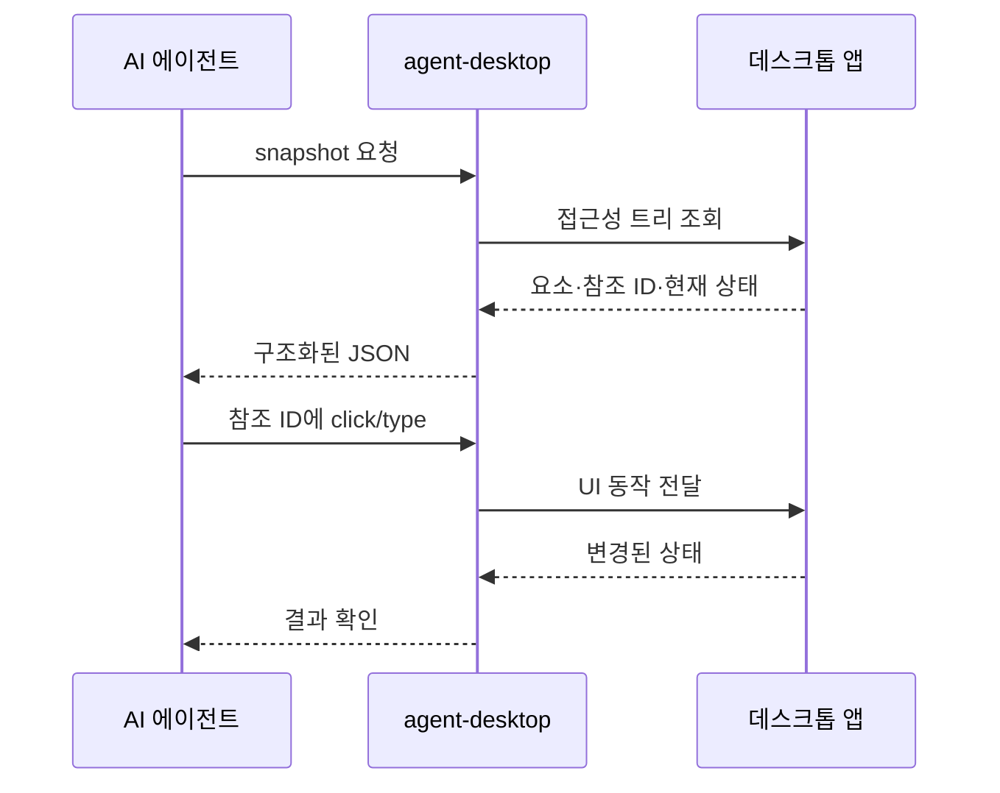

주의할 점은 접근성 트리와 클립보드·스크린샷·명령 출력에도 개인 정보가 들어갈 수 있다는 것이다. 공식 문서도 이런 자료를 공개 로그나 업로드에 남기지 말라고 경고한다. 게임 개발용 에이전트에 프로젝트 폴더와 에디터 권한을 줄 때는 테스트 전용 계정, 별도 작업 공간, 되돌릴 수 있는 저장소를 사용하는 편이 안전하다.

## 4. 7위: Elephant-Goldfish Model — 기억하는 에이전트와 독립 검토자를 분리하기

Google의 `Elephant-Goldfish Model`은 쇼츠에서 “계획을 쓰는 코끼리 AI”와 “처음 보는 눈으로 빈틈을 잡는 금붕어 AI”라는 비유로 소개된다. 공식 문서는 Elephant를 프로젝트의 역사·사용자 흐름·구성 요소까지 기억하는 풍부한 맥락으로, Goldfish를 생성 과정에 접근하지 않은 제한된 맥락의 검토자로 설명한다. [영상 00:26](https://youtu.be/zYwWHNOlu0c?t=26) · [EGM 문서](https://github.com/google/elephant-goldfish-model)

게임 개발에서는 기획을 오래 기억하는 에이전트와 검토 에이전트를 같은 프롬프트에 넣는 대신 역할을 나눌 수 있다.

1. **Elephant 단계**: 게임의 핵심 루프, 입력 규칙, 저장 구조, 기존 결정 사항을 읽고 구현 계획을 작성한다.
2. **Goldfish 단계**: 계획과 변경된 파일, 테스트 결과만 읽고 요구사항 누락·모순·검증 부족을 찾는다.
3. **사람 단계**: 두 결과를 보고 실제 플레이 경험과 출시 위험을 판단한다.

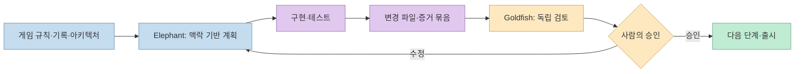

이 구조는 게임의 장기 규칙을 유지하면서도 새 검토자가 익숙한 결론에 끌려가지 않도록 해 준다. 예를 들어 Elephant가 “보스에게만 적용되는 피해 배율”을 기억하고 계획을 만들었다면, Goldfish는 실제 변경 파일만 보고 일반 적에게도 배율이 적용되는지 검사할 수 있다.

## 5. 6위: OpenMausBot — 여러 AI 직원을 대화방처럼 운영하기

쇼츠의 6위는 `OpenMausBot`이다. 영상은 채팅방에 여러 AI 직원을 두고 톡을 보내듯 일을 시킬 수 있다고 소개한다. 공식 저장소는 CLI 에이전트를 연결하고 컴퓨터 사용과 승인 카드를 제공하는 데스크톱 앱으로 설명한다. [영상 00:32](https://youtu.be/zYwWHNOlu0c?t=32) · [OpenMausBot 저장소](https://github.com/milind-soni/OpenMausBot)

이 방식은 한 명의 AI가 모든 일을 순서대로 수행하는 흐름과 다르다. 게임 프로젝트에 적용하면 기획 봇은 게임 규칙을 정리하고, 프로그래밍 봇은 구현을 맡고, QA 봇은 테스트 결과를 검토하며, 아트 봇은 필요한 에셋 목록을 관리할 수 있다. 다만 여러 봇을 만든다고 자동으로 협업이 되는 것은 아니다. 각 봇이 읽을 수 있는 파일, 수정할 수 있는 영역, 작업 완료를 표시하는 형식이 필요하다.

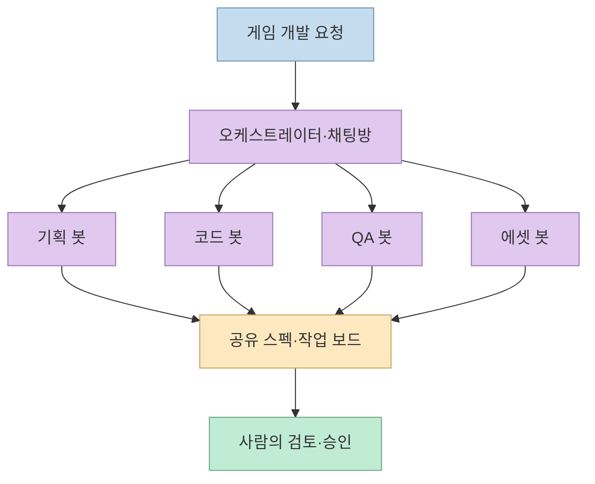

승인 흐름도 중요하다. 코드 봇이 파일을 수정하는 것과 배포 버튼을 누르는 것은 위험도가 다르므로, 읽기·작성·실행·외부 전송 권한을 분리하고 큰 변경이나 삭제·배포는 사람 승인을 요구해야 한다.

## 6. 5위: Chrome modern-web-guidance — 에이전트에게 현대적인 웹 규칙을 알려 주기

쇼츠는 Chrome·Edge·Firefox 팀이 함께 만든 최신 규칙으로 AI가 홈페이지를 현대적인 방식으로 만들게 하는 도구라고 소개한다. 확인 가능한 프로젝트는 Google Chrome의 `modern-web-guidance`다. 이 저장소는 AI 코딩 에이전트가 접근성, CSS, HTML, JavaScript, 성능, 보안, PWA, WebMCP 등 현대적인 웹 개발 주제의 가이드를 참고하도록 구성되어 있다. [영상 00:37](https://youtu.be/zYwWHNOlu0c?t=37) · [modern-web-guidance 저장소](https://github.com/GoogleChrome/modern-web-guidance)

브라우저 게임을 만들 때 이 프로젝트의 가치는 코드 생성 자체보다 **기본 품질 기준을 프롬프트 밖으로 꺼내는 것**에 있다. 게임 화면에도 일반 웹 앱과 같은 문제가 생긴다.

- 버튼과 인터랙티브 요소가 키보드·게임패드로 접근 가능한가
- 모바일 화면에서 HUD와 입력 영역이 겹치지 않는가
- 이미지·폰트·오디오가 불필요하게 큰 초기 로딩을 만들지 않는가
- 캔버스 밖의 메뉴와 설정 화면이 시맨틱 HTML을 사용하는가
- 외부 링크·저장 데이터·사용자 입력을 안전하게 처리하는가

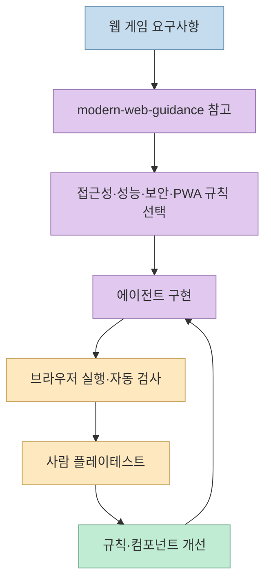

이런 가이드는 게임 규칙을 대신 정하지 않는다. “점프 버튼을 눌렀을 때 어떤 감각을 줄 것인가”는 게임 디자인의 영역이고, 가이드는 그 버튼이 다양한 입력과 화면 크기에서 실제로 동작하도록 돕는 품질 기준에 가깝다.

## 7. 4위: Anthropic skills — 반복 업무를 일관된 실행 절차로 만들기

Anthropic의 공식 `skills` 저장소는 문서, PDF, 스프레드시트, 슬라이드, 디자인, 스킬 생성 등에 사용할 수 있는 작업 지침을 모아 둔 프로젝트다. 쇼츠는 이를 Claude 회사가 직접 공개한 AI 업무 매뉴얼이라고 설명하며, 문서와 디자인 작업을 매번 같은 품질로 수행하는 데 초점을 둔다. [영상 00:46](https://youtu.be/zYwWHNOlu0c?t=46) · [Anthropic skills 저장소](https://github.com/anthropics/skills)

게임 개발에서 스킬은 “AI에게 잘 부탁하는 긴 프롬프트”보다 재사용성이 높다. 예를 들면 다음과 같은 절차를 프로젝트 규칙으로 만들 수 있다.

- 기획 문서를 읽고 구현 가능한 기능 목록과 제외 범위를 만드는 스킬
- 게임 밸런스 표를 읽고 평균·분산·극단값을 검사하는 스킬
- 스프라이트 시트의 프레임 순서와 크기를 확인하는 스킬
- 출시 노트를 작성할 때 변경된 플레이어 경험만 추리는 스킬
- 버그 리포트를 재현 절차·기대 결과·실제 결과로 변환하는 스킬

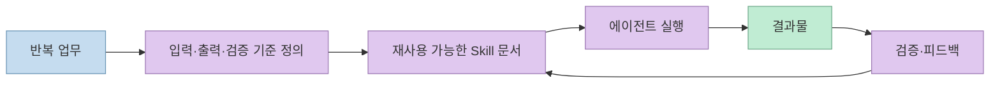

스킬에 “항상 멋지게 만들어라”만 적으면 검증할 수 없다. 입력 파일의 위치, 금지된 변경, 반드시 실행할 명령, 결과에 포함할 근거, 실패 시 중단 조건을 구체적으로 적어야 한다. 게임 개발에서는 이런 조건이 자동화의 품질을 결정한다.

## 8. 3위: Matt Pocock skills — 소프트웨어 엔지니어링 작업을 작은 단위로 쪼개기

쇼츠의 자막에 나온 `맵포커스킬즈`는 문맥과 별 수를 보면 TypeScript·소프트웨어 교육으로 알려진 Matt Pocock의 `skills` 저장소를 가리키는 것으로 보인다. 영상은 지난주보다 크게 상승한 프로젝트이자 수십만 개의 별을 받은 스킬 모음으로 소개한다. [영상 00:52](https://youtu.be/zYwWHNOlu0c?t=52) · [Matt Pocock skills](https://github.com/mattpocock/skills)

이 저장소를 게임 개발에 참고할 때는 별 수보다 작업 분해 방식이 중요하다. 큰 요청인 “전투 시스템을 만들어 줘”를 다음처럼 나누면 에이전트가 확인할 경계가 생긴다.

1. 기존 전투 상태와 입력 흐름을 읽는다.
2. 상태 전이와 데이터 모델을 먼저 제안한다.
3. 실패하는 테스트나 재현 케이스를 만든다.
4. 가장 작은 구현을 추가한다.
5. 테스트와 실제 플레이를 확인한다.
6. 변경 범위와 남은 위험을 보고한다.

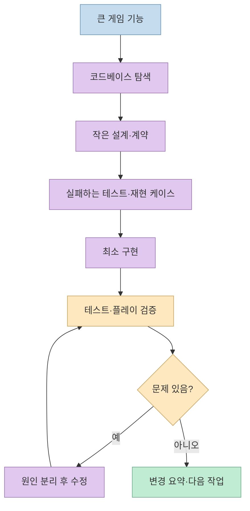

특히 게임에서는 코드 테스트만으로 입력 감각과 UI 흐름을 검증할 수 없다. 스킬의 마지막 단계에 “테스트 통과”뿐 아니라 “실행 화면에서 첫 플레이 루프를 확인하고 스크린샷 또는 로그를 남긴다”를 넣어야 코드와 플레이 결과 사이의 간극을 줄일 수 있다.

## 9. 2위: T3 Code — 컴퓨터와 휴대폰에서 코딩 에이전트 이어서 사용하기

`T3 Code`는 Claude Code, Codex, Cursor, OpenCode 등 여러 코딩 에이전트를 한 인터페이스에서 다루고, 데스크톱·웹·휴대폰에서 같은 스레드를 이어 가는 오픈소스 프로젝트다. 공식 README는 에이전트가 사용자의 컴퓨터에서 실행되고, 사용자는 다른 기기에서 다음 단계를 승인할 수 있으며, Git 작업과 워크트리도 제공한다고 설명한다. [영상 00:58](https://youtu.be/zYwWHNOlu0c?t=58) · [T3 Code README](https://github.com/pingdotgg/t3code)

게임 개발에서 유용한 장면은 긴 빌드나 자동 테스트를 기다리는 동안 생긴다. 데스크톱에서 에이전트에게 테스트를 시작하게 하고, 휴대폰에서 결과를 확인하거나 다음 작업을 승인하는 식이다. 단, 원격 제어 편의성이 커질수록 승인 범위와 비밀 관리가 더 중요해진다.

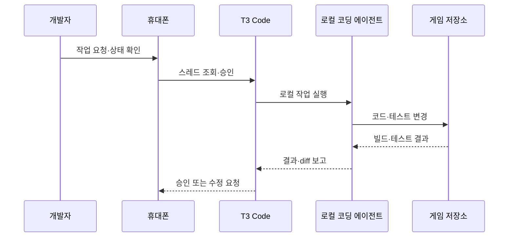

안전한 구성은 작업별 Git worktree와 제한된 환경 변수를 사용하는 것이다. 게임 프로젝트의 출시 키, 스토어 토큰, 결제 설정을 일반 개발 작업과 같은 권한으로 노출하지 않고, 배포는 별도의 사람 승인 단계를 둬야 한다.

## 10. 1위: Meta Astryx — AI가 이해할 수 있는 디자인 시스템

쇼츠의 1위는 `Astryx`다. 영상은 Meta가 수천 개의 앱에 사용하던 디자인 시스템을 공개했고, AI가 바로 가져다 화면을 만들 수 있다고 소개한다. 공식 문서에 따르면 Astryx의 기반이 된 내부 시스템은 13,000개가 넘는 제품을 지원했고, 오픈소스 버전은 TypeScript·StyleX·현대적인 브라우저 기술, 테마 시스템, CLI 문서와 AI용 참조를 결합한다. [영상 01:05](https://youtu.be/zYwWHNOlu0c?t=65) · [Astryx 공식 문서](https://github.com/meta/astryx)

여기서 중요한 점은 컴포넌트 숫자가 아니라 **사람과 AI가 같은 규칙과 참조를 사용한다는 것**이다. 버튼, 폼, 테이블, 모달, 색상 토큰, 간격 규칙이 문서화되어 있으면 AI는 매번 새 UI를 즉흥적으로 만들지 않고 기존 시스템 안에서 조합한다.

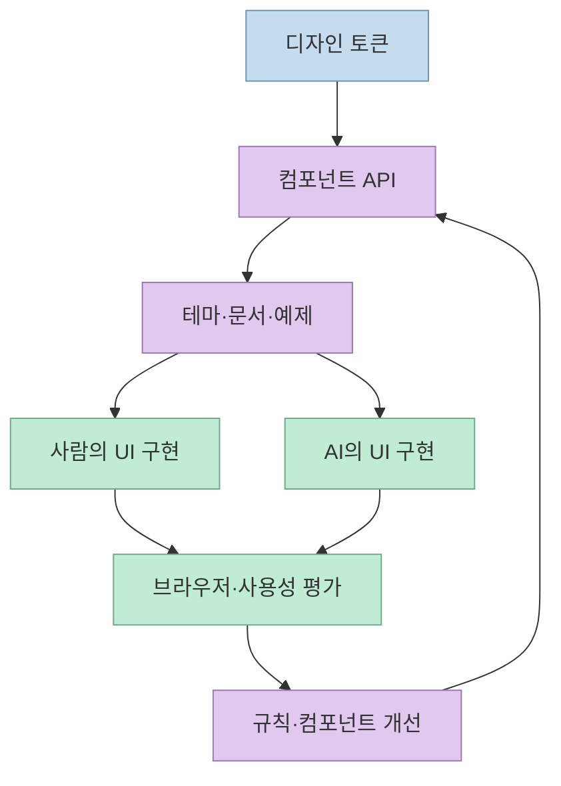

게임 프로젝트에서도 규모가 커지면 자체 디자인 시스템이 필요하다. 전투 HUD, 카드 선택, 상점, 인벤토리, 설정, 튜토리얼이 서로 다른 스타일로 만들어지면 플레이어는 기능을 배울 때마다 새로운 인터페이스를 해석해야 한다. 색상·타이포그래피·버튼 상태·패널 간격·입력 포커스를 토큰과 컴포넌트로 정리하면 AI에게 새 화면을 맡길 때도 일관성을 유지하기 쉽다.

## 11. 10개 도구를 게임 개발 파이프라인에 배치하기

이 목록은 하나의 만능 도구를 고르는 순위라기보다 서로 다른 층을 보여 준다. 데이터 수집과 관찰, 디자인 품질, 데스크톱 조작, 장기 맥락, 역할 분담, 웹 규칙, 재사용 절차, 작업 분해, 원격 제어, UI 시스템이 각각 다른 문제를 해결한다.

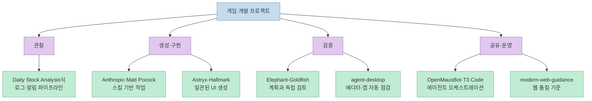

실제로 도입할 때는 별 수가 큰 순서가 아니라 다음 질문으로 좁히는 편이 낫다.

1. 지금 가장 반복적인 작업은 무엇인가?
2. 그 작업의 입력과 성공 조건을 문서로 표현할 수 있는가?
3. AI가 읽고 쓸 파일의 범위를 제한할 수 있는가?
4. 결과를 테스트·렌더링·로그로 검증할 수 있는가?
5. 실패했을 때 사람이 쉽게 되돌릴 수 있는가?

## 핵심 요약

- 쇼츠의 순위와 별 수는 게시 시점의 GitHub 트렌드 스냅샷이므로 현재 인기 순위와 동일하게 보면 안 된다.
- `Daily Stock Analysis`에서 배울 점은 게임 로그·빌드·리뷰를 정기 수집하고 알림으로 연결하는 관찰 파이프라인이다.
- `Hallmark`는 AI가 만든 UI의 반복적인 시각 패턴을 줄이고, 실제 렌더링과 브라우저 검사를 강조한다.
- `agent-desktop`은 스크린샷 추측보다 접근성 트리를 이용해 데스크톱 앱을 구조적으로 읽고 조작한다.
- Elephant-Goldfish Model은 프로젝트 맥락을 기억하는 계획 단계와 독립적인 검토 단계를 분리한다.
- `OpenMausBot`과 `T3 Code`는 여러 에이전트와 원격 작업을 편하게 만들지만, 권한·승인·비밀 관리가 필수다.
- Chrome의 `modern-web-guidance`와 Anthropic·Matt Pocock의 skills는 반복 작업과 품질 기준을 재사용 가능한 절차로 만든다.
- Meta Astryx의 핵심은 AI가 임의로 화면을 만들지 않도록 사람과 AI가 같은 디자인 시스템·문서·CLI 참조를 사용하는 데 있다.

## 결론

이번 목록에서 게임 개발자가 가져갈 핵심은 “AI 도구 10개를 모두 설치하라”가 아니다. 게임 로그를 관찰하고, 반복 작업을 스킬로 만들고, 계획과 검토를 분리하고, UI와 입력 규칙을 시스템화하는 것이다.

작은 게임 프로젝트라면 먼저 **재현 가능한 테스트와 로그 집계**를 만들고, 그다음 자주 반복하는 문서·에셋·UI 작업을 스킬로 묶는 순서가 현실적이다. AI가 더 많은 일을 하게 만드는 것보다, AI가 무엇을 바꿨고 어떻게 검증했는지 사람이 계속 확인할 수 있게 만드는 편이 장기적으로 더 강한 개발 워크플로가 된다.
