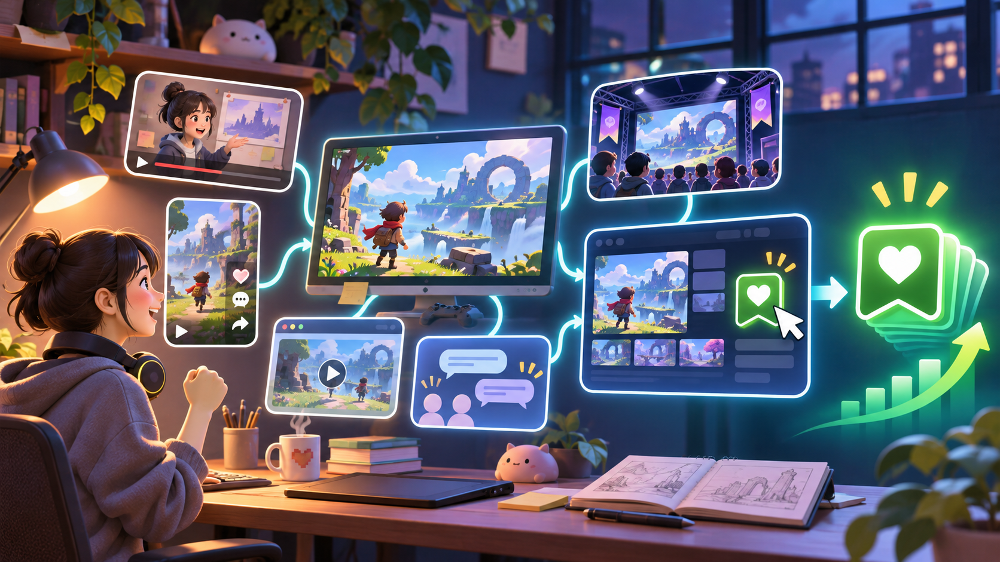
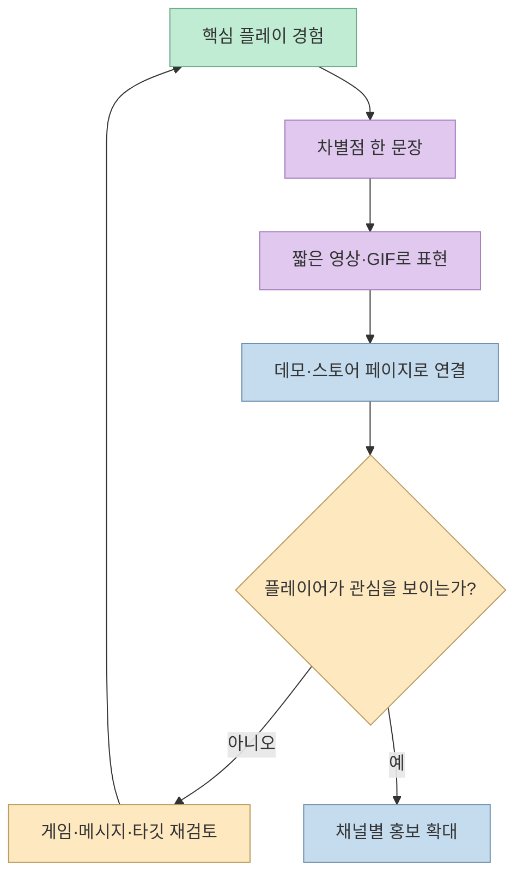
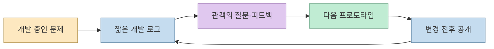
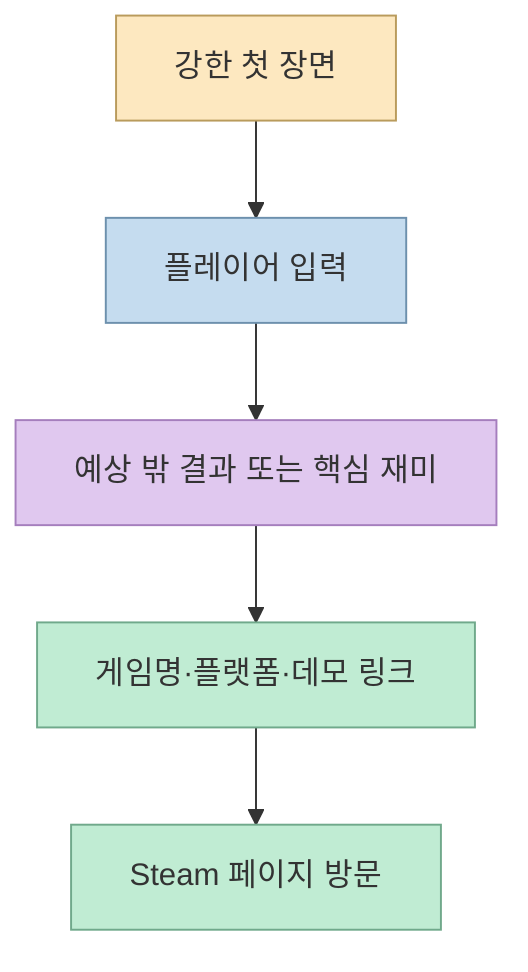
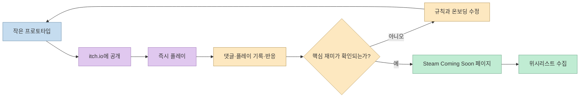
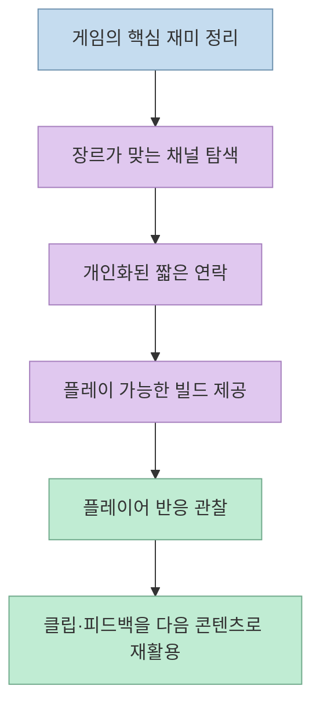
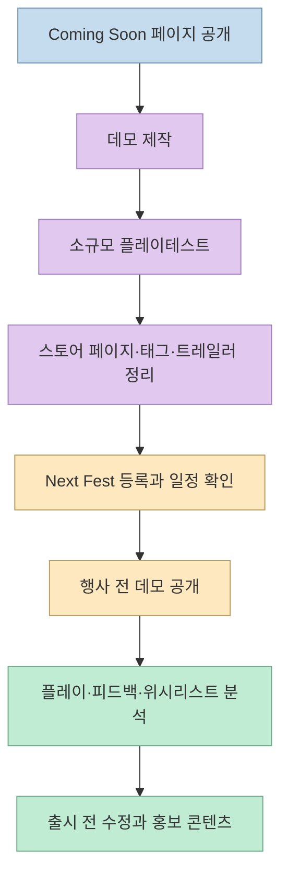
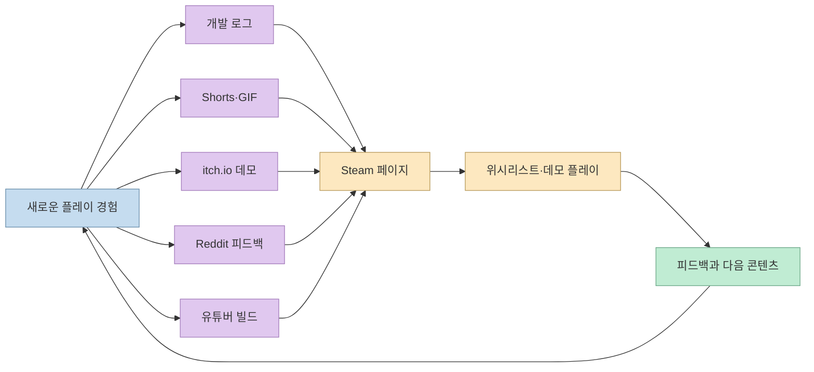

Steam에 게임을 출시할 때 “좋은 게임을 만들면 알아서 발견될 것”이라고 기대하기는 어렵다. 영상은 최근 Steam에 게임이 많이 출시되고 AI로 빠르게 만든 게임까지 섞이면서 인디 게임이 묻히기 쉬워졌다고 말한다. 그래서 성공한 게임들이 출시 전부터 어떻게 위시리스트를 모았는지 사례를 따라가며 개발 로그, Shorts, itch.io, Reddit, 유튜버 연락, 데모와 Steam Next Fest를 소개한다.

위시리스트는 단순한 인기 투표가 아니다. Steamworks 공식 문서에 따르면 공개된 스토어 페이지가 있으면 플레이어가 게임을 위시리스트에 추가할 수 있고, 출시 시점의 위시리스트 사용자에게 이메일 또는 모바일 푸시 알림이 갈 수 있다. 다만 위시리스트 수가 많다고 Steam의 모든 노출 알고리즘이 자동으로 보장되는 것은 아니다. 이 글에서는 위시리스트를 **발견 → 관심 → 플레이 → 알림 → 출시**로 이어지는 마케팅 퍼널의 중간 목표로 다룬다.

<!--more-->

## Sources

- [YouTube Shorts 원문](https://youtu.be/e7FLpmUq_1A) — 인디 게임의 출시 전 홍보 방법과 사례를 소개한 영상.
- [영상 0:00](https://youtu.be/e7FLpmUq_1A?t=0) — Steam 출시 경쟁과 위시리스트의 중요성에 대한 문제 제기.
- [영상 0:32](https://youtu.be/e7FLpmUq_1A?t=32) — 개발 로그, Shorts, itch.io, Reddit, 유튜버 연락, 데모와 Next Fest 사례.
- [영상 1:35](https://youtu.be/e7FLpmUq_1A?t=95) — 데모와 Next Fest를 통한 위시리스트 증가 사례.
- [Steamworks 위시리스트 문서](https://partner.steamgames.com/doc/marketing/wishlist) — 위시리스트 추가, 출시·할인·데모 알림과 데이터 확인.
- [Steamworks Coming Soon 문서](https://partner.steamgames.com/doc/store/coming_soon) — 공개 스토어 페이지와 출시 전 관심 수집.
- [Steam Next Fest 공식 문서](https://partner.steamgames.com/doc/marketing/upcoming_events/nextfest) — 참가 조건, 공개 데모, 피드백과 관객 확보.
- [Steamworks Visibility 문서](https://partner.steamgames.com/doc/marketing/visibility) — Steam 노출과 위시리스트의 관계에 대한 주의사항.

> 영상에 등장하는 게임명과 위시리스트·판매량 숫자는 영상 제작자가 소개한 사례로 옮겼다. 이 글에서 독립적으로 검증한 것은 Steamworks의 플랫폼 동작과 행사 조건이며, 개별 게임의 수치는 성공 보장 공식이 아니라 사례 참고용으로 봐야 한다.

## 1. 위시리스트는 홍보의 끝이 아니라 다음 행동을 예약하는 장치다

Steam의 Coming Soon 페이지가 공개되면 관심 있는 플레이어는 게임을 위시리스트에 추가할 수 있다. 이후 게임이 정식 출시되거나 얼리 액세스로 출시되면, 그 시점에 위시리스트에 남아 있는 사용자에게 출시 알림이 전송될 수 있다. Steamworks 문서에는 할인과 공개 데모도 별도의 알림 조건으로 설명되어 있다.

따라서 외부 홍보의 목표를 단순 조회 수로 잡기보다 다음 행동으로 연결해야 한다.

1. 콘텐츠를 본다.
2. 게임의 차별점을 이해한다.
3. Steam 페이지로 이동한다.
4. 위시리스트에 추가한다.
5. 데모를 플레이하거나 커뮤니티에 참여한다.
6. 출시 알림을 받고 구매 또는 플레이한다.

```mermaid
flowchart LR
    A[개발 로그·Shorts·커뮤니티 글] --> B[게임의 차별점 이해]
    B --> C[Steam Coming Soon 페이지]
    C --> D[위시리스트 추가]
    D --> E[데모·Next Fest·업데이트]
    E --> F[출시 알림]
    F --> G[구매·플레이·리뷰]
    classDef reachTone fill:#c5dcef,stroke:#6d90ad,color:#333
    classDef interestTone fill:#e0c8ef,stroke:#a57ebd,color:#333
    classDef steamTone fill:#fde8c0,stroke:#b99b5c,color:#333
    classDef outcomeTone fill:#c0ecd3,stroke:#70a98b,color:#333
    class A,B reachTone
    class C,D interestTone
    class E,F steamTone
    class G outcomeTone
```

위시리스트 수를 크게 만드는 것만으로는 충분하지 않다. 어떤 채널에서 들어온 사용자가 실제로 페이지를 방문하고 위시리스트에 추가했는지, 데모를 플레이했는지까지 추적해야 다음 홍보비와 제작 시간을 어디에 쓸지 판단할 수 있다.

## 2. 가장 먼저 필요한 것은 재미와 차별성이다

영상은 여러 홍보 채널을 소개하기 전에 “재미있고 차별성 있는 게임”이 가장 중요한 준비물이라고 강조한다. 이 순서를 바꾸면 홍보가 게임의 약점을 가리는 작업이 된다.

홍보 전에 다음 질문에 답할 수 있어야 한다.

- 플레이어가 10초 안에 이해할 수 있는 행동은 무엇인가?
- 다른 게임과 비교했을 때 한 문장으로 설명할 수 있는 차이는 무엇인가?
- 영상이나 GIF 한 장으로 그 차이를 보여 줄 수 있는가?
- 처음 플레이한 사람이 다른 사람에게 설명하고 싶은 장면은 무엇인가?

위시리스트를 모으기 위해 아직 재미가 확인되지 않은 게임의 광고를 늘리는 것은 효율적이지 않다. 먼저 짧은 프로토타입과 소규모 테스트로 핵심 루프를 확인하고, 플레이어가 기억하는 장면이 생긴 뒤 그 장면을 홍보 소재로 만드는 편이 좋다.

## 3. 개발 로그는 제품과 관객을 동시에 만든다

영상의 첫 번째 방법은 개발 로그를 일찍 공개하는 것이다. 개발 로그는 단순히 작업 일지를 보여 주는 콘텐츠가 아니다. 어떤 문제를 해결하고 있는지, 무엇이 달라지고 있는지, 다음에 무엇을 확인할지 관객과 공유하는 채널이다.

개발 로그의 주제는 다음처럼 작은 단위로 잡을 수 있다.

- 플레이어가 직접 조종하는 핵심 행동을 처음 구현한 과정
- 이전 버전의 문제와 수정 전후 비교
- 새로운 적·아이템·맵이 게임의 선택을 어떻게 바꾸는지
- 데모 테스트에서 받은 피드백을 어떻게 반영했는지
- 버린 기능과 버린 이유

좋은 개발 로그는 결과만 자랑하지 않는다. 관객이 다음 글이나 다음 영상을 기다릴 이유를 만든다. 다만 스포일러, 개발 중단 가능성, 변경될 수 있는 기능을 미리 명확히 표시해야 나중에 방향이 바뀌었을 때 신뢰를 유지할 수 있다.

## 4. Shorts와 짧은 영상은 차별점을 빠르게 보여 준다

영상에서 소개한 두 번째 방법은 TikTok이나 YouTube Shorts를 꾸준히 만드는 것이다. 짧은 영상은 게임 전체를 설명하는 자리가 아니라, 한 장면의 재미를 전달하는 데 적합하다.

게임 개발자는 다음 구조를 반복해서 실험할 수 있다.

1. 첫 1~2초에 결과나 의외의 상황을 보여 준다.
2. 플레이어가 어떤 입력을 했는지 짧게 보여 준다.
3. 그 입력이 만든 결과를 한 번 더 강조한다.
4. 게임의 이름과 플레이 가능한 위치를 연결한다.

짧은 영상의 조회 수와 위시리스트 전환은 별개의 지표다. 조회 수가 높아도 게임이 무엇인지 이해하지 못하면 Steam 페이지로 이동하지 않는다. 반대로 조회 수는 작아도 정확한 장르의 플레이어에게 도달하면 위시리스트 전환이 높을 수 있다. 따라서 영상별로 조회 수, 페이지 방문, 위시리스트 추가를 분리해 기록해야 한다.

## 5. itch.io는 설명보다 플레이를 먼저 보여 주는 실험장이다

영상의 세 번째 방법은 itch.io에 먼저 게임을 올리는 것이다. itch.io는 누구나 게임을 올릴 수 있고 브라우저에서 바로 플레이할 수 있는 인디 게임이 많다는 점이 소개된다.

이 채널의 강점은 긴 소개문보다 플레이 경험을 먼저 제공할 수 있다는 것이다. 특히 다음과 같은 게임에 적합하다.

- 브라우저에서 실행 가능한 짧은 프로토타입
- 한 가지 규칙이나 아이디어를 실험하는 게임
- 아직 Steam 페이지를 만들기 전의 플레이 테스트
- 플레이어의 조작과 이탈 지점을 확인하려는 데모

itch.io의 반응을 Steam 위시리스트로 옮길 때는 링크만 던지는 것보다 “이 데모에서 무엇을 확인했고, 다음 버전에서 무엇을 만들고 있는지”를 함께 설명하는 편이 좋다. 무료 웹 버전은 최종 제품의 모든 콘텐츠를 보여 주는 버전이 아니라, 핵심 루프를 증명하는 버전이어야 한다.

## 6. Reddit과 커뮤니티는 장르가 맞아야 한다

네 번째 방법은 Reddit의 장르 게시판에 데모 전부터 글을 올리는 것이다. 이 방식은 넓은 곳에 무작정 홍보하는 것보다 게임의 장르와 관심사가 맞는 커뮤니티를 찾는 것이 중요하다.

커뮤니티 글에는 다음을 포함할 수 있다.

- 게임을 한 문장으로 설명하는 문장
- 실제 플레이 GIF나 짧은 영상
- 개발자가 확인하고 싶은 구체적인 질문
- 현재 버전의 한계와 테스트 대상
- Steam 페이지나 데모 링크

“제 게임을 사 주세요”보다 “이 두 조작 중 어느 쪽이 더 읽기 쉬운가요?”처럼 질문을 구체화하면 대화가 시작될 가능성이 높다. 커뮤니티의 규칙과 자기 홍보 정책을 먼저 확인하고, 다른 사람의 글에도 실제로 참여해야 한다.

## 7. 유튜버 연락은 대량 발송보다 적합도가 중요하다

영상의 다섯 번째 방법은 유튜버에게 직접 연락하는 것이다. 사례에서는 1,000통이 넘는 이메일을 보냈고 한 대형 채널의 플레이 이후 다른 채널로 확산되었다고 소개한다. 이 숫자는 특정 사례의 결과일 뿐, 대량 발송 자체가 성공을 보장한다는 의미는 아니다.

실무적으로는 다음 정보가 중요하다.

- 채널의 장르와 시청자가 게임과 맞는가?
- 게임을 한 문장과 30초 영상으로 설명할 수 있는가?
- 플레이어가 처음 접했을 때 재미가 드러나는가?
- 키, 데모, 빌드, 스크린샷, 트레일러가 준비되어 있는가?
- 연락을 받지 않아도 부담이 없는 짧고 명확한 메일인가?

연락처를 무작위로 수집해 반복 발송하는 방식은 스팸으로 인식될 수 있다. 게임과 채널의 적합도를 먼저 확인하고, 플레이어에게 어떤 경험을 제공하는지 중심으로 접근해야 한다.

## 8. Steam 데모와 Next Fest는 출시 전 검증 이벤트다

Steamworks 공식 문서에 따르면 Steam Next Fest는 공개 데모가 있는 출시 예정 게임이 플레이어에게 노출되고, 개발자가 초기 피드백과 관객을 확보하는 행사다. 참가하려면 공개된 기본 게임 스토어 페이지와 행사 기간에 플레이 가능한 데모가 필요하며, 이미 출시된 게임이나 이전 Next Fest에 참가한 게임은 조건에서 제외된다.

영상의 여섯 번째 방법도 데모와 Next Fest를 묶어 설명한다. 이 조합의 핵심은 행사 참여 자체가 아니라 행사 전에 데모가 준비되어 있어야 한다는 점이다.

Steamworks 문서에는 Next Fest가 연 3회 열리는 행사라고 안내되어 있으며, 최신 일정과 등록 조건은 개별 행사 페이지에서 확인해야 한다. 또한 위시리스트 수에는 보편적인 성공 임계값이 없고, Steam의 일반적인 노출이 위시리스트 수만으로 결정되는 것도 아니다. 따라서 Next Fest를 “위시리스트를 폭발시키는 버튼”이 아니라 실제 플레이와 피드백을 모으는 집중 테스트 기간으로 설계하는 편이 안전하다.

## 9. 출시 전 홍보를 하나의 반복 루프로 묶는다

여섯 가지 방법을 각각 별개의 홍보 업무로 보면 혼자 개발하는 팀에는 부담이 커진다. 대신 하나의 게임 장면을 여러 채널의 소재로 재사용하는 구조를 만들 수 있다.

예를 들어 새 보스의 특수 패턴을 구현했다면 다음처럼 연결한다.

1. 개발 로그에서 패턴을 만들며 해결한 문제를 설명한다.
2. Shorts에서 패턴의 가장 놀라운 장면을 보여 준다.
3. itch.io 데모에서 직접 플레이하게 한다.
4. Reddit 장르 게시판에서 난이도와 가독성을 질문한다.
5. 유튜버에게 해당 보스가 포함된 짧은 빌드를 보낸다.
6. Steam 데모와 Next Fest에서 수정된 버전을 공개한다.
7. 모든 콘텐츠에서 같은 Steam 페이지로 연결한다.

## 10. 출시 전 체크리스트

### 게임과 메시지

- [ ] 게임의 차별점을 한 문장으로 설명할 수 있다.
- [ ] 10~30초 안에 보여 줄 핵심 장면이 있다.
- [ ] 공개 전 최소한의 플레이테스트를 진행했다.
- [ ] 재미없는 상태를 홍보로 덮으려 하지 않는다.

### Steam 페이지

- [ ] Coming Soon 페이지가 공개되어 있다.
- [ ] 첫 화면에서 장르와 핵심 플레이가 보인다.
- [ ] 트레일러와 GIF가 실제 플레이를 보여 준다.
- [ ] 위시리스트와 데모 링크를 모든 홍보 채널에서 추적할 수 있다.

### 채널 운영

- [ ] 개발 로그와 Shorts의 발행 주기를 정했다.
- [ ] itch.io에서 플레이 가능한 작은 데모를 준비했다.
- [ ] 커뮤니티별 규칙과 적합한 질문을 확인했다.
- [ ] 유튜버 연락은 채널과 게임의 적합도를 기준으로 개인화했다.

### Next Fest와 데모

- [ ] 행사 조건과 등록 일정을 공식 문서에서 확인했다.
- [ ] 행사 시작 전에 공개 데모를 제출·검증했다.
- [ ] 데모에서 수집할 피드백 질문을 정했다.
- [ ] 행사 후 수정할 우선순위와 출시 계획이 있다.

## 핵심 요약

- 인디 게임 홍보의 출발점은 재미와 차별성이지 홍보 채널 자체가 아니다.
- Steam 위시리스트는 출시·할인·일부 데모 알림으로 이어지는 관심 예약 장치다.
- 개발 로그는 관객을 만들고, Shorts는 핵심 장면을 빠르게 전달한다.
- itch.io는 작은 프로토타입을 직접 플레이시키며 Steam 이전의 가설을 검증하는 데 유용하다.
- Reddit은 장르가 맞는 커뮤니티에서 구체적인 질문과 함께 사용해야 한다.
- 유튜버 outreach는 대량 발송보다 채널 적합도와 플레이 경험의 명확성이 중요하다.
- Steam 데모와 Next Fest는 홍보 이벤트이면서 동시에 출시 전 플레이테스트 기간이다.
- 영상에 나온 위시리스트·판매량 숫자는 특정 사례이며, 일반적인 성공 기준으로 복사하면 안 된다.

## 결론

출시 전 위시리스트를 모으는 가장 좋은 방법은 한 가지 채널을 찾아 반복하는 것이 아니다. 게임의 핵심 재미를 짧은 콘텐츠로 보여 주고, 직접 플레이할 수 있는 데모로 연결하며, 커뮤니티와 플레이어의 반응을 다시 개발에 반영하는 루프를 만드는 것이다.

Steam 페이지와 위시리스트는 이 루프의 종착점이 아니라 다음 행동을 예약하는 중간 지점이다. 개발 로그·Shorts·itch.io·Reddit·유튜버·Next Fest를 각각 따로 운영하기보다, 하나의 좋은 플레이 장면을 여러 형식으로 재구성하고 모든 경로를 측정 가능한 Steam 페이지로 연결해야 한다. 그래야 홍보가 개발과 분리된 비용이 아니라 제품을 검증하고 관객을 만드는 개발 과정이 된다.
