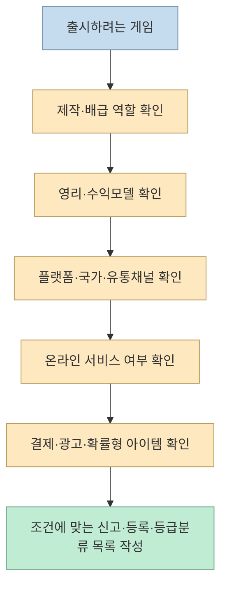
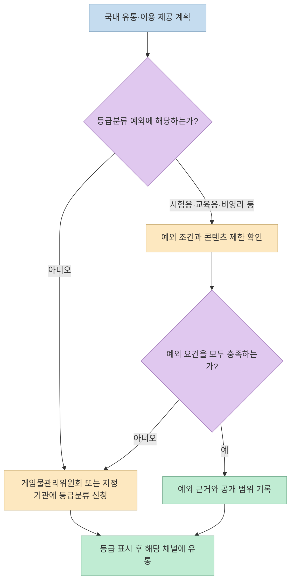
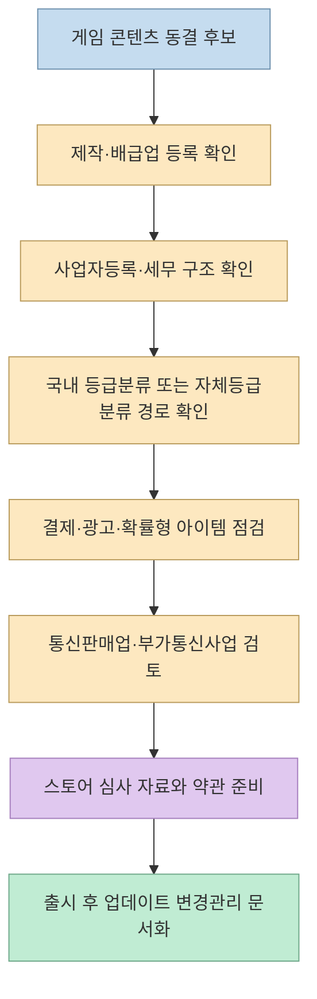

게임을 완성한 뒤에야 사업자등록이나 등급분류를 알아보면 출시 일정이 늦어질 수 있다. 어떤 플랫폼에 출시하는지, 무료인지 유료인지, 광고와 인앱결제를 넣는지, 온라인 서비스를 운영하는지에 따라 확인해야 할 제도가 달라지기 때문이다.

Threads의 [「게임 출시 전, 개발만큼 중요한 인허가 체크리스트」](https://www.threads.com/share/BAS_XVLuKL)는 게임제작업·배급업 등록부터 등급분류, 통신판매업, 부가통신사업, 확률형 아이템 표시와 내용수정신고까지 열 가지 항목을 짚는다. 이 글은 그 목록을 한국 법령과 공식 민원 안내에 대조해 **항상 필요한 절차**와 **조건에 따라 검토할 절차**를 나누어 정리한다.

> 이 글은 2026년 11월 26일 확인한 일반적인 정보 정리이며 법률·세무 자문이 아니다. 실제 의무는 사업자 형태, 게임 내용, 결제 주체, 유통 채널, 서버 운영 방식에 따라 달라질 수 있으므로 출시 전 관할 지자체·게임물관리위원회·국세청·공정거래위원회·과학기술정보통신부에 확인해야 한다.

<!--more-->

## Sources

- [원문 Threads](https://www.threads.com/share/BAS_XVLuKL) — 게임 출시 전 인허가 체크리스트.
- [게임제작(배급)업 등록 · 정부24](https://www.gov.kr/mw/AA020InfoCappView.do?CappBizCD=13700000177&HighCtgCD=A09006&tp_seq=01) — 신청 방법, 처리기관, 구비서류, 수수료 안내.
- [게임산업진흥에 관한 법률 제21조 · 국가법령정보센터](https://www.law.go.kr/LSW/lsLinkCommonInfo.do?chrClsCd=010202&lsJoLnkSeq=1025570459) — 등급분류와 비영리·시험용 등 예외.
- [게임산업진흥에 관한 법률 제21조의2 · 국가법령정보센터](https://www.law.go.kr/lsInfoP.do?lsiSeq=265811) — 자체등급분류사업자 지정과 대상.
- [게임산업진흥에 관한 법률 제25조 · 국가법령정보센터](https://www.law.go.kr/lsLinkCommonInfo.do?lsJoLnkSeq=1025570319) — 게임제작업·게임배급업 등록.
- [게임산업진흥에 관한 법률 제33조 · 국가법령정보센터](https://www.law.go.kr/LSW/lsLinkCommonInfo.do?chrClsCd=010202&lsJoLnkSeq=1029708933) — 확률형 아이템 종류와 공급 확률정보 표시.
- [통신판매업 신고 · 정부24](https://www.gov.kr/mw/AA020InfoCappView.do?CappBizCD=11300000006&HighCtgCD=A09006&tp_seq=01) — 소비자와 직접 상거래하는 통신판매업 신고 안내.
- [사업자등록 신청 · 정부24](https://www.gov.kr/mw/AA020InfoCappView.do?CappBizCD=12100000072) — 신규 사업 개시자의 사업자등록 신청 안내.
- [전기통신사업법상 부가통신사업 신고 안내 · 방송통신위원회](https://www.kcc.go.kr/download.do?fileSeq=51117) — 인터넷 게임 등 부가통신역무와 자본금 1억 원 이하 신고 면제 안내.
- [게임산업진흥에 관한 법률 제21조 내용수정 관련 조문](https://www.law.go.kr/lsLinkCommonInfo.do?chrClsCd=010202&lsJoLnkSeq=1029200565) — 내용수정신고와 등급 재분류 대상 통보.

## 1. 먼저 게임의 출시 형태를 한 문장으로 정의한다

인허가 체크리스트는 게임 장르보다 **사업과 유통의 구조**에서 출발한다. 다음 질문에 답하면 필요한 제도가 빠르게 좁혀진다.

- 혼자 만든 게임을 무료로 공개하는가, 수익을 목적으로 판매하는가?
- 직접 게임을 제작하는가, 다른 개발사의 게임을 배급하는가?
- 국내 이용자에게 유통하는가?
- PC·웹·모바일·콘솔 중 어느 채널에 제공하는가?
- 게임 파일을 직접 판매하는가, 스토어가 판매·결제를 맡는가?
- 광고, 인앱결제, 유료 확률형 아이템이 있는가?
- 로그인·매칭·저장·채팅을 위한 온라인 서버를 운영하는가?

이 과정을 거치지 않고 “게임이면 무조건 이 서류가 필요하다”고 외우면 오히려 잘못된 결론을 내릴 수 있다. 예를 들어 게임을 직접 제작하는 경우와 타인의 게임을 배급하는 경우는 게임산업법상 확인할 업종이 다르고, 직접 결제하는 웹 서비스와 앱 마켓을 통해 유통하는 게임은 소비자 거래 구조가 다르다.

## 2. 게임제작업·게임배급업 등록은 역할에 따라 확인한다

게임산업진흥에 관한 법률 제25조는 게임제작업 또는 게임배급업을 영위하려는 자가 관할 특별자치시장·특별자치도지사·시장·군수·구청장에게 등록하도록 규정한다. 정부24의 민원 안내도 게임물을 제작하거나 배급하려는 경우의 등록 민원으로 설명하면서, 게임제작업은 제작시설·장비 명세서 등을 구비서류로 안내한다. [법 제25조](https://www.law.go.kr/lsLinkCommonInfo.do?lsJoLnkSeq=1025570319) · [정부24 등록 안내](https://www.gov.kr/mw/AA020InfoCappView.do?CappBizCD=13700000177&HighCtgCD=A09006&tp_seq=01)

따라서 다음처럼 분리해 확인하는 편이 좋다.

| 확인 대상 | 확인할 내용 |
|---|---|
| 게임제작업 | 직접 게임을 제작하는 사업을 영위하는지, 관할 지자체 등록이 필요한지 |
| 게임배급업 | 다른 사업자가 만든 게임을 유통·배급하는 사업을 영위하는지 |
| 등록 기관 | 사업장 소재지를 관할하는 시·군·구 등 접수기관 |
| 구비서류 | 신청서, 임대차계약서 해당 여부, 제작시설·장비 명세서 등 |
| 수수료 | 정부24 안내처럼 수수료가 조례로 정해질 수 있으므로 관할 기관 확인 |

원문 체크리스트처럼 제작업과 배급업을 모두 등록해야 한다고 일반화하기보다, 실제로 두 역할을 모두 수행하는지부터 확인해야 한다. 정부24는 처리기간을 총 3일로 안내하지만, 보완이나 관할 기관의 실제 접수 조건에 따라 일정이 달라질 수 있으므로 출시 일정에 여유를 두는 편이 안전하다.

## 3. 사업자등록은 수익모델과 사업 개시를 기준으로 본다

사업자등록은 게임산업법상의 게임제작업·배급업 등록과 다른 세무 절차다. 정부24의 개인사업자 사업자등록 안내는 신규로 사업을 개시하는 자가 사업장 관할 세무서장에게 신청하는 민원이라고 설명하고, 국세청을 담당 기관으로 표시한다. [사업자등록 신청 안내](https://www.gov.kr/mw/AA020InfoCappView.do?CappBizCD=12100000072)

따라서 다음을 분리해 기록해야 한다.

- 누가 게임을 제작·판매하는 사업자인가?
- 수익이 사업자에게 직접 귀속되는가, 플랫폼이 판매자인가?
- 광고·후원·인앱결제·라이선스 등 수익원이 있는가?
- 개인사업자와 법인 중 어떤 형태로 운영하는가?
- 사업장 주소와 실제 영위 업종은 무엇인가?

“무료 게임이므로 사업이 아니다”라고 단정하는 것도 위험하다. 광고나 후원, 데이터·서비스 판매처럼 금전적 수익이 발생하면 무료 다운로드 여부와 별개로 사업자등록과 세무 처리를 검토해야 한다. 다만 과세유형과 업종 코드는 실제 구조에 따라 판단되므로, 게임제작업이라는 이유만으로 특정 과세유형을 확정해서는 안 된다.

## 4. 국내 유통 전에는 등급분류를 확인한다

게임산업법 제21조는 게임물을 유통시키거나 이용에 제공할 목적으로 제작 또는 배급하려는 경우, 원칙적으로 제작·배급 전에 위원회 또는 지정된 사업자로부터 등급분류를 받도록 한다. 법에는 시험용 게임물, 교육·학습·종교·공익 목적 게임물, 영리를 목적으로 하지 않는 일정한 게임물 등 예외가 있지만, 예외의 구체적인 범위와 청소년이용불가 콘텐츠 제외 조건을 함께 확인해야 한다. [제21조](https://www.law.go.kr/LSW/lsLinkCommonInfo.do?chrClsCd=010202&lsJoLnkSeq=1025570459)

비영리 단순 공개용 게임이라고 해도 청소년이용불가 내용이 있으면 예외에서 제외될 수 있다. “무료 공개”와 “비영리”는 같은 말이 아니며, 광고·후원·유료 기능을 포함하는지까지 함께 살펴야 한다.

## 5. 구글플레이 자체등급분류는 개발자의 개인 면허가 아니다

원문은 구글플레이 출시 시 자체등급분류를 활용할 수 있다고 설명한다. 여기서 중요한 점은 **모든 개인 개발자가 자체등급분류사업자가 되는 것**이 아니라, 게임산업법 제21조의2에 따라 지정된 자체등급분류사업자와 그 대상 게임을 통해 등급분류가 이루어지는 구조라는 점이다.

법령상 자체등급분류사업자는 일정 요건을 갖춘 법인 중 지정되며, 자체등급분류 대상에는 중개계약을 맺고 서비스하는 게임물이나 해당 사업자가 제작한 게임물 등이 포함될 수 있다. 반대로 법에서 제외한 유형이나 청소년게임제공업·일반게임제공업에 제공되는 게임물은 자체등급분류 대상에서 제외될 수 있다. [제21조의2](https://www.law.go.kr/lsInfoP.do?lsiSeq=265811)

실무적으로는 다음 순서로 확인한다.

1. 출시하려는 스토어가 어떤 등급분류 체계를 사용하는지 확인한다.
2. 해당 스토어가 국내 자체등급분류사업자에 해당하는지 확인한다.
3. 게임의 장르·내용·서비스 형태가 자체등급분류 대상인지 확인한다.
4. 스토어 등록 화면에서 등급 표시·설문·콘텐츠 정보를 정확히 입력한다.
5. 국내 유통 범위와 다른 플랫폼 출시 여부를 별도로 관리한다.

## 6. 웹에서 직접 판매하면 통신판매업을 검토한다

정부24는 통신판매업 신고를 전기통신매체나 광고물 등을 통해 소비자와 직접 상거래를 하려는 경우의 민원으로 설명한다. 근거 법령으로 전자상거래법 제12조와 시행령·시행규칙을 제시하며, 선지급식 통신판매를 하려는 경우 구매안전서비스 이용 확인증을 제출할 수 있다고 안내한다. [정부24 통신판매업 신고](https://www.gov.kr/mw/AA020InfoCappView.do?CappBizCD=11300000006&HighCtgCD=A09006&tp_seq=01)

게임에서 통신판매업 검토가 필요한지는 “온라인 게임인가”가 아니라 **누가 소비자와 직접 거래하는가**가 핵심이다.

- 자체 웹사이트에서 게임 키·DLC·아이템을 직접 결제받는가?
- 결제·환불·청약철회 관련 소비자 계약의 주체가 개발자인가?
- 앱 마켓이나 플랫폼이 판매·결제·환불을 맡고 개발자는 공급자 역할만 하는가?
- 게임 외에 실물 상품이나 별도 디지털 상품을 함께 판매하는가?

앱 마켓을 이용한다는 이유만으로 통신판매업 신고 의무가 자동으로 사라지거나 생긴다고 단정하지 말고, 실제 계약 구조와 판매 주체를 확인해야 한다.

## 7. 온라인 서비스라면 부가통신사업 신고 여부를 확인한다

방송통신위원회 안내서는 인터넷을 통한 포털·온라인쇼핑·게임·SNS·인터넷금융 등을 부가통신역무의 예시로 들고, 부가통신사업을 경영하려는 자는 신고 대상이 될 수 있다고 설명한다. 같은 안내서는 인터넷을 이용해 부가통신역무를 제공하는 자본금 1억 원 이하 사업자의 신고 면제와, 자본금이 그 기준을 초과하게 된 경우의 신고 시점을 함께 안내한다. [방송통신위원회 안내서](https://www.kcc.go.kr/download.do?fileSeq=51117)

원문에 적힌 “온라인 게임이면 부가통신사업 신고 검토”는 방향으로는 유용하지만, 자본금 기준과 서비스 유형을 함께 봐야 한다. 로그인·매칭·채팅·클라우드 세이브·실시간 월드처럼 서버를 운영한다고 해서 모든 게임이 동일한 절차를 거친다고 단정할 수는 없다.

## 8. 광고 수익은 무료 게임을 자동으로 비영리로 만들지 않는다

게임의 다운로드 가격이 0원이어도 광고, 유료 아이템, 구독, 후원, 플랫폼 수익 배분 등으로 수익을 얻는다면 비영리 게임으로 보기 어려워질 수 있다. 특히 등급분류 예외를 검토할 때는 무료 배포 여부가 아니라 영리 목적과 게임 콘텐츠, 배포 형태를 함께 확인해야 한다.

다음 자료를 출시 전에 하나의 문서로 묶어 두면 좋다.

- 수익모델 설명서
- 광고 SDK와 광고 노출 위치
- 인앱결제 상품 목록
- 플랫폼별 판매·환불 주체
- 이용약관과 개인정보 처리방침
- 사업자등록·게임제작업 등록 여부

이 기록은 인허가 판단뿐 아니라 스토어 심사, 이용자 문의, 세무 신고의 근거를 정리하는 데도 도움이 된다.

## 9. 유료 확률형 아이템은 확률 표시를 별도로 관리한다

게임산업법 제33조제2항은 게임물을 유통하거나 이용에 제공할 목적으로 제작·배급·제공하는 자가 게임물과 인터넷 홈페이지, 광고·선전물에 확률형 아이템의 종류별 공급 확률정보와 대통령령이 정하는 사항을 표시하도록 한다. [제33조](https://www.law.go.kr/LSW/lsLinkCommonInfo.do?chrClsCd=010202&lsJoLnkSeq=1029708933)

시행령은 정보통신망으로 제공되는 게임물로서 확률형 아이템을 제공하는 경우를 표시의무 대상 게임물로 규정하고, 한정 수량·기간 등 추가 표시 사항을 정한다. [시행령 제19조의2](https://www.law.go.kr/lsLinkCommonInfo.do?chrClsCd=010202&lspttninfSeq=56614)

출시 전에는 다음을 확인한다.

- 유료 재화로 구매하는 확률형 상품이 있는가?
- 확률의 단위가 아이템·등급·묶음 중 무엇인가?
- 공급 확률과 보장·천장·중복 규칙을 어떻게 표시할 것인가?
- 게임 안, 홈페이지, 광고·선전물의 정보가 서로 일치하는가?
- 확률 변경 시 변경 내용과 시점을 어떻게 기록·공지할 것인가?

확률표를 한 번 작성하고 끝내는 것이 아니라, 상품 버전과 서버 설정의 변경 이력을 함께 관리해야 한다.

## 10. 업데이트가 등급에 영향을 주는지 판단한다

등급분류를 받은 뒤 게임의 폭력성·선정성·사행성·이용 방식 등 등급에 영향을 줄 수 있는 내용을 추가하면 내용수정신고와 재분류 여부를 검토해야 한다. 법령은 기존 등급분류 결정에 영향을 미치지 않는 것이 명백하거나 문화체육관광부령이 정한 경미한 사항은 예외로 두지만, 등급 변경이 필요할 정도의 수정이라고 판단되면 위원회가 재분류 대상임을 통보하고 새로 등급분류를 받도록 조치할 수 있다. [내용수정 관련 조문](https://www.law.go.kr/lsLinkCommonInfo.do?chrClsCd=010202&lsJoLnkSeq=1029200565)

업데이트를 다음처럼 분류해 두면 판단이 쉬워진다.

| 업데이트 유형 | 먼저 확인할 것 |
|---|---|
| 버그 수정·성능 개선 | 등급 관련 콘텐츠가 바뀌지 않았는지 |
| 신규 스테이지·캐릭터 | 폭력성·선정성·사행성 등급 정보 변화 여부 |
| 신규 결제·확률형 상품 | 확률 표시와 등급분류 정보의 동시 변경 여부 |
| 채팅·거래·온라인 기능 추가 | 이용 방식과 서비스 구조의 변화 여부 |
| 스토리·연출·컷신 추가 | 등급분류에 영향을 주는 표현 포함 여부 |

업데이트를 배포하기 전에 변경 목록, 이전 버전과의 차이, 관련 스크린샷과 동영상, 등급 영향 검토 결과를 보관하면 신고나 재분류가 필요한지 문의할 때 설명하기 쉽다.

## 11. 출시 전 실무 체크리스트

- [ ] 누가 제작자이고 누가 배급자인지 정리했다.
- [ ] 제작업·배급업 등록 필요 여부와 관할 지자체를 확인했다.
- [ ] 사업자등록과 수익 귀속 구조를 세무 담당자에게 확인했다.
- [ ] 국내 유통 여부와 등급분류 경로를 정했다.
- [ ] 무료·유료·광고·인앱결제·확률형 아이템을 구분했다.
- [ ] 웹 직접 판매라면 통신판매업을 검토했다.
- [ ] 온라인 서비스라면 부가통신사업 신고 면제·대상 여부를 확인했다.
- [ ] 게임물과 홈페이지·광고의 확률 정보를 일치시켰다.
- [ ] 등급에 영향을 줄 수 있는 업데이트의 신고·재분류 절차를 기록했다.
- [ ] 출시 후 변경관리 담당자와 문서 보관 위치를 정했다.

## 핵심 요약

- 게임 출시 인허가는 장르보다 제작·배급 역할, 수익모델, 플랫폼, 결제·서버 구조에 따라 달라진다.
- 게임제작업·게임배급업 등록과 사업자등록은 서로 다른 절차다.
- 국내 유통은 원칙적으로 등급분류 대상이며, 비영리·시험용 등 예외도 조건과 콘텐츠 제한을 확인해야 한다.
- 구글플레이의 자체등급분류는 지정된 자체등급분류사업자와 대상 게임의 구조로 이해해야 한다.
- 웹에서 소비자와 직접 거래하면 통신판매업 신고를 검토하고, 온라인 게임 서비스는 부가통신사업 신고 면제·대상 여부를 확인한다.
- 무료 게임이라도 광고나 결제가 있으면 비영리로 단정할 수 없다.
- 유료 확률형 아이템은 종류별 공급 확률과 추가 정보를 게임물·홈페이지·광고에 표시해야 할 수 있다.
- 등급에 영향을 줄 수 있는 업데이트는 내용수정신고와 재분류 여부를 출시 후에도 관리해야 한다.

## 결론

게임 출시 준비에서 서류는 개발이 끝난 뒤 처리하는 마지막 단계가 아니다. 어떤 방식으로 돈을 벌고, 어디에 유통하고, 어떤 온라인 기능을 제공할지 결정하는 순간부터 필요한 확인 항목이 생긴다. 출시 전에 사업 구조와 콘텐츠를 문서화하고, 공식 기관의 최신 안내에 따라 등록·신고·등급분류 경로를 확인하면 일정 지연과 재작업을 줄일 수 있다.
