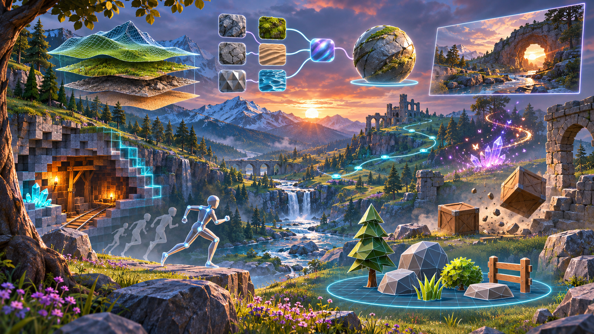
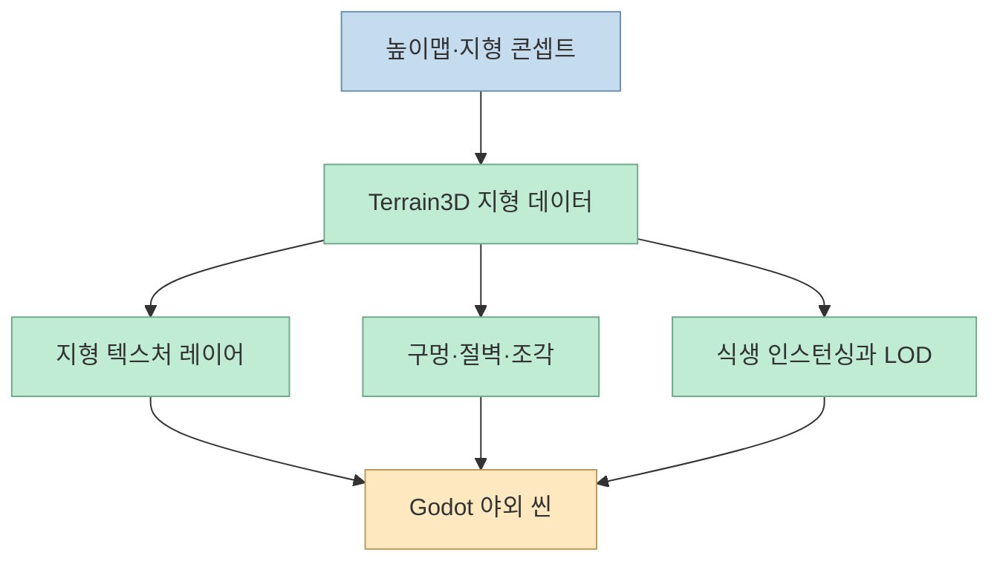
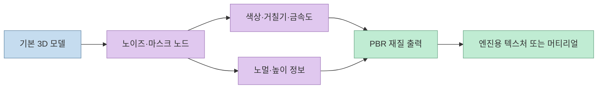
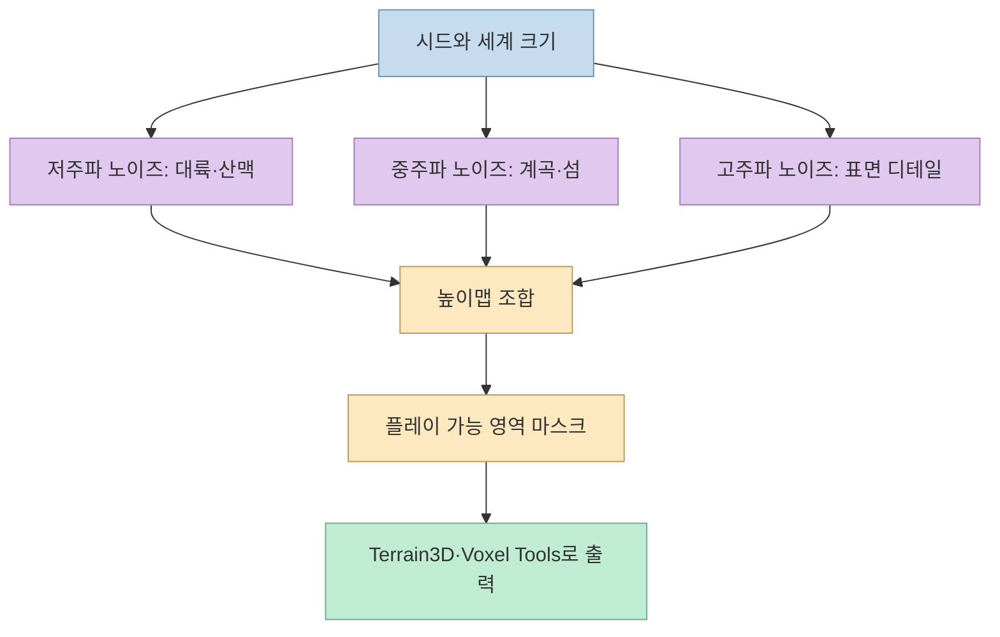
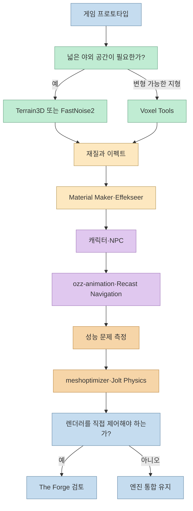

AI 코딩 도구로 게임의 장면과 시스템을 빠르게 만들 수 있어도, 3D 게임을 완성된 작품으로 끌어올리는 데에는 별도의 기술이 필요하다. 거대한 지형을 만들고, 땅을 파고, 재질을 입히고, 이펙트를 재생하고, NPC가 길을 찾고, 생성된 메시를 최적화해야 한다.

한 Threads 게시물은 이런 작업을 처음부터 직접 구현하지 않고 오픈소스 프로젝트와 AI를 조합하는 방법을 소개한다. 목록에는 Godot용 지형 플러그인부터 범용 물리 엔진과 렌더링 프레임워크까지 서로 다른 계층의 도구가 섞여 있다. 이 글에서는 각 도구가 해결하는 문제와 게임 제작 파이프라인에서 들어갈 위치를 구분해 정리한다.

<!--more-->

## Sources

- [Threads 원문](https://www.threads.com/share/BAT7HMRX6-) — 10개 오픈소스 3D 게임 제작 도구를 소개한 게시물.
- [Terrain3D 공식 저장소](https://github.com/TokisanGames/Terrain3D) · [공식 웹사이트](https://tokisan.com/terrain3d/) — Godot 4용 편집 가능한 지형 시스템.
- [Voxel Tools 공식 저장소](https://github.com/Zylann/godot_voxel) · [문서](https://voxel-tools.readthedocs.io/) — Godot에서 복셀 기반 지형을 다루는 도구와 문서.
- [Material Maker 공식 저장소](https://github.com/RodZill4/material-maker) · [공식 웹사이트](https://rodzill4.github.io/material-maker/) — 노드 기반 PBR 재질·텍스처 제작 도구.
- [Effekseer 공식 저장소](https://github.com/effekseer/Effekseer) · [공식 웹사이트](https://effekseer.github.io/en/) — 게임과 실시간 콘텐츠용 파티클 이펙트 제작 도구.
- [meshoptimizer 공식 저장소](https://github.com/zeux/meshoptimizer) · [공식 웹사이트](https://meshoptimizer.org/) — 메시 최적화와 압축 라이브러리.
- [Recast Navigation 공식 저장소](https://github.com/recastnavigation/recastnavigation) · [공식 웹사이트](https://recastnav.com/) — 내비게이션 메시와 경로 탐색 도구.
- [FastNoise2 공식 저장소](https://github.com/Auburn/FastNoise2) · [Node Editor](https://auburn.github.io/FastNoise2/) — 고성능 노이즈와 절차적 생성 라이브러리.
- [ozz-animation 공식 저장소](https://github.com/guillaumeblanc/ozz-animation) · [문서](https://guillaumeblanc.github.io/ozz-animation/) — C++ 골격 애니메이션 라이브러리와 도구 모음.
- [The Forge 공식 저장소](https://github.com/ConfettiFX/The-Forge) · [공식 웹사이트](https://theforge.dev/) — 크로스플랫폼 렌더링·프레임워크.
- [JoltPhysics 공식 저장소](https://github.com/jrouwe/JoltPhysics) · [문서](https://jrouwe.github.io/JoltPhysics/) — 멀티코어 친화적인 강체 물리와 충돌 검출 라이브러리.

> 원문 게시물의 GitHub 주소는 Threads 화면에서 일부가 줄임표로 표시되어 공식 저장소 검색 결과를 기준으로 복원했다. 라이선스와 엔진 버전 지원 범위는 실제 도입 시 각 저장소의 `LICENSE`, 릴리스 노트, 플랫폼 문서를 다시 확인해야 한다.

## 1. 거대한 야외 공간은 Terrain3D로 시작한다

[Terrain3D](https://github.com/TokisanGames/Terrain3D)는 Godot 4용 고성능 편집 가능 지형 시스템이다. 공식 저장소는 높이맵 기반 지형, 여러 텍스처, 지형 조각, 구멍, 텍스처 페인팅, 식생 인스턴싱과 LOD 같은 기능을 제공한다고 설명한다. 작은 지형부터 최대 약 65.5km × 65.5km 규모의 비연속·가변 영역까지 지원하며, MIT 라이선스로 공개되어 있다.

이 도구의 핵심은 산과 계곡을 모두 메시 모델링으로 만들지 않아도 된다는 점이다. 높이 데이터와 텍스처 레이어를 이용해 넓은 풍경을 구성하고, 필요한 곳에 나무와 풀을 인스턴싱할 수 있다. 따라서 AI에게 “오픈월드 지형을 만들어 줘”라고 요청하기 전에 Terrain3D가 관리할 데이터 디렉터리와 높이맵·텍스처 입력을 정의하는 편이 재현성이 높다.

## 2. 땅을 파고 바꾸는 세계에는 Voxel Tools를 사용한다

Terrain3D가 넓은 높이맵 지형을 편집하는 데 적합하다면, [Voxel Tools](https://github.com/Zylann/godot_voxel)는 지형 자체를 실시간으로 변형하는 문제에 더 가깝다. 공식 문서는 복셀 기반 데이터를 이용해 지형을 만들고, 편집하고, 스트리밍하는 Godot 도구를 제공한다.

플레이어가 땅을 파서 터널을 만들거나, 폭발로 절벽을 무너뜨리거나, 블록을 쌓아 구조물을 만드는 게임에서는 일반적인 정적 메시만으로 모든 상태를 준비하기 어렵다. 이때 복셀 데이터가 세계의 원본이 되고, 렌더링용 메시와 충돌용 데이터는 그 원본에서 갱신된다.

다만 복셀은 모든 문제의 해답이 아니다. 저장 용량, 청크 스트리밍, 메시 재생성 비용, 충돌 업데이트, 멀티플레이 동기화까지 함께 설계해야 한다. 단순히 파괴 효과만 필요하다면 파괴 가능한 메시 조각이나 데칼이 더 저렴할 수 있다.

## 3. Material Maker로 모델에 표면 정보를 입힌다

[Material Maker](https://github.com/RodZill4/material-maker)는 Godot Engine을 기반으로 한 노드 기반 PBR 재질 편집기이자 텍스처 페인팅 도구다. 공식 문서는 노드를 연결해 알베도, 메탈릭, 러프니스, 이미시브, 노멀과 깊이 맵을 만드는 절차적 작업을 설명한다.

AI가 생성한 3D 모델이 형태는 괜찮지만 금속·가죽·나무·돌처럼 표면의 차이가 부족할 때, 메시를 다시 생성하는 대신 재질 그래프를 조정할 수 있다. 노이즈, 마스크, 색상, 거칠기, 노멀 강도를 별도 입력으로 관리하면 같은 모델에 여러 테마를 적용하기도 쉽다.

## 4. Effekseer로 전투의 피드백을 만든다

[Effekseer](https://github.com/effekseer/Effekseer)는 폭발, 불꽃, 번개, 마법진, 연기와 먼지 같은 실시간 파티클 이펙트를 제작하는 도구다. 공식 사이트는 게임과 실시간 콘텐츠에서 사용할 수 있는 이펙트 제작 환경과 여러 엔진·플랫폼 연동 자료를 제공한다.

이펙트는 단순한 장식이 아니라 플레이어에게 결과를 전달하는 피드백이다. 공격이 명중했는지, 적이 경직됐는지, 스킬 범위가 어디까지인지, 상호작용이 성공했는지를 소리·색·크기·속도로 알려 준다. AI에게 이펙트 코드를 직접 작성하게 하더라도, 실제 파티클의 타이밍과 곡선은 Effekseer 같은 전용 도구에서 조정하는 편이 빠를 수 있다.

## 5. meshoptimizer로 생성된 3D 자산을 가볍게 만든다

AI로 3D 모델을 여러 개 생성하면 파일 크기와 렌더링 비용이 빠르게 늘어난다. [meshoptimizer](https://github.com/zeux/meshoptimizer)는 메시를 더 작게 만들고 빠르게 렌더링하기 위한 라이브러리다. 메시 단순화, 정점·인덱스 캐시 최적화, 메시렛 구성, glTF 관련 압축과 도구를 제공한다.

실전에서는 원본 모델을 보존하고, 빌드나 임포트 과정에서 최적화된 산출물을 만드는 구조가 안전하다.

1. 원본 메시와 텍스처를 보관한다.
2. 화면 거리와 품질 기준에 맞춰 LOD를 만든다.
3. 정점·인덱스와 메시렛을 최적화한다.
4. glTF 또는 엔진 전용 포맷으로 패키징한다.
5. 실제 GPU와 타깃 해상도에서 프레임 시간과 메모리를 측정한다.

최적화는 폴리곤 수를 무조건 줄이는 작업이 아니다. 실루엣이 중요한 캐릭터와 멀리 보이는 바위는 다른 오차 허용치를 가져야 한다. 파일 크기, CPU 디코딩 비용, GPU 정점 처리 비용을 함께 측정해야 한다.

## 6. Recast Navigation으로 NPC가 이동할 수 있는 영역을 만든다

[Recast Navigation](https://github.com/recastnavigation/recastnavigation)은 내비게이션 메시 생성과 경로 탐색에 사용되는 오픈소스 도구 모음이다. 캐릭터가 걸을 수 있는 영역을 메시로 추출한 뒤, 그 위에서 경로를 계산하고 장애물을 회피하도록 연결한다.

Godot, Unity, Unreal 같은 엔진에는 관련 내비게이션 기능이 이미 들어 있지만, 여러 엔진에서 같은 경로 탐색 기술을 사용하거나 자체 런타임을 구성하고 싶을 때 Recast와 Detour 계열 구조를 참고할 수 있다. 중요한 구분은 다음과 같다.

- **내비게이션 메시 생성**: 어떤 영역을 걸을 수 있는지 계산한다.
- **경로 탐색**: 시작점에서 목적지까지의 경로를 찾는다.
- **로컬 회피**: 다른 캐릭터나 움직이는 장애물과 부딪히지 않게 보정한다.

길찾기만 추가하고 NPC의 충돌과 회피를 생략하면, 여러 캐릭터가 같은 경로에 겹쳐 멈추는 문제가 생긴다. AI에게 NPC 이동을 구현하게 할 때도 이 세 계층을 나누어 요청하는 편이 좋다.

## 7. FastNoise2로 자연스러운 패턴을 절차적으로 만든다

[FastNoise2](https://github.com/Auburn/FastNoise2)는 노이즈 함수를 이용해 산맥, 섬, 동굴, 구름, 지형 높이맵과 같은 자연 패턴을 생성하는 고성능 라이브러리다. 공식 Node Editor를 사용하면 노드를 연결해 생성 규칙을 시각적으로 조합할 수 있다.

절차적 생성의 장점은 많은 결과를 손으로 배치하지 않아도 된다는 점이다. 하지만 노이즈만 넣는다고 자연스러운 세계가 만들어지지는 않는다. 큰 형태를 만드는 저주파 노이즈, 계곡과 능선을 만드는 중간 주파수, 표면 디테일을 만드는 고주파 노이즈를 분리하고, 플레이 가능한 지역과 장식 지역을 별도 규칙으로 제한해야 한다.

## 8. ozz-animation으로 캐릭터 동작을 재생한다

[ozz-animation](https://github.com/guillaumeblanc/ozz-animation)은 C++ 기반의 골격 애니메이션 라이브러리와 도구 모음이다. 공식 저장소는 애니메이션 데이터를 로드하고, 샘플링하고, 블렌딩하는 런타임 기능과 다양한 DCC 포맷을 최적화된 런타임 구조로 변환하는 도구를 설명한다. MIT 라이선스로 배포된다.

캐릭터 애니메이션에서는 파일을 재생하는 것보다 여러 상태를 자연스럽게 연결하는 것이 어렵다. 걷기에서 달리기로 전환할 때 발이 튀지 않아야 하고, 상체 공격과 하체 이동을 섞을 때 관절의 우선순위를 정해야 한다. ozz-animation 같은 라이브러리는 애니메이션 데이터를 런타임에서 효율적으로 재생·블렌딩하는 기반으로 사용할 수 있다.

다만 엔진에 바로 붙일 수 있는 완성형 캐릭터 시스템과는 구분해야 한다. 렌더러, 물리, 입력, 상태 머신, 리타게팅은 프로젝트가 별도로 연결해야 한다.

## 9. The Forge로 렌더링과 플랫폼 계층을 살펴본다

[The Forge](https://github.com/ConfettiFX/The-Forge)는 DirectX, Vulkan, Metal 등 여러 그래픽 API와 플랫폼을 대상으로 하는 C++ 크로스플랫폼 프레임워크다. 공식 저장소는 리소스 로딩, 애니메이션, 셰이더 변환, 그래픽 유틸리티와 다양한 렌더링 예제를 제공한다고 설명한다.

이 도구는 일반적인 Godot·Unity 프로젝트에 플러그인처럼 추가하는 에셋 도구와 성격이 다르다. 자체 렌더러나 엔진 구조를 공부하거나, 특정 플랫폼의 GPU 기능을 직접 제어하거나, 렌더링 프레임워크의 설계 방식을 비교할 때 적합하다.

특히 콘솔 플랫폼은 저장소의 안내처럼 별도 인증 개발자와 상용 라이선스 조건이 적용될 수 있다. “오픈소스”라는 이유만으로 모든 플랫폼에서 동일한 조건으로 사용할 수 있다고 해석해서는 안 된다.

## 10. JoltPhysics로 물리와 충돌을 구성한다

[Jolt Physics](https://github.com/jrouwe/JoltPhysics)는 C++로 작성된 멀티코어 친화적 강체 물리와 충돌 검출 라이브러리다. 공식 저장소는 게임과 VR 애플리케이션에 사용할 수 있으며, 다양한 물리 시뮬레이션과 예제를 제공한다고 설명한다.

물리 엔진을 선택할 때는 단순히 “충돌이 된다”만 확인하면 안 된다. 캐릭터 컨트롤러가 계단과 경사면을 어떻게 처리하는지, 물리 오브젝트가 많은 장면에서 CPU 시간이 어떻게 늘어나는지, 네트워크 게임에서 상태를 어떻게 동기화할지까지 봐야 한다. Godot처럼 Jolt를 통합한 엔진을 사용한다면 엔진 버전과 통합 상태를 먼저 확인하고, 자체 엔진에서는 메모리·스레드·결정성 요구사항을 별도로 검토해야 한다.

## 11. 10개 도구를 한 번에 도입하지 않는 순서

이 목록의 도구는 서로 경쟁하는 제품이 아니라 서로 다른 계층을 담당한다. 따라서 처음부터 모두 설치하기보다 게임의 병목이 생긴 지점에 맞춰 단계적으로 도입하는 것이 좋다.

실제 도입 순서는 다음처럼 잡을 수 있다.

1. 엔진 기본 기능으로 작은 플레이 가능 장면을 만든다.
2. 지형 규모나 파괴 가능성에 따라 Terrain3D 또는 Voxel Tools를 선택한다.
3. FastNoise2는 수작업 배치가 병목이 될 때 추가한다.
4. Material Maker와 Effekseer로 시각적 피드백을 정리한다.
5. NPC가 필요해질 때 Recast Navigation과 ozz-animation을 연결한다.
6. 프로파일링 결과에 따라 meshoptimizer와 Jolt Physics를 조정한다.
7. 렌더링 API 자체를 통제할 이유가 있을 때만 The Forge를 검토한다.

## 핵심 요약

- Terrain3D는 Godot 4에서 넓고 편집 가능한 높이맵 기반 지형을 구성하는 도구다.
- Voxel Tools는 실시간으로 땅을 파고 변형하는 복셀 세계에 적합하다.
- Material Maker는 노드 기반 PBR 재질과 텍스처 제작을 담당한다.
- Effekseer는 전투와 상호작용의 시각적 피드백을 만든다.
- meshoptimizer는 생성된 3D 메시의 크기와 렌더링 비용을 줄이는 데 사용한다.
- Recast Navigation은 이동 가능 영역, 경로 탐색, NPC 이동의 기반을 제공한다.
- FastNoise2는 지형과 자연 패턴을 절차적으로 생성한다.
- ozz-animation은 골격 애니메이션 재생과 블렌딩을 위한 저수준 라이브러리다.
- The Forge는 엔진 플러그인보다 자체 렌더러·플랫폼 계층을 다룰 때 적합하다.
- Jolt Physics는 멀티코어 게임과 VR을 고려한 강체 물리·충돌 라이브러리다.

## 결론

AI가 게임 코드와 장면을 빠르게 만들어도, 실제 게임 제작은 지형·재질·이펙트·애니메이션·경로 탐색·최적화·물리 같은 전문 계층을 필요로 한다. 이때 오픈소스 도구를 역할별로 조합하면 모든 시스템을 처음부터 다시 만들지 않고도 프로토타입을 실험하고, 병목이 확인된 부분만 깊게 개발할 수 있다.

중요한 것은 10개를 모두 도입하는 것이 아니다. 먼저 게임의 핵심 경험을 가장 크게 막는 문제가 지형인지, 파괴인지, 렌더링인지, NPC 이동인지 측정하고 그 문제에 맞는 도구 하나부터 선택하는 것이다.
