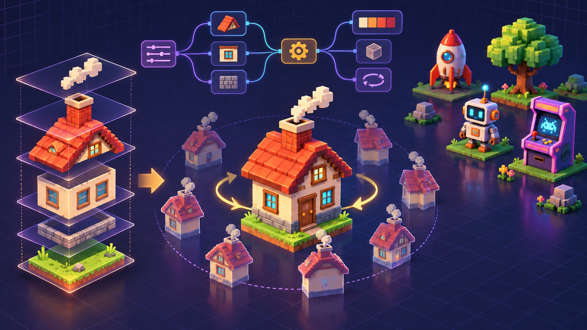
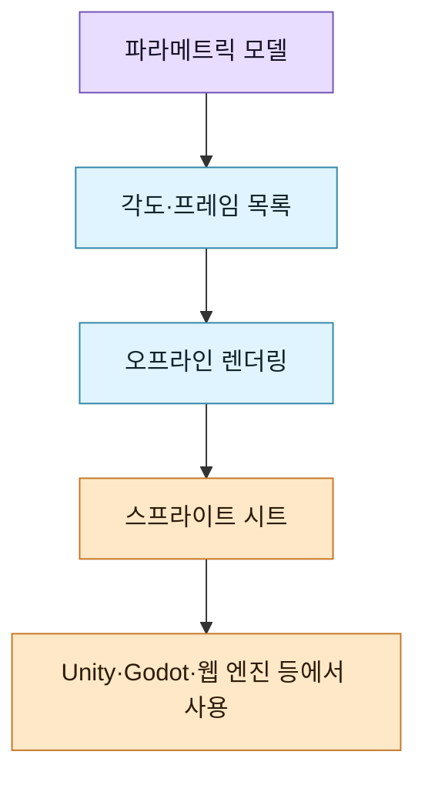
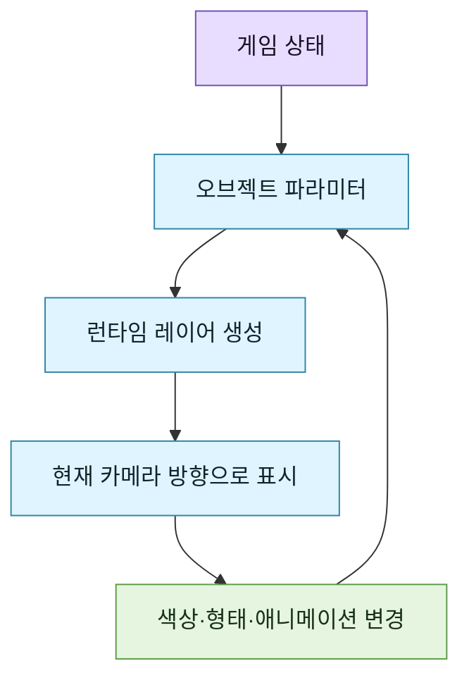

픽셀 아트 오브젝트를 게임에 넣을 때 가장 번거로운 작업 중 하나는 여러 방향의 이미지를 준비하는 일이다. 정면 이미지를 하나 만드는 것과, 플레이어가 빙글 돌려 보거나 카메라가 이동할 때 자연스럽게 보이는 모든 방향을 만드는 것은 전혀 다른 문제다.

`ui8net`이 Threads에서 소개한 [Parametric Sprite Stacking](https://www.threads.com/share/_gTMN69QN)은 이 문제를 이미지 파일의 묶음이 아니라 파라미터로 조절 가능한 모델로 다룬다. [Forge 프로젝트](https://forge.ui8.ai/share/collection/fcol_c7d61bf3-0419-423d-97d1-9573935abf65)에는 집, 로켓, 나무, 로봇, 아케이드 캐비닛 등 32개의 컴포넌트와 이를 만드는 `parametric-sprite-stacking` 스킬이 들어 있다.

이 글에서는 이 방식이 무엇인지, 일반적인 2D 스프라이트와 어떤 점이 다른지, 실제 게임 프로젝트에 적용할 때 어떤 파이프라인으로 연결할 수 있는지를 정리한다.

<!--more-->

## Sources

- [Threads 원문 공유 링크](https://www.threads.com/share/_gTMN69QN) — Parametric Sprite Stacking을 소개한 게시물.
- [Threads 원문 게시물](https://www.threads.com/@ui8net/post/DgCnklUESix) — 게시물의 실제 본문과 댓글.
- [Parametric Sprite Stacking · Forge](https://forge.ui8.ai/share/collection/fcol_c7d61bf3-0419-423d-97d1-9573935abf65) — 32개 컴포넌트와 제작 스킬이 공개된 프로젝트.

## 1. 스프라이트 스태킹이란

스프라이트 스태킹은 여러 장의 2D 이미지를 깊이 방향으로 쌓아 3D처럼 보이게 만드는 기법이다. 각 레이어는 작은 픽셀 조각 또는 복셀에 가깝고, 레이어의 위치·색상·크기·모양을 바꾸면 같은 구조에서 다양한 오브젝트를 만들 수 있다.

일반적인 2D 스프라이트는 완성된 픽셀 이미지가 중심이다. 반면 스프라이트 스태킹은 이미지를 구성하는 레이어와 규칙이 중심이 된다. 따라서 결과물은 단순히 “그려진 집 한 장”이 아니라, 바닥·벽·지붕·굴뚝을 조합해 다시 만들 수 있는 집의 구조에 가깝다.

## 2. Forge 프로젝트의 구성

공개된 프로젝트에는 32개의 예제 컴포넌트가 있다. 집이나 등대처럼 건축물을 표현하는 오브젝트뿐 아니라 로켓, 잠수함, 선인장, 펭귄, 초밥, 게임기 같은 게임용 소품도 포함되어 있다.

구성은 크게 두 부분으로 볼 수 있다.

1. **재사용 가능한 오브젝트 컴포넌트**: 집, 자동차, 나무처럼 게임에 바로 배치할 수 있는 기본 에셋
2. **오브젝트를 만드는 스킬**: 참고 이미지를 분석하고, 복셀 빌더로 형태를 만들고, 여러 디테일 단계와 각도를 확인한 뒤 출력하는 작업 지침

이 구조의 장점은 새 에셋을 추가할 때도 기존 키트의 규칙을 재사용할 수 있다는 점이다. 게임마다 처음부터 픽셀 오브젝트 제작 파이프라인을 다시 설계할 필요가 줄어든다.

## 3. 파라미터가 바꾸는 것

게시물에서 말하는 파라메트릭 모델은 오브젝트의 결과를 코드 또는 조절값으로 바꿀 수 있다는 뜻이다. 프로젝트 설명에는 다음과 같은 조절 대상이 제시되어 있다.

- **형태**: 몸체의 폭과 높이, 지붕의 기울기, 부품의 배치
- **색상**: 팔레트, 명도, 강조색, 재질별 색상
- **애니메이션**: 회전이나 반복 동작에 필요한 변화
- **디테일**: 낮은 해상도의 아이콘부터 세부적인 에셋까지의 단계
- **출력 각도**: 턴테이블 또는 게임 카메라에 필요한 방향

예를 들어 같은 집 모델에서 지붕 색상만 바꾸거나, 창문을 추가하고, 전체 크기를 줄여 마을의 여러 건물로 사용할 수 있다. 완전히 다른 이미지를 다시 그리는 대신, 하나의 구조와 파라미터 세트를 여러 변형에 공유하는 방식이다.

## 4. 이미지 파일과 코드 사이의 선택

이 프로젝트는 결과물을 두 가지 방식으로 게임에 전달하는 것을 목표로 한다.

### 4.1 베이크된 스프라이트 시트

여러 각도와 애니메이션 프레임을 미리 렌더링해 스프라이트 시트로 저장하는 방식이다.

장점은 런타임 비용이 예측 가능하고, 전통적인 2D 렌더링 파이프라인에 쉽게 연결된다는 것이다. 모바일 게임이나 수많은 오브젝트를 동시에 표시해야 하는 장면에서는 베이크 방식이 더 안전할 수 있다.

### 4.2 런타임 파라메트릭 코드

반대로 게임 실행 중에 오브젝트의 색상이나 디테일을 바꾸고, 필요한 각도로 직접 생성할 수도 있다.

이 방식은 커스터마이즈가 많은 게임에 유리하다. 플레이어가 건물의 색을 고르거나, 장비를 장착하거나, 오브젝트의 손상 상태를 실시간으로 바꿀 때 매 조합마다 새 이미지 파일을 만들 필요가 없다.

다만 런타임 생성은 드로우 콜, 메모리, 캐싱, 플랫폼별 성능을 함께 검토해야 한다. “코드로 만들 수 있다”는 사실이 언제나 “실행 중에 만드는 것이 좋다”는 뜻은 아니다.

## 5. 게임 제작 파이프라인에 넣는 방법

처음부터 모든 에셋을 런타임 모델로 바꾸기보다, 다음 순서로 적용하는 편이 현실적이다.

1. **스타일 기준을 정한다.** 픽셀 크기, 팔레트 수, 그림자 방향, 오브젝트의 회전 단위를 먼저 고정한다.
2. **대표 오브젝트 하나를 고른다.** 집이나 나무처럼 여러 장면에서 반복되는 에셋이 적합하다.
3. **낮은 디테일 단계부터 검증한다.** 작은 화면에서 실루엣이 읽히는지 먼저 확인한다.
4. **필요한 방향만 출력한다.** 360도 회전이 필요하지 않다면 카메라에 보이는 각도만 베이크한다.
5. **엔진에 연결한다.** 정적 장면은 스프라이트 시트로, 커스터마이즈가 필요한 오브젝트는 런타임 파라미터로 연결한다.
6. **성능을 측정한다.** 생성 비용, 텍스처 메모리, 배칭 가능 여부를 실제 타깃 기기에서 확인한다.

이 과정을 거치면 에셋 제작의 유연성과 실행 성능 사이에서 프로젝트에 맞는 절충점을 찾을 수 있다.

## 6. 이 방식이 특히 잘 맞는 게임

파라메트릭 스프라이트 스태킹은 다음과 같은 게임에서 효과가 크다.

- 건물과 장식물을 반복 배치하는 타이쿤·시뮬레이션 게임
- 카메라 회전이 중요한 아이소메트릭 게임
- 플레이어가 집, 차량, 장비의 외형을 직접 꾸미는 게임
- 같은 오브젝트를 다양한 색상과 희귀도로 변형하는 수집형 게임
- 픽셀 아트 스타일을 유지하면서 절차적으로 많은 오브젝트를 만들어야 하는 게임

반대로 손으로 그린 프레임별 애니메이션의 미세한 표현이 핵심인 게임이라면, 파라메트릭 생성 결과만으로 최종 아트를 대체하기보다 기본 형태와 변형안 제작에 활용하는 편이 적절하다.

## 마무리

Parametric Sprite Stacking의 핵심은 픽셀 아트를 단순한 이미지가 아니라 **레이어, 파라미터, 출력 규칙의 조합**으로 보는 데 있다. 이 관점에서는 하나의 에셋으로 여러 색상과 형태를 만들 수 있고, 필요에 따라 스프라이트 시트와 런타임 코드 중 하나를 선택할 수 있다.

게임 개발에서 중요한 것은 모든 것을 절차적으로 만드는 것이 아니다. 반복되는 에셋과 커스터마이즈가 필요한 에셋을 찾아 파라메트릭 구조로 만들고, 나머지는 베이크된 이미지로 유지하는 것이다. Forge의 공개 키트는 그 경계를 실험해 볼 수 있는 출발점으로 활용할 수 있다.
